# 斯坦福大学《社会和经济网络：建模与分析｜Social and Economic Networks： Models and Analysis》中英字幕 p51 51_05_01_5-1-扩散.zh_en -BV1v1421U7Nk_p51-

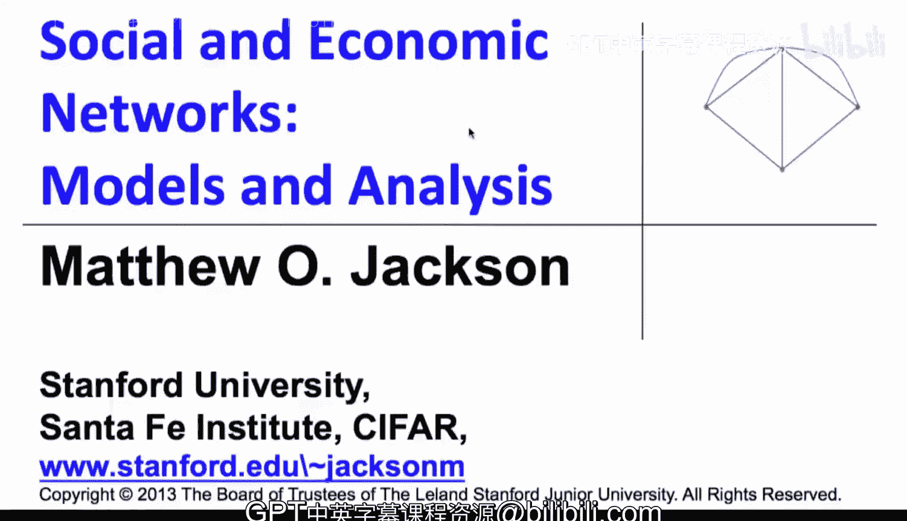

Okay folks， so now we're ready to start looking at the last major part of the course。

 which is understanding how networks influence behaviors。

 So taking the networks as given and then understanding or implications for behaviors and in terms of the starting point we'll start with diffusion and then talk about other aspects and so we're moving into this part of the course。

 and we can think of sort of breaking this in first we'll start with diffusion and we'll think about learning and then we'll talk about situations where what I do actually depends on what my neighbors are doing So there's some strategic interaction going on。

 So we'll take those each in turn and one thing to sort of emphasize is here we looked at formation and here we're looking at taking the networks as given and then studying the behaviors obviously these things influence each other。

 So what I expect to happen given a network will influence which。

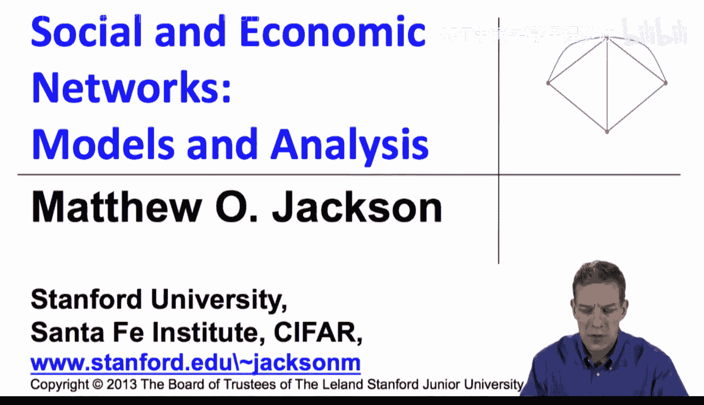

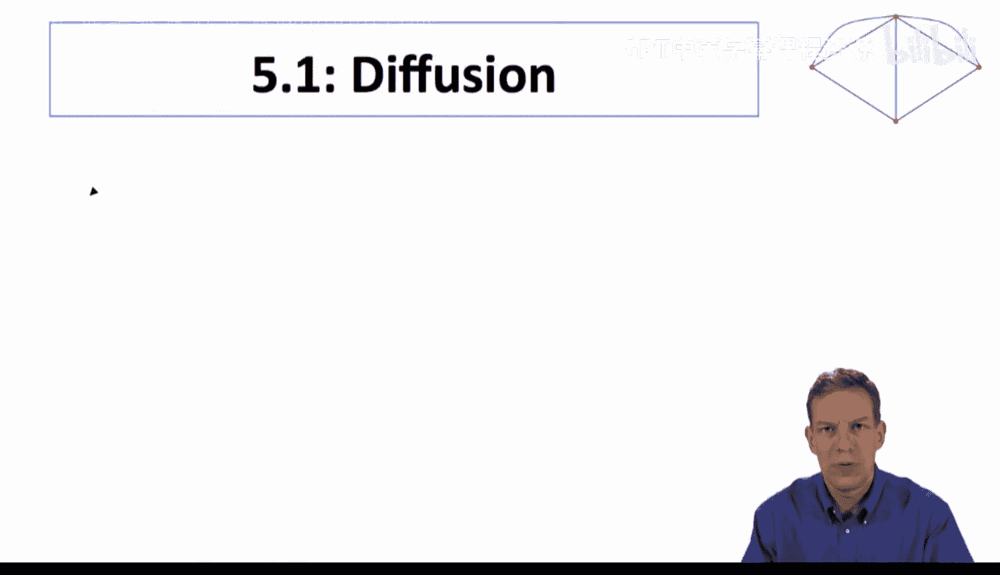

Links I form and which links I form influence of the behavior。

 So these things are really co-determined or coevolve。

 And yet we're going to take them one at a time and ultimately to understand the formation process。

 you would have to make predictions about what's going to happen once the network form。

 So before we treated the utility function or the benefits coming from a network as a given。

 Now this will put some meat on the。 So we know what will happen once the networks formed that then gives payoffs to people and then we could go back and understand if a certain process operating on a network。

 what is that imply for the formation process。 So most of the literature has sort of gone through this question in this question and the codetermination has been looked at a little bit but not much。

 I'll say a little bit about that at the end of the course when we sort of wrap up the last section。

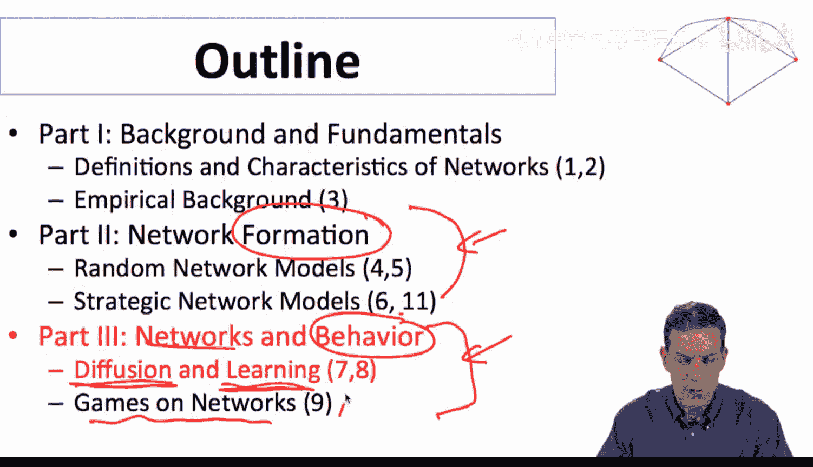

Okay， so now into diffusion and when we think about how network structure impacts behavior what we're going to start with is the idea some things like simple infections。

 contagions will' think about diffusion in a fairly mechanical way where it goes from one node to another when we think about richer settings where opinions are being formed information being processed there's learning going on。

 that's going to be a little more complicated because it's not going to be a process where either I've got the flu or I don't have the flu and I've caught it。

 which we can look just at the network structure and trying to understand those things。

 Now we're gonna to actually have to think about how do people process information。

 how does information flow， what happens in terms of forming opinions and so forth that'll get a more and more complicated。

 and then when we allow people to make choices and decisions that will further complicate things。

 So then they have to think about what other people are doing and how they react to that。

 So sort of three layers here and they'll get an increasingly。

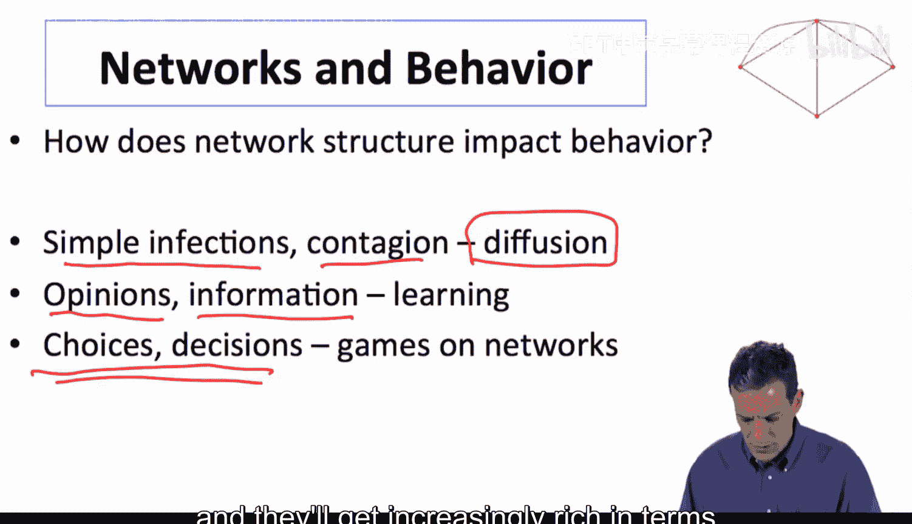

Rich in terms of what we're allowing people to do and what kinds of processing is going on。Okay。

 so diffusion， let's think about you know we can think about things like the flu basic disease diffusion we can also think about ideas or basic information so something you just either know or don't know so if you're just made aware of a fact then that's a situation where there's not information processing and really complex learning going on it's just you have to be told about something okay there's a new iPhone out there so you're just told a fact。

And we can also think about you know the sum of applications of this basic kind of diffusion have been people adopting a product or not。

 but doing so in a situation where all they need to do is know about the product and they can make their own decision they don't have to worry about what other people are doing in situations where whether I want to buy a product depends on what other people are doing that's going to be more complicated and we'll come back to this complementities later。

 So let's just think of simple processes。 And so we'll start with some questions and a little bit of background on this。

 And then we're going to talk about the best model which is sort of the simplest and probably best known model of diffusion and then we'll start bringing in interaction structure and network structure。

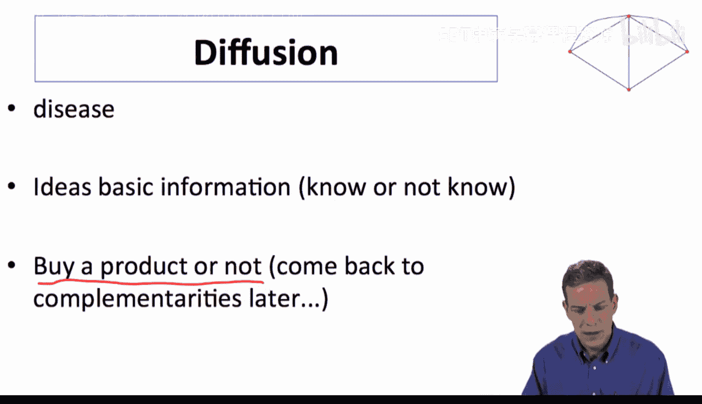

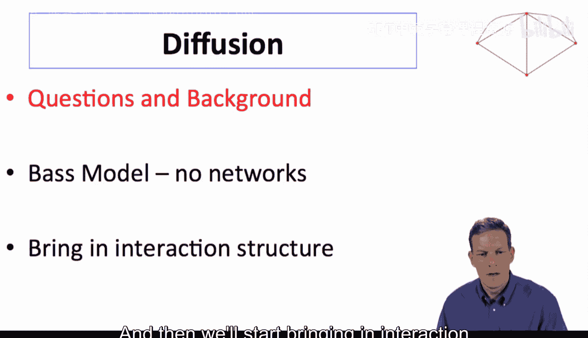

Okay， so first thing。When we think about diffusion。

 there's something that's just known as sort of S shapepe adoption。

 When you look at diffusion over time in space， there are different patterns to how things spread and how many people have adopted something over time or caught the flu。

 etc ceter。 things start out slowly， they accelerate and eventually peak we can ask questions about who are initial adopters。

 are they people with high degree low degree what accounts for different speeds in a diffusion process。

 why might there be an eventual slowdown。 There's a whole series of questions that come up and let's start by looking at one of the early studies of this。

 it was a study by Coleman， cats and menzel in the 1960s。

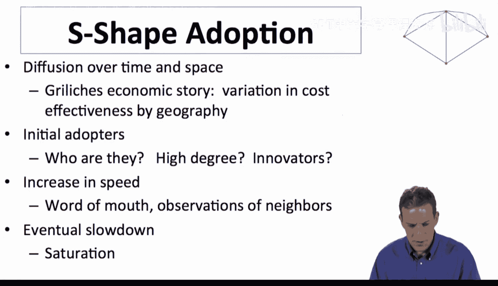

And they were looking at the adoption of a new drug by doctors and in particular there was a drug that had just been developed。

 it was an antibiotic and it needed to be prescribed by doctors and there was a question of so their idea was a doctor adopted this new drug if they prescribed it at some point in time and so there was a question of how many how much time it took for different doctors to start prescribing the drug and so what they did is they kept track of the doctors over time and kept track of which doctors had prescribed the drug by some time period。

 so six months out from the development of this drug。

 how many or from the legal adoption of this drug had some doctors prescribed it eight months out。

 how many had prescribed it10 months out and so forth。

And what they did was they before they started this。

 they surveyed the doctors and they asked which other doctors would you go to for advice okay and so then they kept track of that gives a network of doctors and in particular we can break subjects into three different categories。

 they broke them into three different categories， they had 36 doctors that were not named by anybody else。

 so nobody said that they would go to that person for advice。

56 doctors were named by one or two others， and 33 were named by at least three others。

 three or more others。Okay， so these were different doctors in terms of how many other people would say they would come to this person for advice。

 and then they kept track of the adoption rates over time and the ones that hadn't been named by anyone else by six months out。

 31% of them had started prescribing this new drug。By eight months out， 42%， by 10 months。

 47% by 17 months， it was 83%。 And when you look at the doctors that had been named by one or two others。

 it started at 52%，6 months out， it was a two- thirds roughly by eight months，70 and so forth。

 so here we're seeing higher adoption rates at an earlier time。

 And then when your name by three or more others， it was even higher。

 they were picking even higher reaching higher rates at an earlier time and so forth。

 So what this shows is that the diffusion process actually differed based on the position of the doctors in the network。

There's been followup studies there's some difficulties in doing these kinds of studies and making sure that you've got a clean test because it could be that whether you're name by three or more others also correlates with other things which could correlate with whether or not you heard about this drug from advertising or other sources you might be pressured directly by the drug company。

 so there's a series of other things that might be accounting for these kinds of results。

 there's been a series of followup studies that have tried to make sure that the kind of finding here is actually robust and not something that's just a spurious correlation。

 but in any case what we do see is differences here based on the。

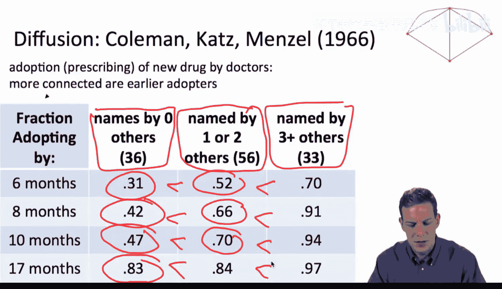

The connected and this seems to hold up if you look at the data with more scrutiny。嗯。

So here I've just plotted based on how many months out what those rates were and what you see is the ones that were named by nobody else had lower rates at each point in time。

 eventually they reach the ones by one or two others and the one or two others are below the ones named by three or more others。

 but so you're seeing adoption rates， different adoption rates based on the degree of the individuals involved and that's one thing we can pay attention to in trying to model diffusion and understand diffusion。

 why is it that it might vary by the degree of the individual and they'll be fairly intuitive explanations for that as you might expect。

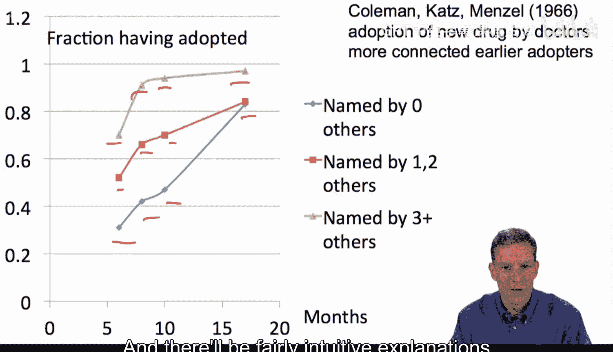

Let's take a look at another example， which is another fairly famous one。

 this is data analyzed by V Grlics in a paper in 1957。

It goes back to data that had been collected earlier in the 30s and 40s on the adoption of hybrid corn among farmers in different areas of the United States so basically hybrid corn where you had mixed the genetic material of different corn species was being developed actually this kind of husbandry of corn has's gone on for millennia but it was being marketed and developed in a new way in the 1930s and the yields of the corn that was being produced in this way were somewhere between 15 to 25% higher than the existing corn streams so you could get much higher yields from the corn seed that were being developed at this points in time。

 and this type of corn eventually just completely replaced the old single corn types that。

Existed before that。And Grlic he sort of analyzes why it took different paths in different places。

 so if we look at these， here are three different states that are corn producers。

 Iowa is a state which basically is mostly corn there's a lot of corn in Iowa and it's a very good climate for growing corn and it was the state which adopted this earliest on。

 then in Wisconsin you see a different curve a little later adoption。

 there's more variety of things grown in Wisconsin and then Kentucky even less hospitable to corn and has other things going on in terms of what it's growing and indeed than that comes in even later than Wisconsin and he's got other I think Texas and Arkansas a whole series of states。

But what we're seeing here that was sort of important was the fact that this had an S shape to it。

 So in particular， we see the adoption start out fairly slowly where it takes you know till 1935 or so before it's even hit sort of 10% even in exceeded 10% even in Iowa And so it took quite a while before it really starts hitting then it accelerates。

 So it starts out slowly， it accelerates， and then it comes back， so we get this very nice S shape。

 which is actually observed in a number of different applications。

 So a lot of diffusion processes will have this shape and we can try and understand exactly what it is that might lead to this shape。

 Why does it start out slowly。 The idea that it eventually has to asymptote and slow down That's obvious。

 I mean， it can't go above 100%。 So it's got to slow down eventually。

 it can't just keep going forever。 So that part's easy the difficulty is going to be in figuring out why does it start accelerating in this manner。

And word of mouth and the social interaction parts are going to be important in sort of explaining that acceleration。

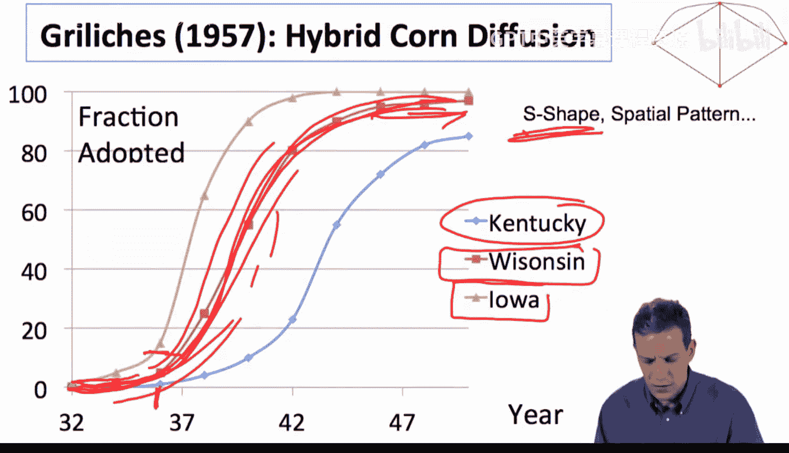

Okay， so questions that come up， what's the extent of a diffusion。

 How does it depend on the particulars of a network structure。

 Can we say something about these time shapes， Where does the S shape come in。

 can we say something about welfare analysis， if you want to accelerate a diffusion。

 how would you want to do it， So suppose you want to make sure that corn actually diffuses quickly。

 How would you do that if you want to make sure that a flu doesn't diffuse。

 How do you prevent one from diffusing， Who would you want to vaccinate。

 how would you go about doing that？ There's a whole series of questions that we can begin to analyze using diffusion and in particular modeling the network process。

 which is going to be important in answering a lot of these questions。

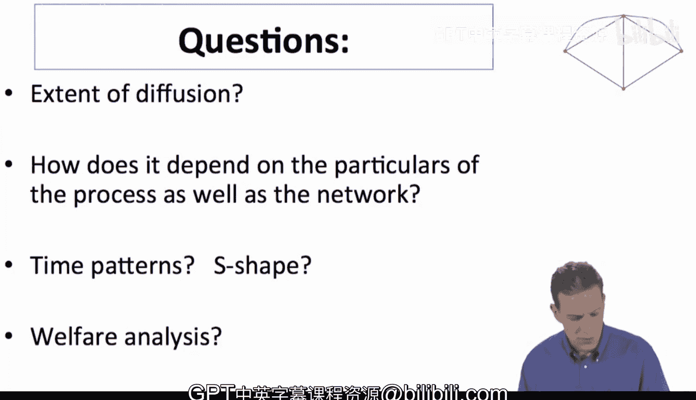