# 斯坦福大学《社会和经济网络：建模与分析｜Social and Economic Networks： Models and Analysis》中英字幕 p52 52_05_02_5-2-巴斯模型.zh_en -BV1v1421U7Nk_p52-

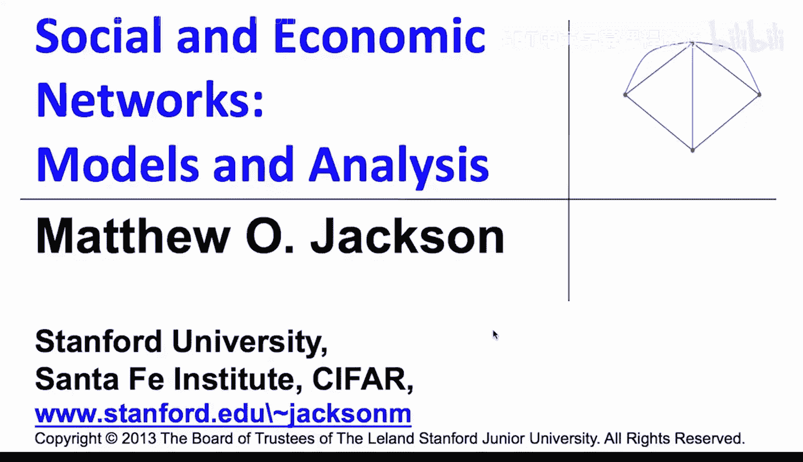

Okay folks， we're back and I'm talking more about diffusion。 and in particular。

 we're going to start looking at one of the best known models in the literature and diffusion。

 which is known as the BaS model and as you've been used quite extensively。

 especially in marketing and trying to understand things。

 So we've gone through some questions in background and we're going to start with the BaS model and one thing about the BaS model is networks are not going to make an explicit appearance here。

 we're just going to have social interaction in the background。

 And after we've looked at the Ba model， then we'll enrich the analysis by bringing interaction structure explicitly in trying to understand how things diffuse over time。

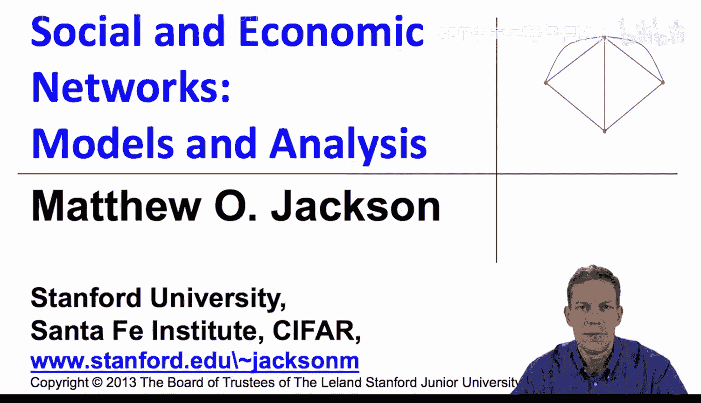

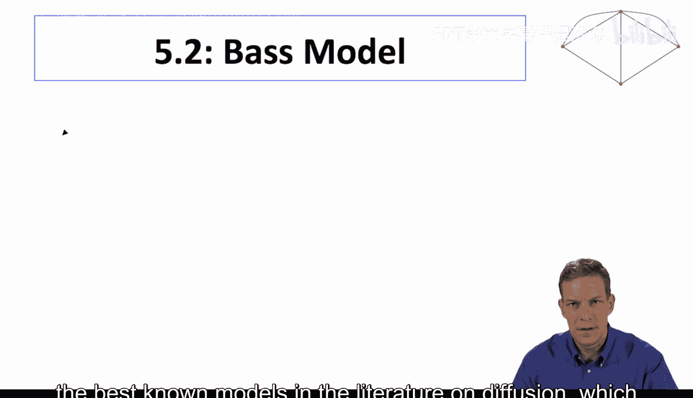

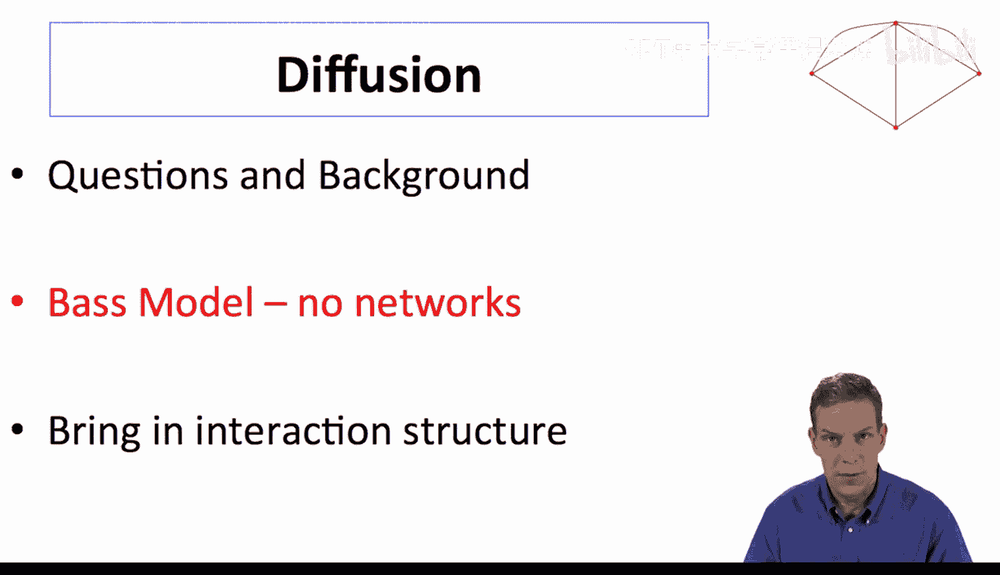

Okay， so why is the best model interesting， It's a benchmark model。

 It gives us very stark and simple structure which can begin to produce things like the S shapes that we saw before and there's gonna be two actions。

 behaviors or states so either you're not infected or you are or youre not adopting a new product or you are and what the best model will keep track of is over time。

 what's the fraction of individuals who have adopted say taken action1 by time T and in this model you move from state zero to state1。

 you don't move back So everybody starts on state zero and people start moving towards state1 some fraction of the people can move to state1 and that will just move over time and we'll just keep track over time of how many people have now moved to state1 so they've seen the movie or they've adopted corn or they have caught the flu。

 etc。So it's a one way street and we keep track of that over time。

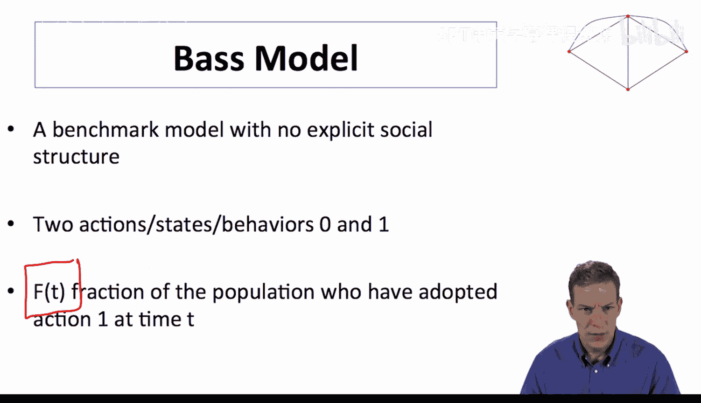

Okay， two key parameters in the Ba model P is going to be a rate of spontaneous innovation or adoption。

 so that's going to be a rate that's independent of what else is going on in the economy or the world or the society so some people will just go and decide to see a movie regardless of what's going on or they will adopt corn regardless of whether other people are doing it or they've heard about it。

 etc ce and there's some other individuals who will actually do it as a function of having heard about it or。

Somehow imitated other individuals who were doing it。

So there's these two parameters P and Q and the BaAs model basically boils down then to a simple equation which keeps track of the differential of the fraction of people who have adopted at time T as T varies okay so how is this changing with time well。

 there's two parts to it so at any point in time the people who haven't yet adopted。

 so these are the people who have not yet adopted。Yet， move to one。So they haven't become a one yet。

 So there's still zeros。 So 1 minus F T are the people who are still zeros and can possibly change。

And then the fraction of those people who change， well， some of them change directly， spontaneously。

 that's the P。And the others changed by imitating the existing population。So you also。

 you have a chance of just spontaneously deciding to become a one or you also have a chance of imitating somebody in the population。

 and that's proportional to how many in the population or already ones。

 So this Q parameter says that you have some rate of imitation。 These are the ones existing。

 This is your imitation。 And so this is the probability that you end up adopting one due to some imitation。

 This is the chance that you do it spontaneously and needs of the fraction of people who have not yet adopted and could make that change。

 So that gives us an expression for the differential over time。

 very simple and intuitive model in terms of its。

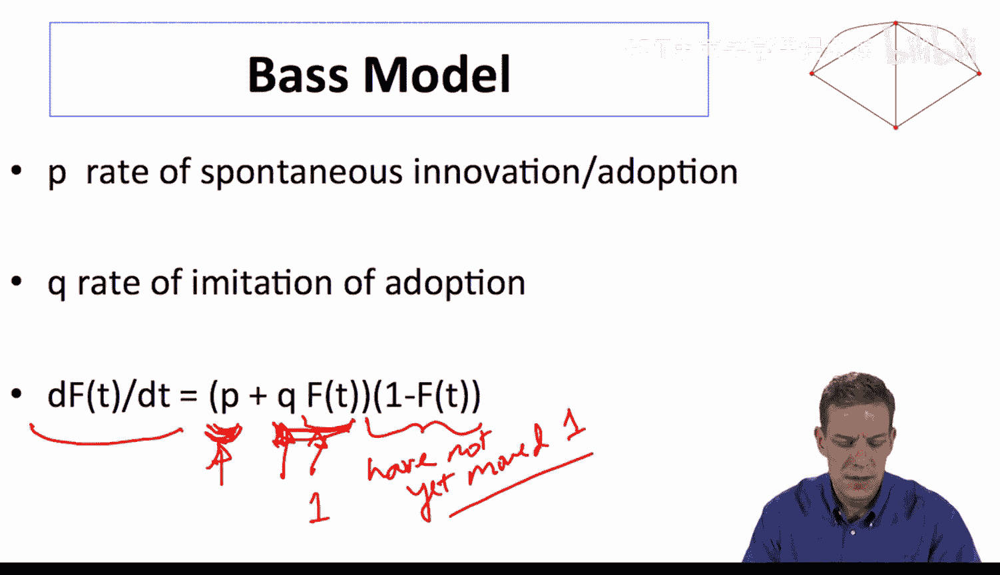

Basic building blocks。Okay， so when we look at this， if you want to solve this expression。

And then you can start with an initial condition of F of0 equals zero。

 if you solve that you get a simple equation for what F of T looks like and it depends on P and Q obviously and so higher P's and Q's are going to lead to faster diffusion。

 so more people adopting by any particular time， lower P's and Q's are going to lead to lower adoption rates。

 and so this thing will be increasing in P and increasing in Q at any point in time the number of people that have adopted by that time。

Okay， so you get a simple solution， and then let's look at some of the aspects of this and why the model has been so well used and is well known。

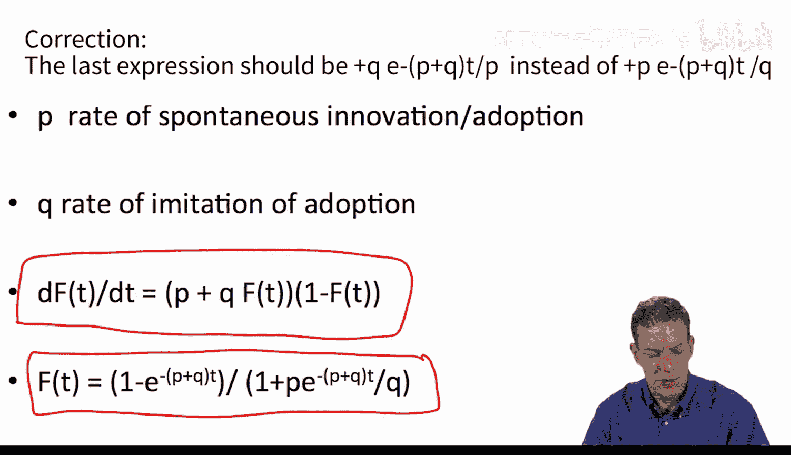

Okay， so。First thing is that it's going to end up giving an S shape if Q is bigger than P。

 it's going to tend to1 in the limit as t becomes large。

 and basically what's going on in this model is initially the only way that people can adopt it it's mainly going to be through P and then eventually Q is going to become the important parameter and things will slow down as your fraction of people that have adopted eventually reaches one。

 So if we go back and look at exactly what this equation looks like。

 let's try and analyze this in a little more detail and try and understand why we get interesting dynamics out of this。

 so first of all， when F T gets close to one， this things going to have to slow down and so what happens is the rate at which you're gaining new people adopting as F of T gets close to1。

 this thing gets close to zero。

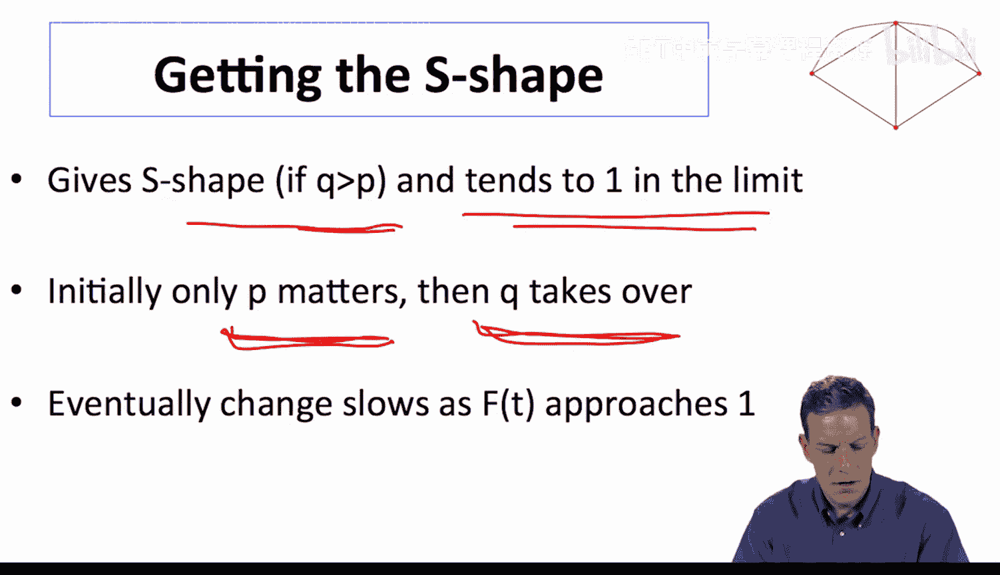

RightAnd so this thing has to get close to  zero。 So this things going to tend to0 as FT gets close to1。

 So eventually it has to slow down just because the fraction of people who haven't adopted yet becomes small。

 So even if a lot of them are adopting， there's just not many of them left。

 and that's what gives you the last part of the curve。 So that's very intuitive。

 and it's coming directly out of the limitation of this thing has to converge most to one。

When you're initially at zero。Then this part is going to go to 0。 right。

 So there's no imitation going on because there's nobody to imitate and everything is just happening from the spontaneous adopters。

 So initially， this thing is going， this thing is going to look like one。Everybody can still adopt。

 but all of it's going to happen through the P。 So what starts out is you start out with a slope of P。

 So you start out with some initial adoption rate from 0。

 you're going to start out of the slope of P。 And then eventually the Q is going to start kicking in。

 So as you get more and more people adopting here then the Q can kick in。

 and that can begin to give you the S shape。 So the idea can be that the S shape can start going up as Q begins to kick in as more people start imitating but there's a competing factor。

 which is as more people are adopting， this thing is also going down So you've got fewer people left to adopt So whether or not you get this S shape is going to be era raceed between the increase in Q and the decrease in the population that's left。

 And eventually we know it has to asymptde and be concave And so the question is whether it's going to be initially convex。

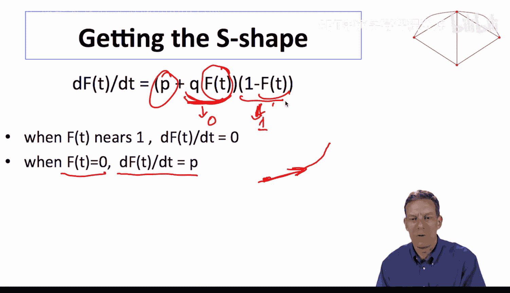

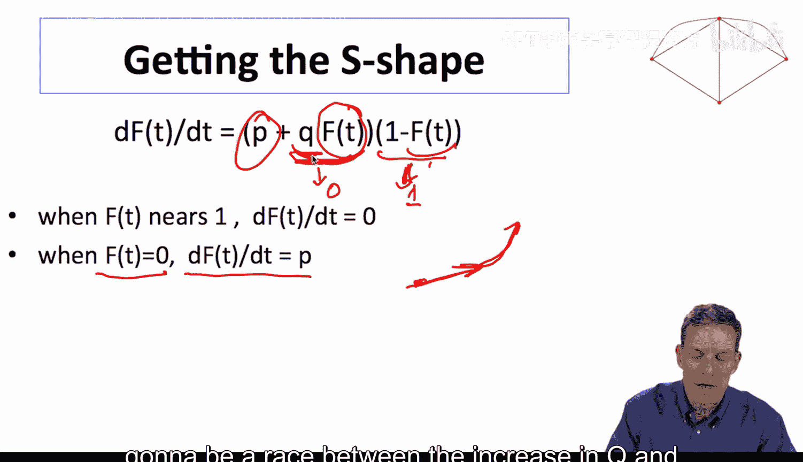

And so we can analyze that by looking at this process close to zero。

We know that the initial slope is P。 So let's look at what happens with some small epsilon。

 so we've just started moving out and we'll see whether we're going to start accelerating or not。

 is it accelerating or is it going to be already decreasing in speed。

 So what does DFDT look like at some small epsilon it's going to look like P plus Q epsilon times1 minus epsilon。

 So if you just plug in a small epsilon for this You get this to a need to get the initial convexity。

 you need this thing to be bigger than P right we have to be accelerating the slope started out at P。

 now we have to be getting a slightly larger slope。So initially to get that S shape。

 you're going to have to have this be bigger than P。

And what does that tell us that tells us basically that。Q is going to have to be bigger than P。

 so for very small epsilon， the only way that you can have this thing be bigger than P is to have Q be bigger than P。

So if Q' is bigger than P， then you'll get it effectively the Qq epsilon is going to be bigger than the P epsilon。

 and so we end up with a situation where you get the convex initial condition so Q bigger than P gives us the initial growth where we get a convexity at the beginning so we get this S shape here if p's bigger than Q。

 we get initially the slope is P， then it starts accelerating and eventually when F of T gets very large。

 it's going to have to slow down because now there's just not many of the adopters left and then things slow down and we eventually get an S towards1 so that's the bass model very compact。

 simple， easy model。

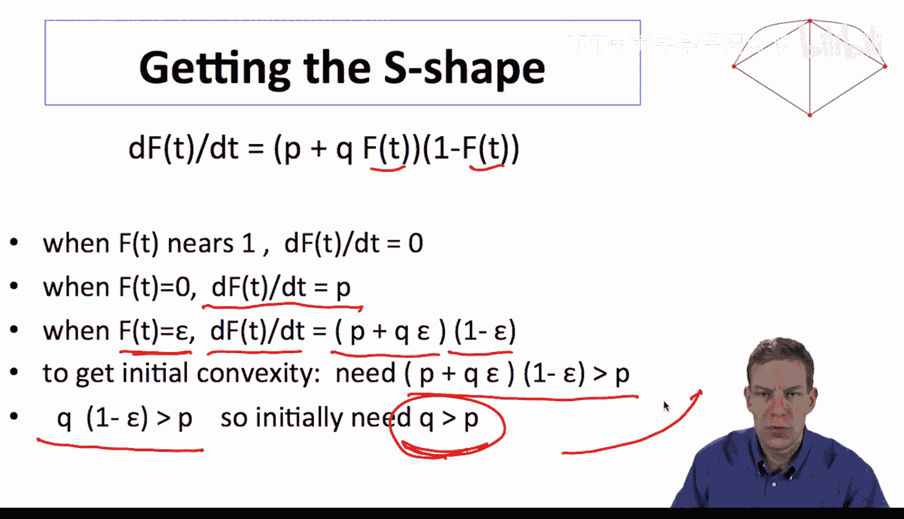

The this model has been used quite extensively， Why has it been used so extensively it's very compact So if you can begin know so suppose we we're just here at some time period that's already enough to estimate what P was and to begin to estimate what Q is so as this process takes off you don't need much data to begin to analyze and form estimates of P and Q once you've got estimates of P and Q。

 you can get estimates of what the rest of the process is going to look like so this model has been used extensively in forecasting by trying to estimate from initial take up So if you look say at the box office of a new movie how many people go see the movie and the first week。

 how many people go see the movie in the second week based on that first week and second week you've already got a piece of the two pieces of this curve you can begin to project how long is it going to take for this thing to keep to slow down and where。

Will it eventually reach in terms of its asymptoing so the bass model has been enriched a lot by adding in extra moving parts maybe some people wouldn't see the movie so here this assumes it goes up to 100% maybe some people would never see a certain movie you can enrich it by you know adding in different kinds of heterogeneity and so forth so there's different ways to enrich this model and people use richer versions of the bass model for forecasting but this basic simple part gives us that S shape in a very simple way and we realize that you know it's this combination of social limitation which grows with time which gives us that convexity which is important here。

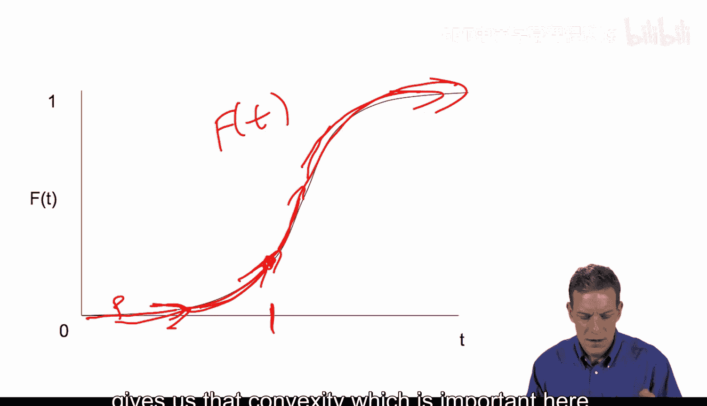

OkayBeyond the bass structure， what we're going to look at next is component structures and start bringing a network in。

 So here， know more generally the reach of diffusion is gonna to be bounded by some component structure。

 So if there's certain groups of people that don't interact with others。

 then things aren't going to move across one group It could be that some players or nodes are immune so if we're talking about the flu people could have a vaccine against it and maybe not catch it。

 or it could be that know there' are certain individuals who just wouldn't go see a certain kind of movies that will never see a horror movie and so you could think of them as being immune to certain kinds of diffusion。

 It might be that some relationships between individuals are transmitting with higher probability than others。

 So if we start looking at the network structure we're going to see that there could be some probabilistic transmission So the answers of questions of when we get diffusion and this extent aren't answered so easily by the simple bass model and we'll have to enrich these kinds of diffusion models in order to answer those。

And so that's what we'll take a look at next。

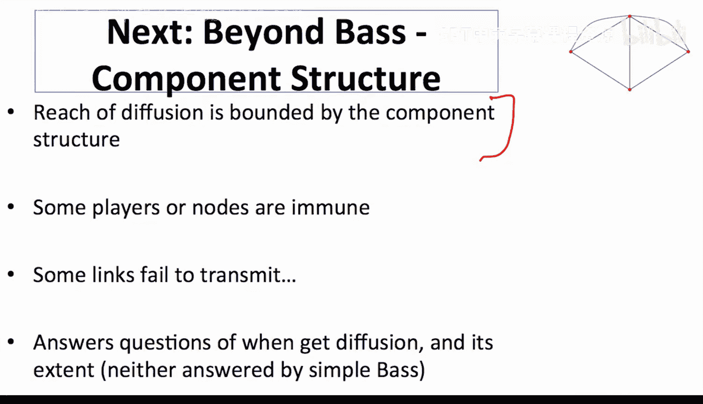