# 斯坦福大学《社会和经济网络：建模与分析｜Social and Economic Networks： Models and Analysis》中英字幕 p54 54_05_04_5-4-巨分量-泊松情形.zh_en -BV1v1421U7Nk_p54-

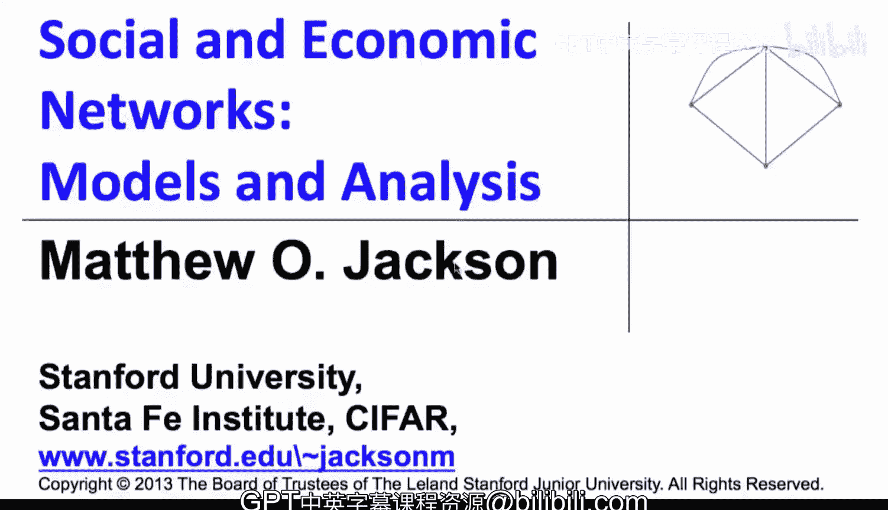

Okay， so we're back and we're going to talk a little bit more about computing the size of a giant component in a random graph。

 and in particular we'll focus in on a Po or GM random graph， the Eruramani random graphs。

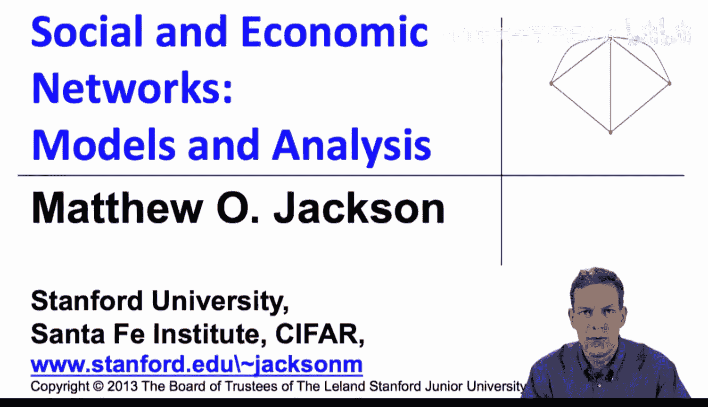

And so we're doing giant component calculation。 and we're going to just sort of a heuristic calculation。

 but one of it turns out to be fairly accurate。 And the idea here is is we'll just do the following kind of calculation。

 let's let Q be the fraction of nodes in the largest component Now let's look at a given node and if we just pick a node at random。

 the chance it's in there is Q。 But another way to figure out that that chance that a given node is in the giant component。

 it has to be that all of its neighbors are outside of the giant component。

 if it's outside the giant component， or if it has any neighbor inside the giant component。

 it'll be inside the giant component and so that'll give us an ability to do a calculation。

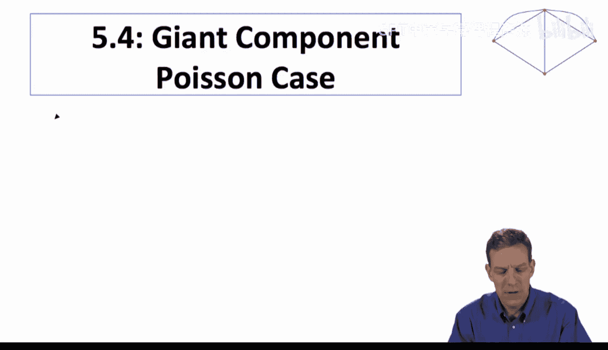

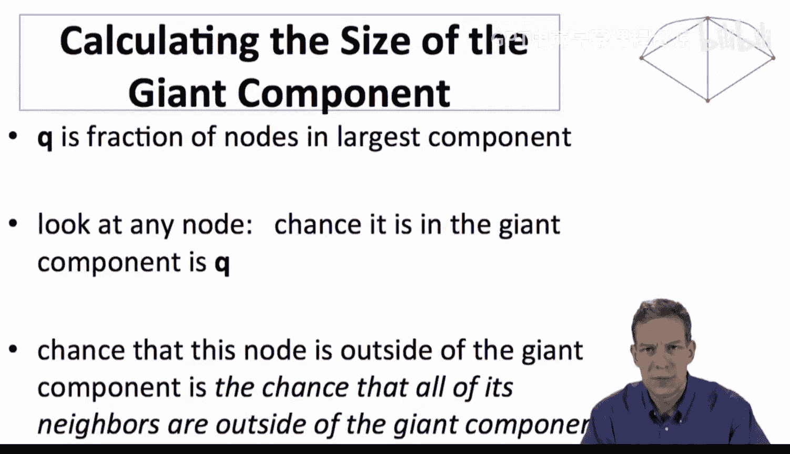

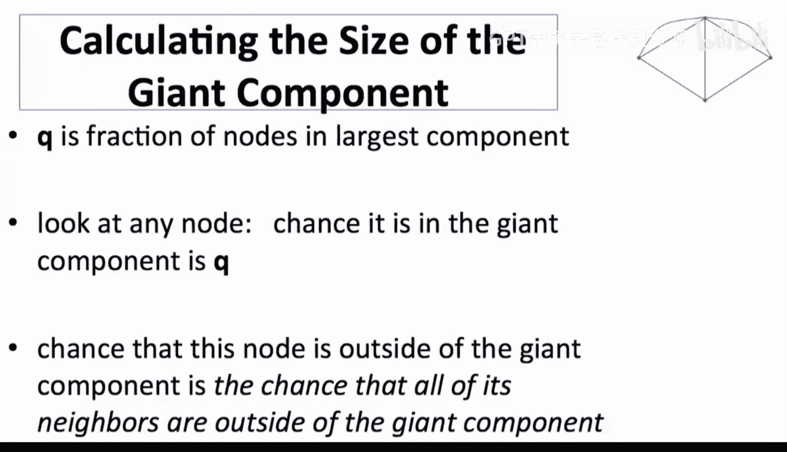

So the probability that a given node is outside the giant component。

 so it's not in the giant component is 1 minus Q since Q is the probability that it's in there。

But that's also equal to the probability that all of its neighbors are outside。

So if the node has degree D， if it has D neighbors。

 then the chance that each one of those is outside of the giant component。Is 1 minus Q。

 we raise that to the de power and we end up with 1 minus Q raised to the de power is the chance that it's outside the giant component。

And so what we can do is just look at the expected degree。

 take an expectation over this based on the probability of it having different degrees and then find an equation based on that。

 Okay， so we have this Q we're going to try and solve for Q So the probability that you're outside the giant component。

 that's one minus Q。 It's also the probability that all of your。

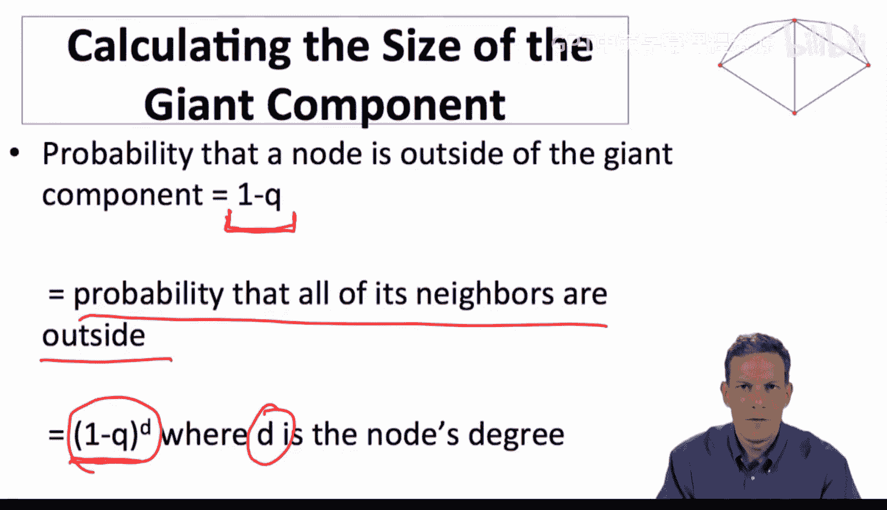

Neighbors are outside the giant component。 You have D neighbors。

 What's the probability that you have D neighbors， Well， it's given by a degree distribution。

 So P of D here。Is our degree distribution， so this is the chance that you have D neighbors。

And once we've got a degree distribution， then we can solve for Q Okay now this is a calculation that you could do it's a heuristic calculation because I'm not worrying about correlations in some of these variables I'm treating if they're independent。

 they're not quite independent， you can do it more exact calculation using generating functions there's some of that in the book。

 but this will give us a fairly good approximation and work fairly well especially on large networks。

So what we want to do is solve for Q。 Now， this is an equation so far that doesn't require us to work with a specific degree distribution。

 You could plug in any degree distribution you wanted into this and then solve for what Q is。

s it's a nonlinear equation。 So it's going to be a little difficult to solve for a closed form for Q。

 but you can plug in whatever degree distribution you want。

 and then solve that for Q or get an approximate solution for Q as a function of your degree distribution。

 So this is a nicely well definedfin。

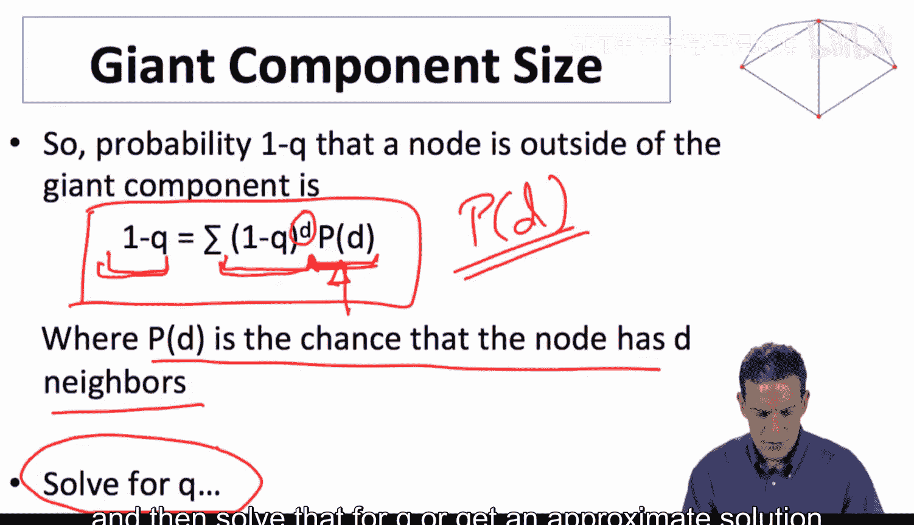

Equation， and basically when we look at this， there's always going to be a solution of  Q equals zero。

So there's one solution to this equation which has Q equals0， right。

 So we're basically solving this equation one possibility as well。

 if we put in Q equals0 here and  Q equals0 here， then we're just summing across all degrees for the probability of we get one on both sides。

 That's always going to be a solution。 The interesting solution to this is going to be the one where we have a non-zero Q。

 So we want to solve for a nonzero Q。 So one possibility is we assume everybody's outside the giant component。

 and then everybody ends up outside the giant component because all their neighbors are。

 that's in a nonsensical solution in a lot of situations。

 So the one we want to solve for is going to be the one where there's a positive solution to this equation。

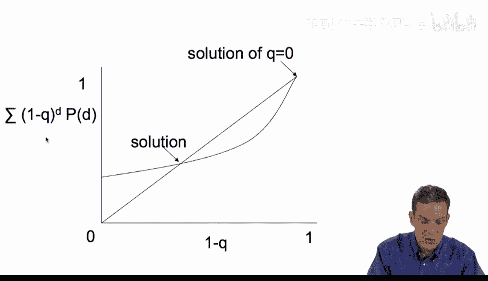

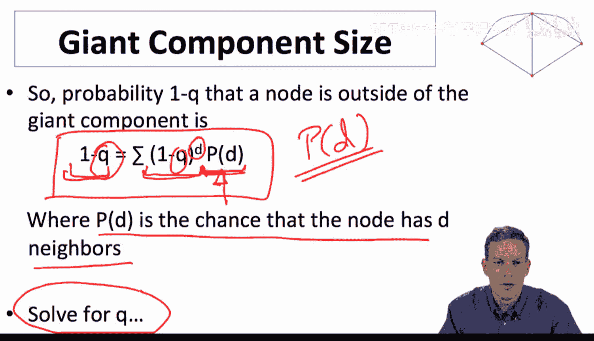

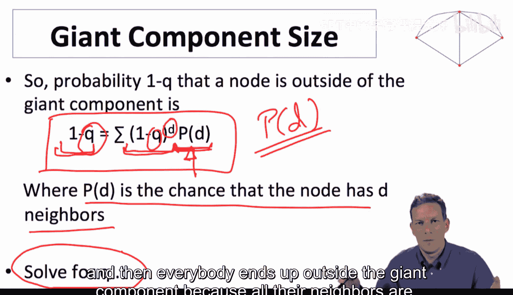

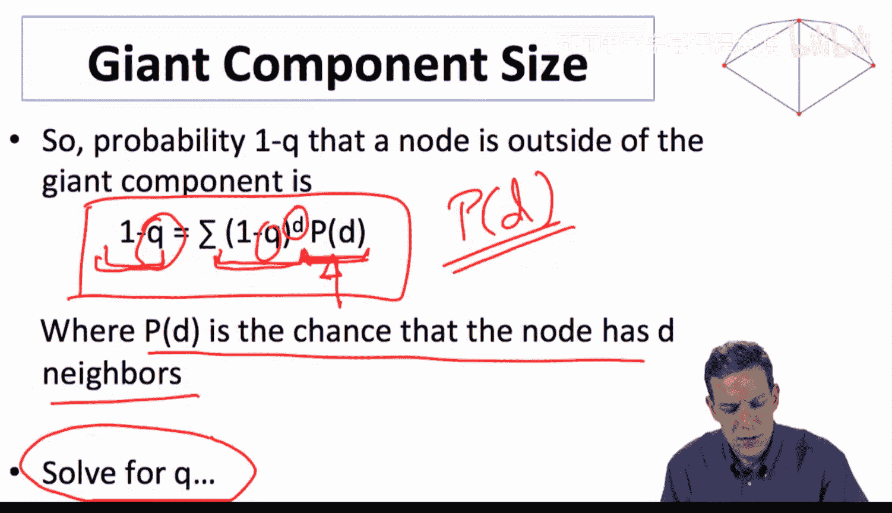

So if we look at this and try and solve for the positive solution。

 it's going to be the point where 1 minus Q is equal to the sum of the 1 minus Q to the d over the different probabilities of D and so we're trying to solve for what1 minus Qs solve this simultaneously that gives us a solution to Q。

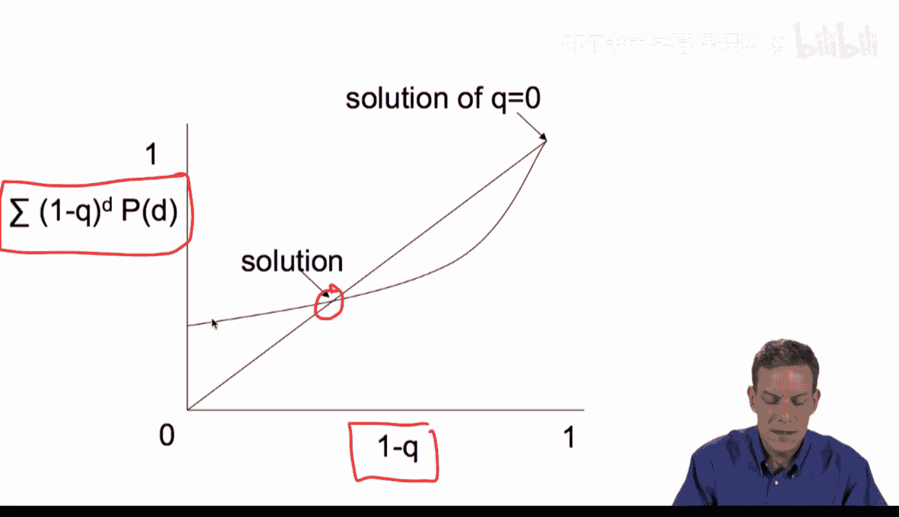

That's what we need and so you could solve this for different degree distributions。

 let's do it for the case of GNP or approximately a Poisson random graph。

 so we'll plug in a Poisson distribution for P of D so we have the Poisin distribution here。

 so this is the probability that a given node has degree D is given by this formula。

And when we plug that in， then we end up with this equation， so now we can solve this for Q。

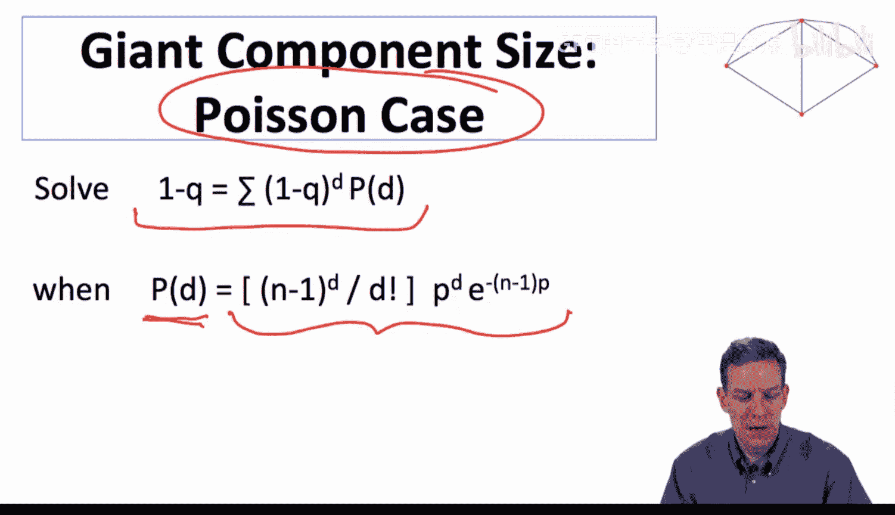

And this looks like a daunting equation。 It's got sum over a factorials of D。 So again。

 this is some over different D's。 we've got factorials here。 It looks like a fairly nasty equation。

 but luckily there's some nice parts to this equation。

 So when you look at things that look like sums of some expression raised to the D over D factorial that actually has a nice exponential form。

 So that sum is a nicely behaved sum。

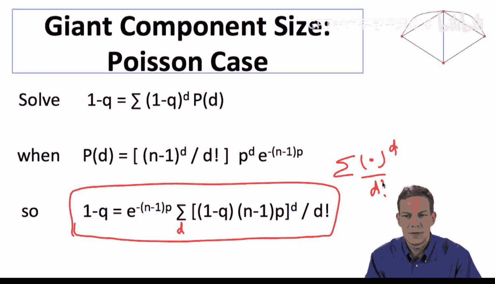

And one useful approximation just to have in the back of your mind is that when you look at writing down a Taylor series of approximation for E to the X。

 that looks like sum of x to the D over d factorial。

So Taylor series's approximation tells you that E raised to some power of X is the same thing。

 It's summing X to the D over Dial。 So you've got a nice expression here， and in particular。

 when we go back， we looked like we're summing something to the D over Dials。

 that's going to look like an exponential。 So when we plug in that expression。

 now we say we can rewrite this， given our formula as exponent of what's inside here。

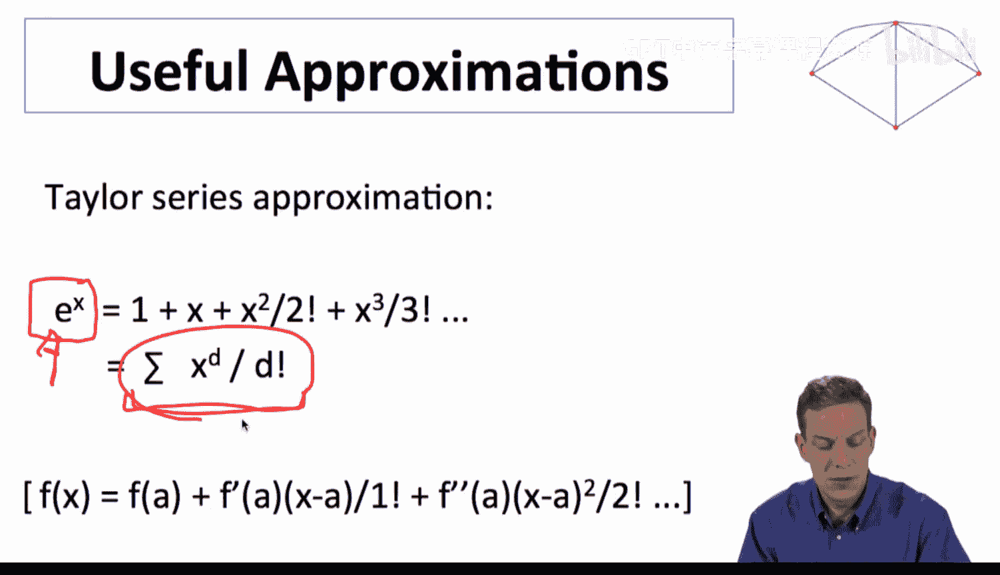

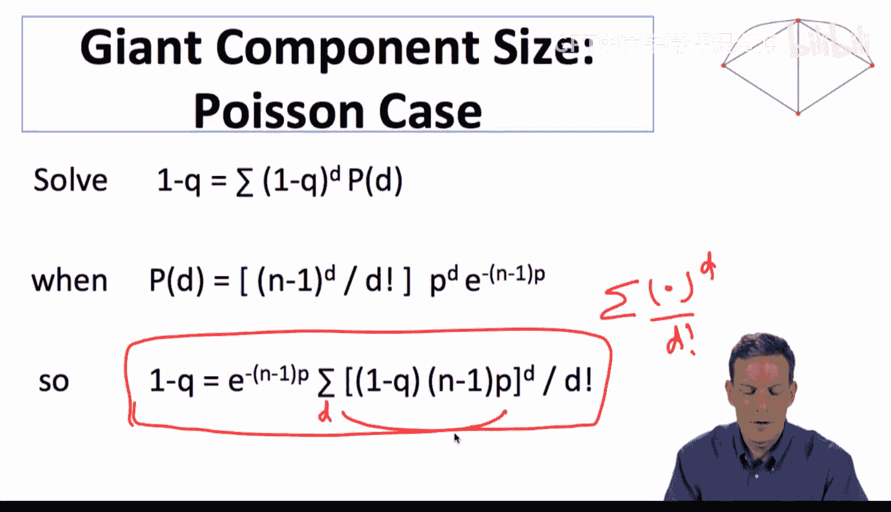

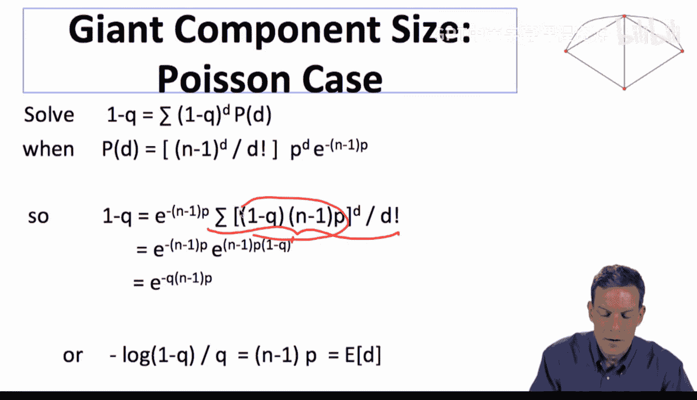

So we rewrite this in a nice form so that now we've got one minus Q is equal to this expression here。

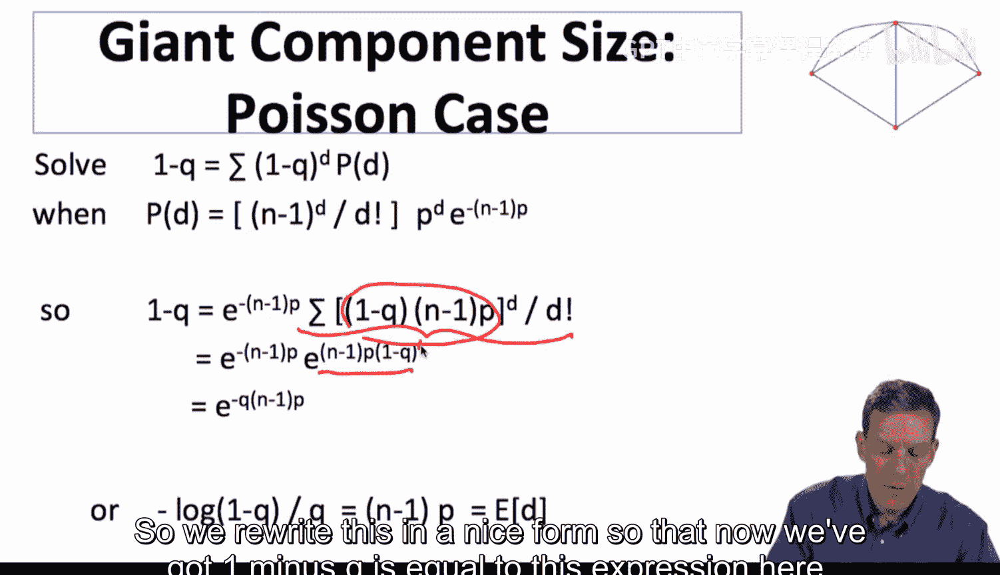

Okay。And collecting terms， some of our Ps simplify here。

 and we end up with E to the minus Q times n minus1 P。Well。

 remember that n minus1 p is the expected degree， right， so P is the probability of any link。

 multiply that n minus1 times that's the expected degree。

So what we end up with is here1 minus Q is equal to E to the minus Q。Expected degree。

 And if we take log of both sides， we get log of。Minus log of minus Q over Q is equal to E of D。

So very nice， simple equation now， we've got a relationship between the Q on the one side and the expected degree on the other side。

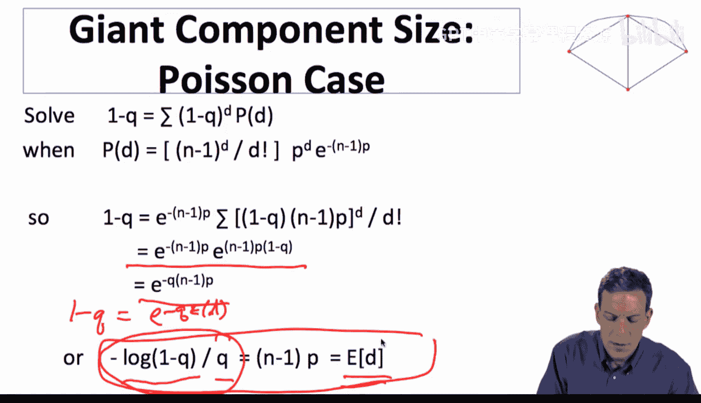

Okay， so now we've got an expression that tells us how large the giant component is as a function of the expected degree。

 it's not quite a solution directly in Q because it's minus log 1 minus Q over Q。

 but what we can do is at least plot this out and see what it looks like。

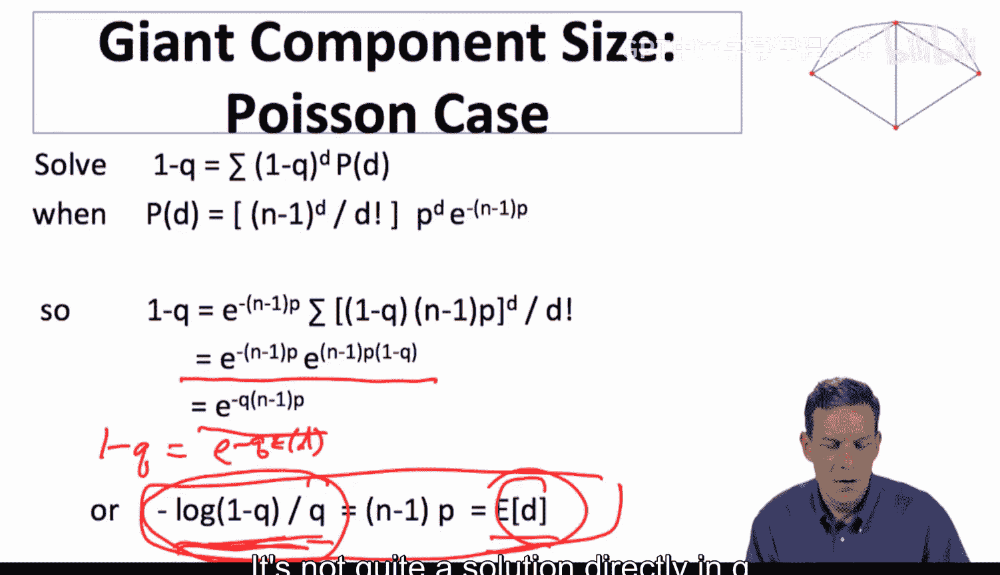

So if you plot that out as a function of the E of Ds and then see what the Q's look like。

 basically what happens is as Q gets close to1， there's no giant component right so Q' is very small at one and then the giant component grows。

And by the time you get up to three is an expected degree， your cu is actually very large。

 It's already close to 95%。 So by a degree of three。

 we've already hit close to 95% in terms of the size of the giant component and at one we're close to zero。

 So this is interesting and this is somewhat characteristic of these Erdashmani random graphs。

 we get these tight phase transitions。 So if people have expected neighbors less than one expected interactions that would transmit a diffusion of less than one。

 we don't get diffusion。 Once you hit one， we get a diffusion and then it grows fairly rapidly。

 and by the time you have three interactions， then we're already to the point where you're very likely to hit most of the population。

So if you remember in our。Promo video I said to tell at least two friends。 Well。

 if you tell just one friend about this， then we don't get much diffusion。

 two friends is at least enough to start pushing us fairly far along this and you get to three friends and you're most of the way there So just in terms of a giant component size here we are we see that there's a fairly tight transition from having no giant component to having almost everybody being connected and so most of the play is in this one region and indeed when people study epidemiology。

 there's this idea that having at least one contact that's going to transmit something if people are doing more than one。

 you're going to get diffusion or contagions and if people are having less than one transmission then things are going to die out and that makes perfect sense you need at least more than one and it's growing fewer than one and it's shrinking that's the critical point and then here we find that it actually transitions very rapidly so that by the time。

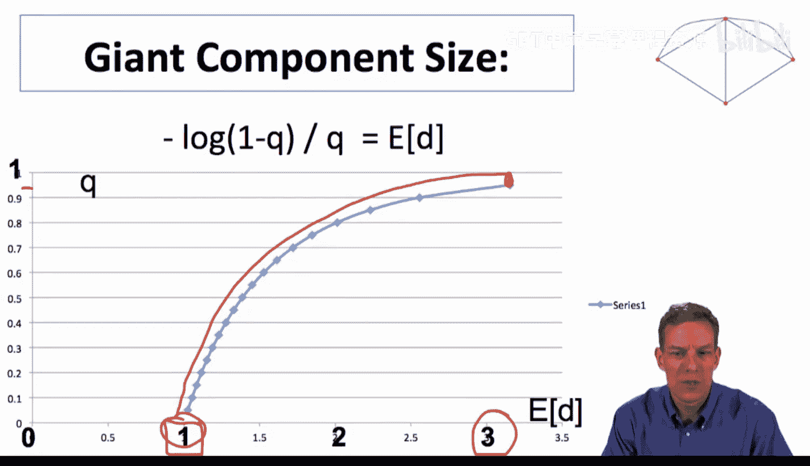

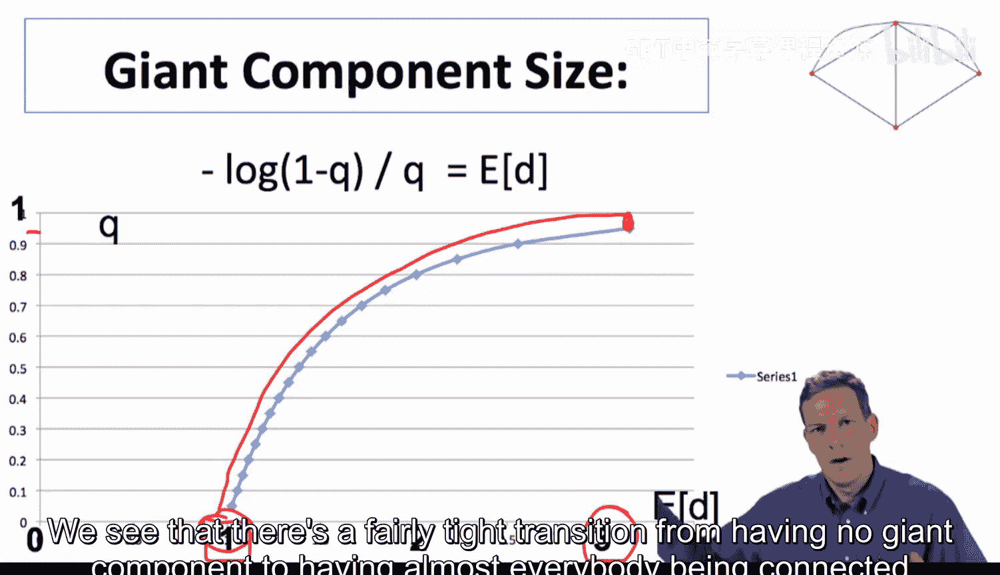

You've got three interactions that are likely to lead to contagion。

 then our diffusion is quite extensive。

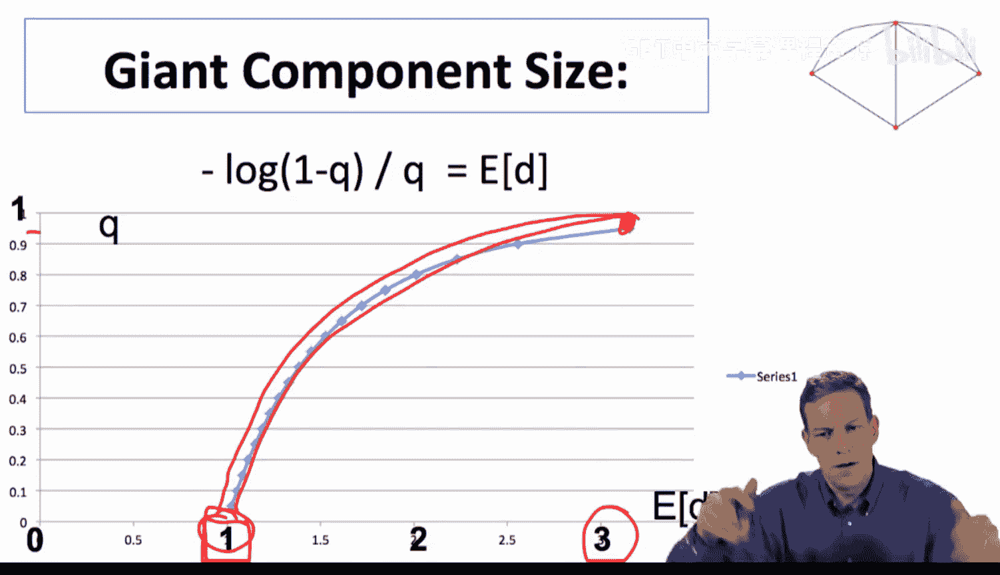

Okay， so given that， we can also do calculations of what's the probability of being in a giant component。

 Well， this was the probability that you weren't in a giant component。

 probability that you are is one minus that this is increasing in D。

 It's an increasing function of D。 and basically that just tells you more connected。

 you're more likely to be infected and this is exponential in D。

 so it tells you that increasing your interaction rate makes it much more likely exponentially more likely that you end up in a giant component。

 so you're more likely to be infected at any point in time if we do a dynamic and much more likely to end up infected。

 and this gives us some insight behind that Coman cats and menzel finding that the people with more interaction we're adopting the antibiotic prescribing the antibiotic at an earlier time。

So here we see this directly in terms of this model。

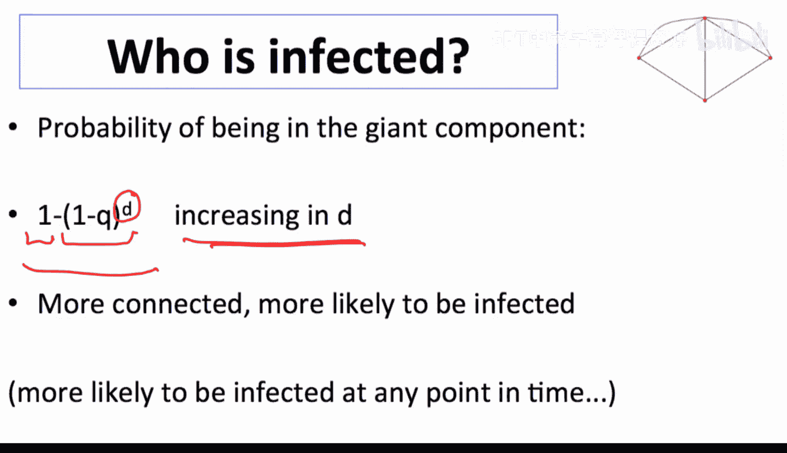

Okay， extensions， let's talk about some extensions quickly immunity well that's easy if some nodes are immune then they can't catch something。

 they can't transmit it so we can just drop those out of our model to begin with and then study the giant component on the remaining nodes。

And what that's going to do is actually decrease the degree。 right。

 So if we have some fraction of the nodes that disappear， then that's going to decrease the degree。

 and that decreases the overall interaction。You know， in terms of probabilistic infections， you know。

 we just have links fail and we can incorporate that directly into the link probability so we can think about you know some nodes initially exposed to infection we could have some fraction pi of the nodes that are immune and we could think also that maybe only some of the links are actually going to transmit。

 let's let a fraction F of the links transmit and then we ask what's the extent of the infection and basically we could just start with our。

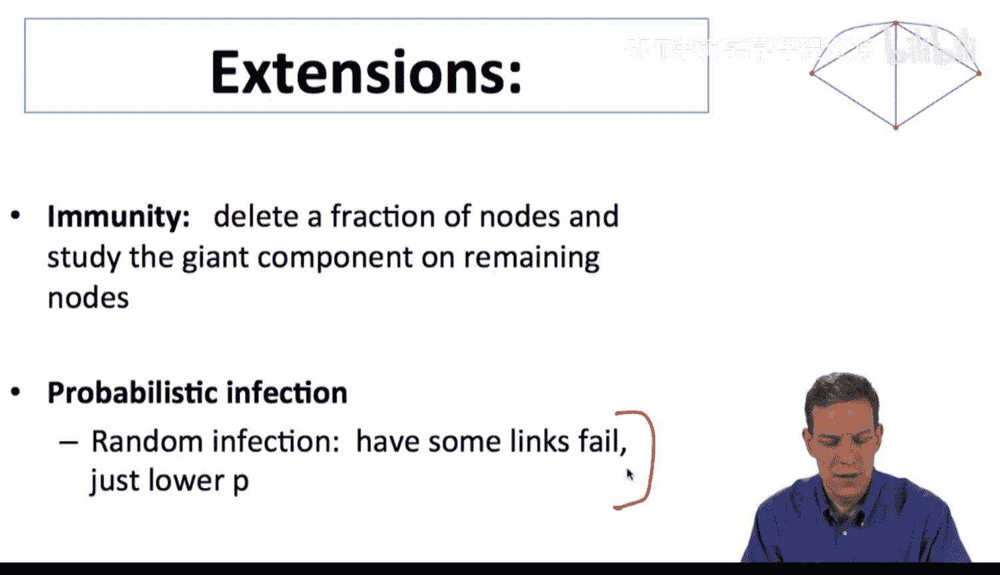

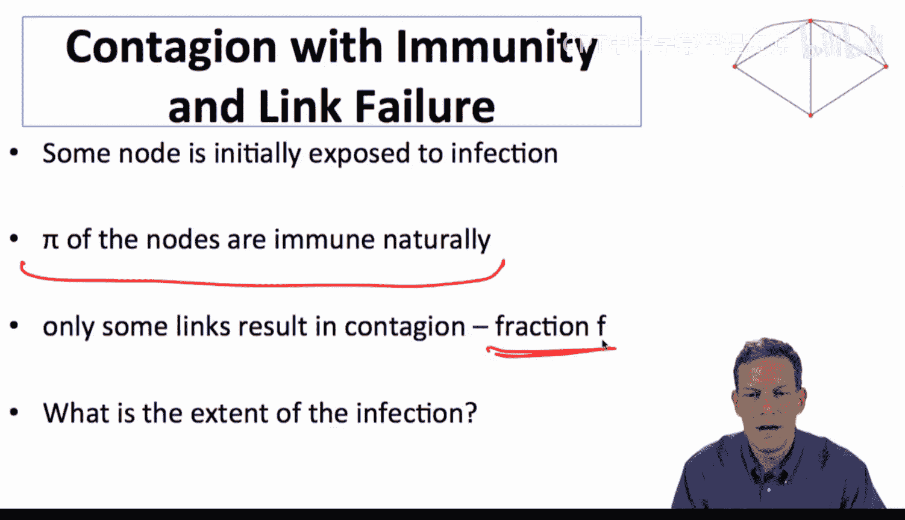

Network on end nodes， we delete some fraction of the nodes， delete some fraction of the links。

 and we look at what's left and if we get an infection and a giant component on what's left。

 then we'll get to reach whatever the giant component is on what's left and otherwise we don't get an infection so it's a very simple extension to start to incorporate these things。

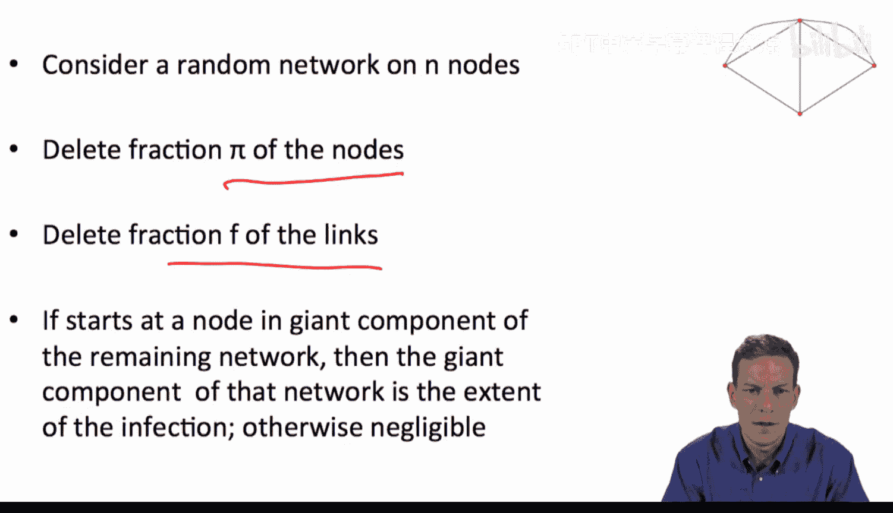

And if we let Q be the fraction of nodes remaining network on the remaining network in a giant component。

Then Q times 1 minus P is the probability of having a non trivial contagion。

And that's also sort of the extent of the infection。 So basically。

 what we can do is just resolve the equation where now what we've got is we're going to have a lower expected degree for the individuals plus。

Moving that down so lower， given the fact that they're not going to have as many neighbors because some of those neighbors are immune and then also scaling down by the F。

 and once we've done that， we end up with basically the same exact equation。

 just taking these two modulations into effect。 And so what we end up with is a similar curve as we had before。

 But now what we have is on the the x axis， the expected degree the one that's sort of relevant here is now mod modo。

 the fact that some of the nodes are going to be missing and some fraction aren't going to transmit。

 And so it has to still be at least one on of what's remaining in this and then going up to three。

 So you can just direct calculations this just scales things back。

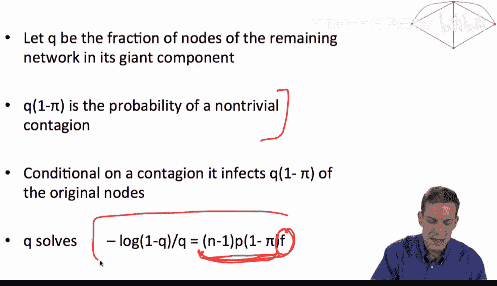

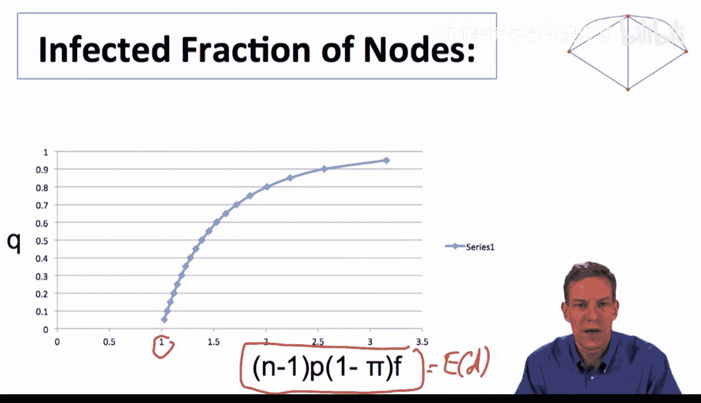

So implications， the infection can fail now if p is high enough or if F or P are low enough。

 so that basically puts you below the one， so high pi， high immunization， low F。

 low contagiousness of the process， low P， low contact among the population。

 so you can think of these different modulations to。To what we had before。

 and that's going to affect the eventual process。

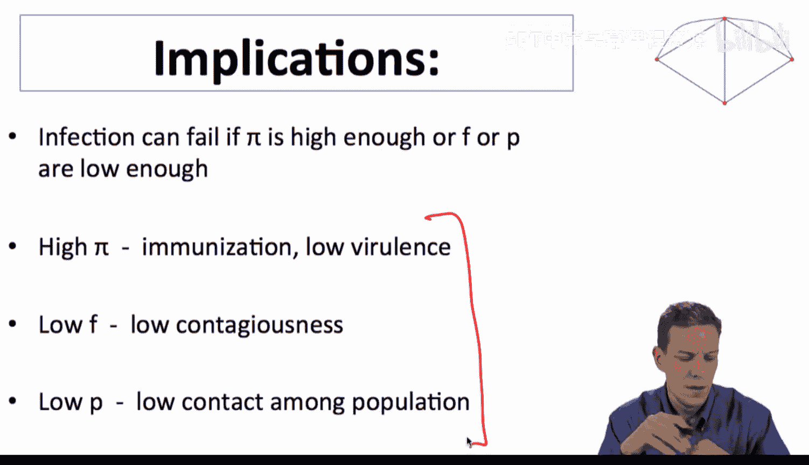

Okay， so that takes us through a quick look at component size and doing these kinds of calculations。

 This has been for a process that just spreads through one network The next thing we're going to look at is an ongoing process where people can sort of change back and forth between state1 and zero so maybe you support somebody you don't。

 you like of technology you don't like it so you can change your mind over time or there are certain kinds of diseases that people can catch and and recat And so you know these are ones that can last in a population so I can clean my computer of a virus。

 get the virus back， it can infect other people and so forth so I I can go back and forth between the state  zero and1 over time and we can look at that kind of model as well。

 that'll be the next thing we'd have a look at。

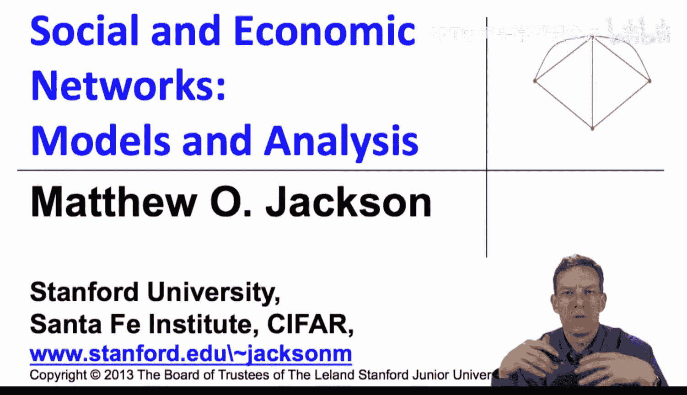

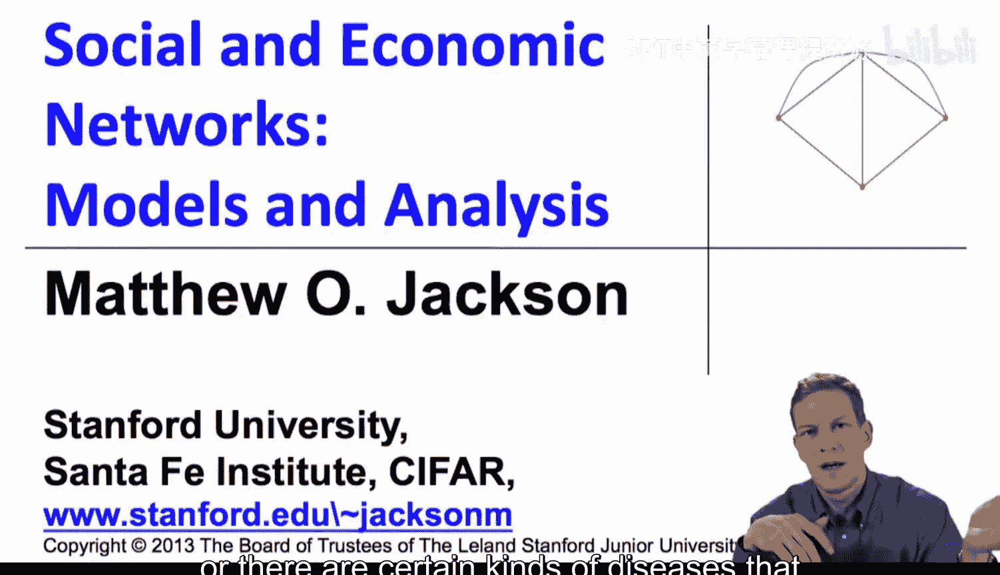

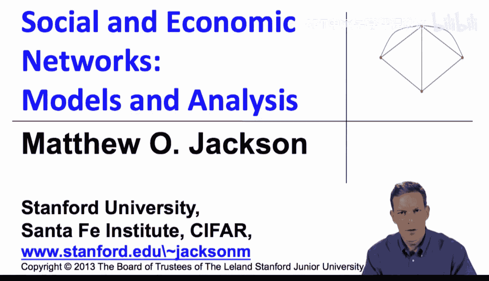