# 斯坦福大学《社会和经济网络：建模与分析｜Social and Economic Networks： Models and Analysis》中英字幕 p55 55_05_05_5-5-SIS模型.zh_en -BV1v1421U7Nk_p55-

We're back and now we're talking a little bit more about diffusion and we looked at calculating the size of a giant component in a random graph as one heuristic approximation to the extent of a diffusion and the probability and now what we're going to look at is another model which is known as the SIS model and it's a simple model of diffusion。

 it's highly stylized， it's not directly applicable to a lot of things。

 but it's a useful model because it gives us some basic intuitions of how things work。

 we can bring in degree distributions， we can vary them we can get comparative statics out so a lot of the insights that will come out of this model be quite useful even if the model is a little bit too simple and stark to actually match a lot of things so what's the structure of this model so this model comes out of a model that's been used and studied a lot in epidemiology。

There were a set of models by Bailey in the 1970s that sort of defined a lot of these things there's so what does S stand for susceptible so basically we've got susceptible。

And then， I infected。And then susceptible again。So the idea here is you can recover so you can catch something。

 you become infected， so you're susceptible， you can catch it， you get it， then you recover。

 and this is something which you can catch over time so it might be something like I erase a virus from my computer。

 I'm susceptible again now I can catch them， a new one comes， I catch it again。

 I erase it and so forth so I go back and forth from this process of you know realizing that I have a virus getting rid of it and then catching it again later in time。

嗯。🤧Okay so the key thing is nodes are going to move back and forth over time and you you can think of this as I might be changing my mind over time in various things but look at the basics of it So nodes are in these two states infected or susceptible the probability that you get infected in the simplest version of this model is just proportional to the number of infected neighbors with some rate say v greater than zero and we'll add in a spontaneous epsilon so that you can catch things as in the bass model and then you get well in any period with at some rate delta So this is like the bass model except here you can actually reverse yourself and get well and that's going to happen with a rate delta greater than zero。

 and let's let rh be the percent of the population it's infected at any point in time So what we're going to want to do is make predictions about rh as a function of the network。

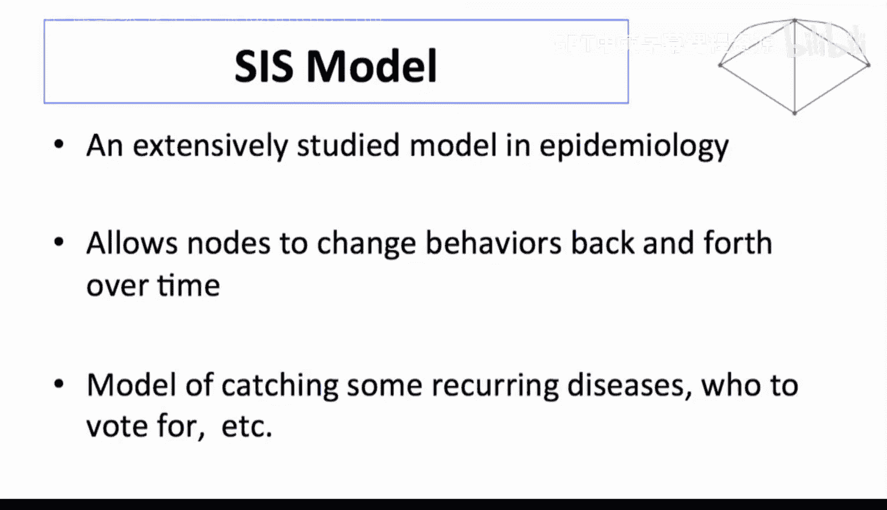

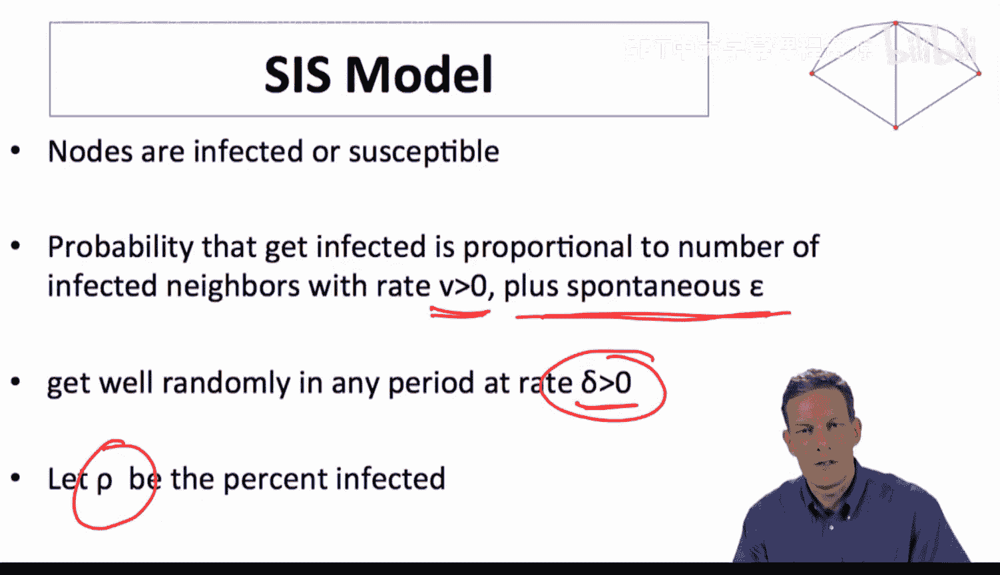

These other parameters of the model。So what we're going to do is start with a simple version where all the individuals。

 players， agents in the society， the nodes are going to mix with even probabilities。

 So you random meet one person per unit of time and that's just going to give us a large Markov chain and we can do calculations on that and the steady state distribution is just going be one in which the change of this infection parameter row with respect to time is zero。

 So the simplest version of this model is one where there's not actually a explicit network structure it's just a completely random process and it looks a lot like the bass model in its basic form and then we'll bring in network structure on top of this in just a few minutes。

 So let's start with the simplest version。 So what's the change in the infected population over time。

 Well you can only become infected if you're not infected yet。

 So you're susceptible So this is the susceptible size of the。

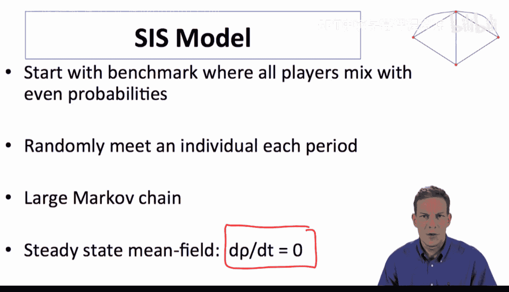

Population then you catch it from a given individual with v times rh and epsilon is this spontaneous rate。

 so this looks a lot like the bass model did basically the same functional form as the Ba model but what we're also going to do is we're going to have people recovering over time and so we'll look for a steady state so out of those who are infected they recover at some rate delta and so all put together you're gaining new infection at this rate and losing infection at this rate and in order for this to be in steady state。

 these two things are going to have to balance new infection rate going to have to balance against the number of people who recovering for period of time and so if you solve this equation then you get an expression for what row looks like as a function of the rest of the parameters in this setting okay。

So there we've got a simple equation and a simple solution and now we're looking for a steady state and what we've done is we've enriched this bass model essentially to have a recovery part which then allow for a steady state distribution。

 which is going to be different from everybody becoming infected So if we let epsilon go to zero and then we solve this basically we end up with two solutions。

 one is that nobody's infected， nobody gets infected and then the other one。

 the more interesting one is that rh is equal to one minus delta over V So if this turns out to be greater than zero so if delta is bigger than V basically what does that mean that means that people recover so fast that this thing will never really take root。

 but if delta is smaller than V so you can catch things faster than you can recover from them。

 then rh can be positive and basically the smaller delta is and the low。

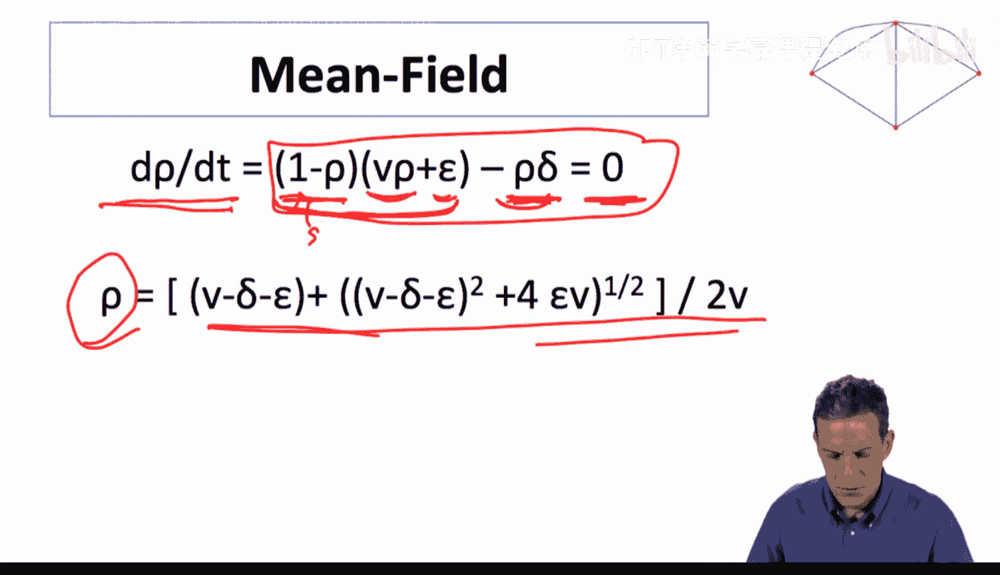

largerger V is the larger row is going to be。 So rh is increasing in V and decreasing in Delta。

 and it only has this positive。A solution as long as Delta is less than V。

Right so so we have a simple solution and you know very simple steady state here。

 so this hasn't brought in the network structure at all， so this is like the BaS model。

 but now with a recovery rate and we end up with a solution here which makes sense as long as delta is less than p。

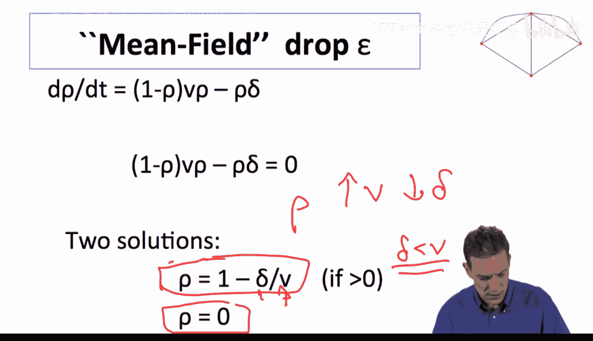

Okay。So。we've got an infection in at least when Dlta is less than V where it's going to stay at some level for low recovery rates。

 this can lead to large infections and what we haven't brought in yet is where's the network right so this is uniformly at random interaction。

 We're missing the heterogeneityian degree。 we're missing local patterns and what we're going to do is is we're going to start by just bringing this in。

 and bringing in local patterns and explicit network structures is going to be a lot more difficult without doing simulation And so what we'll start with is just taking a look at how we might bring in the fact that some people are going to have more interactions per unit of time than other individuals。

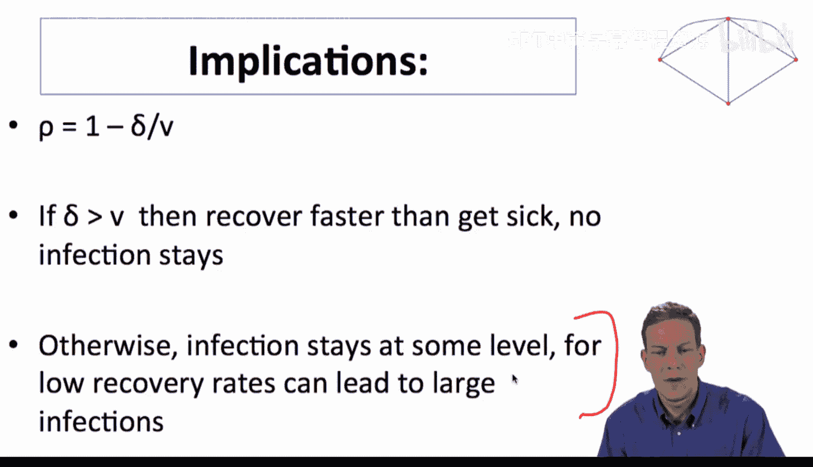

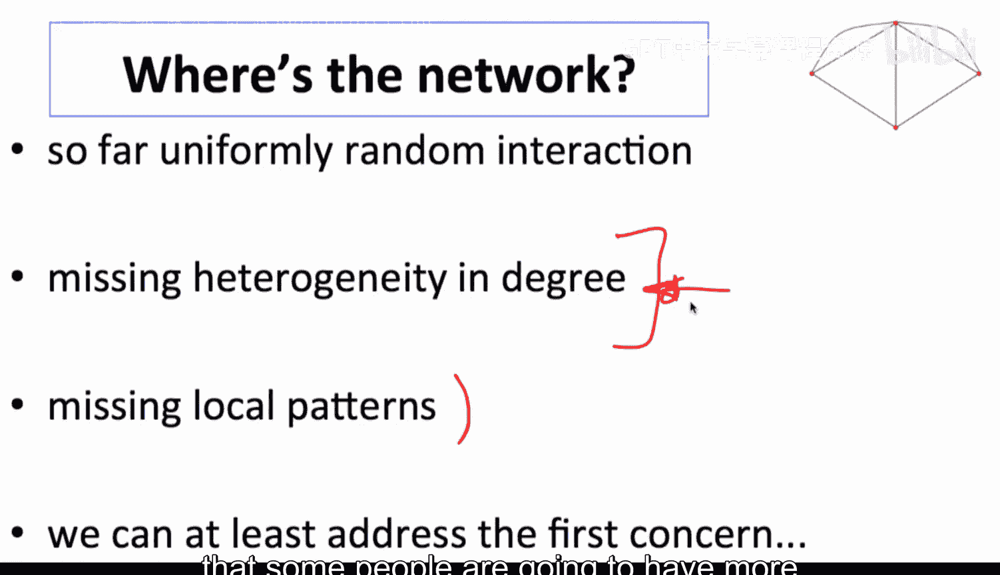

so exploring the dependence of this on the degree distribution is what we're going to do is start by having a random matching process where each different individual might have a different degree and their degree is just going to tell you how many matches per unit of time they're going to have okay。

And what we're going to keep track of now is the fraction of nodes。

 not just overall which are infected， but also as a function of the degree。

 So it might be that people that have three interactions per unit of time have a higher infection rate than people who have two interactions per unit of time and so forth okay。

And another thing we're going to keep track of is if I'm meeting a random person in the population。

 so each period I'm meeting some number of people， my DI。

 so say this is four I'm going to meet four people per unit of time。

 What's the chance that any one of those four people is infected。

And theta is going to be that fraction。 Okay， Now， what's going to be important is the fraction of people overall that might have something in the population is not going to be the same as the fraction of people I meet because I'm more likely to meet people who are meeting lots of people。

 So some people have lots of interactions。 Those are the people I'm more likely to meet。

 Those are also the people who are going to be more likely to be infected。 Okay， so。

 so that's the the process that's going on。

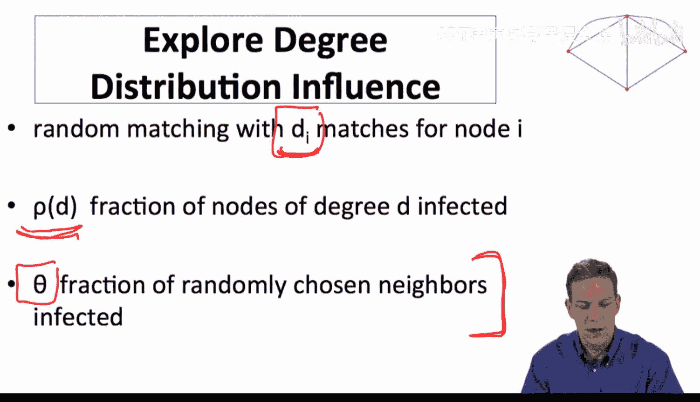

Okay， so how are we going to deal with this， Let's deal with again。

 this is this random matching process， So let's let P of D be our degree distribution。

 So this is the fraction of nodes that have degree D。

And when I think about what's the probability that I'm going to meet somebody in terms of this random process where we're all randomly matched。

I'm much more likely to meet somebody with high degree。 And in particular。

 given that the high degree people， if somebody has 10 meetings per unit of time。

 they're going to have to meet 10 people。 somebody has five meetings per unit of times。

 we're going to meet five people The person with 10 is going to be twice as likely to be met by somebody as the person with five meetings。

 So the people with more meetings are going to be easier to find and the likelihood of meeting a node of degree D is going to be directly proportional to their degree compared to the average degree。

 So we look at the fraction of those people in the population。

 but we have to reweight that by what's their relative degree compared to the average degree in the population。

 because that's going to determine how many meetings they have and how easy it is to find them when you're bumping into the people in the population。

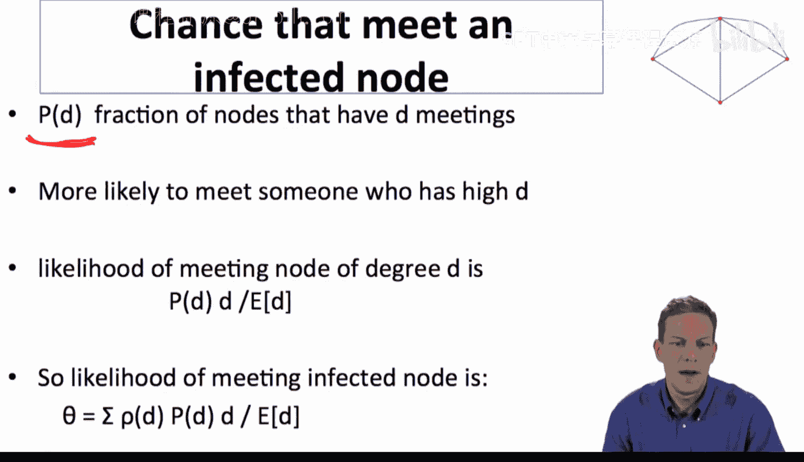

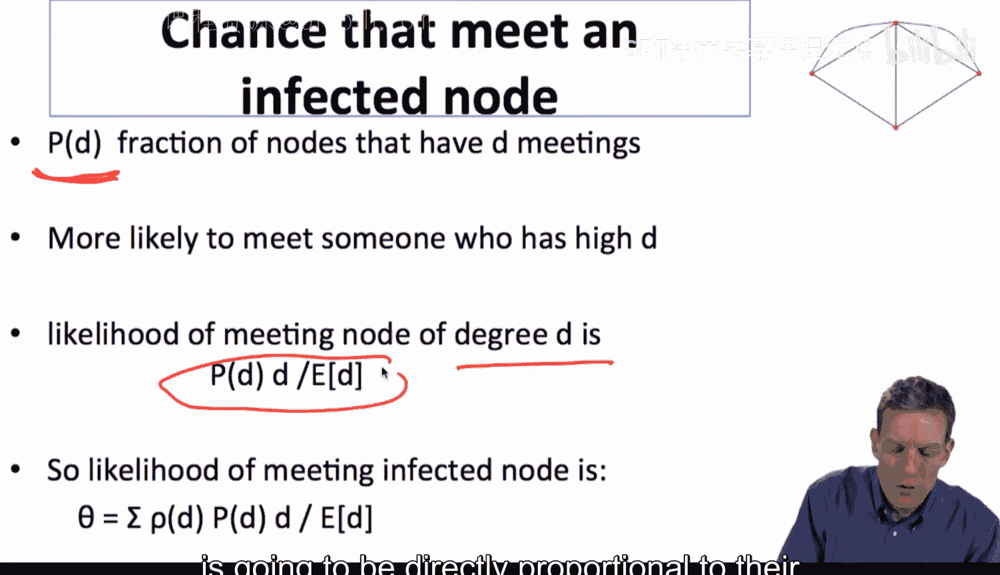

Okay， so that's an important thing and that's a critical thing for understanding contagion processes more generally。

 we've already seen it once earlier in the course， and you know this is important in trying to understand the fact of the operation of this SIS model。

Okay， so if we want to calculate the fraction of infected people I'm likely to meet， well。

 this is the likelihood that I'm going to meet somebody of degree D。

This is how likely they are to be infected， and then we're just going to sum across theses and that gives us a theta Okay。

 so we have an expression now for theta and we're going to have to just solve this expression and see what it gives us。

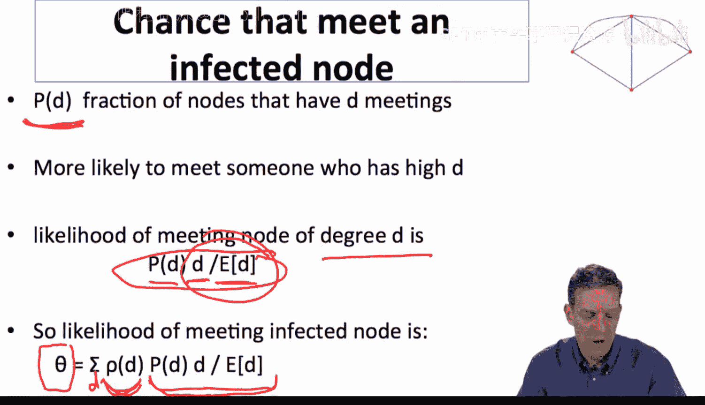

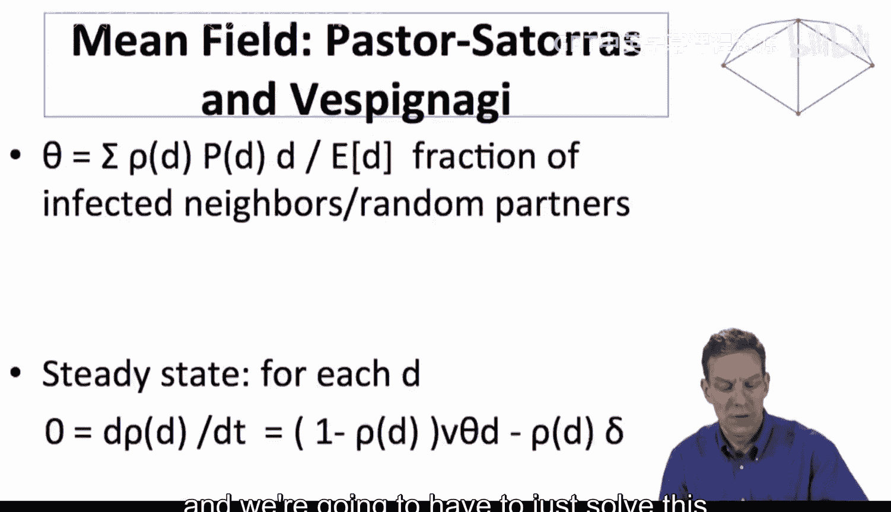

So this is the fraction of infected neighbors， random partners， if we look at steady states。

 steady states are going to tell us for each different degree。

 we have to have the change over time of the infection rate of different degrees all going being zero。

So what we end up with is this infection rate for each different type being zero and what we know what those infection rates look like for different types and so we can then set that equal to zero。

 what does that infection rate look like for different types， well。

 so the fraction of people of type D that are。Currently susceptible is  one minus row of D。

The chance that they meet。Infected individuals， the number of infected individuals per unit of time they're likely to meet is theta times D。

And the chance they get infected by one of them is V。

So this is the rate at which they're going to gain infections and then they get better at a rate delta。

 so they recover， they get rid of their computer virus。

 they recover from whatever cold or they had so here we've got a situation where we've got an expression now that involves our theta and we can solve this for each row of D this has to be equal to zero。

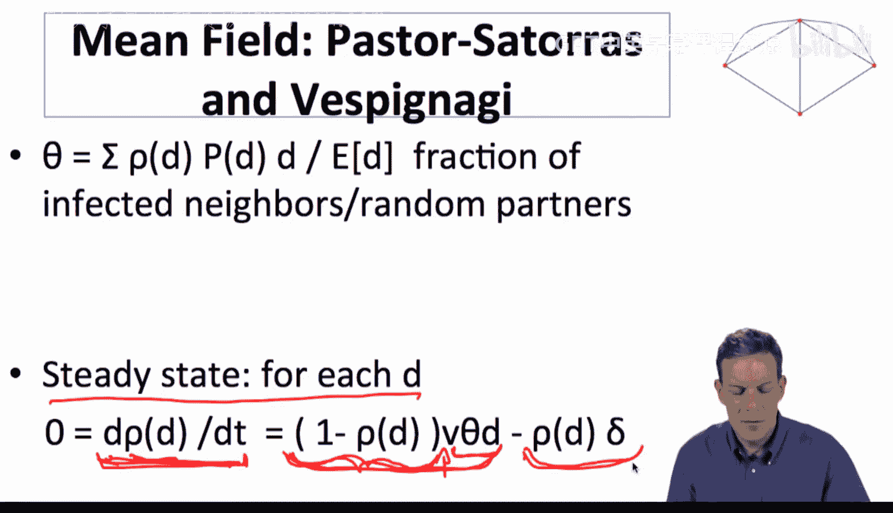

So said state says this equals。To zero and basically that tells us that the row of D for any given D is going to be proportional to this expression over here。

 lambda theta d over lambda theta d plus1 where lambda is V over delta So what's the relative rate at which you get infected compared to the rate at which you get better so generally for this infection to take hold this expression is going to be something which is bigger than one and so here we've got something which sort of captures the well doesn't necessarily have to be bigger than one in settings where we have different degree distributions So so this is going to be a very useful parameter and this happens because when we solve through it's only the relative rates of V and D that matter and not the absolute rates so if we double both of these and the expression was already solved wed get the same solution so these are scaling。

Together and it's relative rates at which you get infected and recover that matter。

 not the absolute rates。Okay。

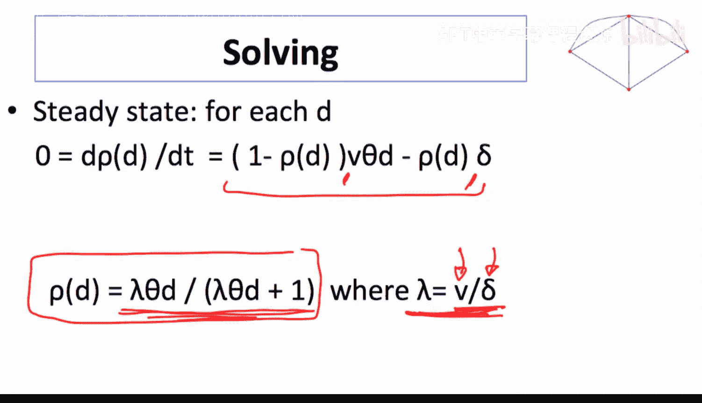

So solving this equation， we've got this expression now for row of D。

 we can plug that back into our expression for theta， and then we end up with theta equals。

A function of theta which now depends only on the primitives of what's the degree distribution。

 what's the infection relative infection compared to recovery rate in this and those are the only expressions that enter in so we've got expected degrees and so forth。

 and now we've got to solve this for theta。

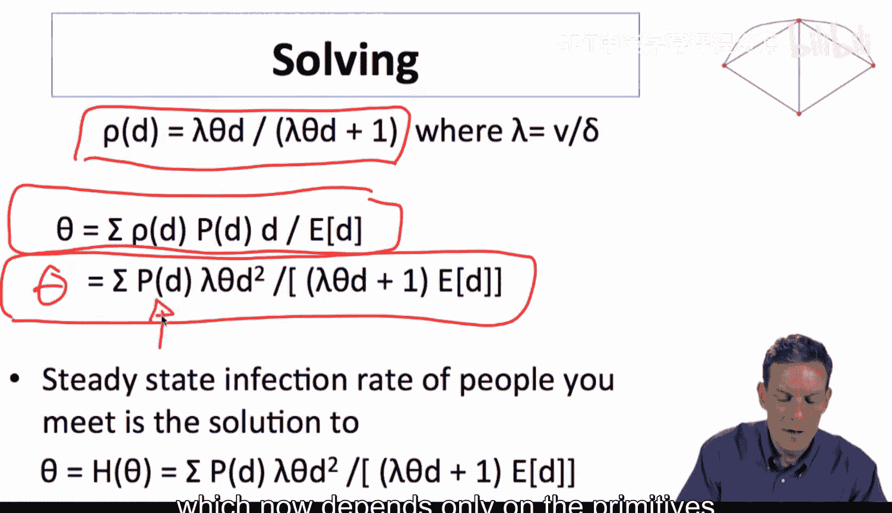

Okay，So we've got theta as a function of H of theta。

 which is where H of theta is this big expression over here。

So we've got some function of theta and basically we're going to look for a fixed point of this expression Okay so now we've boiled everything down this model to a simple equation that one can solve。

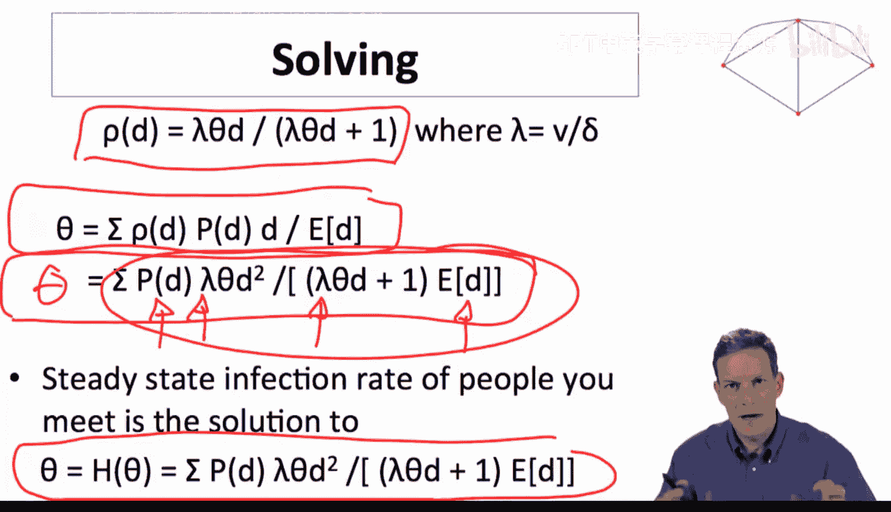

Okay。So solving this equation we know that theta is some expression which is a function of the P's and so forth generally this isn't going to be easy to solve。

 we can solve it by simulation it's a nonlinear equation it depends on the expected degrees and the full degree distribution and the lambdas but when we can do is do some fairly easy comparative statics and say let's suppose that we increase the probability of higher degree nodes。

 what's that going to do to theta What happens as we change the expected degree what happens as we change lambda so we can do different comparative statics and begin to understand how these things work。

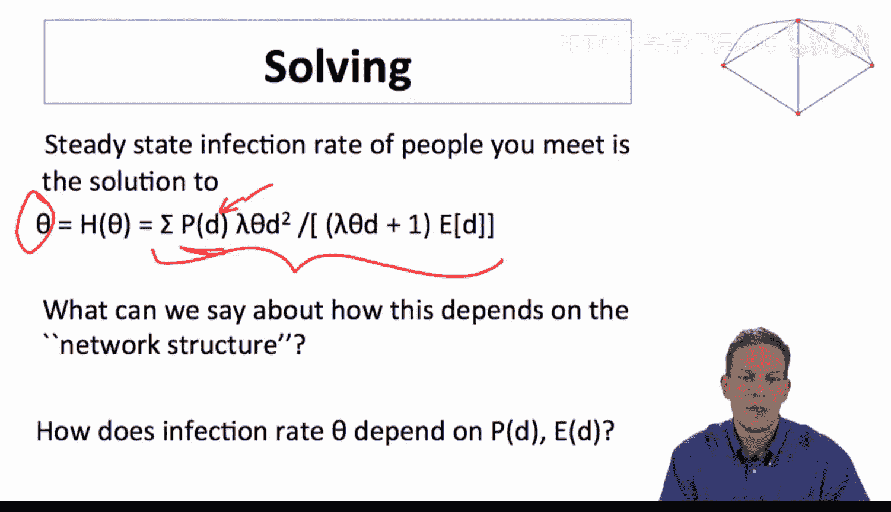

嗯。Okay so in particular we want to ask what H of theta looks like and how it depends on these different parameters。

 the degree distribution， the expected degree and so forth。

 so solving this will depend on making sense out of these so let me just go through how this looks in terms of the solutions so basically when we go back to this we're trying to look for thetas which solve this equation we want theta equal to H of theta H of theta is going to be an increasing in concave function and we'll talk about that in a little bit。

 so H of theta is increasing in theta and it's concave function。

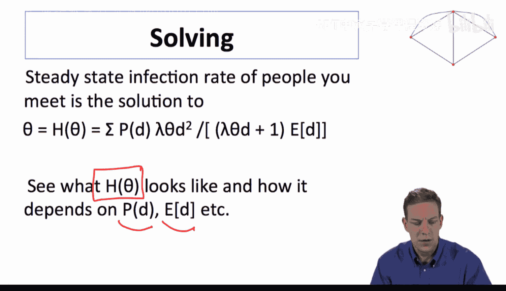

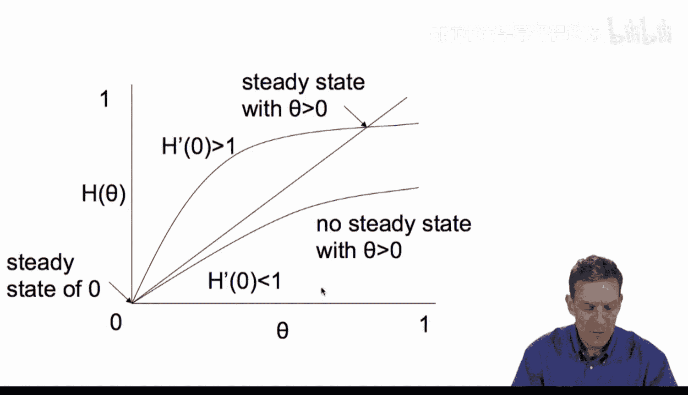

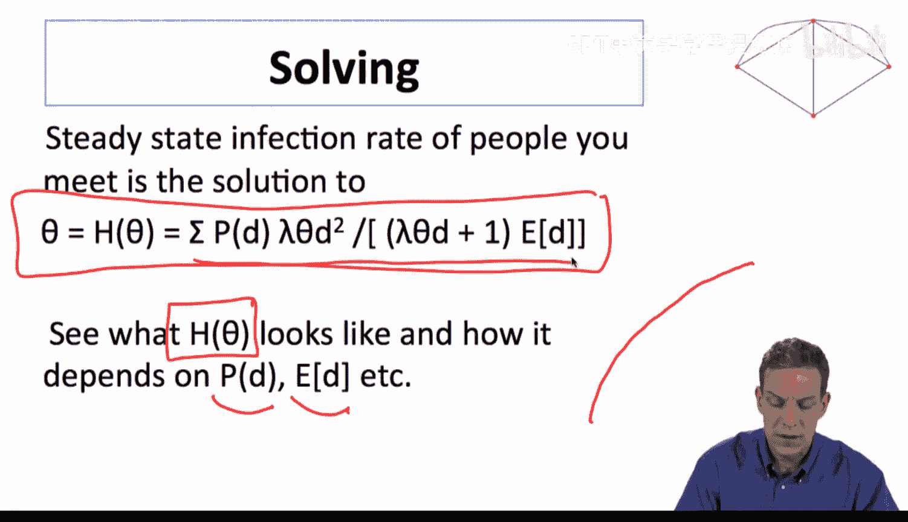

And in particular， when we look at looking for thetas and H of thetas that intersect one possibility is theta zero。

 so if nobody's infected that nobody gets infected in this model and so one steady state is no infection and once you eradicate something it just doesn't come back another possible steady state is a positive one。

 but it's going to depend on what this H function looks like。

 so it could be that this H function is so shallow that there's no positive solution。

 it could be that it's a steeper function and the concavity will give us a positive solution to it。

 So understanding whether this works in terms of having a non-zero steady state in this is going to depend on the properties of this H function。

 which depend on the degree distribution the relative infection rate and so forth。

 So even though there's a little bit of technicality here。

 the intuitions are fairly simple basically more degree。Higher degree nodes， more interactions。

 higher infection rates in terms of the V compared to Delta are going to lead to higher H's。

 which are going to lead to higher steady states and more infection in a population。

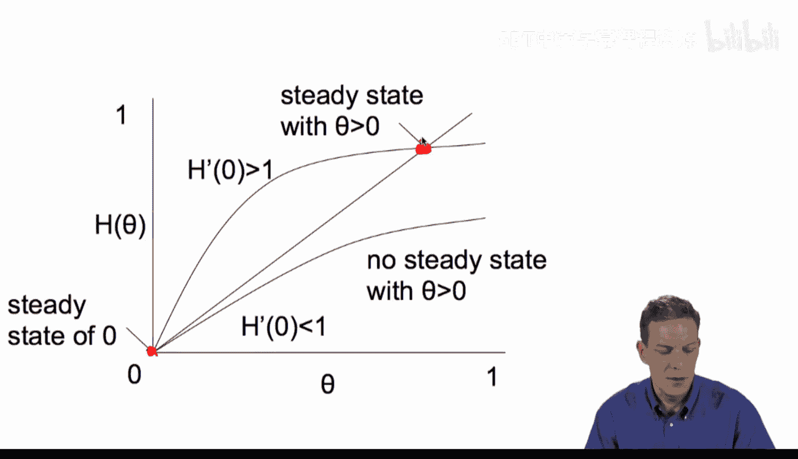

Okay so we're going to take a look at that in some detail next。

 that'll be our next look in more detail at the diffusion process。

 so we'll solve out the SIS model for explicit expressions in different settings and then look at what we can say about comparative statics。

