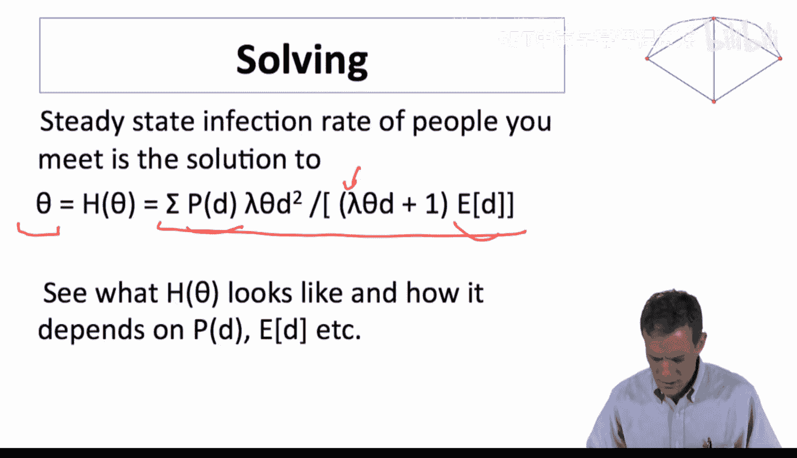
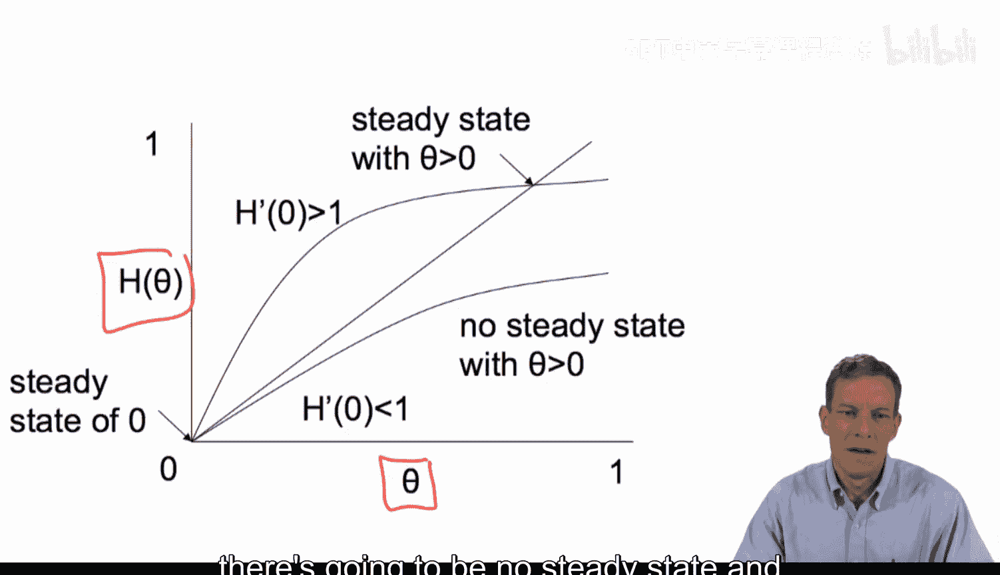
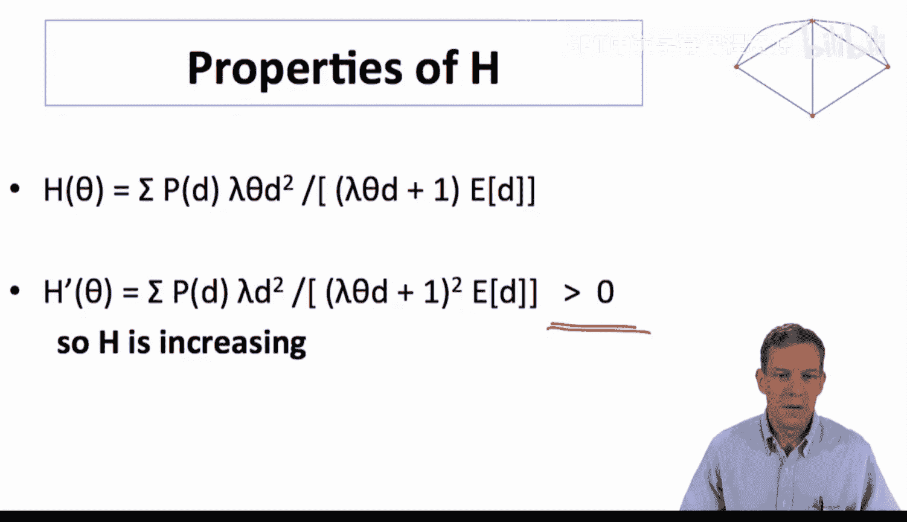
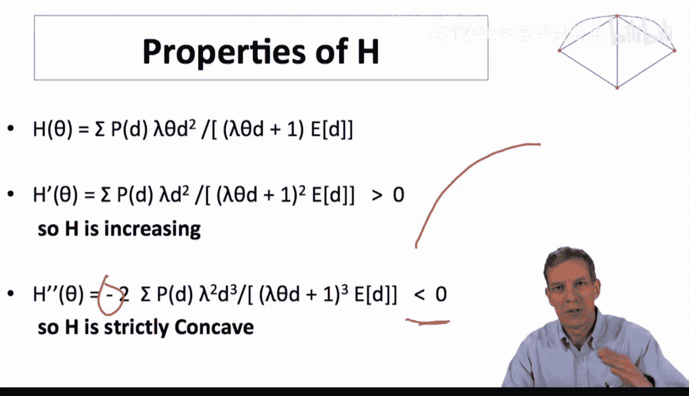
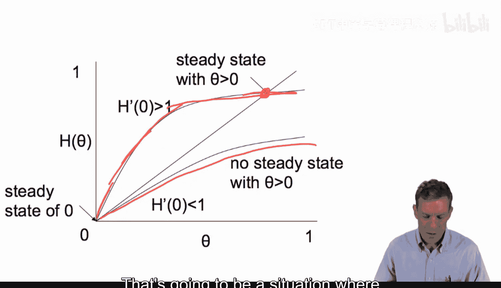
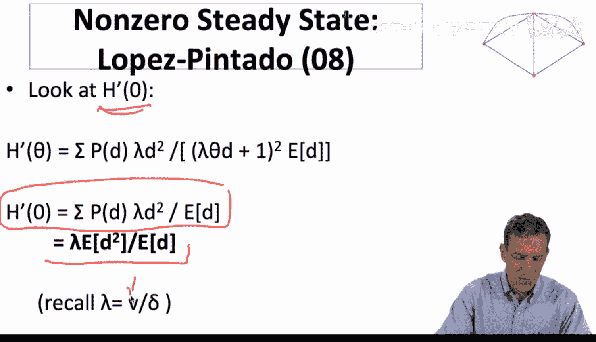
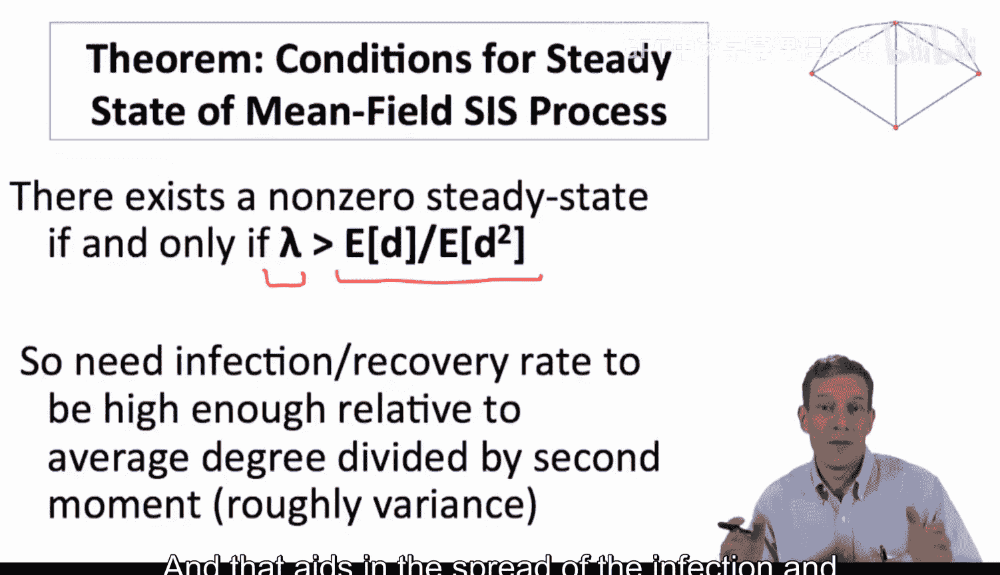
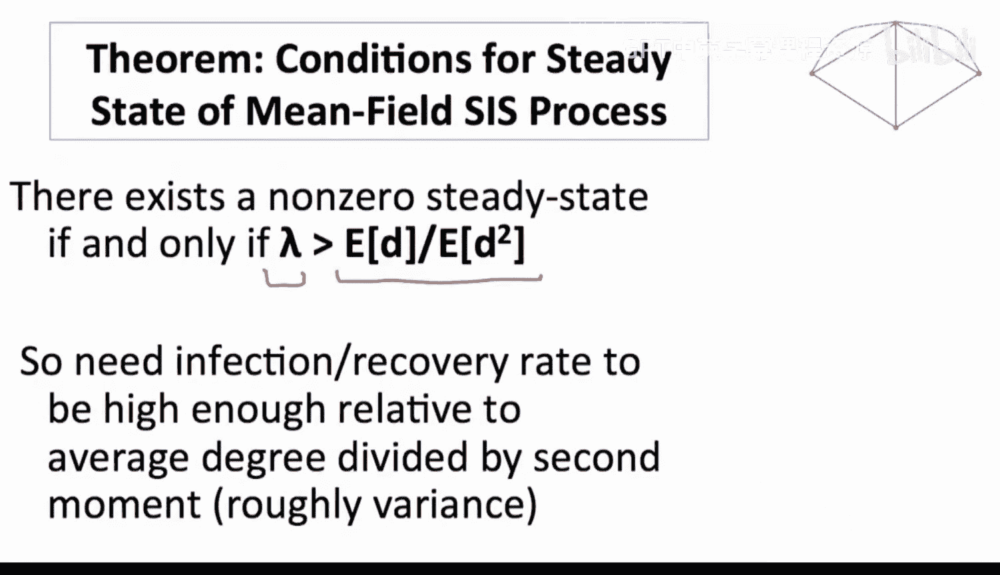
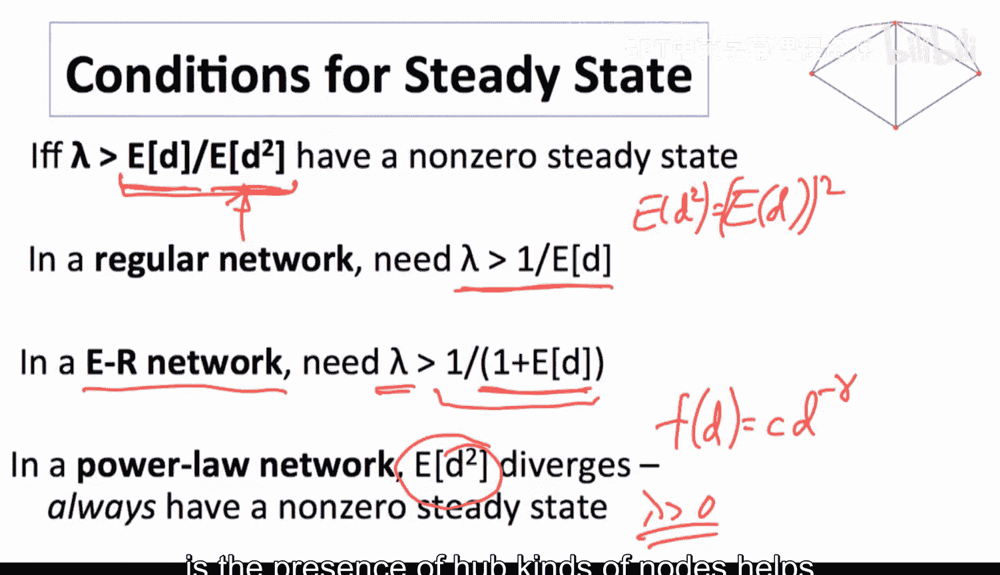
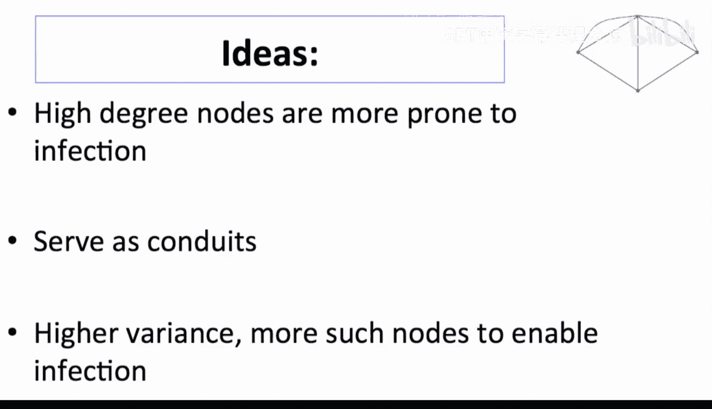

# 斯坦福大学《社会和经济网络：建模与分析｜Social and Economic Networks： Models and Analysis》中英字幕 p56 56_05_06_5-6-SIS模型求解.zh_en -BV1v1421U7Nk_p56-

Hi， folks。 So let's talk a little bit more about getting solutions in the S I S model。

 So as we had talked about in terms of finding the steady state， we have an equation。

 which relates the。

Fraction of people that you're going to randomly meet who are infected to an expression which involves the degree distribution and。

Parts of that degree distribution as well as parameters indicating the relative frequency of infection compared to recovery。

 So what we need to do is see what this H looks like。

 and then figure out what the steady state solution looks like。 So again。

 as we point out H is going to be a function where if we're finding we want to find theta's that equal H of theta。

 then basically if we've got a situation where H prime at0 is less than one and it's a concave function。

 there's going to be no steady state and otherwise we'll find a positive steady state。

So let's take a look at this function in a little more detail。

 So we want to take derivatives of this with respect to theta to figure out what its shape looks like。

And if we take the first derivative of this with respect to theta。

 that's quite easy and in fact we'll find that this expression is greater than zero and therefore we end up with an increasing function so you can take the derivative here and verify that this is the expression you get and indeed what we end up with is a positive function and then if we take the second derivative of this function。

 then we get an expression which is less than zero。

 so here I'm not going to explicitly solve for the derivatives you can go through and take those derivatives。

It's relatively straightforward these are just polynomial functions， take the derivatives。

 the first derivative is positive， second derivative is negative and so here we've got a function which is going to be increasing and strictly concave and that's going to tell us that the picture that I was showing you before is an accurate picture and then the question is where is this going to hit and have an intersection so are we in a situation where if H prime at zero is bigger than one then initially it's going above the 45 degree line again is it given a strictly concave。

 either we're going to have a steady state all the way up at one。

 so we'll end up hitting up here or it'll cross somewhere and have a non-zero steady state or if H prime is zero is less than one then basically there's no possibility of sustaining an infection。

 the only theta solution is going。

B0， and that's going to be in a situation basically where the degree distribution is putting weight on very low degrees and the lamb does fairly low so you don't have much infection。

 that's going to be a situation where H prime has fairly low derivative。

So if we look at h prime at zero， we can plug in0 for theta and then see what this thing looks like and if we calculate h prime at0。

 it looks out to be lambda E of D squared over E of D， so it's looking at the relative。

Expectation of the square of the degree compared to the expectation of the degree and waiting that by lambda。

 where we recall lambdas looking at the relative infection rate compared to the recovery rate。

 So we have those expressions。

And so the theorem， then we get that the conditions for a steady state process of the SIS model to have a non-zero steady state is going to be if and only if this lambda is large enough and what it needs to be larger than is E of D compared to E of D squared so you need the infection recovery rate to be high enough relative to the average degree divided by a second moment。

Roughly think of variance there so large enough lambda is going to give us a steady state that's non-zero。

 Now the interesting thing here is increasing the variance if you do a mean preserving spread so you increase the variance that makes it easier to satisfy this equation so in a situation where we keep ED constant and increase E of d squared then we're going to be in a situation where basically what we're doing is spreading out the degrees but that makes higher degree nodes which are going to have service hubs and be conduits for infection and that aids in the spread of the infection and allows us to have a steady state that's non-zero。

So if we think about this condition， then we can plug in what we know for various different models。

And for a regular network， what does this turn out to be Well， in a regular network。

 everybody has the same degree， so the expected degree is just whatever that degree is。

 the expected degree squared is just the expected degree squared。

 so in this case for regular network E of D squared。Is just equal to E of D。Everybody has the same。

Squared so in that case， then you just need lambda to be bigger than one over the expectation。

 So in that case， the larger the expected degree， the easier it is to satisfy this。

 So that makes sense and also the larger lambda， obviously the easier it is to sustain a positive steady state for an Udash Reni random network。

 if you work through what E of D is an E of D squared R for a Po random network。

 then you end up with situation where the E of D squared is just equal to E of D times1 plus E of D So in in that model then we end up with in this case。

 lambda greater than one over1 plus the expected degree if you work in a power law network。

So if we have， say， for instance， we work with one where the density function looks like C times D to the minus gamma。

 then what we end up with is if you do a calculation to integrate that and look for the variance。

 E of D squared actually becomes infinite。And if that becomes infinite。

 then this whole expression becomes zero。 and so we end up with lambda greater than zero。

 And so you basically always have a non-zero steady state and what's happening here is in a power law network。

 at least in sort of the limit， if you have a very large network you're going to have very。

 very large degree nodes they're going to interact and always become infected and carry the infection through the society So in that setting you end up putting weight on the tails and sufficient weight on the tails that you always sustain an infection now if if you do a power law where you actually truncate the distribution and have some maximum degree。

 then you won't quite find this， but you'll find that that expression converges to zero as you let whatever the maximum degree you allow in the society to go to infinity so in the limit you always have nonze steady state in that model and so basically what we find is。

The the presence of hub kinds of nodes helps substantially in sustaining non-zero study states so the idea here is these high degree nodes are more prone to infection。

 they serve as conduits， higher variance allows more such nodes and that enables infection and we see that directly in the theorem so this is one of the kinds of insights that comes out of the SIS model。

 which is a useful insight and make explicit in this particular model and it also then allows us to compare degree distributions showing that if you have the same mean but you're increasing the E of d squared then it's easier to satisfy these conditions。

Okay， so so that shows some insights that we get out of the SIS model next we'll take a little more close look so what this did is allow us to know when it is that we get a non-ze steady state we can also ask questions about how large that steady state is and whether we can do comparative statics in that and that's not going to be exactly the same kind of answer is just when there exists one which was just looking at that derivative at zero and more generally we can we can go through and try and solve this model and say something about what's the average infection rate in the society。

