# 斯坦福大学《社会和经济网络：建模与分析｜Social and Economic Networks： Models and Analysis》中英字幕 p57 57_05_07_5-7-SIS模型求解-排序（可选-进阶-24-16）.zh_en -BV1v1421U7Nk_p57-

Hi， folks， so we're back again and let's talk a little bit more about solving this SIS model and getting explicit expressions for the infection rates when there exists a positive steady state infection rate。

And so if you recall， when we were looking at solutions。

 we could find a steady state in terms of the theta。

 which is the fraction of people that you would meet randomly who are infected。

 then it was given by this expression。And we can simplify this by dividing each side by theta。

And we end up with an expression that looks like this。

And so solving this for the theta would then give us a solution。

So let's first look at a regular example with regular networks so everybody has exactly the same degree。

 then P of D is just going to put weight on some particular degree which is just the expected degree and so then things simplify and we end up with one is equal to the expected degree squared over we've got an expected degree here an expected degree here。

 so that's going to simplify and we'll end up with an expression which looks like this。Okay。

 so just plugging in that everybody has the same degree， which is just the expected degree。

 Then we can get rid of this。 This is going to become expected degree。Squared。

And this is expected degree here。Expected degree here。 We can get rid of one of these。

 get rid of that， and we end up with this expression here。Okay， so when we solve that。

 we end up with a very simple expression， now we can rearrange this in terms of theta and we end up with theta as equal to1 minus1 over lambda times E of D。

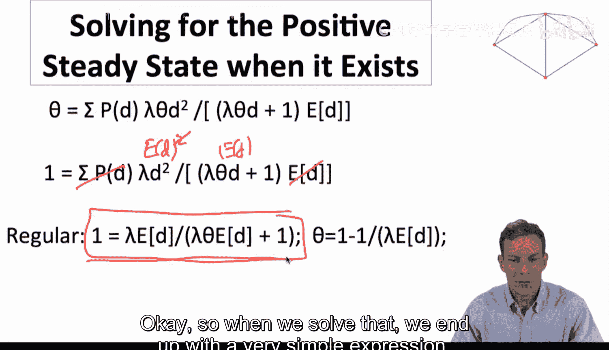

So if everybody had the same degree， then we can solve explicitly for what the steady state expression is going to be for the infection rate。

 and we notice now that this is increasing in lambda E of D and in order for this thing to be at least zero then we need lambda E of D to be greater than1 greater than equal to1 or greater than one for it to be positive。

 so that was what we found in there networks and then this thing just scales up with lambda and with the expected degree。

 so it's actually just linear in the level of lambda times e of D。

 which is effectively just this infection rate so this is one where it goes back to the original model we looked at where we just had random meetings and this is just increasing the rate of random meetings and things are disproportal to the lambda parameter。

Okay so let's have a look at a more interesting degree distribution。

 one where we have this power law and if you plug in the power law and integrate this out then you'll end up with an expression that you can solve for for theta and in that case if you want to go through and verify you can just integrate this and then solve for theta or you can take my word for it and theta will come out to be1 over lambda times e to the one over lambda minus1 so what do we end up with we end up with theta having an expression which depends on lambda and we can plot that out so if you plot that function out so we're just looking at this function right here and plotting this function as a function of lambda so how does it vary with lambda and what we see is it's very rapidly increasing so as lambda。

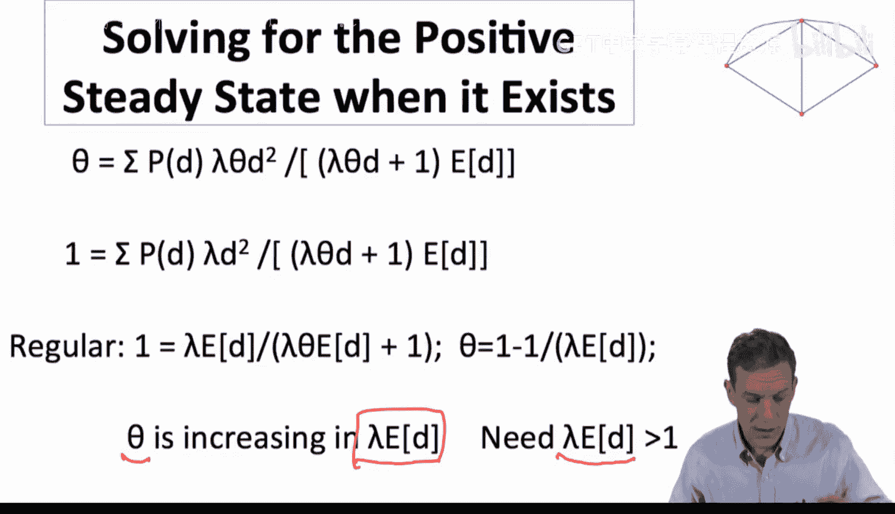

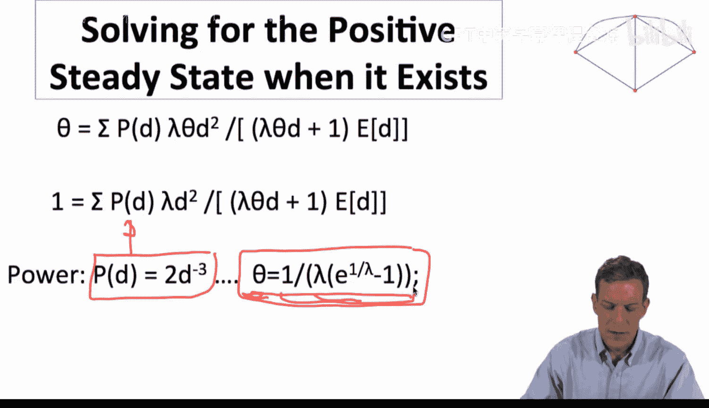

Increases， we get a very rapid increase and then eventually it asymptotes， it can't go above one。

 but we're getting a very high neighbor infection rate。

 as lambda increases because then we've got these very high degree nodes， they become infected。

 they infect others and so forth and as lambda is increasing， we get a very rapid infection increase。

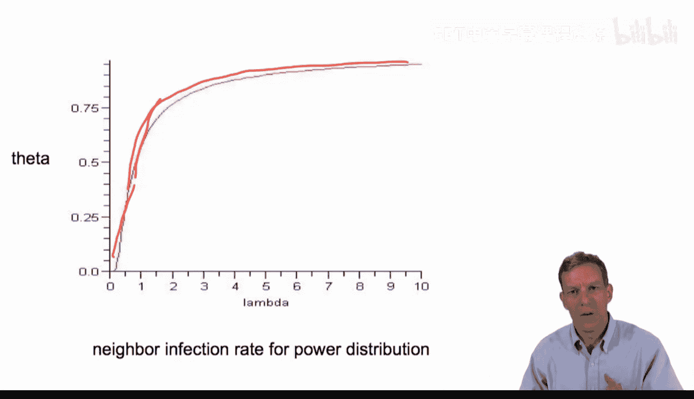

Okay， what can we say about how these things change with the degree distribution。

 So if we want to do comparisons and say okay， well if we go from regular to power law or regular to Menashreni sort of graph。

 how does that going to change and one way we can do that is we can look at this expression。

And ask how this right hand side changes with P of D， right， Because remember the the。

Way that we're solving this。 We look at theta here。 We have this right hand side。

 which is H of theta。And。We're looking for the solution to this thing， and。

If we can say that H of theta goes up。So if we do something that changes H of theta in a way that goes up。

 then that's going to move the solution to this equation upwards。

 so any kind of comparative static where we're making changes that change the distribution in a way that increases this overall expression on the right- hand side for each theta gets a higher value。

 then we can say something about what the resulting changes in theta。

 so let's see what we can say about how this right hand side moves。Okay， so first thing。

 if you look at this this function， what we're doing is we're weight it by different degrees and then we've got some function here that we're taking an expectation over with respect to the different degrees and what can we say about this function right here。

How does it behave？And one thing we notice， so we're taking expectations with respective degrees。

 this thing is increasing in degrees。OkaySo higher degree nodes are going to have higher relative expected infection rates and basically that's what we're getting here。

 This is remember our old row of D and so this thing is going to be tend to be higher for higher degree nodes so more connected nodes are going to tend to have more contact they're going to tend to be more infected So this overall function is increasing in D so that tells us that any distribution which puts weight puts more weight on higher degree nodes is going to have relatively higher infection rates that's going to move this whole function up。

 that's going to give us a higher solution and a higher steady state so one thing we can say is that if we take a distribution and then shift it so that we put more weight on higher degree nodes that's known as first order stochastic dominance when you're comparing two distributions So if we have two distributions and we move it towards higher degree weight。

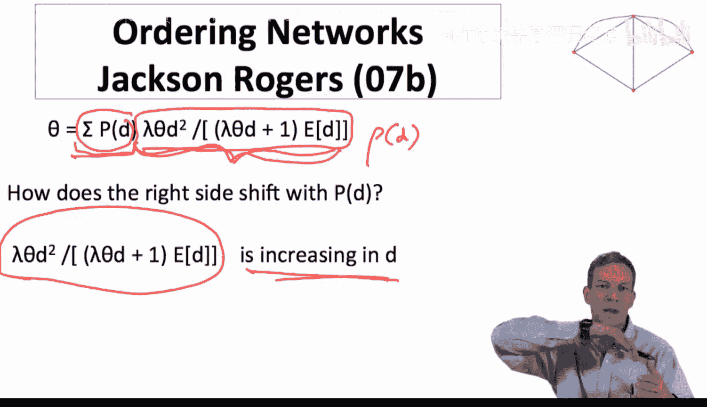

Then that right hand side of this thing， this h of theta is going to increase that every theta。

 where' basically going to have higher infection rates that's going to lead to a higher steady state so basically putting weights on higher degree nodes is going to increase infection。

Okay， so that's relatively straightforward and basically we're just shifting the weight towards higher degree nodes。

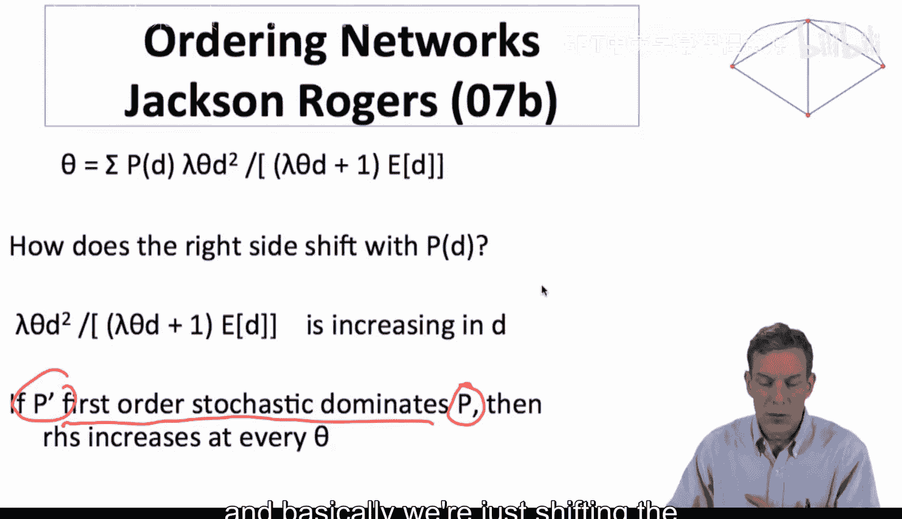

So when we do that， we end up with shifting this H function higher at every theta。

 And that leads us from a steady state with P。 So if we go to P prime， which。

Is increased the weight on higher degree nodes， we're going to end up with an increased steady state。

 So the theta that solves this is going to be higher， okay。

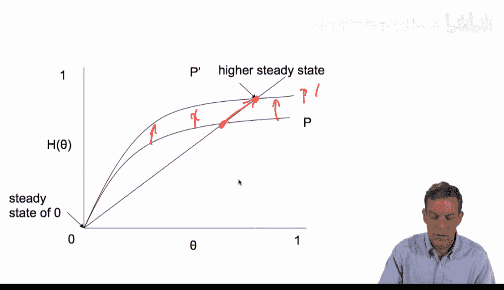

So。Let's take another look at this， so that just says if we're all shifting weight towards higher degree nodes in a very welldefined sense。

 this notion of first order stochastic dominance and just to sort of give you a feeling for first order stochastic dominance if you're dealing with a frequency distribution where you've got different degrees down here。

 say one2， etc cetera， three， so you've got some degree distribution。

 first order stochastic dominance shifts are ones where we're essentially moving the distribution to the right。

 so we're putting more weight on higher degree nodes and that's what's moving us up in having us have more interactions。

 higher infection rates， everybody gets and higher steady state of infection。

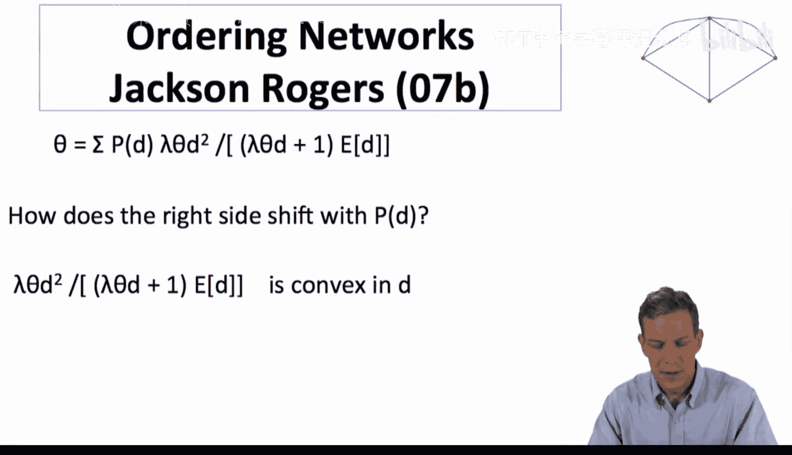

So if you have you know when you look at the world and you have increased travel or increased contact with people。

 you're going to have increased spread and things like the flu or other in this particular model it's something you can catch repeatedly but you're going to have increased contact and increased number of contacts per individual are going to increase the steady state infection rate。

 okay that's fairly intuitive， fairly simple， let's do a little more nuanced calculation now and again。

 we're looking at this function， this row of D function。

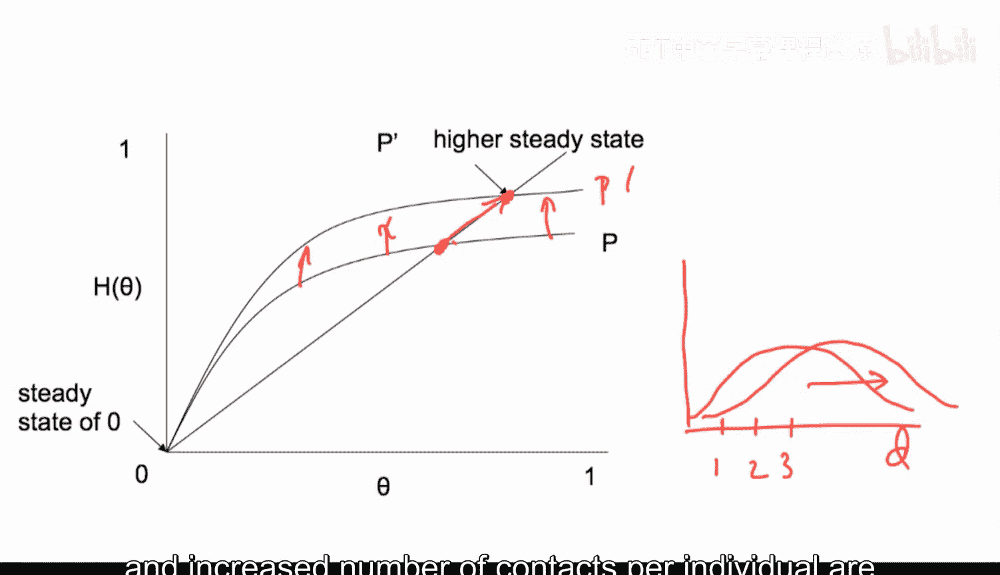

So the infection rate for different degrees， and if we look at that function。

 it's also a function which is convex ind。Okay so if you look at this function。

 it's a function of D squared over something which is linear in D。

 this is actually a convex function in D。 so in fact。

 when you look at what this row of D function looks like， it is not only increasing。

So this function is increasing and convex。Okay。So that tells us， okay， first of all。

 if we put more weight on higher degrees， we're going to end up with higher values for this are're going to come out right so we put on higher degrees where get so here's degree。

 here's this row of D function。 and as we put weight on higher degrees， we're getting higher values。

 that was what we just showed， but also even if you took a mean preserving spread。

 So suppose instead of putting all your weight on some particular value E of D。

 So we start with a regular network and instead we spread it out。

 so that now we have half our weight on something lower， half our weight on something higher。

 but we move these in equal distance。If we keep the same mean。

Then when we take the expectation over the higher and lower。

 we're going to end up with a higher expected value than what we started with。 Okay。

 so the idea is if you're taking an expectation of a convex function and you do a mean preserving spread。

 so you move some weight higher and some weight lower。When you're moving lower， well。

 the rate at which you slow down decreases， but here you get an increasing rate at which you get higher values。

 So the convexity of this function means that the expectation is higher。

 So if you take a mean preserving spread。 So if you start with some P and you take some expectation with respect to P of some function in this case row of D。

 And now you take a mean preserving spread P prime and you take the same expectation of row of D。

 if this is a mean preserving spread， So you've kept the same mean。

 but you've spread out and put more weight on the extremes。

 then what you're going to end up with is a higher expectation。

And that's going to lead then to a higher value of the right hand side here。 Okay。

 so this is a form of what's known as second order stochastic dominance where you fix the mean。

 So taking mean preserving spreads on convex functions gives you a higher expectation。

 So since this is a convex function， we can say the mean preserving spread is also going to increase things。

 And this is why， you know， So even though you're， you're losing some degree on some nodes。

 you're increasing it on other nodes， the fact that those are hubs actually increases the expectation overall。

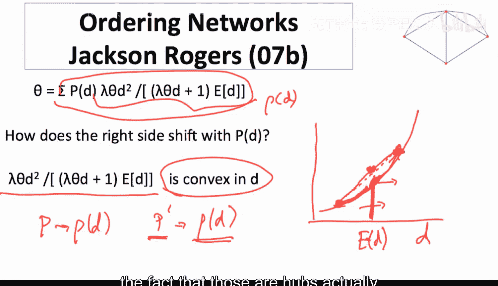

So if P prime is the mean preserving spread of P， then the right hand side increases at every theta。

 and so what happens， well， it increases everywhere， we end up with a higher steady state。

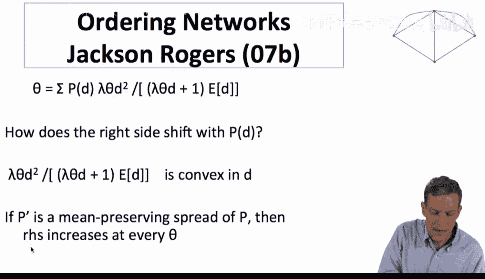

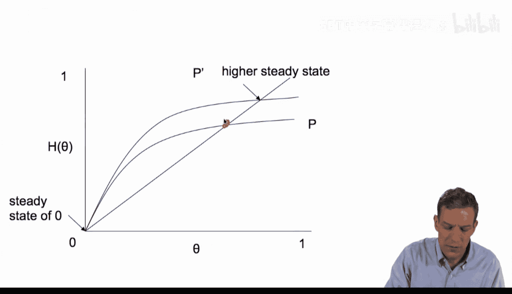

So either way that we went through things， mean preserving spread。

 more high degree nodes and low degree nodes， but the higher degree nodes are more prone to infection。

 neighbors are more likely to be high degree， so either first order stochastic dominance or mean preserving spreads。

 both of those lead to increases in the infection rates。

 so here we're now able to say something about the degree distributions of interactions and how infection rates so it's a nice model in terms of allowing us to be able to do these kinds of calculations。

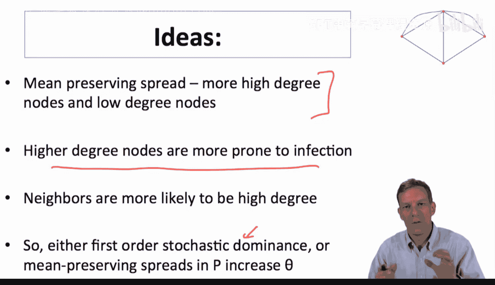

Okay， what about average rates， so what we've been talking about is theta。Right。

So theta is the chance when you're meeting somebody in the population that they're infected。

 and that has been， what we showed was increased as we increased in these senses of first or second order stochastic dominance。

But what about the actual average they row in the population？

So if we take expectations over all degrees， so the higher degree people are going to be infected at higher rates。

 so when you're meeting them at higher values， that means the people you're going to meet are more infected。

 but if we're somebody who just cares about the average level in the population。

 So if I'm a government and I care about how infected my population is ultimately what I care about is what R is not what theta is so theta is very important in determining what the study state's going to be。

 but the thing I might be interested in in terms of my policies is what fraction of my population ends up being infected。

ok。So what？So in work with Brian Rogers， we looked at this question in more detail and interestingly。

 the things can reverse themselves when you get to looking at rh compared to theta。

 so if you look for instance at what we just did where you take a mean preserving spread of a distribution。

 then the highest steady state of theta that goes up。

 so we end up with a new theta prime which is higher than what it was before。

But the corresponding row， it goes up if lambda is relatively low。

 but it actually goes down if lambda is very high。 So if you've got a very high infection rate。

 lambda， then the corresponding row prime goes up in the case where lambda is low。

 but it actually goes down if lambda is high。Okay， and， and what's the intuition behind this。

 I'll sort of go through the intuition。 And then we can look， take a quick look at why this is true。

 The intuition is that that in situations where lambda is very high。

The high interaction nodes are already going to be very infected and so actually increasing in putting weight on higher degrees isn't going to matter that much because those nodes are going to be infected at such a high rate that they're going to to already be infected and so you're not changing that much。

 but putting more weight on low degree nodes can actually decrease the so now you've got some people have very few interactions。

 those people can actually end up being infected with lower lower rates。

 so the actual overall infection rate in the society can be balanced by the fact that you are increasing some of the higher degree nodes。

 but those people are already going to be infected even without this increase and the low degreee nodes as you move them towards lower parts。

 they can actually end up with lower infection rates into that counterbalances that went to when you average across the population。

 not with the。Relative frequency of meetings， you actually end up with a decrease in the overall rate。

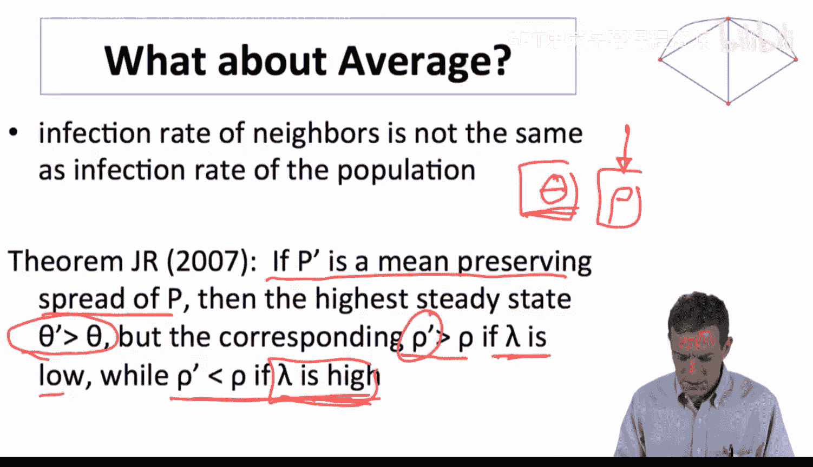

So in terms of pictures， here's what the picture looks like。

 so here's our this is actually log of Lambda in this picture。

 and then this is the largest steady state row， so this is the positive row in equilibrium and the blue figure。

 these are regular networks。And these all have the same mean regular network。

 this one is a power law。The green one and the red one here is one for an exponential。

 So basically the growing version of the Orashini random network， all with the same mean。

 And so what you see is if lambda is relatively low。

 then the regular one has everybody right at the mean is the lowest。

 spread it out in terms of exponential， it increases things spread it out even further in terms of going to a power distribution。

 So here as you increase the variance， you end up increasing the relative rows。

 So that's what's happens for low lambda。 But once you get to very high lambda。

 the picture completely flips itself。 and the regular one has the highest infection rate and the power one actually has the lowest infection rate。

 So these things can reverse themselves as you get to higher lambdas。

 and that's because rh is actually something you're weighting things by the frequencying the population。

 not by the meeting rates。

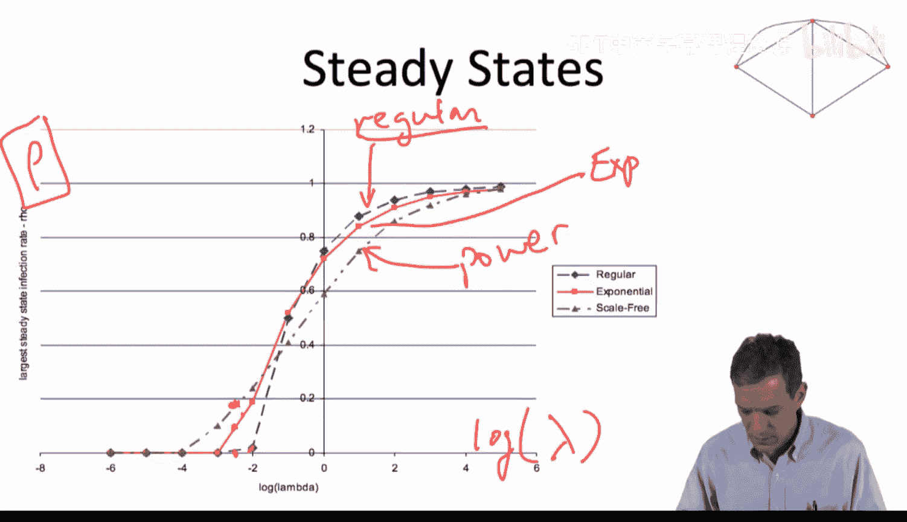

And so if you actually want to go through a proof of this， just go through a quick proof。

 so one way you can do this is remember in a steady state you have to have these changes in rows be equal to zero。

 so zero is equal to this expression， which is the change in row that we got before which you remember。

Our expression for what the change in the infection rate of anybody's given degree was per unit of time and again that was some recovery。

 this is the rate at which they recover， this is the fraction that aren't infected。

 this is the rate at which they become infected， depending on theta and if you just take。

 so we've got an expression which looks like this thing is equal to zero。Now， just。

 let's take an expectation over D。So we'll just take an expectation over D， what do we end up with。

 we're going to end up with v theta D times a 1， take an expectation of that。

 you get this expression。Take an expectation of this， you get that expression。

 take an expectation of this， you get the actual overall row times delta and so what do we end up with is an expression where this first one looks like V times theta this if you take that expectation is just our definition of what theta was so we get a theta squared times e of D and then a minus row of D and so you can solve this。

For how rh behaves as a function of theta。 So now what we get is rh is equal to something which is proportional to theta。

 but also times1 minus theta。So this。So what we can do is as we change theta。

 how does that change row， well the right hand side here is increasing in theta if theta is less than a half。

嗯。But it's decreasing in theta if theta is bigger than a half。Right。

 so once theta is bigger than a half， then this thing actually starts decreasing in theta。

 So this is proportional to theta times1 minus theta。

This is an increasing function once about up to one half and then decreasing thereafter。

 And so what happens is initially， as you're increasing theta， your increasing row。Up to。

Theta equals a half。 and then beyond that， as theta continues to increase。

 rh actually decreases above this level of a half。And so what we get is initially we get an increasing part of row and then actually then increases in theta lead to decreases in row。

OkayAnd and overall， we also have that theta is increasing in lambda。

 So then you can do comparative statics of row in terms of lambda because the lambda is going to change the theta and which then changes the row。

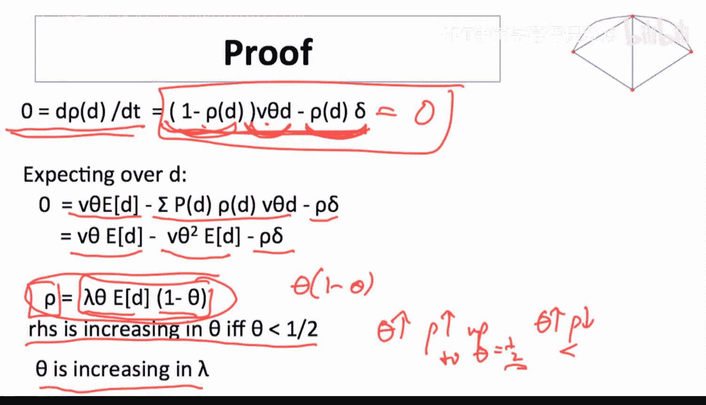

Okay， so what we've done is gone through the SIS diffusion model。

 It was a useful model just to get some comparative statics out and to study some techniques。

 So these techniques of actually looking at distributions and talking about changes in degree distributions doing stochastic dominance actually turns out to be quite useful it's been used now in other areas besides in the original paper with Brian Rogers。

 but now been used in games on networks and other areas as well。

 and the SIS model is a very simple and tractable model。

 So it's very stylized it's nice because it brings in relative meeting rates which has some elements of network structure。

And then we can order infections by properties of networks in terms of the degree distributions what are some of the limitations of this model Well。

 important limitations are first of all just in terms of this SIS。

 we lose the fact that a lot of applications are one where you become infected。

 but then if you recover you're actually immune to catching the disease again。

 which is actually true of some flus and other kinds of things。

 or if you know if you add new virus protection software to your computer。

 then you won't get certain viruses again， you get a new virus but not the same old one。

 so it limits it's somewhat limited in terms of the applications， also。

The interactions that we talked about were completely random meeting processes。

 so it was not as if we'd drawn out a network and actually had people located on the network。

 we just had people bumping into each other and meeting each other and so that's a special kind of process which gives rise to special kinds of conditions。

Now， we more generally， what we'd have to do if we start to work with things where the network architecture is given。

 then it's going to be more important to use simulations and so forth。

 So we did some calculations before where we talked about component size and so forth。

 and that gives us some insights， but more generally， if you actually want to study these processes。

 a lot of it's going to be done by simulation。 So if you give me a particular network and ask what's going to happen on it。

 then I might have to write down a program and actually simulate what's going to happen。

So the next thing we'll look at is a simple model of diffusion where we'll do some calculations and just simulate that model and see exactly how it works。

 And that'll allow us to actually fit something directly to data。

 And there's a large amount of that that goes on in epidemiology and marketing and other kinds of areas where you're trying to make predictions。

 If you know something about the network you're working with。 you can actually simulate things。

 and that's going to go a long way towards improving your accuracy。

 So the SIS model gives us nice of intuitions， simple ideas。

 but it's not when you're going to easily take to data。

 We're going to have to enrich the model to fit it to networks。

 And that's what we'll talk about next。

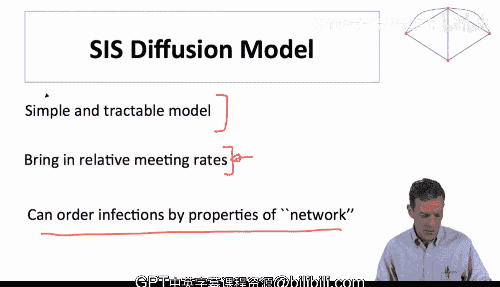