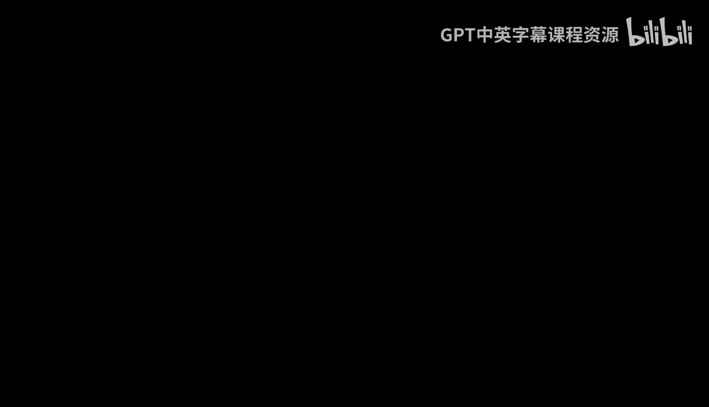
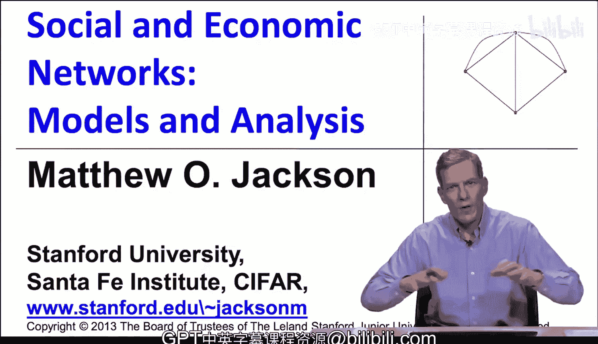
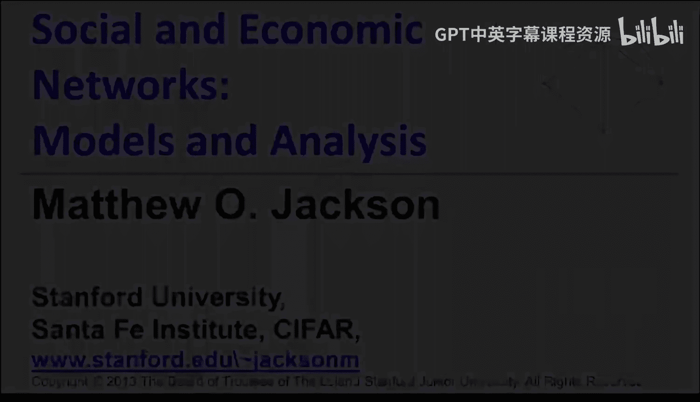

# 斯坦福大学《社会和经济网络：建模与分析｜Social and Economic Networks： Models and Analysis》中英字幕 p58 58_05_08_5-8a-扩散模型数据拟合（可选-进阶-22-47）.zh_en -BV1v1421U7Nk_p58-

Okay so let's have a look at a statistical estimation of a model of diffusion。

 So what we're going to do is now work with diffusion and actually bring it to some data and see what we can learn from that。

 And I'm just going to do an application when I've been involved in to sort of show you how this might work and how we can build models So something that I've been thinking about quite a bit and take you through that。

 So this is the paper with Abiji Baerji Rra Siika and has to do flow and what we're going to do is we are going to map social network for his surveys。

 So we have a series of surveys we mapped out the villages you've seen before。

 we observe then the behavior over time。 and we're going model diffusion and fit a model based on that to try and understand exactly what was going on。

And in particular， you kinds of questions we could think about is you what determines behavior generally so when we think about a diffusion process where individuals are making some choice do I adopt a technology do I buy some new product in this case do I end up taking out a loan from a new possibility in terms of microfinance is when people don't do it。

 is it because they don't have information， just basic information。

 they don't even know the opportunities out there or are there complementarities between individuals so that I'm more likely to do it when a friend ends up doing it for various reasons because either I learn from that or I feel peer pressure or maybe there's just benefits for both of us taking out loans than we could end up learning from each other and having useful interactions from that so that's one kind of question and another question we actually look at here is the role of non-particip in diffusion processes so sometimes do you see this？

In the epidemiology literature as well it could be so when we think about something like the flu generally to pass the flu along you might you have to have the flu。

 but there could be people that are asymptomatic who don't actually come down with a disease who could still catch something and transmit it and in this case we could ask is it possible that somebody finds out about the availability of microfinance loans。

 they hear about it from friends， they end up not taking out a alone。

 but nonetheless they still pass information along and are process useful in the process of diffusion so what we're going to do is is model take our network model seriously and thenfi that to the data？

So here we know this set in this particular instance。

 we know this set of initially formed nodes I'll tell you a little more about that and then we see how things are going to work and we're going to model this as initially formed nodes are going to pass information to their friends at random and then their friends can pass information on and so forth so we'll just do a very simple diffusion model where we can estimate that directly and then once you're informed people will decide whetherre not to participate so the background here there were 75 villages in Carnaotica relatively isolated from having availability of loans before a bank went in and to 43 of these villages and those the ones we look at here and offered microfinance so they started offering loans and these are relatively poor villages on the order of a dollar or so a day per capita income so fairly poor villages and the way in which the information was got out was by word of mouth。

The bank would come in， identify a few people in the village and then tell them about microfinances they bring to inform your friends about those and we know who the first people they talked to are we surveyed the network the villages and got network information and then we can track the microfinance over time so now how are we going to go about modeling this and bringing diffusion explicitly into the picture so here's Cararmatica here's the kind of networks we collected。

 we've seen a little bit of these you know if you had to borrow 50 rupees from a day for a day who would you go to borrow from so the borrowing network here we have these households are groups of individuals in fact this is a directed network so you can see little arrows here so one household somebody in one household would say they borrowed they would borrow from somebody else so households are going to be linked based on this we'll work at a household level so we can collapse these individuals into households because you're allowed only one。

Kn per household。 So we think of the households as the relevant decision units。

And then we can link up the households based on whether they borrow money。

 kerosene and so forth so we have these different who do you go to temple with。

 who do you ask for advice， who comes to you to borrow kerosene。

 who would you go to for medical help， so what we're going to do is just build a full network to say that two households can communicate if they have any of these relationships in common。

And then we also have microfinance participation， demographics， age， gender， subcast， religion。

 wealth variables， does the House have a latrine， how many rooms does it have。

 what kind of roof does it have， do people work or participate in self-help groups do they have ratio cards。

 there's a whole series of things， and then we have the cast information that we talked about earlier。

And so before we get into the diffusion model， let's just do a benchmark of the standard way that we would we might think of doing a pure effects kind of analysis。

 so we can do is say what's the probability that a given individual participates and takes out a loan and so what we might do in that situation without modeling diffusion is just say okay will just do this in a standard logistic form so the log that the probability that they take up a loan compared to not is going to depend on their characteristics。

So it might be higher， depending on which profession they're in or which religion they have or whether or not they are in a certain caste group or of certain age and so forth so we have a whole series of characteristics we can put in there that's going to affect their choice and then the standard peer effects would say does it also depend on how many of their friends participate or the fraction of their friends。

 so I'm more likely to participate all else I'll equal if 80% of my friends participate compared to 20% and we do have to worry about homophily here that's going to be an issue behind the scenes because it could be that part of the reason that I participate compared to my friends is that there's things that we have in common that we're not seeing and it's not that my friends influenced me but it's just that I'm friends with people who were very similar to me so homophily could be behind the scenes it's actually not going to be so much of an issue for us because we're going to find that eventually when we properly do a diffusion model we're not going to find these peer effects。

But it is something that we have to keep in mind。So let's run that standard regression。

 if you run that with a whole series of characteristics you could find all the details of these regressions in the paper but effectively what you're going end up with is a parameter here of 2。

5 highly significant which would seem to indicate that the more of my friends the higher the fraction of my friends participating the more likely I am to participate we can't say causal but but it seems to be there's a high correlation there and in particular how do we make sense of 2。

5 given that we're looking at log of odds ratio so what does that mean so if you do some calculations if you took my fraction of my friends from zero to1 holding all the other characteristics at their average。

 you would increase the odds ratio by a factor of 12 it would make it the relative likelihood of me participating compared to not 12 times higher so that's a huge impact。

If you took it from just 0。1 to 0。3， which is closer within one standard deviation of what the actual numbers are。

 you'd still go up a a factor of about 1。65 so you'd still get a substantial impact of just moving one standard deviation and the fraction of friends participating comes to a 50% increase in the relative likelihood of participation so we see a very strong effect if we just do the regression and now the only network information we're using is just in terms of who are my friends so basically now we're going to try and use。

Bring a diffusion model into this and get a little more understanding of what that 2。

5 really represents or what's going on behind the scenes there。

 So we're going to use network information， not just who are my friends。

 but we'll keep track of people hear about microfinance will'll repeatedly pass information to friends and then once I hear we'll make a decision of whether or not to participate so we're going to bring diffusion officially into the picture now So let's stick first of all。

 with the participation decision。 So once I'm informed。

I'm gonna make a decision of whether or not to participate and will allow the choice to basically vary the same way it did before。

 Okay， so exactly the same logistic kind of regression we we had before。

 the log adds of ratio that I'll participate once I'm informed will look like something which depends on my characteristics and depends on the fraction of friends I have who are also informed who are participating。

 Okay， so now we'll keep track of who's informed and keep track of whether or not I participate as a function of my characteristics and the fraction of friends participate。

 But what we're doing differently is we're actually gonna map out the information flow。

 and so whether or not I participate whether I choose to participate will be conditional on whether or not I'm informed。

 Okay so how we going to do that we're gonna have just a very simple model of passing information。

And so。If I become informed then I will pass information randomly to my friends and in particular what we're going to do is we'll allow for two different probabilities if I chose not to participate。

 so if I'm a person who thinks that I don't want to take up microfinance。

 I'm going to pass information along with some probability Q superscript N。

 and if I chose to participate so and for no not participate if I choose to participate。

 I'm going to be allowed to pass it with a different probability so we're going to try and estimate what these probabilities are from the diffusion process。

So if I didn't participate， I pass with one probability， if I participate。

 I pass with a different probability so let's look at what a typical thing would look like。

 so let's call the leaders the first people who are informed in the village so the bank comes in it tries to find the village leaders it looks for people they think are important they tell a few of them and they start with those people and then they say tell your friends about it okay so let's suppose that we had this is just a snapshot of part of a network and here we see two different people so one of the leaders chose not to participate one decides to participate in the loan program so we've got these two people。

Now， what are they going to do， Well， they can randomly tell some of their friends。

 So these are relatively word of mouth is the way that information is flowing in these villages。

 So now they can randomly talk to some of their friends。

 So we allowing for different probabilities of passing， we might say， okay。

 maybe if somebody's not excited about it， They didn't take out the loan。

 they're they're going to talk about it less than somebody who just took out a loan is more excited about it。

 So if those probabilities differ， this person might tell three friends。

This person ends up telling only one friend。 So now we've got some friends who are informed now they can look around and this person' is going to make a decision。

 This person's going to make a decision。 This person。

 so we've got four people that are now making decisions。

 they're going to make those decisions based on their characteristics。

 but these people all have a friend who's taken up this person has a friend who hasn't taken up right so now we'll get some variation and we can begin to see once they're informed。

Do they still take up with， does it still matter whether or not this person is their friend has taken up or not。

 so we'll still be able to condition on that？And so these nodes decide some of them decide to participate。

 some decide not to and the information keep spreading and so forth。

 so it goes on and new people become informed and the idea here these new people becoming informed this person has half of their friends who' have had a chance to take up microfinance participate this person has 100% of the friends who have had a chance to participate and so we can begin to see after we account for the fact that information is flowing through this network and I'm more likely to become informed because I'm next to somebody who knows about it is that a chance to participate whether we still get a peer effect after that that I'm more likely to participate if more of my friends do so that's the idea and we can just keep it on this model So what's the estimation technique So the estimation technique is we're going to first of all estimate some of the parameters for this logistic just from the initially informed and that saves on just computers。

Space and the three things we're really interested in on are what's the probability that nonparticipants pass information。

 what's the probability that participants pass information and what does this peer effect kind of or endorsement to effect parameter look like once we've corrected for。

The passing。 So we're going to。Allow for the number of times that people can pass information to be proportional to the number of trimesters that the bank was in each village。

 depending on the village that goes from three to eight trimesters。

 so we either pass three times or pass eight times you can actually estimate we also did this by estimating that endogenously which allows you another parameter。

 it doesn't really help that much often it comes out between four and seven or so。

 so this seems to be a fairly good estimate in any case。

And then how are we going to do this we're going to try and so we search on a grid of these。

 so we'll look at various parameters so start at probability of 0。00。050。

1 and so forth so we'll march across a grid of different possible parameters and then for each one we can simulate the model see what comes out and then try and match that to the observed moments So this is a form of general generalized method moments in fact simulated method moments here。

So for instance， what we could do is let's suppose that we set QN to be 0。15 QP to be 0。

3 and be pure to be 0。5 so if we did that and ran we just simulate the model now so we start with the actual data of the network we know who the initially formed ones are we know which ones so then we randomly some choose to participate。

 they pass information depending on whether they participate or not based on these probabilities and so we just simulate that and that gives rise to a certain pattern of people who end up being informed and participate so if we ran that out we'd get some participation rate in the village so we end up with a number。

Now we redo it， so instead let's set the nonparticipants to 0。05 and participants rate to 0。

5 and then be peer to 0。1 and what that would do is it would mean that there would be less less spreading from people who didn't participate and more spreading in a neighborhood of people who did participate so this person participates it spreads more and then people are more likely to react to that so we're going to get a different pattern of data as we vary those parameters and so what we'll do is then。

As we vary the parameters， look for the parameters that produce the most accurate participation data。

 So if we match what the variance in participation is。

 what's the mean participation and so forth So we can have a series of moments and then try and match those to the actual data So we're just going to search across the grid。

 run simulations for each one， figure out which one best match this。

 what what actually happens So if you go ahead and do that。Then what do you end up with。

 the diffusion parameters， 0。05 and 0。55 in terms of these probabilities。

 so you're about 10 times more likely to pass information along if you're a participant than not according to this。

The difference is statistically significant， so you can do standard errors by a bootstrap method of randomizing and choosing from the simulations and then seeing what would happen if the parameters were different from the ones that we actually observed and so here we end up with things being highly significant when you actually look at the pure。

Parameter， it's now no longer significant and in fact it's actually slightly negative。

 so the point parameter estimate is negative and it's insignificant so it looks like there's really not that much influence going on and if anything it's slightly negative you could tell a story that maybe I'm less likely to take up a loan if my friend does because now I can borrow from them。

 but this is statistically insignificant so it's hard to tell whether there's even different from zero。

Okay， so what do we see， we see that adding this diffusion model gives us a very different picture of what's going on。

 it's saying that the reason that we are seeing a lot of correlated take up between people and their friends is not because theyre paying attention to what their friends are doing and being influenced by that once they're informed it's that I'm much more likely to hear about information if I have friends who participate so if my friends participate I'm getting past information at a much higher rate and that's what seems to account for this correlation so when we fit this diffusion model we get a different picture that comes out。

Now again this isn't a causal， we can't make causal inferences here。

 we have to be careful all we know is we fit a model and these we got parameters which seem to come out and to the extent that this model captures important features of reality then we're picking something up it seems to be highly significant it seems to recreate the data fairly well。

 whether or not it's the right causal story is something that we might never know okay so network effect significant information passing information passing depends on whether you participate or not。

 we see some slight complementities and in this case negative in fact， but insignificant。呃。

One question we can ask is okay the non-participants past at rate of only 0。

05 so 1 in 20 are they still important Do they matter at all in terms of spreading information in these villages so what we can do now and this sort of makes the point of why is it important to have models that we can work with we can do counterfactual so we can say okay suppose now we reran model but we muzzle all the non-participants so we don't allow the nonparticipants to talk anymore。

 So we keep everything else the same， but we just say okay if you're nonparticipant don't tell your friends and let's see what happens and then that allows us to figure out how much did they actually contribute because we kept everything else equal and we only zero them out so then we can say what was the marginal effect if the change in the participation rate is going to be entirely due to their passing at 0。

05 compared to passing at zero so we can do that next。So the model as fit。

 we had 86% of the people were informed and the participation rate ended up around 21% if you rerun it。

 everything else held constant and just set the non-participants to not passing information any longer。

 the informativeness drops to about 59% participation drops to about 14% so roughly a third drop and each one of these things by just changing that 0。

05 to a  zero and what's going on here， well even though they're passing at a fairly small rate。

 there's a lot of people who are non-participants and so the fact that most people choose not to participate about 80% of the people end up not participating that gives you an idea that they can still be very important in passing information even if they're passing at a lower rate。

Okay so we fit this model， we get significant information passing insignificant peer effects now once we've corrected for the diffusion process。

 the information passing depends on whether you're not you're a participant and nonparticipants still play an important role so conclusions well why do we go through this what we begin to see is by actually including that model of diffusion and explicitly taking into account the network pattern of diffusion。

 we got a much better handle on what was going on in in the peer effects and if we just run that regression at the start and got that 2。

5 we'd have no idea of why it was that I'm being influenced by friends and here it begins to tell us it looks more like it's just information passing than actual influence and that can be very important for policies so if you want to enhance microfinance diffusion in these villages it says that it's basically。

spreading that's the more important part。 And it's not pure influences so it's not that you need to help overcome pure influences。

 it's more that you need to enhance information spreading。

 you could also begin to relate this back to network structure changing homophily structure information spread better。

 you could do counterfactuals on this。 So once you fit one of these models then you could actually do a whole series of things by changing things and begin to see how things would operate。

 So so basically that's just a look at one diffusion model that allows us to say something and get a handle on different peer effects。

 And one thing to emphasize here， the conclusion should not be that it's always information passing。

 that was true in this one instance。 instead we really want to take away from this。

 the methodology of explicitly carefully taking into account information passing separating it out from decision processes So our diffusion model is a little richer than we were looking at before where it's just simple like fluid。

tagion now we allow for these different things， we can map that out， work with data。

 try and see what's going on。

