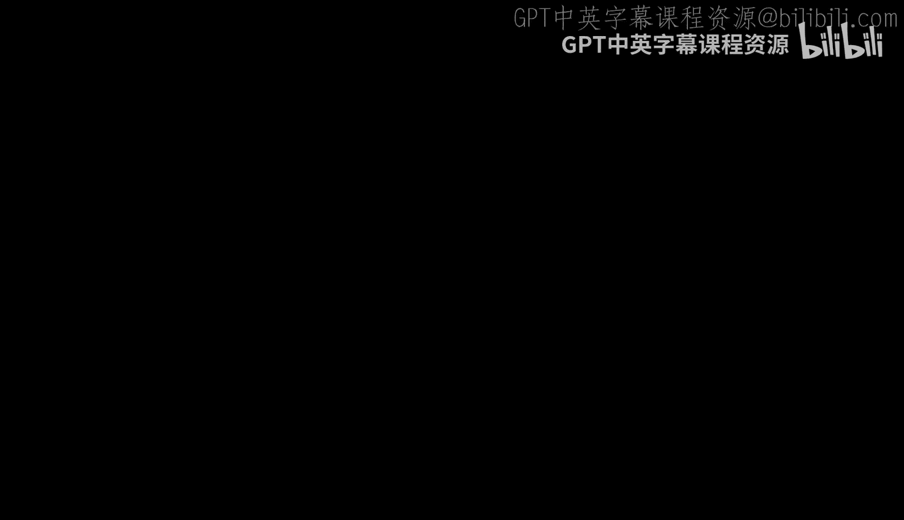
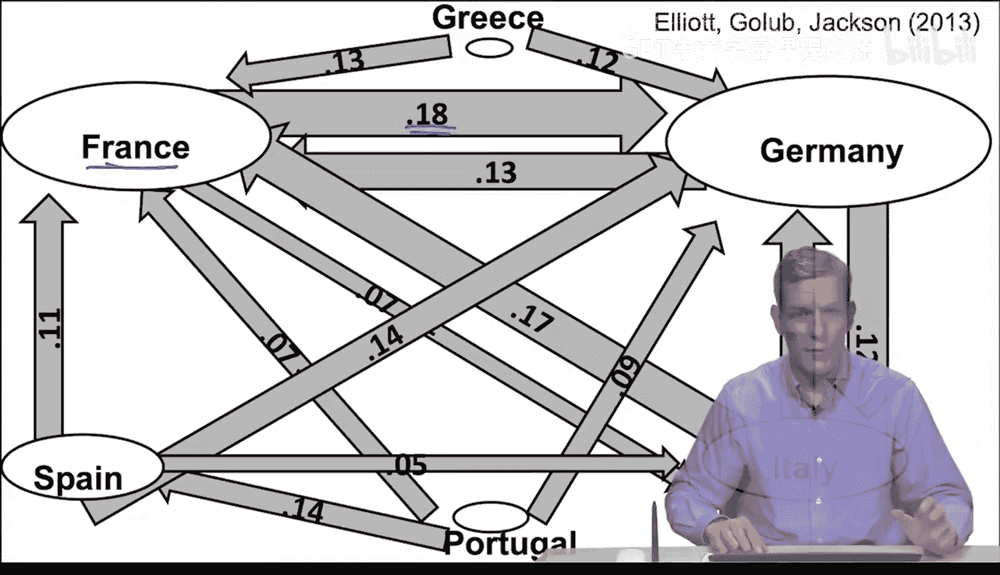

# 斯坦福大学《社会和经济网络：建模与分析｜Social and Economic Networks： Models and Analysis》中英字幕 p59 59_05_09_5-8b-应用-金融传染（可选-进阶-12-47）.zh_en -BV1v1421U7Nk_p59-

Okay hi folks， so we're going to look now at another application of models of contagion and try to look at a little bit of what networks can tell us about financial contagions。

And what I'll do is I'll base this off just a simple model I've been working on with Matt Elliott and Ben Goeb。

 and the idea here is that we're going to just explore contagions to try and understand how we might use network analysis to try and understand how the fact that at one。

Company or country has some difficulties how that might translate to others。

 So here we're going to have companies or countries， etc cea。

 are going to be linked to each other via various types of contracts。

 So it could be that they have debts to each other promised deliveries。

 it could be I'm a supplier and I owe you something or I'm a buyer。

 I owe you some money or it could be that's equity， So I actually have stock in a company。

 And effectively， these kinds of cross holdingings are going to expose one company to others investments and values。

 So I now expose to how well some company is doing if if I owe if they owe me something and and there's some value claim I have on their values。

So what we're going to do is I'll break this into two pieces so the first part right now what we'll do is let's just first take a look at how we might use networks to model exposures and I'm going to keep this very simple。

 we're going to work with just sort of straight equity values but we're just going to first start to see how it can to be that if I know what percentage of the value of some other company that I'm exposed to and I've got a whole series of these things how can we keep track of the ultimate exposure that we have in the economy so an organization is going to have direct investments。

And it's also going to have some holdings in other organizations So I'm saying organizations here because it might be countries。

 it might be banks， it might be companies， it might be individuals， etc ce。

 So here the idea is that there's going to be some fraction so if organization I some fraction of the value accrues directly to them and one minus C is something that's owed to others they also are going to hold obligations of some other number of organizations。

 so I might have some degree I and I own know if it's seven there's seven other organizations that I have claimed to so I hold obligations of them。

 they owe me something it could be stock that I owe of them and if they make more if their value goes up then I'm going to get some of that but we'll model that as some claim so in particular let's think of there's this number of organizations。

 countries from banks we'll make。Things really simple so each organization I has some price of investments so you can just think of this as the cash flow that should be coming in so what's the value of their investments it could be if I'm a country。

 it could be the amount of taxes I'm going to be able to collect in a given time period if I'm a company。

 it could be the revenue minus the costs that I have access to so this is sort of the value of the overall price of the investments that I'm got in hand and the crossholdings are going to be where the network comes into play so the organizations aren't just in isolation I has some claim to the value of J and in particular we can think of the fraction of organization I's value that's owned by organization J's value that's owned by organization I will let be CJ and you don't own yourself so you don't own parts claims to yourself but what we will。

That is the residual claim， so there's a whole series of if I'm organization I。

 there's a whole series of other organizations that I owe something to that either own part of the shares of me and then the remainder of that fraction is owned by private investors。

 people who don't have claims to each other， so these are the shareholders。

 initial shareholders of the company who are private investors and not owned and turned by somebody else。

Okay， so now when we look at the value of a given organization I， this should be a subscript here。

 What's the value Well they have so let's think of the book value， the overall straight book value。

 well they have some direct asset values， the revenue that's coming in and then they also have some claim on the values of the other organizations。

 they have cross holdingings so this is just on the value in terms of the assets they have on the book So if we look at that。

 then when we rewrite this equation keeping this as a matrix of crossholdings。

 then we can say that the vector v of values is equal to this vector of P investment values plus the cross holdingings times the next the values So if we solve this out solve this equation in terms of network calculation。

 what do we get， we get that the actual vector of overall book values。

like I minus c to the minus1 so the inverse of I minus c times s p vector right so we just solve this。

 we bring this so this looks like v times minus sorry I minus C times V equals p and then we solve that and we get I minus c to the minus1 is equal to V。

This is related to what was little studied by Leonf。

 It's just a straight calculation of book values in this case。 So when we look at that。

 when we want to then figure out what's the market value。

 the value to the final private investors who aren't owing something to somebody else is not a company that owns then owned by other people。

 that value is then what's the amount that's held in private by private shareholders。

 so that's C hat Ii times V， now we plug in the Vs here and we get that V is equal to C hat times I minus C inverse times P so this is a very simple calculation。

 it tells us as a function of the underlying asset values， what's the value of different companies。

 So it's not that a value of different organizations here in terms of value to their actual owners。

Is just dependent directly only on their own asset holdings。

 but it's going to be dependent on the whole portfolio of asset holdings in terms of this factor。

 So we'll call this C hat times I minus C inverse This is the a matrix we'll call it an a matrix and what's that doing AIJ tells us what's the fraction of the investments owned by organization J that ultimately accrue to the private shareholders of I。

So let's just look at a very simple example to make this clear。

 So this was we just two organizations in the world and each of them owned half of the shares of the other okay and so here I'm going to do everything in terms of equity。

 You can do this in terms of debt。 it gets a little more complicated。 This makes it nice and linear。

 So here I know each owns half of the assets or investments of the other and some value。

So what's the implied holdings by private investors， well。

 half of organization two is held by Or one， that means that the remaining half is privately held。

And half of organization one is held by two， and that means that the remaining half is held privately as well。

 so half of each of organization is held by private investors， half is held by the other。

Okay so if you do the calculation of what the A matrix is。

 it says ultimately if you do this calculation that two- thirdds of the value of the investments of organization1 actually end up going to the owners of organization one and one third of organization twos go to organization one's owners and vice versa so let's try and get an idea of exactly what's going on here。

 so what this does is we've just done a very simple matrix analysis。

 which is implicitly capturing the network。And gives us an idea of what the exposure of different investors are to the underlying assets in the economy so if we think about this we've got organization one and two half of the value of organization one is going out to private shareholders。

 half is going back to organization two which owns half of one's claims and similarly on the two side。

 half is going out to private shareholders， half is going back to one okay so that's the basic structure in terms of the ownership。

And now let's figure out where this two thirds， one third came from。

 So let's suppose that there's a dollar thats a return to one of the investments of Or one。 Okay。

 well， here's our dollar。Now half of that should be going to Or2。

 half of that accrues to the private shareholders。So half goes out here， half goes over here。

Now this part is just going off to the private shareholders that's owned by them， this half。

 what happens here， well， half of that is owed to the private shareholders。

 half of this again goes back to Or one， which now has claims on what's coming into Or2。

So when we do that calculation， 0。25 goes out here， 0。25 goes back here。Now this 。

25 is going to get split 5050。 and you can see where this is going right so so we go ahead。

 we split this 0。25 up，125 goes out one side，125 goes back that。 we split that up and so forth。

 And when you keep doing this， you can just keep iterating on this as you keep iterating this eventually twots of that one out one side and onetd came out the other side。

 and that was exactly the calculation we got for the a matrix we got that two-tds of the ultimate investments of one。

 we're going to one's owners and onetd werere going to two。

 Now this is just a very simple calculation with two organizations and so forth。

 but this general formula would do this for a very complicated network right we could have arbitrary sets of companies owning different parts of each other and having a very complicated network。

 and it tells you if you wanted to do the same kind of calculation of injecting some funds and in figuring out where they went in the economy。

 this would be the same calculation。 So here we can see the power of the network。

As figuring this out。If you go through， we did a simple calculation for debt in among a few countries in Europe。

 you can actually figure out by looking at how much of Germans debt is held outside of Germany。

 how much of French debt is owned outside of France and so forth。

 you can eventually figure out what the a matrix looks like。

 and the a matrix here based on some simple calculations。

 it says that ultimately out of the tax receipts that come into France。

 18% of that actually ends up going to the German through German banks and so forth to Germany。

 12% of Germany goes to Italy， 11% of Italy goes to Germany and so forth。

 this only lists the numbers above 5%， but basically you can do that calculation。

 you end up with an a matrix and you can begin to see what the dependencies of different countries are in terms of how exposed they are to the investments of each other and so you see that。

countries Italy is exposed to Germany， but France is very exposed to Italian。

 it's relatively exposed to Portugal， to Greece， to Spain。

 so you can begin to see who's at risk in terms of whose investments are accruing to which other country so now what we have is we've put in place a very simple。

Moel of cross dependencies and so forth， which allows us to sort of back out the implicit exposure that different actors in terms of organizations have an economy to each other's investments。

 and then we can begin to use that to model contagions and to see how changes in a value in one place might impact the values of another。

