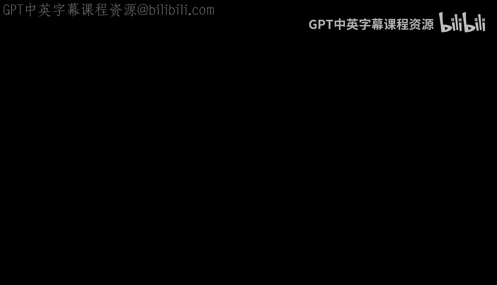
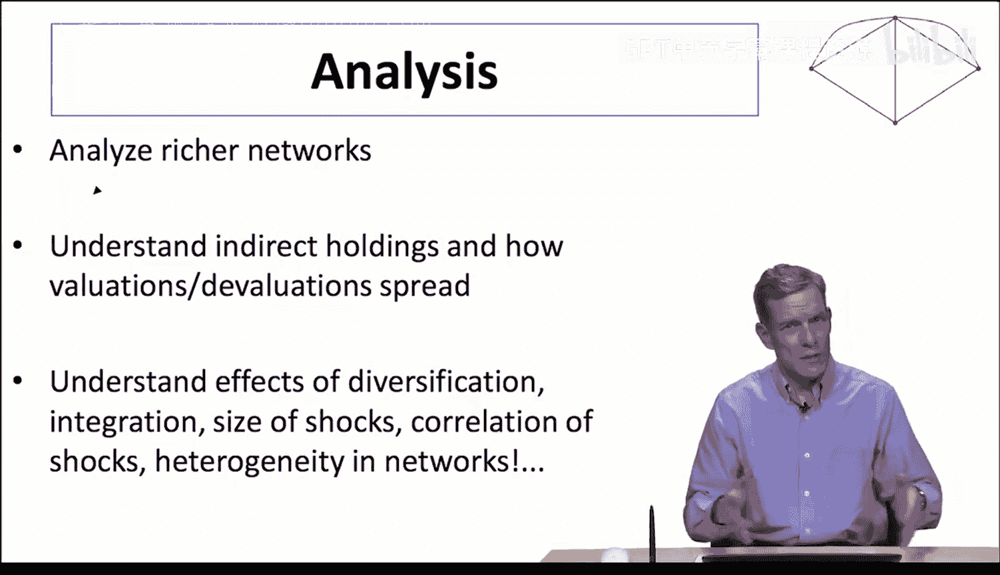

# 斯坦福大学《社会和经济网络：建模与分析｜Social and Economic Networks： Models and Analysis》中英字幕 p60 60_05_10_5-8c-应用-金融传染-模拟（可选-进阶-13-41）.zh_en -BV1v1421U7Nk_p60-

Okay again， So we have just looked at a very simple model of interdependencies among organizations in terms of financial things and we saw that networks can allow us to then infer what's the exposure of one organization to another and once we do that we can then use that directed network directed weighted network as a means by trying to figure out let's suppose that for whatever reason one of these organizations goes bankrupt and suddenly can't pay out so we can look at financial contagion somebody has a failure and now their asset goes from a value one to say zero。

 what's the impact on others。 So now others suddenly have lost some value depending on what that a matrix look like that we figured out in terms of all these indirect holdings So people can be very exposed to that。

 some people might be less exposed and so the full network of interactions then tells us how indirectly exposed we are that might cause of somebody else to fail if they're very exposed so we're going。

With a simple model， and now what we've got is we've got a situation where we're going to look at some fraction of a value is going to accrue directly to a given organization。

 some other fraction is owned to others， and now we'll just have some number of organizations that we owe。

And in particular， let's just do some simple simulation to set this up。

 so we'll look at a network with 100 organizations。

And what we're going to do is let's start by doing a very simple sort Erdaash Reni style network。

 so what we can do is set the probability that there's a link between organization I and J to be D which is going to be the expected degree over n minus1 so if we do these with probabilities。

 the expected number of connections that each organization should have in terms of other organizations that they own should be D so this is the expected number and we can think of that we'll think of that as a level of diversification。

So if I'm not very diversified in terms of the number of other people that I own or then I just own a couple of companies or I'm dealing in terms of the people that own me things。

 it's only going to be a couple of companies as I broaden that out， I'm going to be diversified。

 I'm going to be getting things from many different other organizations and so things that are owed to me are coming from a wider range of things rather than just one。

 so we'll think of that as diversification。Now the separate thing is know that there's some fraction of the organizations that are crosshel。

 some fraction C， and the remainder of that is the part that's held privately。

 and so we'll think of this as the level of integration so if C is very high。

 then it means that most of an organization is actually owed through the economy to other organizations and less of it goes directly to its private holders and otherwise it's more privately held and not very well integrated into the economy。

So if you go through that， then the claim that a given organization I has in some other organization J。

 the CIJ is going to be， okay how much of organization J is owned outside that's C and then will just divide through by the number of organizations that crosshold and so C IJ is going to be the GIJ。

 so what's the whether does I actually have a connection to J and then divided through by the number of holders of J。

 so this DJ now is the number of organizations that actually have claims on J so it's the in degree of J。

Okay， so so now we have CIJ and based on that we can go ahead and figure out an a matrix and then we can just do simple simulations so each organization will start with some investment it has at a value of one。

And now what we're going to do is think of of bankrupting one of these organizations。

 And to keep things simple， we'll just run bankruptcy straight to 0。 Okay， so we take the one。

 some organization fails。 So if the value of its assets goes to 0。

Now that's just the PI in our previous notation。 So the P goes to zero So what does that mean Well。

 that means that this organization now has less coming in。

 it still might have a lot coming in from other organizations and what we'll do is say we'll start we have a starting value of different organizations based on what this network is and if some organizations value falls below some fraction theta of its starting value。

 it'll fail So let's suppose it's 80%。 so if I'm a company if I don't have enough value coming in if I drop below some threshold。

 I have to closeup shop and then we're assuming that then all my assets are liquidated here for a value of zero so in the paper we go through all kinds of other scenarios。

 this is just a very simple one to do some simulations with。

And then we can look at a resulting cascade so so the first asset goes to zero that means that it has caused this company now to fail so let's suppose that theta for instance was 80% if we went back to our two organization example from the last video then each one would be exposed two- thirdds to itself and one thirdd to somebody else。

 so if that asset went down from one to zero I would lose a third of my value if I lose a third of my value。

 then if this is say 80% now I go bankrupt as well so that's the basic idea。

 so we'll be varying theta， we vary the number of organizations you're exposed to we vary the value C。

 so we get a different scenario and then we can just simulate what happens by dropping one one company's asset once it drops now you can revalue what everybody else has some of those might be caused to drop below theta that means that。

asseset value drops to zero then see what the ramifications of that are and you can do this via very simple matlab code okay so let's look at some just simple simulations so here this is the D whichs the expected number of crossholds we have and then this is the percent of organizations that fail on the access here and this was done with a theta of 93% so if you drop below 7% if you lose 7% of your value than that triggers bankruptcy and a situation where half of any company is owned by other companies and half is owned by private shareholderss if you do that then what do you get well for very low degrees 03 less than1 you get fewer than 10% of the organizations fail once you're above about7 and a half or so you're again below 10%。

it drops very low and then in this middle range from owning between one and six。

7 or other organizations now you see a substantial amount of organizations that fail and in particular what we get is a nonmonicity so this is a world where as you increase the density of the network it's not as if more crossholds mean that we end up with just larger and larger amounts of contagion once you get past a certain point here in this case about three。

3 and a half it actually starts to lower a bit and why is it coming downs what's the aspect of that so let's just have a look behind the scenes well first of all。

 as you vary this you can vary the parameters we did it with 0。93 you could make it 0。96。90 here。

87 and so forth so you could change those levels and you would get different curves。

What's the intuition， Okay， with very low levels of D， we're not getting much to contagion。 Why not。

 Because not many of the organizations own each other。 So there's not much of a chance for contagion。

 So if this one goes bankrupt， that doesn't affect anybody else。 If this one goes bankrupt。

 it affects a few， but not very many。 once we get to medium diversification， now， if somebody hits。

 it has a chance to actually hit a number of different nodes。Once we get to full diversification。

 it could spread a lot， but what's different here is now this organization is basically crossheld or owned by just two others and in this case with low diversification they can be substantially exposed to this so when you've only got a few partnerss if one of your partners goes down that can be devastating and so here the fact that we've got connection but also low numbers of partners means that everybody is substantially exposed to a few people and that allows things to spread once you get high diversification。

 you have a chance for things to reach more broadly。

 but now everybody has lots of partners and so the failing of any one partner doesn't necessarily represent as much of a change in terms of your own holdings because when you look at that a matrix now I'm not necessarily exposed to as much of that particular organization's assets so low diversification we get a fragmented network。

 no wide。Contagion medium diversification， What do we get。

 We get a connected network contagions possible but and you get exposure to only a few others makes it easy to spread and and we actually get things going off the ground。

 high diversification。 Well the contagion still possible but now we've got little exposure to anybody else and so the failures don't spread as much so what does this tell us it's a very simple point here。

 But what it says is we can you begin to use these simple network models by using the a matrix by beginning to look at this。

 we can begin to see how these things spread and under what conditions we're going to get broader ramifications of some failures in an economy and what conditions might it be more isolated。

So one of the thing we could do is we could vary the C parameter and if you vary the C parameter。

 you're also going to get some differences and here what's happening is you know as you increase the C parameter now more of what I owe own is in other companies and now if one of those goes bankrupt I'm more exposed to things as you increase the C parameter you're getting more exposure ultimately if you increase it even more。

 if you keep taking it way up it starts to drop back down again， why does it drop back down again。

 well now everybody's exposed to everybody else， but I'm not exposed as much to myself to my own holdings and so if I have a failure of my own assets that doesn't necessarily cause problems for me because I'm well integrated in terms of the other organizations and the economy So you get nonmonosceities here in both cases so low integration。

 low exposure to others failures don't trigger others middle integration。

You have substantial enough to trigger contagion and in high integration。

 now it's difficult to get any first failures because the ownership of your own assets doesn't necessarily trigger failures。

 things are well integrated in the economy。So you can analyze much richer kinds of networks in this model so you can begin to look at core periphery kinds of networks where there's few large say large banks that have investments in and out of many other organizations you can begin to look at how these diversification and integration interact with size of shocks。

 correlations of shocks， heterogeneity in networks， so you can begin to do a lot of different things。

 but the point here is that the network analysis is something which begins to allow us to understand how the economy reacts to shocks to particular organizations to changes in values of particular organizations。

 how that ripple sew and economy what the ultimate ramifications of that are and things like this a matrix can be useful in just keeping track of given organizations exposures to others and indirect exposures to others so instead of just looking。

A given organization in isolation， we can begin to say how exposed is one organization another to the investments in another place and that allows us to begin then to understand what the potential dangers are and for regulators or for other individuals to begin to assess risk and try and manage that risk effectively so here we just see a situation where simple network models can give us some very basic and substantial insights and we can do this with the tools that use fairly basic obviously these are oversimplified models we've glossed over a lot of things but it gives us some idea of how to model exposure。

 what kinds of things we might want to start with and we can enrich the models and go from there。

