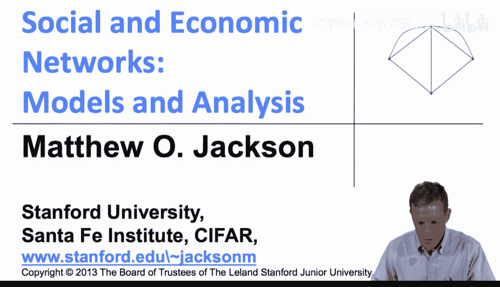
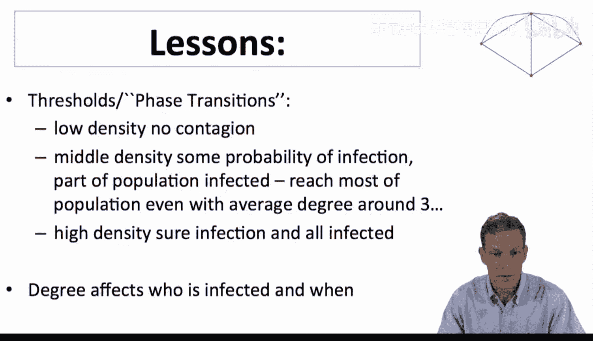
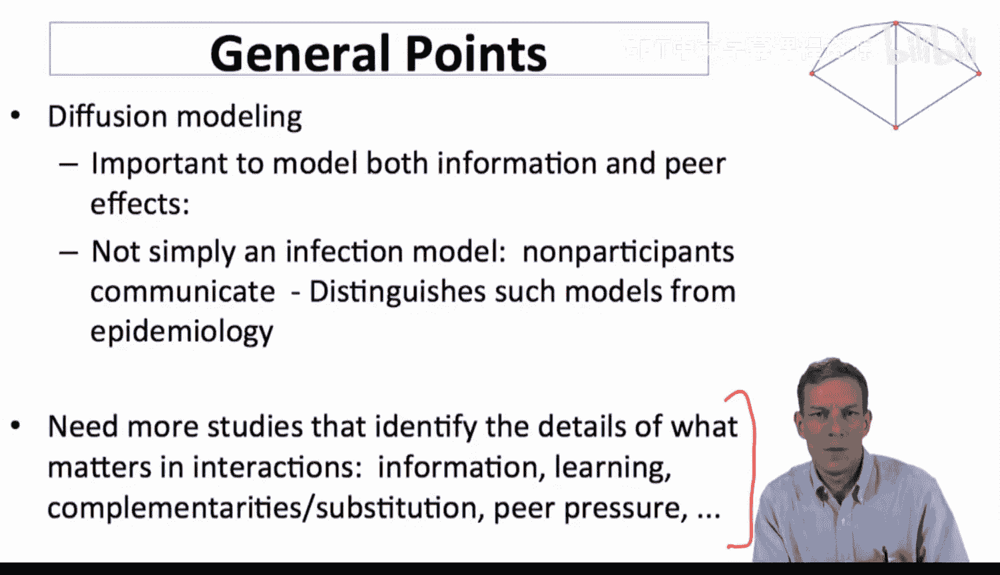
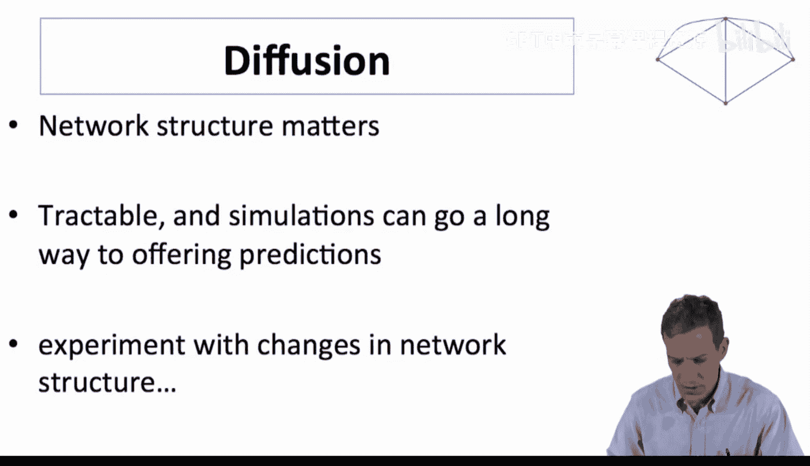
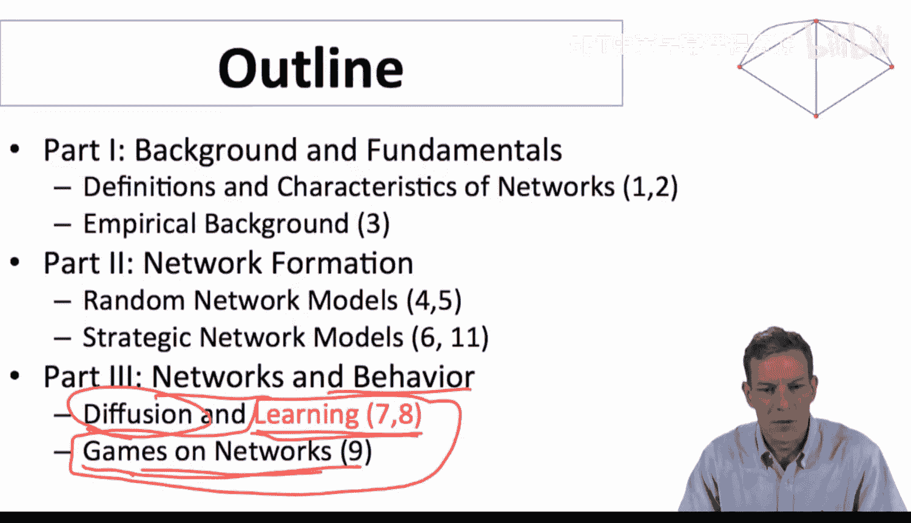
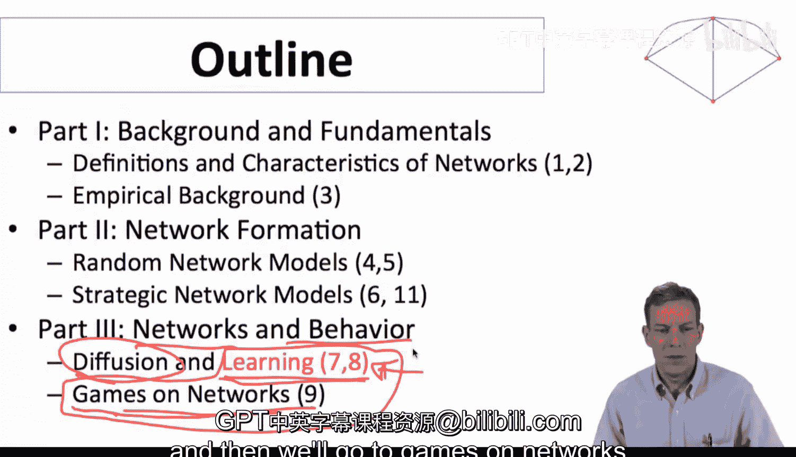
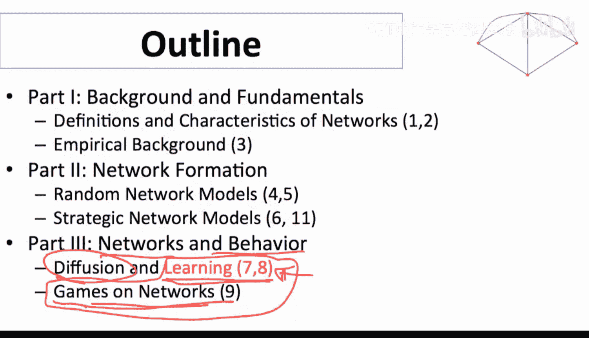

# 斯坦福大学《社会和经济网络：建模与分析｜Social and Economic Networks： Models and Analysis》中英字幕 p61 61_05_11_5-9-扩散总结.zh_en -BV1v1421U7Nk_p61-

Hi， folks， so let's just wrap up our discussion and summarize what we've learned from our diffusion models。

So in terms of， you know， basic lessons， the first thing we saw is that there are phase transitions sort of very。

 They can be very abrupt in terms of whether or not diffusion occurs or not。 And so， you know。

 when we end up with very low densities of interactions， we basically get no contagion。

 we move to a middle density and we begin to get a lot of diffusion and very rapidly in in the model we looked at when were computing things for。

Something like the diffusion model on anda shrenni random graph or a simple one where we're doing component size calculations going from an average degree of just one to three led us for almost no diffusion to almost complete diffusion and then once we get to this higher densities we get sure infection and essentially all that they're susceptible to being infected and degree correlates with who ends up being infected both in most of the models we've looked at having higher rates of interaction are going to lead to higher infection rates so we've seen this kind of basic points and more generally in terms of the modeling diffusion modeling is going to be important。

 it's going to be important in a lot of applications that go beyond just something like the flu to model both information and pure effects。

 we saw that in the last analysis we just did so you want to keep track of things that are not just simply infection models but people communicate and that。

uishes such models from epidemiology。 We need a lot more models and studies that identify to find details of what matters in interaction。

 So when we think about diffusion， am am I just processing information and I learning from other people。

 do I care about how what they're doing is there peer pressure So if we're looking something even even something as simple as the flu there's decisions do I get vaccinated。

 do it depend on how many of my friends are getting vaccinated do I not take a trip if there's an epidemic of flu in the city that I might be going to there's all kinds of things that really enrich the setting and make the diffusion models much more complicated and these are areas where epidemiologists're starting to do studies as we just saw I mean are studies in economics there's studies in different areas which are which are enriching these things and a lot of that's going to be done by once we complicate these models we can do these things by simulation。

 take the simulated diffusion models and try and。

Mch them to data and actually learn quite a bit that way so network structure matters。

 sometimes it's very tractable， otherwise simulations go a long ways towards making predictions。

 we can experiment with with changes in network structure and begin to see how these things affect overall behavior。

So in terms of outlines， what we've done is we've gone through a lot of the course。

 we've talked about networks influencing behavior and now we're getting to sort of the home stretch where we're going to talk about enriching things so diffusion so far we've treated until the last video just we just talked about we were treating the process of diffusion as being fairly mechanical and now we'll more explicitly try and model learning and model effects and then we'll come to modeling games on network where we actually have strategic interactions between individuals which will sort of be an enrichment of the last application we saw and try to understand those so next up is learning and then we'll go to games on networks and understand interactions and behavior。

