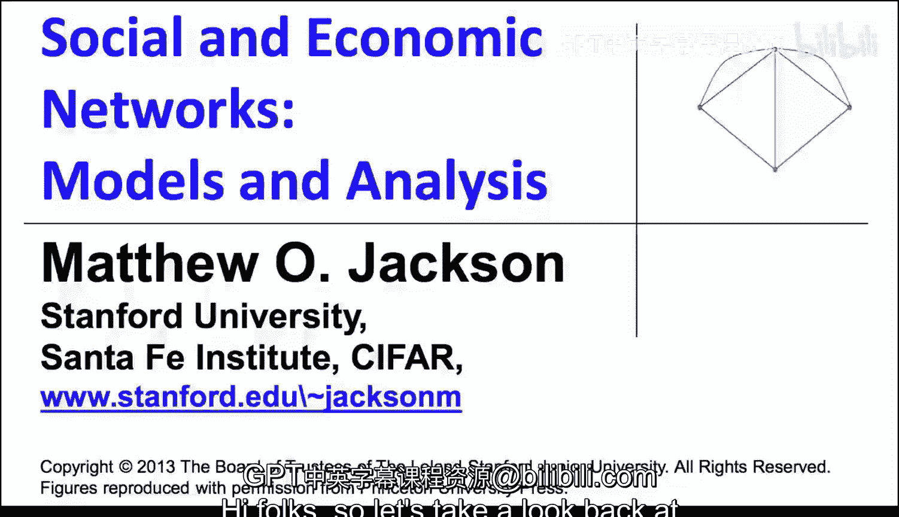
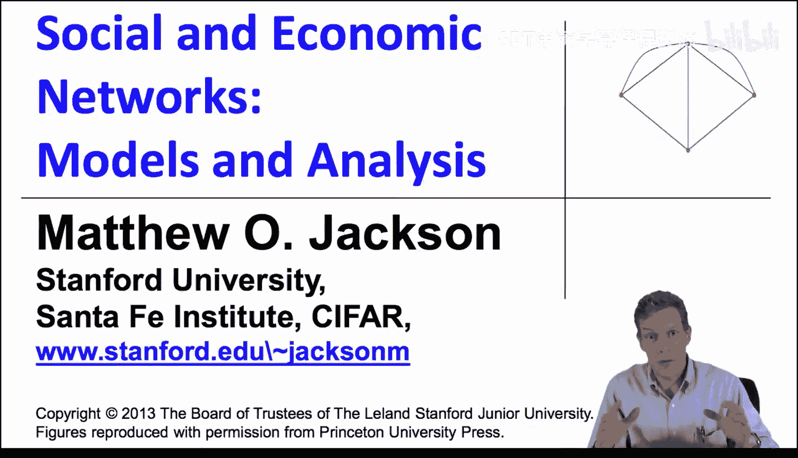
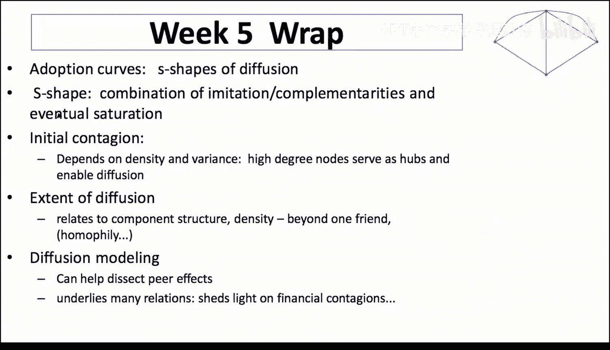

# 斯坦福大学《社会和经济网络：建模与分析｜Social and Economic Networks： Models and Analysis》中英字幕 p62 62_05_12_5-10-第五周总结.zh_en -BV1v1421U7Nk_p62-

Hi， folks。 So let's take a look back at what we've seen in week 5 here， talking about diffusion。

So diffusion is something that's been studied in a wide variety of different disciplines。

 so marketing， social psychology， psychology， soci， economics， anthropology。

 so diffusion is something which is important in many different behaviors。

 and so there are different stylized facts and a number of different models that have been used。

Epidemiology， medicine， so this is something which is very fundamental to many areas。

ABa thing that we've seen in some empirics is s shapeped adoption curves so things start out slowly they pick up and then eventually asymptote so that kind of nice shape has some intuition to it that we talked about and looked briefly at the ba model so the combination of imitation and complementarities is the fact that the more other people do something the more likely a given individual is if you've got that kind of feature then that can give you the initial upswing and acceleration the eventual saturation is going to tend to cause the things to tail off eventually so often we're going to see these kinds of curves the bass model' has been very powerful at capturing these of macro big scale level。

We can build tighter models that bring in the network。

 and the network then can help us understand when is something going to spread。

 When will we get an epidemic， How many people are going to be reached and so forth。

 So initial contagion， when we looked at those kinds of models and。And understanding。

 say the SIS model， high degree nodes tend to serve as hubs and enable diffusion。

 so overall higher density means you're going to tend to have more connections。

 more chances of diffusion or contagion， higher degree nodes can serve as hubs so higher variance can also increase the possibility that you see。

Spreading， and we saw differences then between things like a。

Power law network where we've got a scale free degree distribution can lead to contagion in many cases where other ones might not。

 depending on what the degree is。Extent of diffusion。

 we also looked at say the size of the giant component and again that got back to our phase transitions and so forth and it turns out that there's a fairly rapid shift from no diffusion to a situation where you've got diffusion starting and then very rapidly you can hit saturation and in particular between and when we're looking at the Nurdashrenni kind of network is between degree1 and degree3 where most of the action happens below having at least one other friend you're not going to get diffusion that's not really going to occur。

 things are going to die off people tell on average less than one other individual。

 you've got a decreasing system If they're telling more then you've got expansion properties you can begin to have things spread and by the time you hit telling three other individuals boom。

 you've got complete saturation。Homphily can begin to affect that。We didn't talk about that so much。

 but there are models now that are tending to bring in more structure and breaks in the network and so forth and that can affect exactly how this spreads okay last thing we looked at diffusion modeling well in different situations we can begin to write down explicit models of what we think is going to be happening and by putting those models down。

 they're actually fairly easy to simulate to take to data and they can help us understand。

 for instance， peer effects so how much of something is due to information transmission as opposed to complementarities in actions we can begin to look at things like financial contagions and understand how the structure of the network might lead to contagion from one organization to another each different situation is going to have different kinds of properties in terms of what it takes for one node to end up affecting another node and so by changing those we can end up with different models。

 but those models tend to be fairly tract。In terms of simulating those processes and getting predictions and then taking those to data。

 So as we go forward and look now at learning and games on network。

 some of the themes that we've seen here will carry over there and be embellished in terms of the structures of the interactions。

