# 斯坦福大学《社会和经济网络：建模与分析｜Social and Economic Networks： Models and Analysis》中英字幕 p63 63_06_01_6-1-学习.zh_en -BV1v1421U7Nk_p63-

Wecome back folks。 So now we're going to talk a little bit about learning。 So in terms of our course。

 we've done a bunch on background and fundamentals。

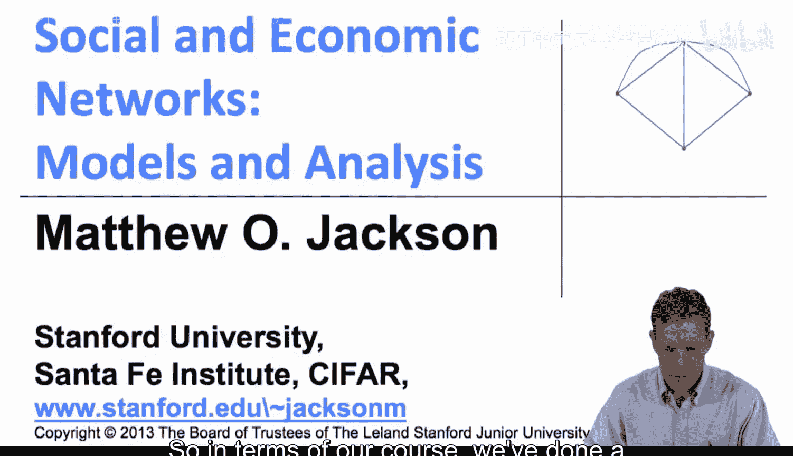

We looked at different models of network formation and now we've moved towards trying to understand how network structure impacts different kinds of behaviors and so forth we talked a bit about diffusion and now I want to focus in a little bit on learning。

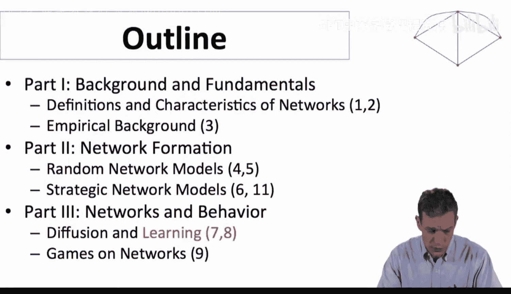

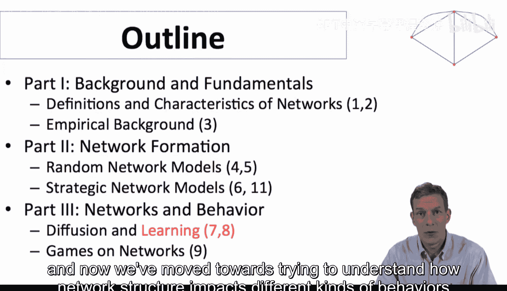

And in terms of learning， we're going to basically look at two different models。

 we'll look briefly at Bayesian learning and then we'll look at what's known as the deroot model and you know there's a whole variety of models out there these days and different ways of modeling learning and it's going to depend on who observes whom and what the network structure looks like and there's hybrid models out there。

 what we're going to do is just look at these two to get some flavor of these things and the deroot model turns out to be a very useful one。

 the Bayesian one has some interesting insights and interesting questions associated with it so we're going to start with the Bayesian learning and we'll talk about repeated actions where people get to observe what each other are doing so I'm deciding over time what I'm doing and I can see what my neighbors are doing and there's going to be an interaction between us and in terms of what I learned from what my neighbors experience and so forth。

 So we'll look at that a bit and then we'll move into。

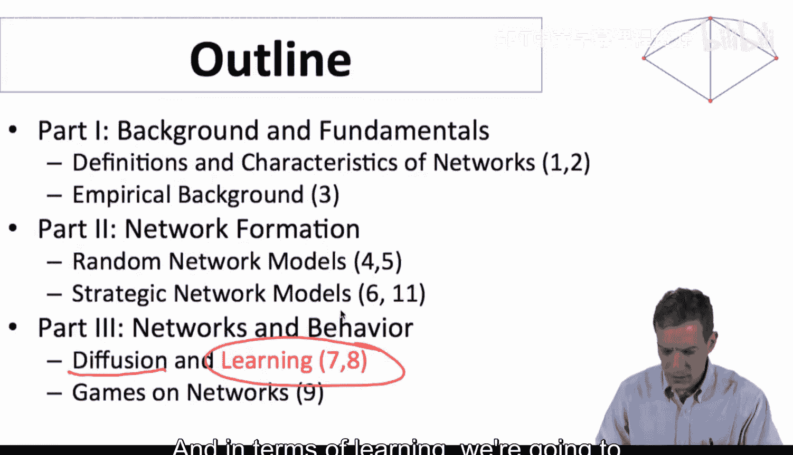

Droot model and the Duroot model is going to be one with repeated communication where people can keep talking to each other。

 but there's gonna to be a very naive way of updating so what I'm going to do is essentially just keep taking weighted averages of information that I get from my friends and I'll form opinions by continuing to average things even though I might end up hearing from things I might end up overweighting or underweight so it'll be a more naive model where I'm not fully rational in a Bayesian sense so Bayesian learning I mean these people are probabilistically sophisticated you take into account information you update a posterior using Bayes rule and then and maximize some payoff based on that so the deroot model is gonna be much more naive and actually easier to work with in many ways and there's some experimental work these days which you can find in some of the references which compare Bayesian models。

and group models and other models and find that humans are somewhat rational in what they're doing。

 but they have limits to their rationality and they don't look like they're necessarily phobaesians and some of these naive models。

 alternative models can be better at actually capturing human behavior。Okay。

 so let's start with the Bayesian model is a very useful benchmark and an important one to consider。

 And the idea here is， first of all， we can ask， know will society converge。

 So will it be that eventually everybody converges to doing the same thing or having the same beliefs will people learn and aggregate information properly。

 So imagine that new technology comes out And we're not sure whether this is a good technology or a bad technology and some people start playing with it and using it and other people can see whether are enjoying it。

 we'll eventually if it's a good technology and a better one than the old one will it take over or will it not。

 will people not necessarily learn under what conditions might that happen So we can ask questions about whether or not people going to accurately aggregate information。

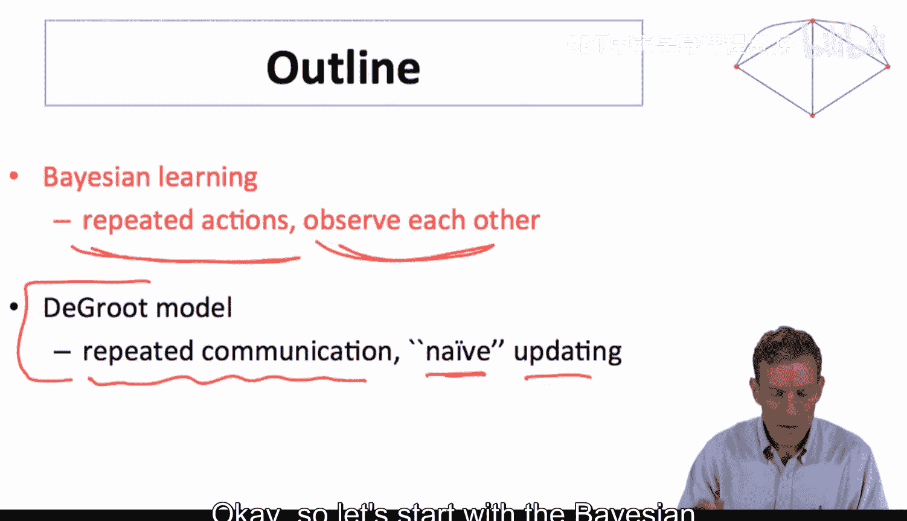

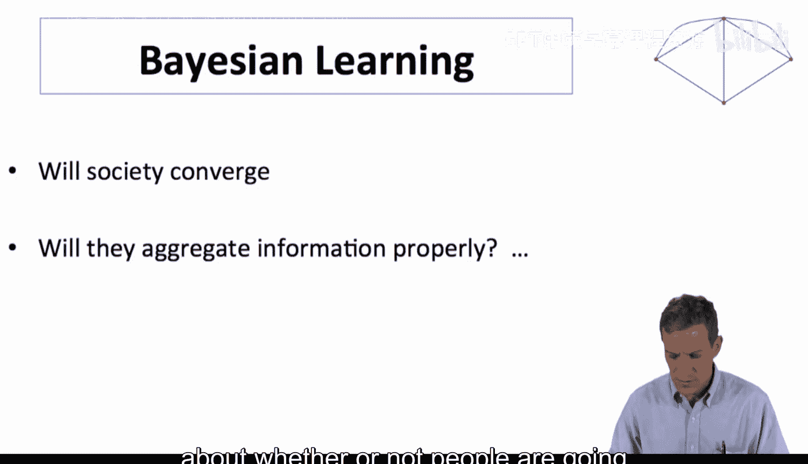

And so I'll start with a model by Baa and Goal from 1998。And it's a very simple setting。

 very natural one to analyze， so there's a number of people in some network and we'll take this network to be a single component so people are all going to be able to pathwise be connected to each other。

So there's N players and in this simple version of this we'll treat it as if you have two actions。

 A or B。 Now you can expand this to some finite number of actions。

 it'll be pretty obvious exactly how to do that once we get to the results So the intuitions here are very easy to state with two actions and I'll do a simple version of this it's going to be obvious how to extend this beyond this。

 So basically let's think of you choosing either action A or B over time。

 and so you think of this as the old technology， A is the old technology B is the new unknown known technology or you know A is。

Acting in one manner， say， you know， keeping my money in bonds and bees。

 investing in some kind of stock over time。 And so， you know。

 we've got these different actions that we can be taking over time。 A or B。And A pays one for sure。

Whereas B is uncertain and it pays 2 with probability P and 0 with probability 1 minus P。

 And let's suppose to make things simple that people don't mind risk。

 So basically they just care about the expected value。

 So they know they can get one from choosing action A and action B is either going to pay off2 with probability P or 0 with probability 1 minus P。

 So basically B is better if P is bigger than a half。This is bigger than one。They should choose B。

But if P is less than a half。Then they should choose a。

So a very simple setting B is better if P is bigger than a half A is better if p is less than a half。

 but we don't know what P is。 So it's a new technology we're uncertain。

 maybe we have some prior information， maybe we have some guess at what P is but we don't know for sure So these individuals have to experiment a little bit with P with B。

 sorry to find out whether P is good or bad so they're going to be choosing actions over time and the learning model is going to be is follows Each period a person makes a choice between A or B。

 and each period you get a payoff。

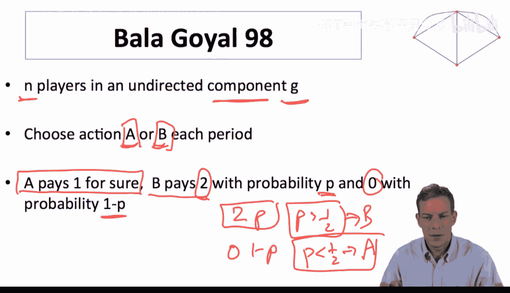

Okay， and so if I choose A， I get a payoff of1 for sure， and if I choose B。

 I'm going to get a payoff of  two with probability P and0 with probability 1 minus P。Okay。

 so I try this new technology。 Maybe I'm a farmer。 I try a new thing。

 and I either get higher payoff or the lower payoff with probability P or 1 minus P。 Okay。

 so each period， I'm going to do that。 And what does the network do。

 the network is such that what I also get to see is I get to see my neighbors choices and their outcomes。

 Okay， so if I'm a given individual and I have two friends。I chose A， I got a payoff of one。

 this individual chose B， they got a payoff of zero， this person chose A， they got a payoff of one。

This person over here shows B and got a payoff of two。 So basically what I learned， I learned。

 I chose a。 they chose a。 I get to see that this person chose B and got a pay off of0。

 This person chose B and got a pay off of2。 and Im every day， I'm gonna get all this information。

 and I'm going to store that information over time。 And over time， I'll begin to to learn。

 So if I get， you know， if I begin to see lots of people choosing B and lots of people getting twos。

 I'm going to think， well， it's probably a good thing。 P's probably pretty high。

 If I see lots of people choosing B and lots of people getting zeros。

 then I'll downgrade my belief on P。 And I would be more likely to pick a。

 And what people are going to do in this setting is they're gonna to maximize their overall stream of expected payments。

 So I'm going get a dollar today。 if I chose a， I get some random amount if I choose B。

 And every day I'm I'm making this this choice。 and I have an expectation of what this thing looks like。

Conditional on what I've seen up to a point in time。

 and so I'm getting some payoff let pi subi at time T be the payoff I get from following a certain strategy of choosing A's and B's。

And there'll be some deelta less than one。Greater than0。 And I'm going to maximize that sum of。

 of discounted payments， okay。And let's suppose the P is unknown。 So I don't know it initially。

 It takes on some finite set of values。 So maybe it could be 01， point2，03， et cetera。 right。

 So I have some finite set of values。 And I'm trying to guess whether B is a good thing。

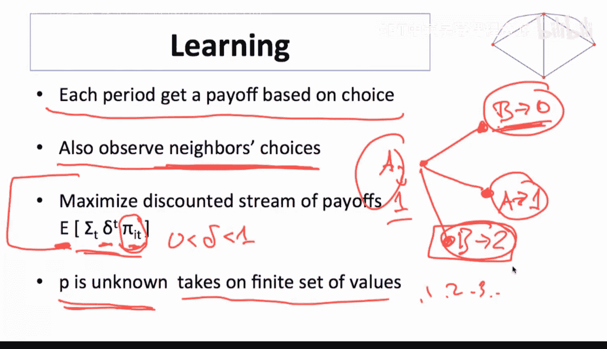

Okay， that's the structure。 So now let's talk about some of the difficulties with this。 What。

 What are the real challenges in Bayesian learning。So first of all。

 let's think of the following so let's suppose that I know what the network looks like I'm person one。

 here's person two， person two is connected to some other individuals， say three and four。

They're connected to five， six， and so forth， right and we've been doing this for a set of periods。

And what I get to see， let's suppose I'm choosing A for a while， I'm kind of pessimistic。

 I'm seeing that this person chose B， okay。Now， the fact that they chose B。Tells me two things。

 one is it tells me something about the fact that they must think B is a good outcome。

But it also tells me things about what they might be seeing from other individuals。

 right so over time， they've been seeing what three and four are doing。

And I don't get to see what 3 and 4 did。 But I know that two saw 3 and 4。

 and I know that three is influenced by 5 and 4 is influenced by 6 and so forth。 right。

 So there's some network out there of a bunch of individuals。 And let's suppose， for instance。

There' just as as an example， let's suppose that I've been choosing A for a while。 I choose。

 I see that this person is choosing B for a while。 And so let's suppose I see them， you know。

 I see person 2， chooseose B。 They get a payoff of two。 I see them choose B。

 They get a payoff of two， B， They get a pathoff of two， something and w。 this is really great。

And so then I switch to B， and I keep seeing them get twos， and then suddenly I see them switch to A。

What would that tell me？Well， now I have to think， well， why would they have switched to A。

 it's probably because their own experiences has been pretty good。

 it must be that they see some bad experiences somewhere else， right？😔，So now I have to think。

 what are all the possible experiences they could have had。 Well， it could be that they saw three。

Getting bad payoffs or for getting bad payoffs。Or maybe is that they saw a3 switch from B to A。

Or you know， so they saw both three and four switch。So I have to， you know。

 in order to think about this problem， it's a very complicated problem。

 I have to think about what are all the scenarios that could be considered in terms of all the histories of A's and B's and what everybody is seeing and how does that impact each person's decision and what should they do in response to that so the updating question here is actually fairly complicated。

So I can make all kinds of indirect inferences just based on what somebody's strategy is。 Okay。

 that's one， one challenge。 What's the second challenge here。

A second challenge is that there also could be some interaction。

 Let's suppose I start with a belief that P is less than a half。Right。嗯。If I was alone in the world。

Even if I believed the P was less than a half。I know that I'm going to be wrong for a long time。

 It's still worth while for me to try B a few times just to see to experiment and to see if P if if。

 in fact， maybe I'm wrong and maybe P is higher than a half。 So even if I start out with a prior。

 I it could be that I want to experiment， it could be that I want to try B a few times just to see what happens。

 And once I've learned， that could be very valuable information。

 because if it pays off to a bunch of times in a row。

 I'm going to want to take B and that's going to give me payoffs for the rest of my life。

 So trying something out can be very worthwhile。 And so being fully rational。

 even if I start with with P less than a half， as long as I'm making choices over time。

 there's an option value for trying this thing。 And and that's going to be positive and I might want to try that and experiment for a while and see what happens。

 Okay， So， so now there's an experimentation that comes into play as well。Okay， well。

 now let's suppose there's two of us。Person  one and person 2。Right。

I'd like the other person to experiment。If I think P's less than a half， why don't I let them try it。

 and I'll sit by and just choose A。 And if they experiment and play with B for a while and it pays off well。

 then I can switch to B， but I don't have to pay the cost of the experimentation。 I want a free ride。

Okay。Now， that becomes a game which is actually going to have a fairly complicated equilibrium。

 especially when you start putting that game in a network with all kinds of players。

And we begin to have the players connected to other players。

 And now we look at this simultaneous decision of who's going to choose B in this period。

 who's chosen it in the last period， What are our beliefs。

 What do I think everybody else's belief and so forth。

 So when you when you get to overall looking at this game， the game becomes very complicated。

 both because of the strategic aspects and because of the Bayesian inference。

 And so now you can begin to see why it might be that， in fact。

 when we put humans in a laboratory and ask them to play games or to make these kinds of choices that they might not behave in a fully Bayesian manner。

 And it's just complicated to do， And it's hard to even write the model down and solve it。Okay。

 so in fact， the way that。Let me just say a little bit about how this is solved in terms of the Baa and Goyle approach so what they did is assume that players are not going to be strategic about this and each person is just going to choose things which maximize their own payoff and not worry about the gaming aspect of it and secondly。

 I'm not going to infer things from the fact that other people are making different kinds of choices I'm just going to keep track of what have I seen in terms of my histories of A's and Bs so I just keep track of whatever I've seen through myself and my neighbors and I'll just keep track of what are the relevant payoffs and most importantly。

 how many times have I seen B payoff2 how many times have I see at payoff zero and then I can update on what I think P is just based on those observations and I'll ignore everything else and I won't do the complicated updating。

Game things I'm just going to look at the twos and zeros and decide whether or not I want to switch from A to B or B to A Okay so let's look at that。

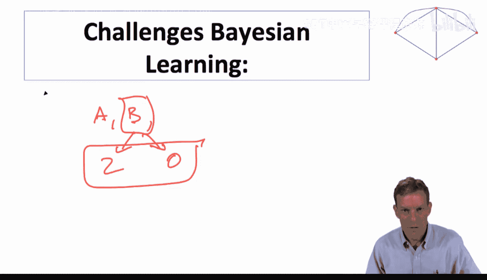

Okay， so what's a proposition you can prove then fairly directly。

 The first thing you can show is let's suppose P is not exactly a half where I'd be indifferent between。

Choosing in action， then with probability one。There's a unique time。

Well there'll be a time a random time， sorry， such that all agents in a given component play just one action and play the same action from that time onward Okay so basically what's happening is as long as p's not exactly a half and we would be sort of indifferent。

 we're basically going to eventually all end up choosing the same action and we'll just lock in on some action and play that forever after at some time。

 Okay so some time well all eventually converge and play the same action forever so that's the nature of the proposition。

 So let's talk through the intuition and basic proof behind this。

 Why is this true and I'm just going to sort of sketch out the proof it's fairly easy to fill into details here。

 So let's suppose that this weren't true right So if it wasn't true。

 then basically somebody's going to be having to switch back and forth infinitely many times otherwise we' eventually converge。

 So somebody's got to be going back and forth between A and B。

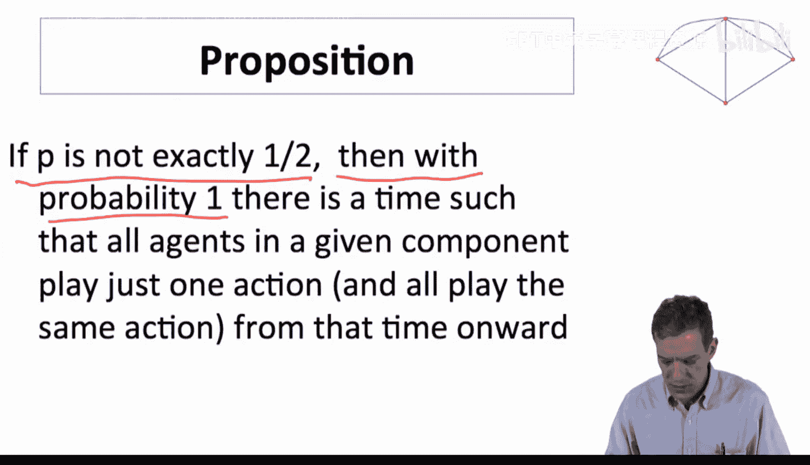

Infinitely often and in particular， somebody， let's suppose we just have one component and this just works。

 you know regardless of which component you're looking at。

 so let's suppose somebody is playing B infinitely often。Okay， so if we don't converge。

 somebody's got to be playing B infinitely often。Okay， now we can use a lot of large numbers。

So law of large numbers is going to tell us that if somebody plays B infinitely many times。

 then they're going to come to get an arbitrarily accurate estimate of what P is。

So with the probability going to one in time， their belief will converge to P。

And so what does that mean， well， in order for them to keep playing B。

If their belief about P is becoming arbitrarily accurate。

Then it must be that P is converging to bigger than a half。Otherwise， they would stop， right。

 So over time， they good， theyre good Bayesians， they know how accurate their belief is they would either converge to P above half or not or below half because it's not allowed to be exactly half under our assumption。

If it's above half， then they'll keep playing it。 If it's below half。

 then eventually they would stop playing it。Because now they'd be arbitrarily accurately convinced that it's that it's not good。

 So if it's not good， they should learn that and they stop playing it if it is good。

 they'll keep playing it。 Okay， so it must be that if they do play it infinitely often。

 then it's got to be the case that they're converging to the good belief。

 Otherwise they would have stopped。Okay， so now this means that they have to be converging to the true belief with probability one。

 the true P has to be bigger than a half。

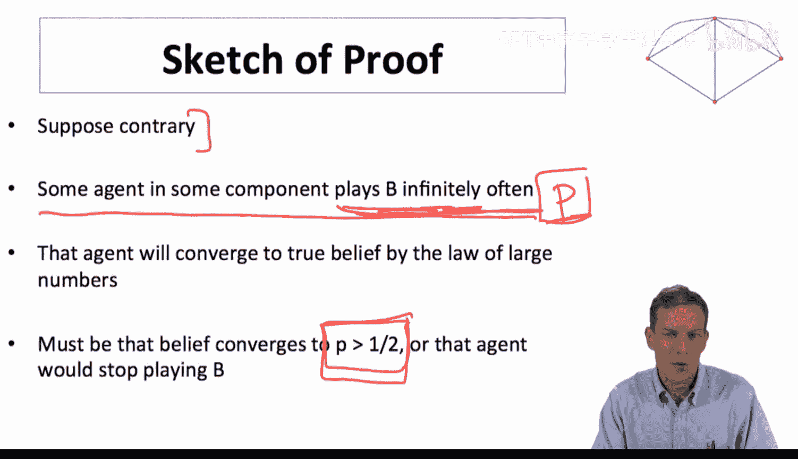

So then everybody who sees this person is actually going to see the sequence。

They're going to also see B played infinitely often。

They're also going to have to converge to the belief that P is bigger than a half。

 And so they should all start playing B。 right， So if this person is， is learning that B is， is good。

 then their neighbors are going all going to have to converge。

Then these people are also going to see B infinitely often and converge to P。

 Their neighbors are going to have to converge and so forth。 So the neighbors of agent must play B。

 Then all agents must have to play B。

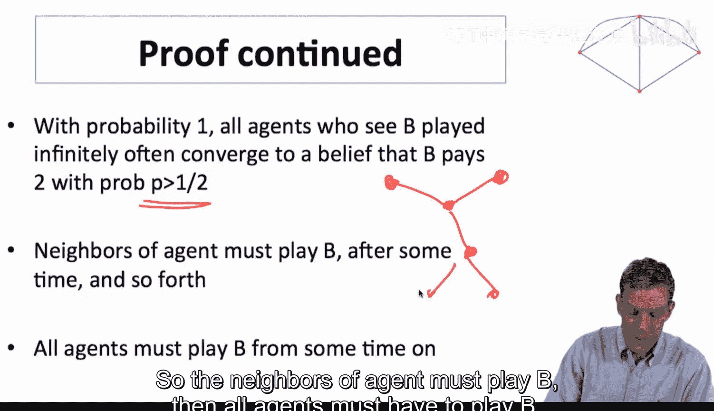

So it just has to spread out okay so if anybody's going to play B infinitely often。

 then it's got to be that it's a good thing and you learn if not。

 then we've stopped and everybody had to played A。 So either somebody plays B infinitely often in which case we converge to B or they don't in which case everybody's converging to A。

So that gives us a proof that basically， we're going to get convergence and we're going to converge to either all playing B or all playing A。

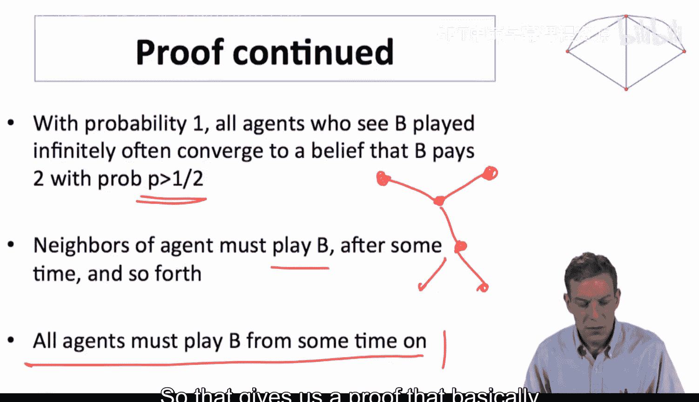

Well， does that mean that we always converge to the right action that is if p is really bigger than a half。

 we converge to B and if P is really smaller than a half， then we're going to converge to A。Well。

 let's suppose that P is really bigger than a half。If P is bigger than half。

 then B is the right thing to do， we should really be playing B。

So that we will play the right thing if we actually converge to that， but it's possible。

That we might not converge to that。 And how could that happen。

 That could happen if we all start pessimistically enough。

And we just happened to get some bad draws on on B。 And initially。

 So it's possible that everybody gets some bad draws on B stops playing B。

 And then we never learn after that， right。 So， so even when P is bigger than a half。

 it's possible for us to converge to A。On the contrary， if a is the right action。

 then we've got to converge to the right action。Because that means that now P is less than a half。

So there's no way to converge to B in that case， because if we play B long enough。

 we'll learn that it's not good。 And then we'll all switch to A。

So in a situation where A is the right thing to do， well。

 necessarily everyone' is going to have to learn that， and we will converge to A。

If B' is the right thing to do， well eventually converge， but we could all stop playing B too soon。

 and we might end up just converging to B。 Okay， so so we will all converge to doing the same thing in this model。

 but whether it's the right thing or not depends on whether B' is the right thing or A' is the right thing。

 if A' is the right thing， will'll definitely converge to the right answer。 If B' is the right thing。

 we might or might not， depending on what our prior distribution is and whether we get good luck in the initial draws。

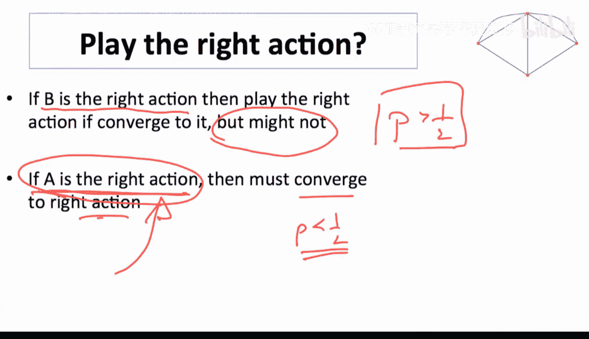

Okay you could enrich this model so that you have different priors for different individuals。

 you can actually start specifying the prior。 So what's different people's priors prior beliefs and then the probability of converging to the correct action of converging to be。

 for instance， when it's the right thing to do can be made arbitrarily high。

 basically if you know if we add many actions as long as each action there has somebody who initially has a very high prior that that action is the best one then we'll get enough experimentation in these different actions so that we'll learn about these different actions and society can learn an arbitrarily accurately as long as there's somebody who's really willing to try out every technology and the case where we might fail to learn is going to be a situation where nobody's convinced enough to begin with to give it a long enough try。

 we might end up not learning about。

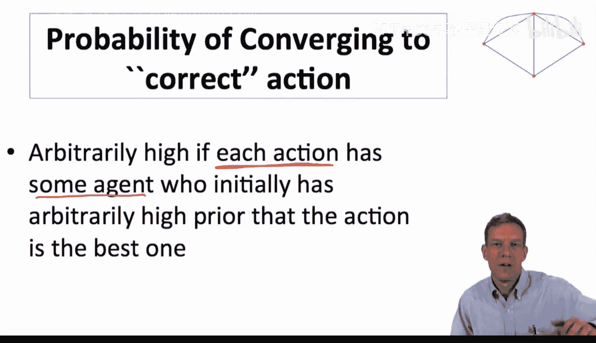

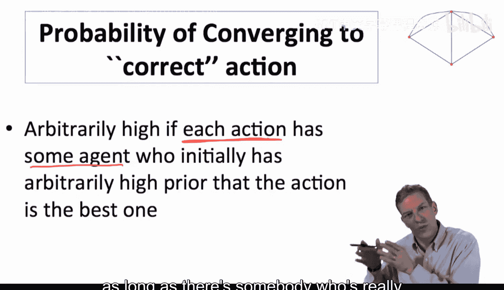

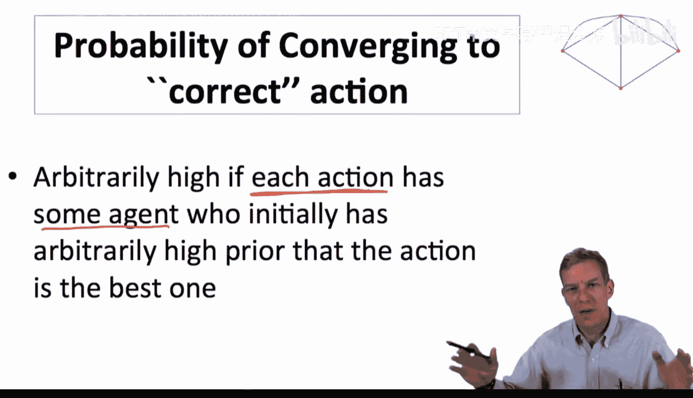

Okay， conclusions， what do we end up in this model， we all end up choosing the same action。

 so we reach a consensus。It doesn't necessarily mean that we all end up with the same belief because we're going to have different observations。

 so it might be that one of us stops with a probability。

 you know our probabilities differ on whether B was good or not。

 we might end up with different beliefs， but we all believe that we're all pessimistic enough to stop。

You can do speed of convergence kinds of results here。 you could。

 you know go through and depending on whether be as good or bad sort of Duke computations。

 then you have to actually explicitly solved through for these optimal actions as a function of what the histories look like。

 And there's a number of theorems in studies of two armed bandits and other things in probability theory。

 where you can get race of convergence on these things， laws of large numbers。

 especially in this kind of Berulli world have well established speeds of convergence。

 so you can calculate those kinds of things。And relatively these things will happen relatively quickly in terms of the number of observations giving good information here。

Limitations， okay， so there's a number of limitations in this kind of model。

 One is that basically everybody was getting the same payoffs from A or B。

 And so when you think about new technologies in the real world。

 new technologies might be right for some people and not right for other people。

 And so when you start putting in that heterogeneity。

 then it's much harder for me to necessarily infer know maybe my neighbors getting a good payoff from this。

 but will that be the same payoff， I get that complicates things and that heterogeneity means that the learning might take a very different form than what it did in this model。

 here we've got repeated actions over time。 So everybody keeps taking all these actions and trying all these different things。

 there's a lot of things in which when we're not trying things repeatedly over time。

 we're just learning about them slowly over time。 So with things like global warming。

 we're gonna get one go at it。 And you know it's not as if we can just try infinitely often experimenting with different things and。

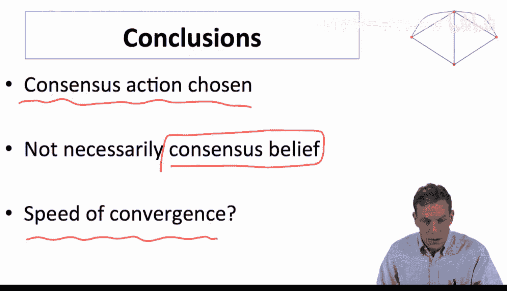

We get it wrong， we've got it wrong so the repeated actions over time and getting feedback from that is a situation where we get lots of information over time and incoming information it might be the information we get it in slower clumps or different bits here there's a very stationary environment it could be that the environment changes which makes things even more complicated and finally and probably most importantly in this model we were not really able to take the network into account。

The network really didn't pay any role。 All the arguments were just that somebody would eventually learn and then the neighbors have to learn and the neighbors of the neighbors have to learn and so forth。

 So it a simple induction argument and we weren't able to say anything about what was going on in terms of one network versus another Now you could do simulations and see whether speeds are faster in one versus another。

 but we can go to other models to try and get a better feeling for exactly how the network works on that and that's what we'll do next when we move to the deroot model that'll bring in the network very explicitly and allow us to do a lot of calculations quite easily So that'll be our next subject we'll start looking at the deroot model where network structure is going to play a much more prominent role in the learning process。

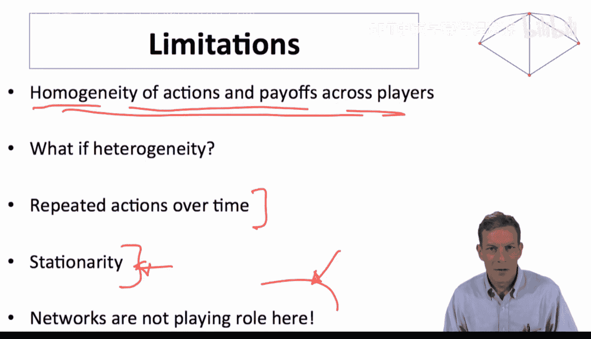

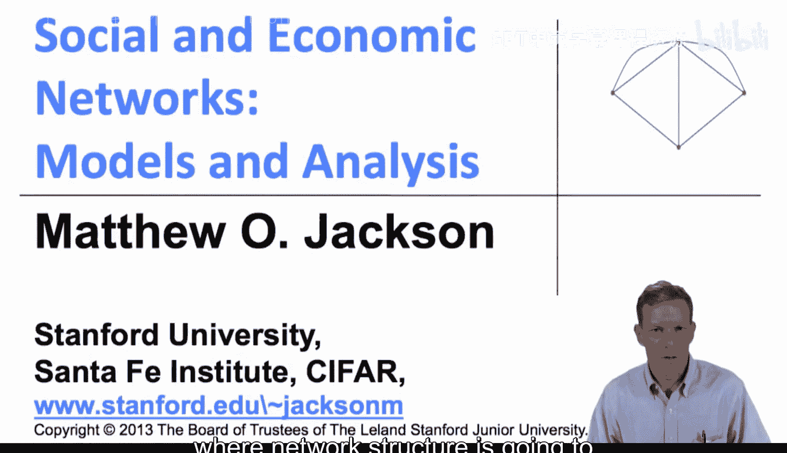

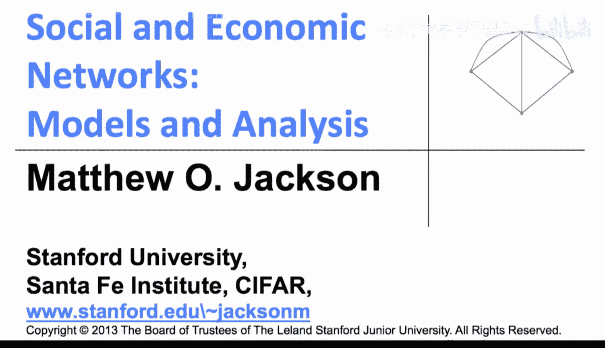