# 斯坦福大学《社会和经济网络：建模与分析｜Social and Economic Networks： Models and Analysis》中英字幕 p64 64_06_02_6-2-德格鲁特模型.zh_en -BV1v1421U7Nk_p64-

i folks so now we're still talking about learning and indeed now we're going to move to talking about the Du groupot model and in terms of our outline。

 we talked a little bit about Bayesian learning and now we'll talk much more about and there's a lot more to say about Bayesian learning。

 but we're not going to have time for that here， but we can look now at the Du groupot model which is a model of repeated communication and a more naive updating。

 so it has advantages and disadvantages。

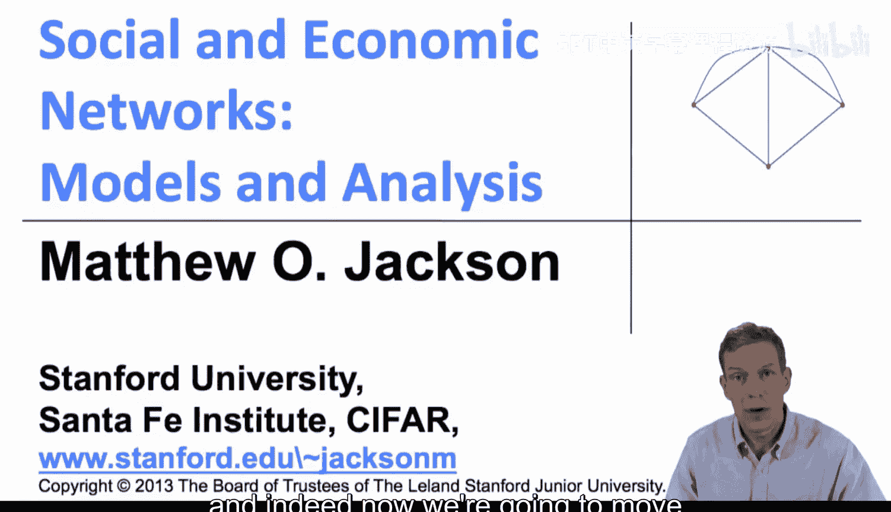

In terms of advantages， the model is going to be quite simple and mathematically elegant。

 and it'll bring network structure in a very easy way。

And will be very powerful in terms of what we can work。

 how we can work with it and what kinds of things we can deuce。It also。

 it turns out that people even operating in this very somewhat naive updating way will be very accurate and can do good things in terms of convergence and so that this can have nice convergence properties。

 even though people don't act in a very sophisticated way the limitations are going to be that we won't have a lot of strategy in this model so it's going to be more mechanical model in terms of the way that it updates。

 but it can still be a very useful model for understanding some behavior。

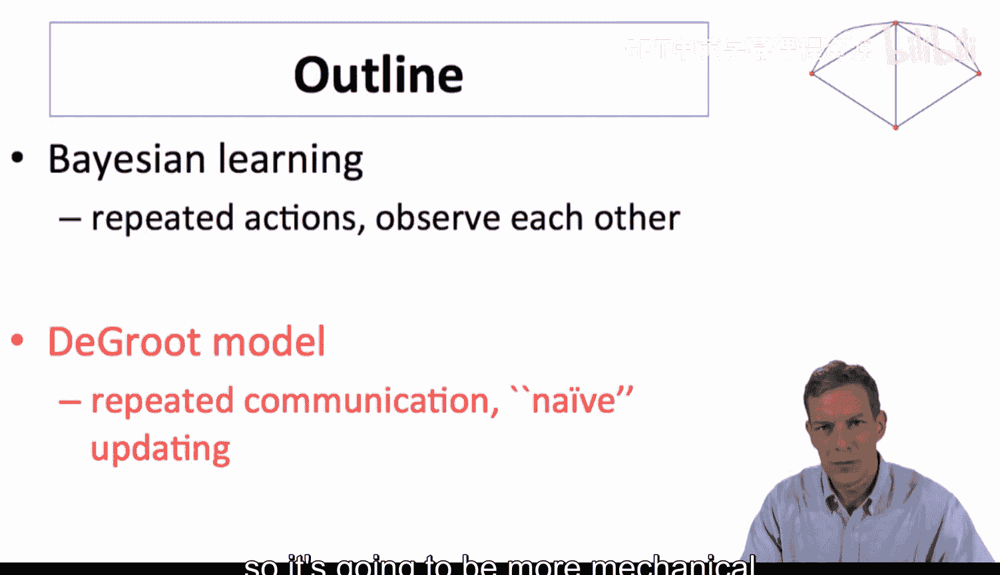

So what we'll do here is we're gonna spend a little more time with this model。

 We'll go through basic definitions。 and then after we've done those。

 we'll talk about things like when is there convergence， when is there consensus。

 This model is going to be very nice in terms of allowing us to figure out who has influence and who has influence in this model is going to relate back to some of the things that we've talked about earlier in our centrality measures like eigenvector centrality so itll give a nice foundation for some of those measures that we saw earlier in the course and we can also ask you know when is it that the estimates that people are making turn out to be accurate So there's a lot that we can do with this model It's a very useful model in many ways。

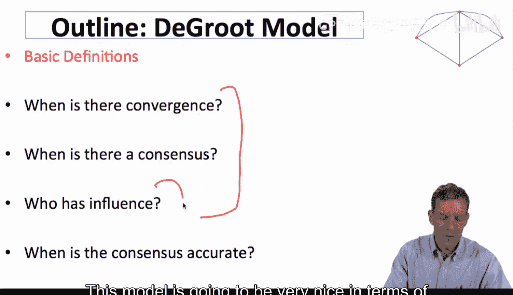

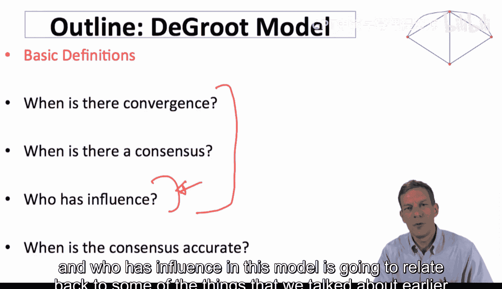

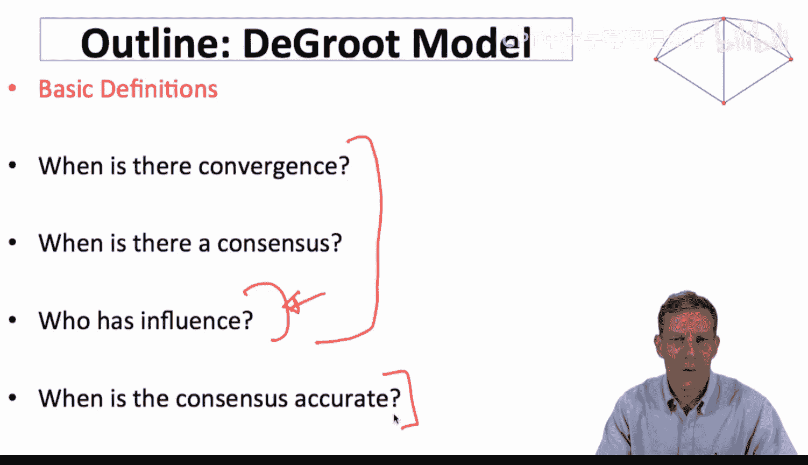

Okay so the structure now is going to be a little different than what we saw before here the information is going to come in only once at the beginning。

 so people are going to start with some initial beliefs and then you're talking to your neighbors。

 you're talking to your friends， so it'll be repeated communication and we'll see how the information disseminate。

 who has influence what's the convergence speed， how does the network structure impact all of this。

 so there's a lot of things that we can analyze here， fairly accurately。

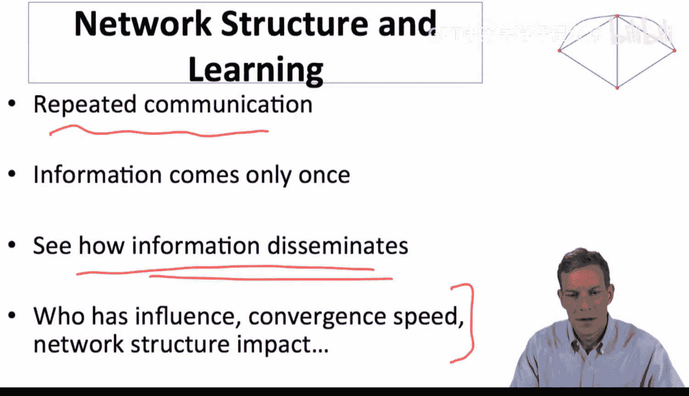

Okay。Bounded rationality here。 So what's going to happen is individuals are going to repeatedly。

Average the beliefs that they have so they'll get information from their neighbors so for instance。

 we might say what's the probability that I think that there's global warming。

 Okay well initially I don't know much I start with the probability of 0。

7 based on what I've seen in red， I talk to some other people that have information and maybe somebody's 0。

9， somebody else is at 0。6。I'll take those， I'll do a weighted average of the 0。9， the 0。

6 and my own 0。7。Come up with a new belief。 and now we talk again and so you know those people will have talked to other individuals so they'll come up with new beliefs。

 and then I'll update their new beliefs with my new belief and so forth。

And the idea that being non-baesian is the fact that the weights aren't going to be adjusting over time。

 so if I was a Bayesian and I started out with my belief of 0。7 and somebody else's belief of 0。

9 if there's global warming and somebody else with 0。6。

 then a Bayesian would have a way of weighting nose and depending on the variances and the precision of the different information。

 you would end up averaging nose and putting different weights on those things and so it would be indeed what you would do is take an average of those and that would become your new belief or an appropriate weighted incorporation of those。

But the second time that we talked and now my friends have learned things from other friends as we talked about before in the previous video。

 those things can be actually quite complicated right so now there's a lot to take into account and so forth。

 And in this model what I'm going to do is I'm just going to average them again I'm not going to to change the weights on different individual because that might be that somebody I know is talking to to other people who might have better information than this other person。

 maybe I should start waiting them more on the second time and the first time and so forth So these aren't going to adjust over time and it can also be that maybe I put too much weight on my own belief and there's some experimental evidence that individuals underweight neighbors there's some experiments by Choi Gail and Kaiv。

 which find these kinds of things there's a number of experiments that have some evidence that people will underweight neighbors And so this kind of model will capture。

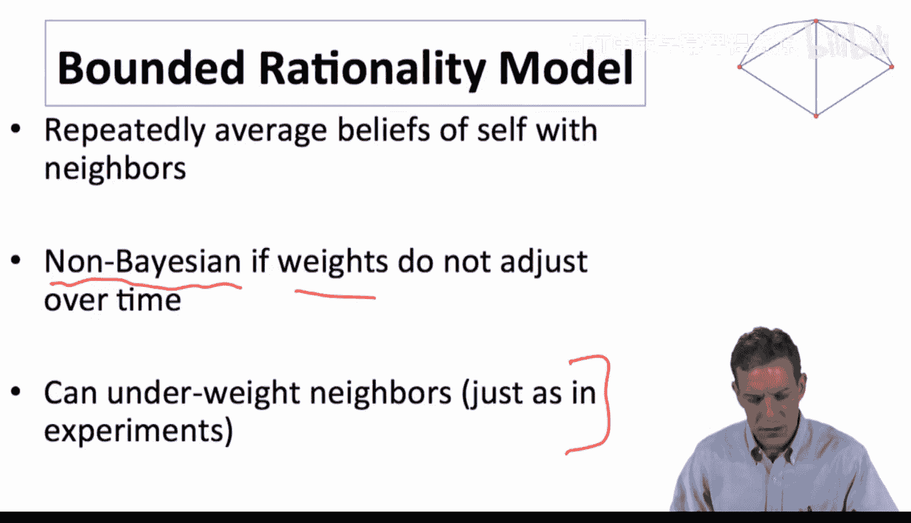

that' in some cases。Okay， so this model is we'll talk about the version which comes out of Degrud in 1974。

 it was also there's earlier versions of it due to French and Harrari。

 it's a model that has appeared in a number of different literatures and。

I guess the fact that it's been rediscovered and used in different literatures attests to the fact that it's a very natural model to write down in terms of specifying communication and learning。

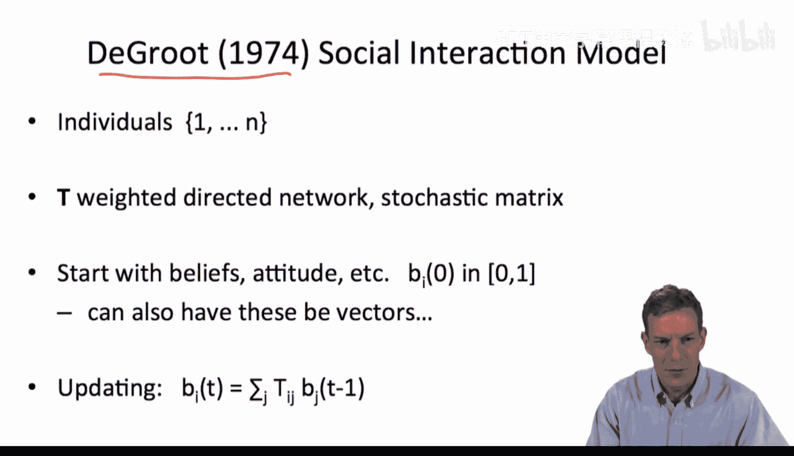

So there's in individuals。And what we're going to work with in terms of a network here is actually going to be weighted and directed。

And it's going to be a stochastic matrix， so we'll work with the notation T as sort of a trust matrix。

So here， what individuals do is they have some。 These are going to be the weights that I put on different individuals when I' updating my belief。

And so what I do is person I， everybody starts at time zero with some initial belief。

So we've all got whatever information we had from the past， whatever experiences we have。

 so we all start with some prior on a big question will there be a recession next year or is there global warming or is this politician a good politician so we'll all start with our beliefs？

And we're going to put these in 01。 You could have these be vectors。

 You can the model actually extends quite naturally to have multidimensional versions of beliefs and beliefs on many things and so forth。

 We'll just work with a simple case where you've got a belief and we'll keep it in 01。

 So this is my belief of what's the probability that there is global warming。Okay。

 now the belief at time T that I have is just going to be a weighted average of the beliefs of my neighbors。

And my neighbors， this is captured through the TIJ。Right， so I put some weight。

 person I put some weight on J's belief， which is captured by T I J。

 So sarcastic here is telling us that the sum of T I Js when we sum across J is equal to one。

 So this thing is each one of the T I Js。Is not negative， so I can't put negative weight on people。

 I put some positive weight and and out of the people I listen to I I'm gonna assign a total weight of one So it could be that in this model。

 it could be that TI is positive right so I put weight on my own past belief。

 somebodybody that never listens to anybody would have TII equal to one。

 right That would be that I just listen to myself。 I never pay attention。

 My belief just stays what it is。 and you can't convince me of anything and I'm extremely stubborn。

But if I listen to anybody else， then I'm going to put some weight on their belief。

 some weight on my own belief， and what people are doing is forming a new belief by repeatedly talking to others and incorporating that and updating your beliefs okay。

 so a very simple natural updating process。

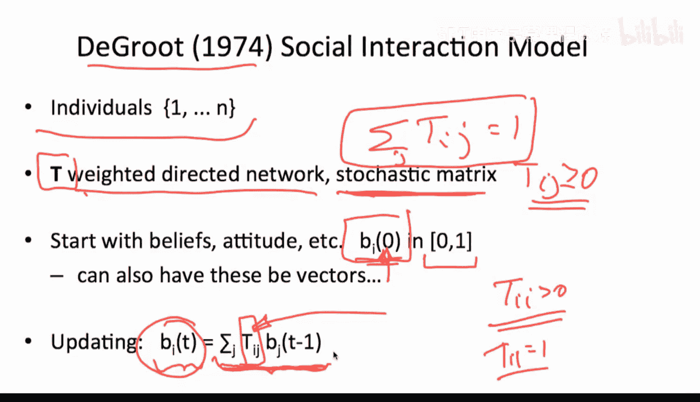

So let's take a quick look at an example， so let's suppose that person one listens to everybody equally。

RightSo a third on everybody。 So here we see person one putting weight， one third on one。

 one third on two， one third on three。Person two puts weight a half on one and a half on two。

 so weights one and two equally， but doesn't listen to three at all。3 listens to one and herself。

 So we get a half on on one and a half on three。 Okay。

 so that would be the T matrix associated with this。

 And and sometimes it's going to be useful to keep track of the diagrams in terms of the cycles and so forth。

 And here we can see that， know， now we're gonna have self links， self loops。

 So some people are listening to themselves。 and we've got weights。

 So now we have a weighted directed matrix and different individuals can pay different attention。

 This is one where each of the individuals happens to put equal weight on each of their friends。

 You don't have to have that。 We'll look at different examples。 afterwards。

 But this is a simple starting point。 Okay， so now what we can do is begin to see how updating works under this。

 So suppose that， for instance， the initial beliefs of the three individuals where person one started with a belief of 0 person 3 started with a belief of0。

 And it was only person two that started with a positive belief。

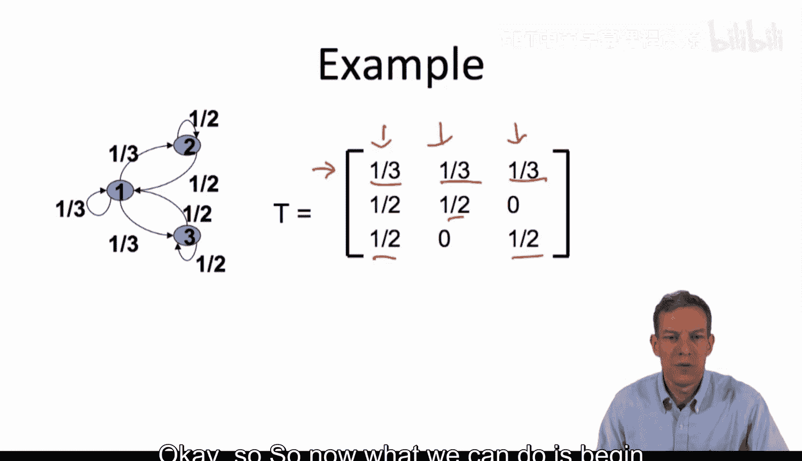

Okay， so person one puts an equal weight on each of these。So they're going to wait a third of0。

 a third of0 and a third of one。 their next period belief。 So at time 0。

 they have this belief of person1 at time one is now a third。 So after one iteration of updating。

 They've switched to a belief of a third。 Okay And so you can just do this。 for each individual。

 This person is waiting a half of a one and a0。 They're going to go to a half。

 This person just saw two zeros。 right？ So they're still stuck at0。

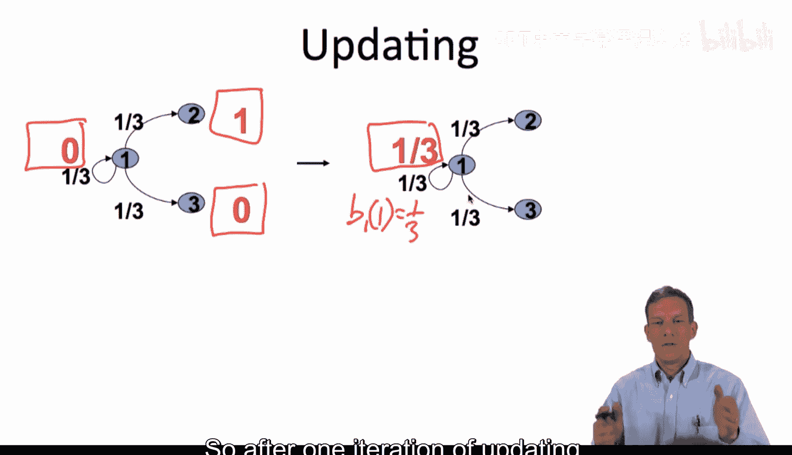

So they didn't update at all。 And we can see that the amount that people updated depended on which weights they had and who they were listening to。

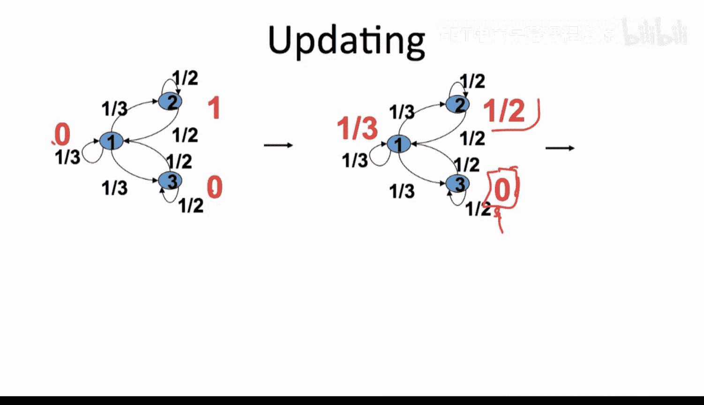

And but this person's belief now in the second period now becomes positive because at this point now。

 you know， it took one period for this person to start having a positive belief。 Now。

 once this person has a positive belief， this person's belief starts going up。

And what we can see is through this averaging process。

 people's beliefs are going to tend to be pulled towards each other。

RightThe people with low beliefs are being pulled up to positive beliefs by talking through two。

 and then eventually the information that passes from two to one passes on to three。

 and the one and twos these people， one in three's beliefs are bringing two down。 And so overall。

 over time， these things will tend to converge to something。 And in this case， if you go through。

 it actually converges to two7s two7s and two7s So if you just keep running this process。

 keep running it， it goes to two7s， to/7s， two7s。

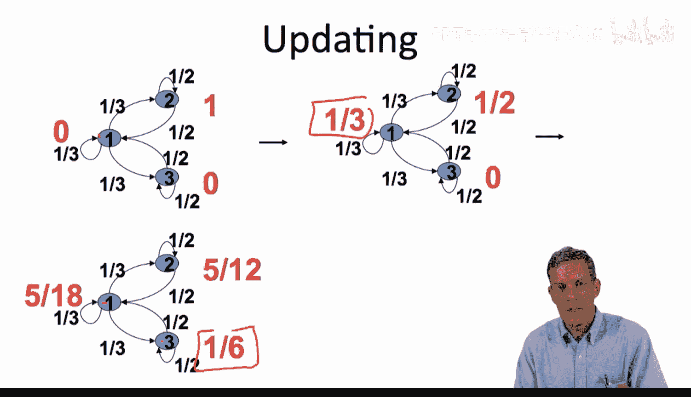

OkayNow you can we'll learn exactly how you could have guessed the two/7s， two7s。

 two7s in a little bit， but basically this is going to be some measure of sort of how influential this particular person too is because they're the only person that started with a positive belief and then we can see you know what is the eventual belief。

 well everybody was brought in by this averaging process towards the same belief and in this case it was two7s。

Okay， and。

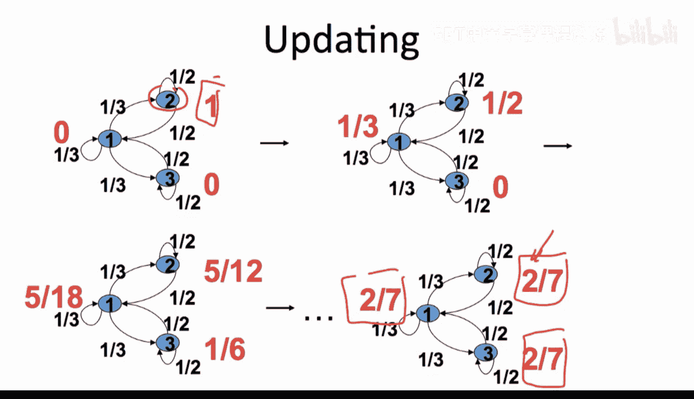

Let's work with a slightly different example。 So now one where everybody doesn't put equal weight on each other。

 So now we'll do one where we have person one， person 2， person3， one and two act as before。

 but person  three now puts three quarters weight on herself and one quarter on person two。Okay。

 and we switch the beliefs around， so now person one starts with the belief of one。

So we can go through this process right so is another example。 if you do this over time。

 you know person  one goes to a third here， person3 is still lags for a little while beliefs go to a half。

 and what would happen in this world。 you can go through now it's going to converge to 311s it converges to something different than it did before。

 It depends on what the network looks like， and it also just depends on what those initial beliefs were。

 So both the shape of the network and the initial beliefs are going to tell us what things converge to。

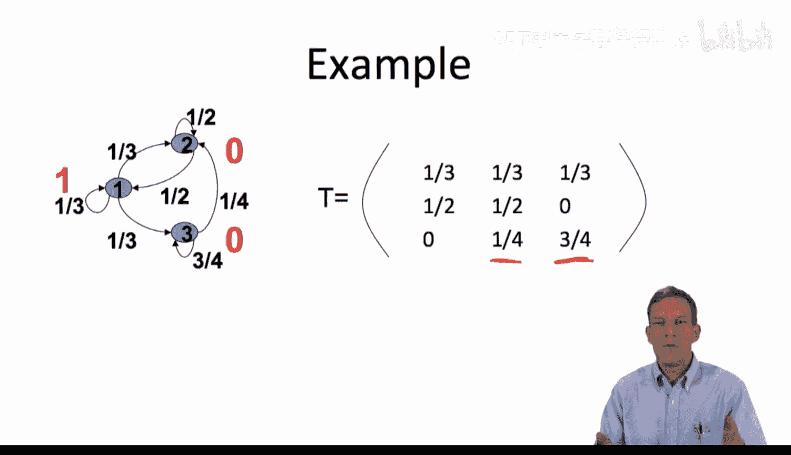

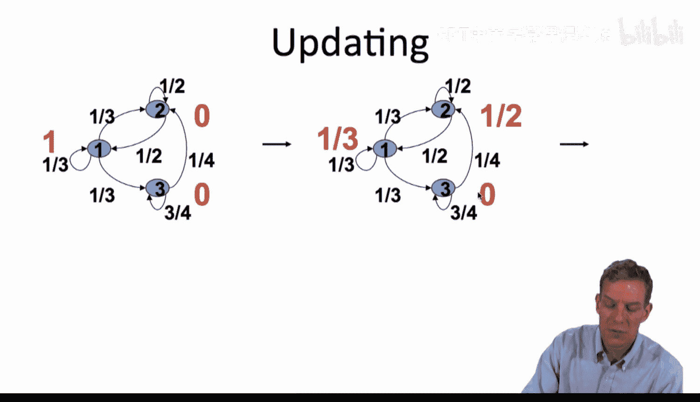

Now， what's nice about this model is that it's essentially weighted averaging over time。

 So it's a nice linear system， and this linear system is something that we know a lot about in terms of the mathematics and these things are going to converge and we'll have a nice way of talking about what are these numbers turn out to be。

 how do they depend on the initial beliefs and how do they depend on the network。

 So there'll be an explicit solution that we can just calculate out directly in terms of what those numbers are and what those relations are So that's going to be a nice part of the model is will learn where what's the limit point of this process and we can actually also say a lot about the speed of convergence here and how that depends on the network and so forth。

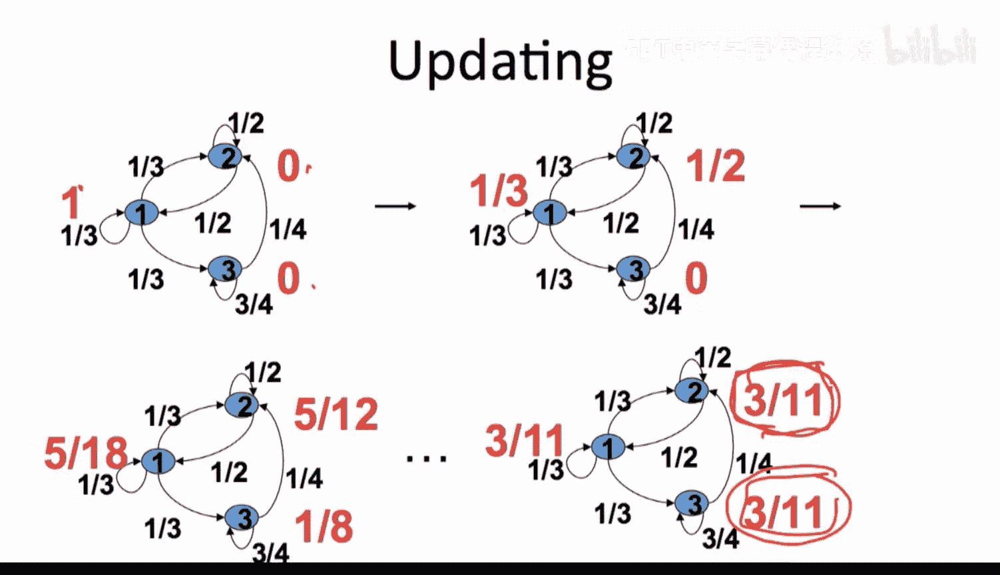

Okay， so what's happening here is you know when a person talks to their friends effectively。

 you know after one period they've incorporated information from these people， after two periods。

 they've indirectly incorporated information from two distances because this information passed on to people that were at distance one。

After you know the first period and so what happens is we end up getting if these people are listening to other individuals。

 that information goes on and gets incorporated by the individual over time so as time goes on we've got more reach in terms of where the information is coming in from and the fact that people are averaging things means that we're going to end up with a nice convergence here。

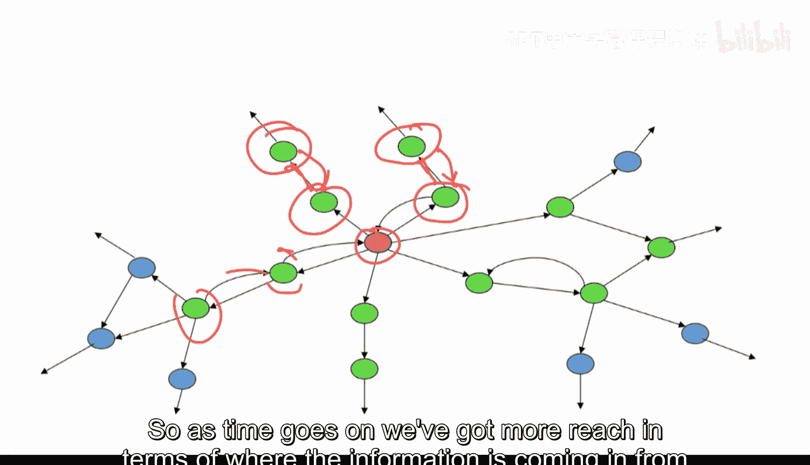

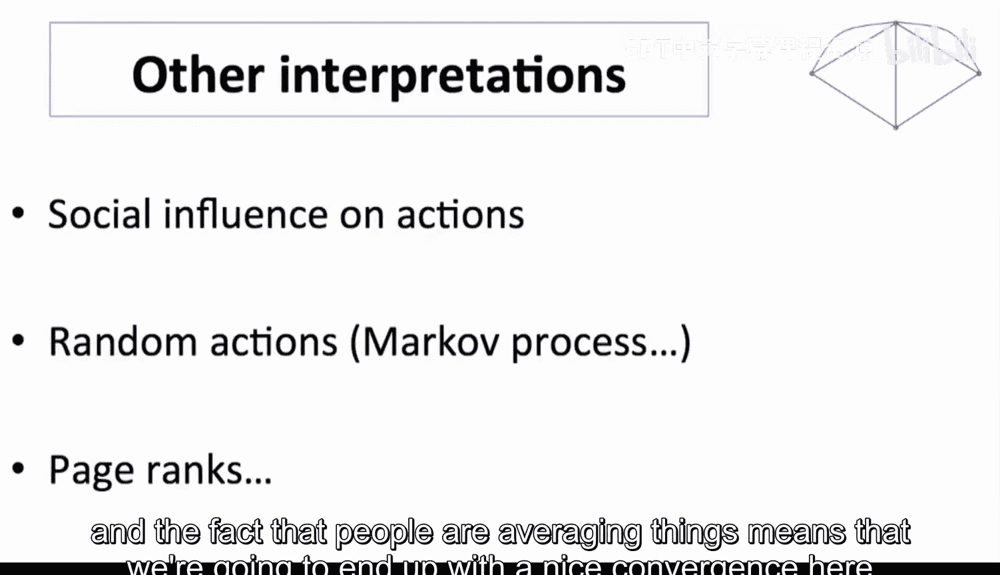

And so things it's going to have nice properties。Other interpretations。

 So this model actually has a lot of interpretations。 we've been talking about averaging beliefs。

 We could also think about social influence on actions。

 So suppose that what I'm doing is I'm just choosing some behavior instead of a belief over time。

 So I think of B I as behavior。And what I'm doing is actually trying to match the behavior of my neighbors and I pay certain amounts of attention to different people and so what I lose is I try and match what people did over time right so that's going to be something where you've got social influence on actions。

 you could think of how those actions。L work。嗯。There's also some ties to Markov processes and probabilities。

 we can think of these as probabilities of different things I'll talk a little bit about that as we go along。

 there'll be also some relationship to page ranks and other kinds of things but we can also in terms of this you can also just think of this as a game where you're trying to match the actions of your neighbors and you want to do that over time and we' end up with the same kind of dynamics So this is going to be very simple tractable model and what we'll do next now is start talking about it convergence properties。

 when does it converge what it will converge to， can we say something about how that depends on the network and so forth。

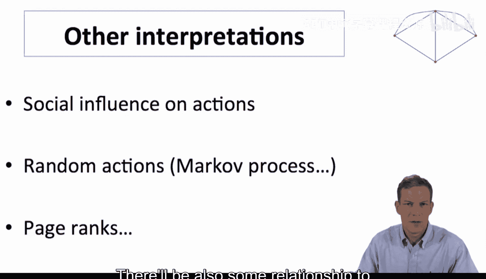

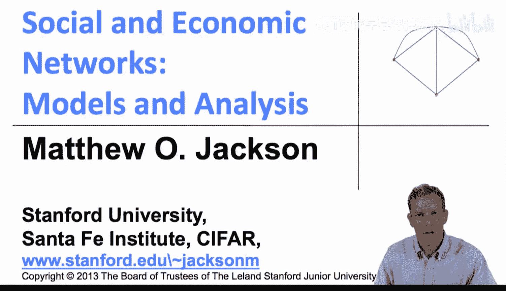

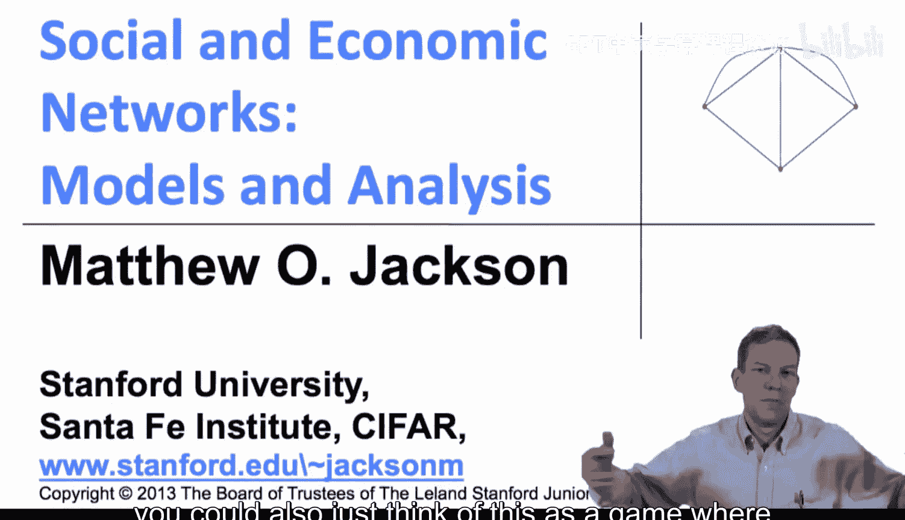

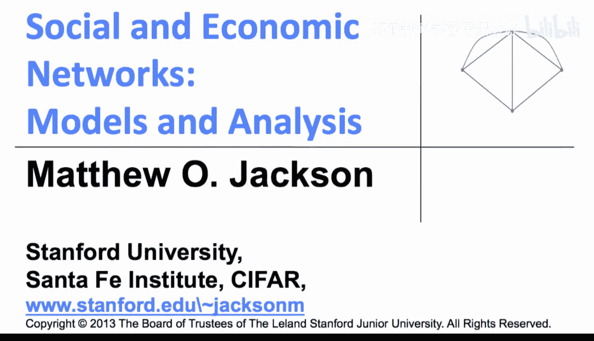