# 斯坦福大学《社会和经济网络：建模与分析｜Social and Economic Networks： Models and Analysis》中英字幕 p65 65_06_03_6-3-德格鲁特模型收敛性.zh_en -BV1v1421U7Nk_p65-

Okay， folks， so we're talking about learning still。

 and we're going to talk more about the group model now and try and understand some of its convergence properties。

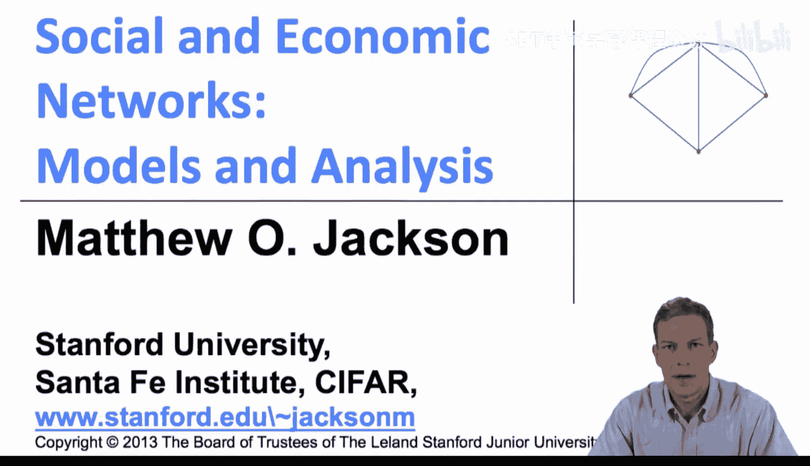

And one， one thing just to start with， let me sort of give you reiterate a little bit on the structure of the model here。

 So we have B， I of T。Looking like the sun。Over Js of。T， I J。Bjei。

A T -1 right So how much the person I puts on different people's weight beliefs in the previous period。

 So it's a very simple model。 The nice thing about this is that if we want to think about the belief structure。

 if we're talking about what the beliefs B1。 So we represent this as a vector of B。Betus。

 leaf fat tea and so forth， down to Ben。Of tea。This is just equal to this T matrix。Times， the vector。

B1 at T-1。And so forth。B B， N。At T-1。Right。So when we're thinking about what this looks like。

 we can think of this as as B at time T， as a vector is just equal to T times B at time t -1。Okay。

 so this fact that this thing looks like a very simple vector means that it's very easy to work with in terms of updating and some of the mathematics behind it and in particular。

This means that we can represent。

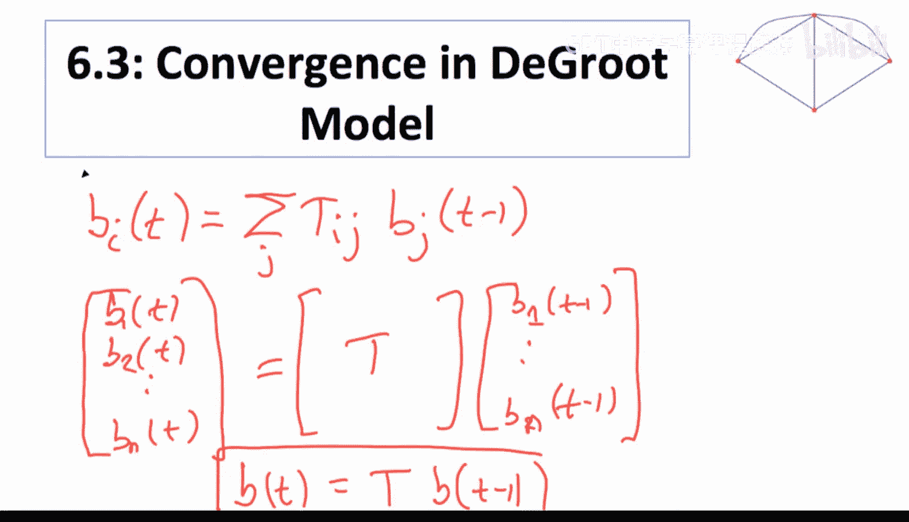

The belief at some time tea。B of T is just going to be equal to t raised to the teeth power times B at 0 right。

 because B1 is equal to t times this right， So to get B1， you do this to get T 2。You do the belief。

 right。We're just raising this to T powers。 and the reason that this model is going to be so nice to work with is that we know a lot about matrices raised to powers and in particular。

 matrices where the rows all sum to one and are non- negative。

 those Those are nicely behaved matrices and there's a lot of study that's been developed in different areas of mathematics in particular in the study of Markov chains which have these kinds of properties in understanding these kinds of of mathematics。

 So the beliefs take a very simple form and what we can do now is begin to ask questions about when is there convergence。

 when is there consensus， who has influence and when is there convergence， when is there consensus。

 that's just going to depend on properties of this。

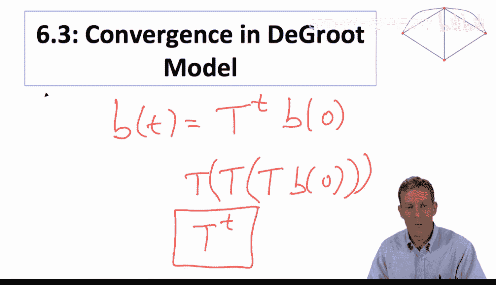

Matrix and who has influence will also depend on what this matrix ends up looking like when we raise this to higher and higher powers。

 what does it end up looking like， who ends up with a lot of weight in that system， Okay。

 so understanding this is really going to depend on these kinds of properties。

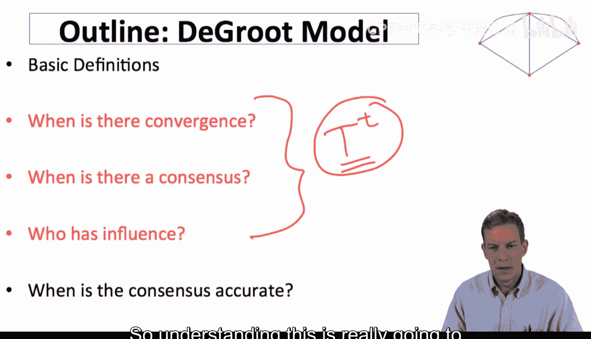

Okay， so let's talk a little bit about convergence。So let's start with an example。

 very simple example， person three here just listens to person two， two just listens to one。

 and one puts equal weight on two and three。 Okay， so this is a world where nobody pays attention to themselves。

 They're all listening to somebody else that who they're listening to depends on who they are。

This is a world that will converge。And let's start with， say example。

 you know belief one for person one， zero for person two and three。

 and so that's this initial belief。And what's going to happen well。

 so person one starts with the belief of one person two is going to take over that belief right they're going to update so after that we can go through what's the next belief going to be well person two is now putting weight one on one。

 they're going to get this person one is averaging two zeros。They're going to get a 0。 person 3 is。

 is just paying attention to  two。 So they're going to get a0。

 So the belief after one period goes to this， you can， you know。Keep looking at this and so forth。

 this will eventually converge to two fist， two fist， two fists。

So if you look at what this process converges to， it's going to be two fifth for each agent and it converges。

Fairly nicely。Okay。Let's look at another example and all I'm going to do now is switch。

 So before three was listening to two and we're going to move that and have instead three listen to one Okay so this was a one before and we're going to move the weight instead of three listening to two。

 three is now going to listen to one。And let's look at what happens in this particular setting。

 So now we're in a setting， and let's start with the same beliefs we did before。

 So all we did was change three's belief from listening to two to listening to one。

And what happens now while we start with these beliefs？And after one period。

1 is going to now believe 0， but both three and2 are listening to one。

 So they're both going to switch to one， okay。Okay。

 so so now we've got a situation where both two and three believe one and one believe zero。

And one is listening to 2 and 3 and2 and 3 are listening to one。 So they're gonna to switch again。

 right。And then they're going to switch again and switch again and so forth。

So what's happening here is they keep it just exchanging beliefs。

And even easier example of something like this would just be， you know。

 if person one listen to person 2 and person 2 just listen to person1。

 they're just going to keep swapping beliefs back and forth。

 And that's effectively what's going on here。 So we get blinking。

 We get no convergence in in this setting。 Okay， so the beliefs just keep changing over time。

 They never converge。And obviously， this is， fairly naive in the sense that the agents don't realize they keep exchanging beliefs back and forth and they keep doing that infinitely often。

 But this is is a system that's not converging。Okay。Now。

 what's true about this in order for this to happen， it's actually based on the cycles in this graph。

And here， all the cycles are of length， too。 And we've got the beliefs in such a way that they keep blinking back and forth。

 And so it's possible for the beliefs to keep switching back and forth on these cycles。

 And so there's acyclity in the graph， which gets is possible to reproduce in the beliefs。Now。

 it could be that， know， for other beliefs you might have converged。

 if we started everybody with a belief of one， they would have converged to a belief of one。

So it depends on which things we choose， but whenever there are even cycles。

 all the cycles are even in a given graph， then we could find situations where we're going to get non convergence。

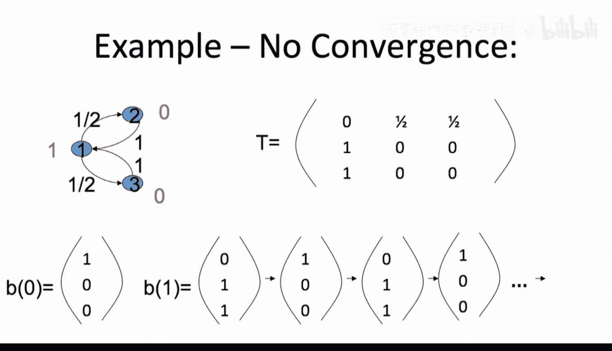

So more generally， let's actually look at the conditions which are going to define convergence。

 so let's say that we're starting with some particular network of weights that people put on different individuals。

 we'll say that that society converges， T converges if the limit of this process raised to the T。

 so the limiting belief exists for all initial beliefs so of matter what initial beliefs we started with。

 we would end up with convergence of this overall belief。Okay， so that'll be a definition。And。

In terms of characterizing this， we'll say that T is a periodic。

If the greatest common divisor of all its simple cycles is one。 Okay， so， for instance。

 of these two things we looked at before。

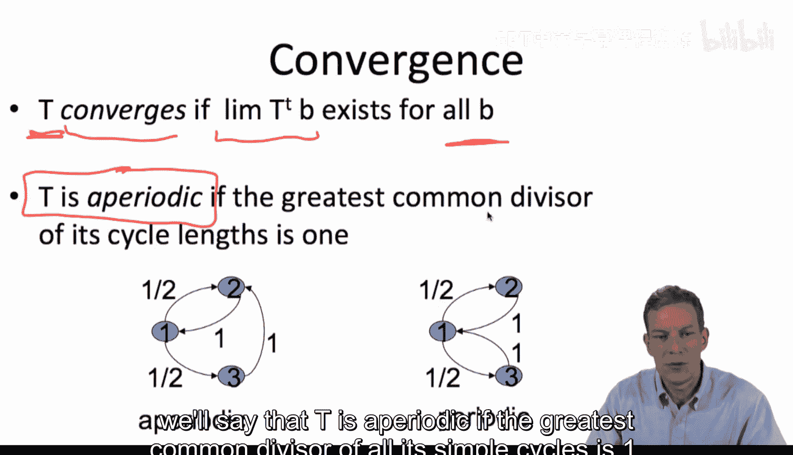

Here we could find a cycle， so let's look at this， we have a cycle of length three。

So we have one cycle of length three。 We have a cycle of length two。

The greatest common divisor of 3 and 2， they don't divide into each other。

 The only thing that divides both of those is one。 greatest common divisor is one。

 This thing is a periodic， right， So this one is a periodic。😊。

What do the cycles look like over here while there's a cycle of length too。Here's a cycle of length。

 too。Here' is a cycle of length。For。All the cycles are even。All cycles are 2，4，6，8， et cetera。

 greatest common divisor。2。So this one is periodic。 It's not a periodic。Not a period。Okay。

So when we're looking at the structure of these matrices。

 what turns out to be true is that this app periodioicity is going to be what defines whether or not you get convergence of this process。

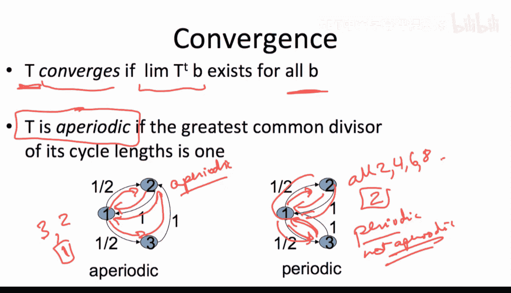

So in particular there's a theorem which you can get out of a variety of sources。

 but basically can be derived from work in Markovcha theory and more generally in linear algebra。

 supposeose that we have T be strongly connected， and let me say a little bit about what strongly connected means。

 strongly connected is going to say that from every given individual there exists a path。

 a directed path from I to J， so there exists a directed path。

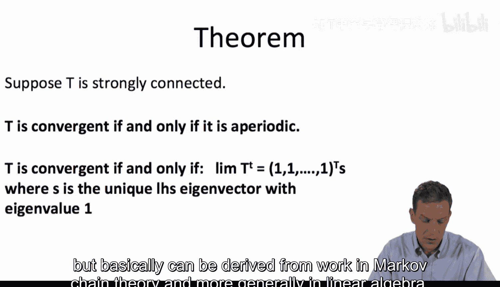

From I to J， for all I J。Okay， so basically we're not in a situation where some people could never end up getting information from other individuals。

 everybody could eventually hear from everybody else if you have non-strong connection。

 the characterization here gets a little more complicated if you're interested in that I have a paper with Ben Golo in 2010 which gives the complete characterization of convergence for nonstr connected networks will just deal with the strongly connected ones and that's most of the intuition。

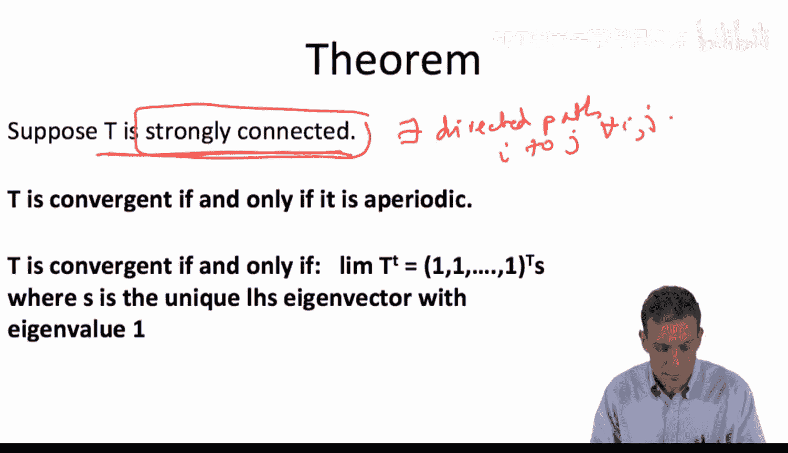

Okay， so what's the theorem say， the theorem says that you get convergence if and only if you get a periodicity。

So that a periodioicity is necessary and sufficient for convergence。嗯。And。Separate part。

 So first part is a periodioicity is going to give you convergence。

 And then a second part of that we learn is if things are convergent。

Then we're also going to have the limit of this matrix。

Actually looks like every row is going to converge to having。

 So if we look at at what T raised in a limit raised。

 the infinite power looks like what it looks like is a vector， a set of each row has。

Entries S1 to S N， the same S1 to S N。So everybody ends up putting in the limit the same weights on other people's initial beliefs indirectly。

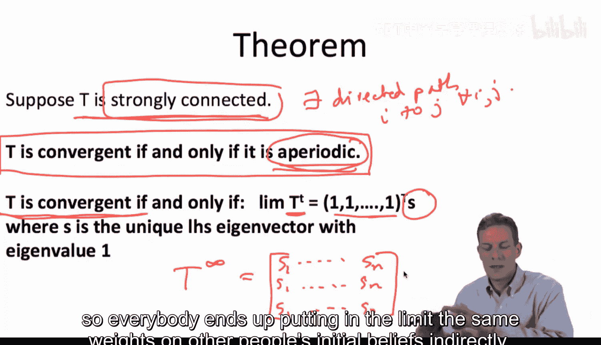

Where S is the unique left hand side eigenvector that has eigenvalue1。Okay， so that's a mouthful。

 But it says that， in fact， what this is is the same eigenvector that we were talking about when we talked about eigenvector centrality。

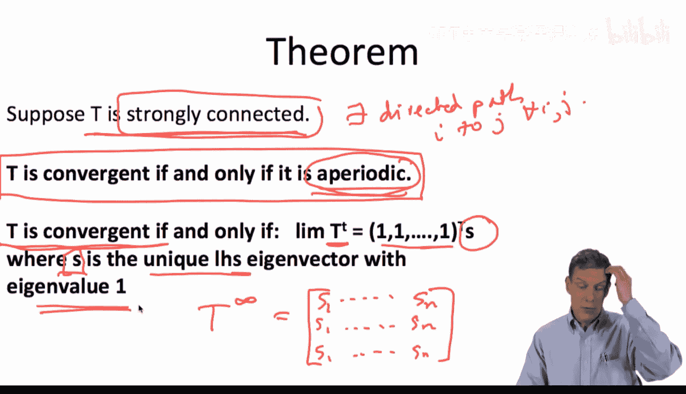

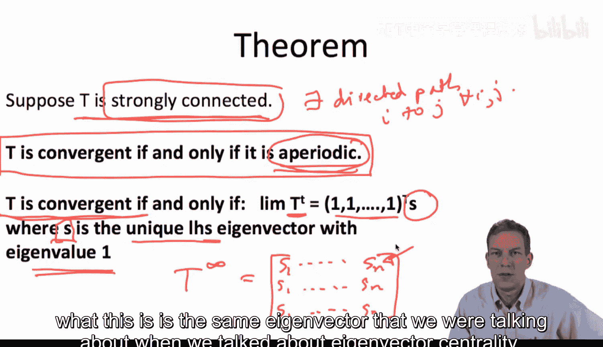

So this is an eigenvector that has eigenvalue 1 in this case it's going to be the unique one if we've got strongly connected and a periodioicity。

 this thing is going to be convergent and it's going to have nicely defined weights here S1 through SN and in fact there will all be non-neg theyll all be positive in fact。

 so these is a very powerful set of results here， it tells us a periodioicity gives us convergence moreover convergence occurs to a very specific limit and that limits given by the left-hand side unit eigenvector of the matrix and that's where those two7s and 2/7s。

2/7s came from and the other numbers that we found in those examples before。

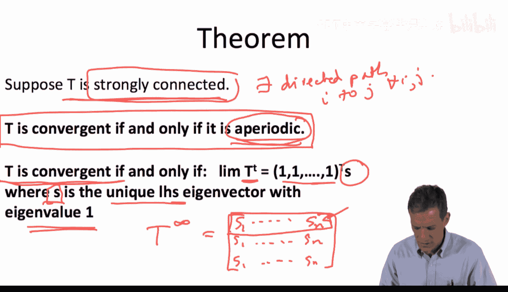

Okay， so what we're going to look at next is I'll go through how you prove this。

 It involves a bit of linear algebra and some theorems from that。

 So if you you can skip that if you like， if you want to see the details。

 I'll explain how you can derive that kind of theorem and then afterwards。

 we'll begin to put this in process。 So what we've got is convergence from a periodioicity plus we know what the limit looks like。

 so we'll then talk a little more in detail about what this S vector actually means。

 what it comes from and look at it in some examples and try to understand how we might use this model a bit。

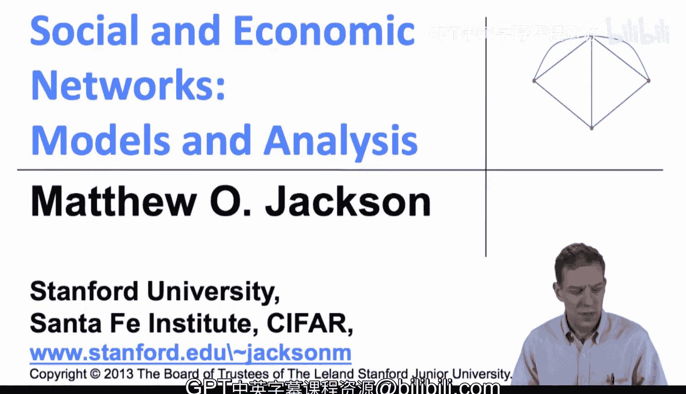