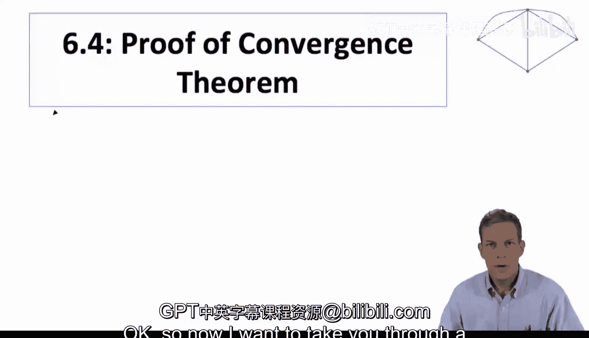
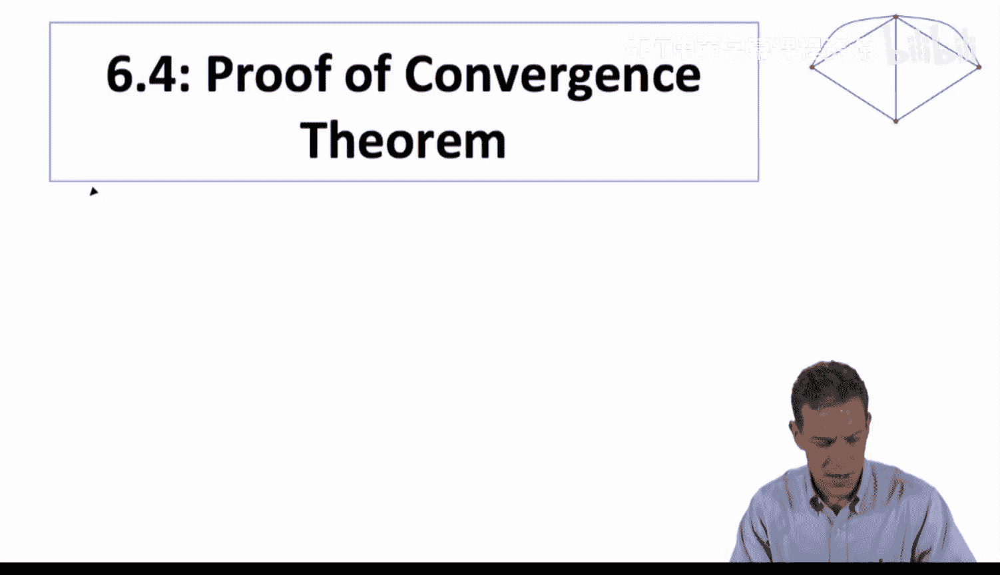
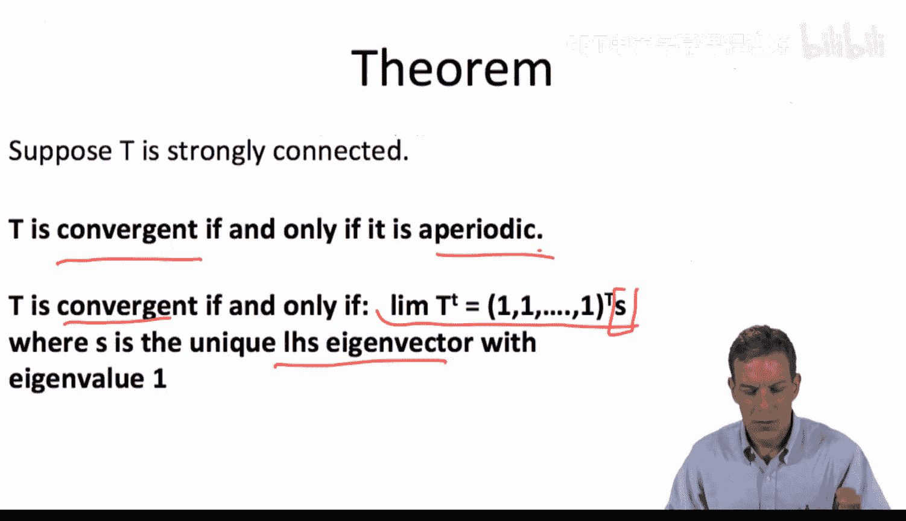
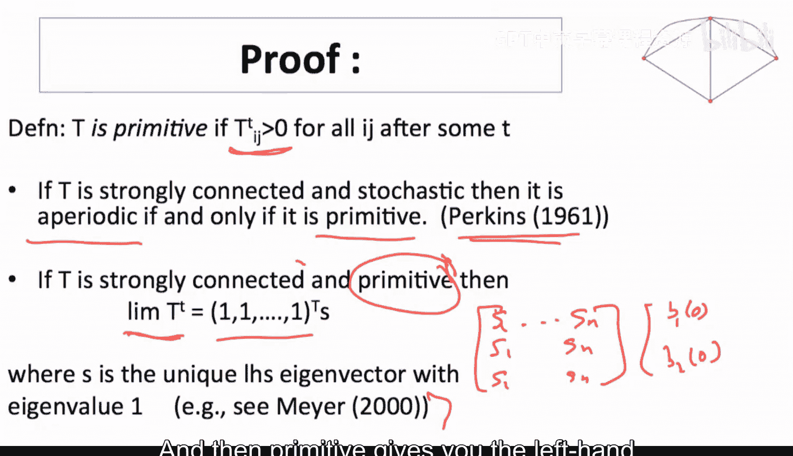
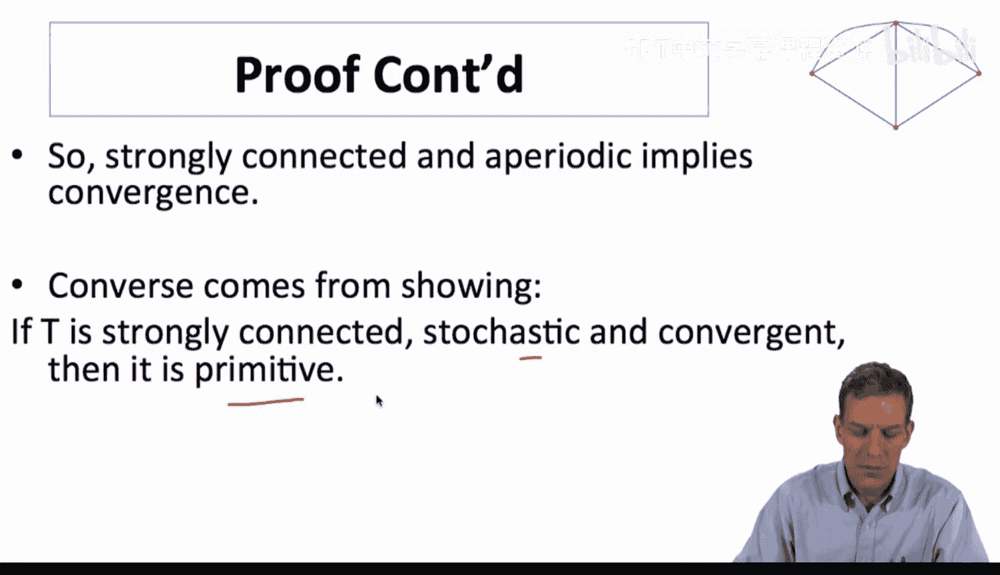
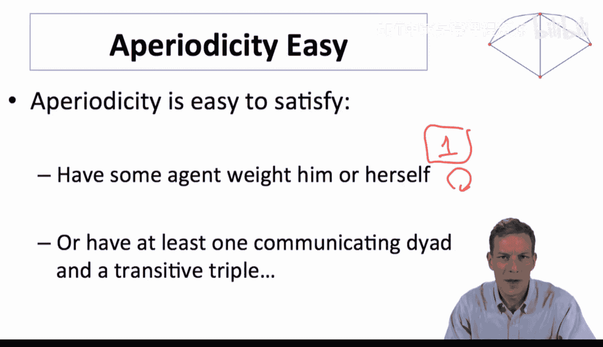
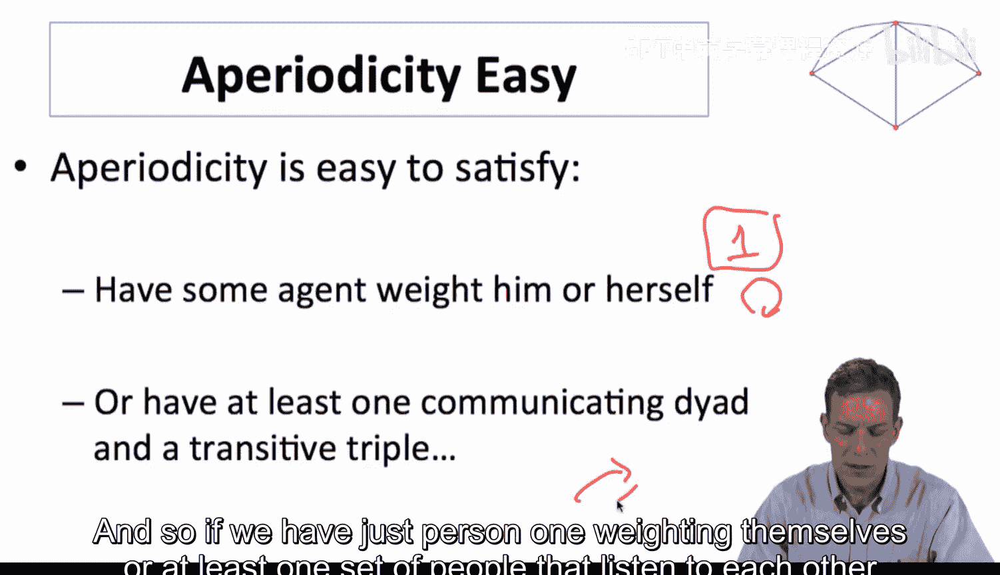
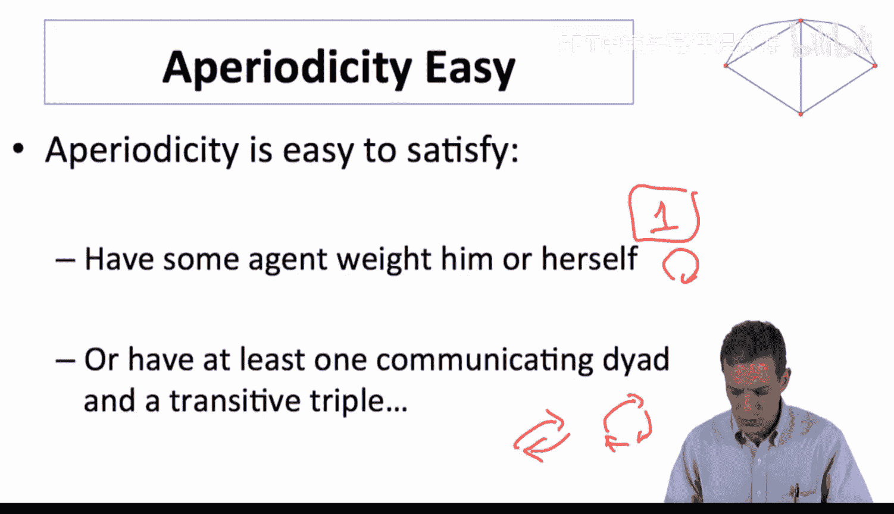
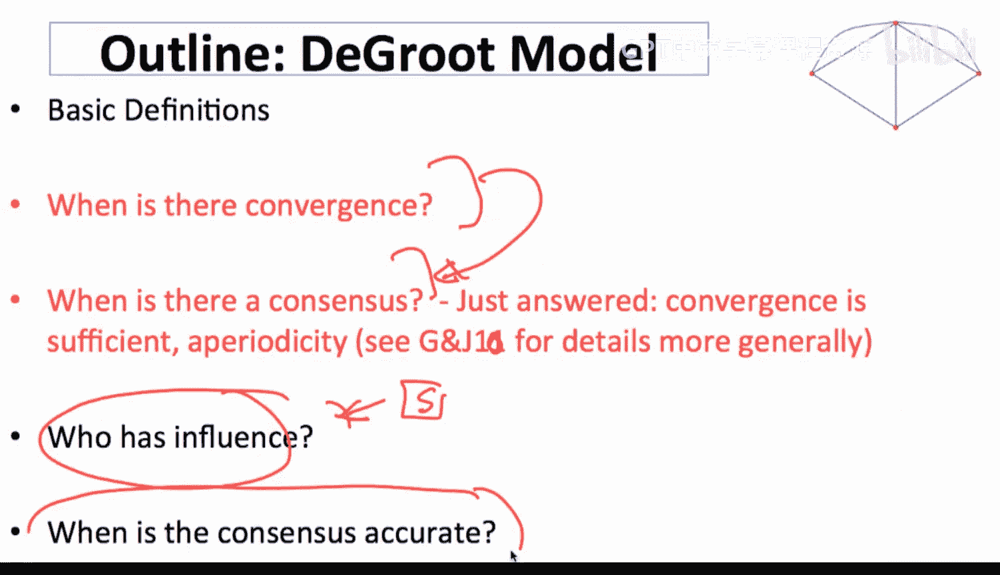

# 斯坦福大学《社会和经济网络：建模与分析｜Social and Economic Networks： Models and Analysis》中英字幕 p66 66_06_04_6-4-收敛定理证明（可选-进阶-10-25）.zh_en -BV1v1421U7Nk_p66-

Okay so now I want to take you through a quick proof of this convergence theorem and what the proof is useful。

 it's a proof that's not terribly insightful because it's one that's going to leverage a lot of results in mathematics and not be a direct constructive proof you can do a direct constructive proof which is a little bit more involved and。

Let me talk through some of the intuitions behind this before I go into the mathematical proof。

 and you know one thing that's true is you know if you've got periodicity。

 it's going to be easy to construct some examples where things blink on and off so you won't get convergence。

 So periodicity， a periodicity is going to be necessary for convergence。

 And then the idea is with a periodicity， one thing you can show is that then the matrix actually eventually everybody is going to be incorporating information from every other person and once you start doing that。

 then the idea is that effectively。Each individual， you know， the。

 the person who has the lowest belief is always going to have to be coming up over time， right。

 So they're waiting other beliefs and indirectly waiting everybody。

And the person with the highest belief is going to be dragged down over time。

 And so those things are going to have to come towards each other and they're going to actually converge。

 And so once you've got a periodicity， then you get this reach。

 which eventually is going to start dragging things towards each other and eventually things will converge。

 Now， what they converge to the fact that everybody is going to have to be moving towards the middle means that each row is going to have to actually converge to the same thing。

 everybody's going to have to have the same belief over time。

 And then whatever that row of the t matrix raised to some power starts converging to is' going to have to be the same thing for each individual and we'll see that that。

 in fact， is going to have to be an eigenvector in order for that to still be something which when you multiply it by the matrix gives back the same belief。

 So if you're going to converge to something， it's going to have to be that those things are unit eigenvectors and。

So。That's the sort of high level intuition behind that and we'll go through the proof and you know playing with these things over time there's a lot of intuition behind these and you begin to see how how they operate okay so now a more formal proof so remember the theorem said that if we we're dealing with strongly connected trust matrix and we'll say that this thing is convergent。

 if and only if it's a periodic and then moreover we also get convergence then if and only if the limit looks like each row is。

Based on the eigenvector， which is the left hand side unit eigenvector that has eigenvalue 1。 Okay。

 so what's a proof of this。 first of all， let's say that a matrix is primitive。

If when you raise it to a high enough power， eventually all the entries are zero， okay。

So there'll be some time after which when you've raised it to some power， all entries are non-zero。

 and then if you keep raising it to powers， once you've got all entries non-ze and each row is summing to one。

 it's going to stay non positive forever after so a matrix is primitive if and only if you get positive entries after some time。

Okay so one thing that you can show and there's a number of different ways you can show this this goes back in linear algebra quite a ways。

 So Perkins 61 will give you one proof of this， but if you've got something strongly connected and stochastic then it's a periodic if and only if it's primitive So primitive is equivalent to a periodicity here basically if it's periodic。

 then things aren't going to always be all entries0， they can blink on and off if it's a periodioic。

 then after some time period， basically all the entries are going to become positive and you end up with a primitive matrix so that's useful and the second part then says that and you can see it's different sources on this if you've got something which is strongly connected it's a primitive matrix So once we've gotten something that's primitive then if we look at the limit of this thing and a stochastic matrix。

The limit is going to look like the every entry each row is just eventually taking on the values of this eigenvector S1 through SN okay so everybody is effectively when we think about what the initial beliefs were the beliefs at times  zero。

 basically everybody is going to be taking the eigenvector and multiplying that times those beliefs to get their beliefs Okay。

 then you can get that theorem amount of mere。 So what this does is say if you've got。

Aerioicity you get that that's equivalent to primitive in this setting and then primitive gives you the left hand side eigenvector as the convergence。

 so strongly connected and a periodiodic implies convergence and the converse is going to come from showing that if we've got T being strongly connected。

 stochastic and convergent， then it's got to be primitive。

Okay。So what we want to show then is this just you know making sure we get this converse part。

 So if we've got something strongly connected and stochastic and convergent。

 then it has to be primitive。 So what we showed is a periodioicity， gives you primitive。

 gives you convergence and the limit， now we want to show if it's convergent。

 then it in fact has to be primitive， which in this world is equivalent to a periodioicity， and that。

Completes the circle of the theorem。Okay， so let's， let's look at convergence。

 So if you're getting convergence， there's something that this matrix eventually converges to。

 Let's call it S。 So we've got this S big S matrix， which we're going to converge to。

So that means that S times t has to be equal to the limit of t to the t times t right if this is the limit。

 and then we just multiply it times t one more time， that would be the same limit。

 so that has to be giving us back S。Okay。So that tells us that S times t has to be equal to S。

 whatever this limit looks like， this limited matrix has to actually look like a matrix full of eigenvectors。

 because when you're multiplying this matrix times T， it's going to give you back the same matrix。

So that tells us that every row of S。When you take a row here， it's like a vector multiplying T。

 you're getting back the same row。 So every row of S is a left hand side eigenvector。 And in fact。

 it has eigenvalue 1。 So we're not moving this S up and down。 It's coming back directly as S。

 So it's scaled exactly with an eigenvalue of 1。So if you have something like this。Then。

The pronephoranius theorem， an eigenvector of an irreducible non negative matrix is strictly positive。

 If and only if it's associated with the largest eigenvalue。

 And this vector is unique in the case where the matrix is primitive。Okay。So since S is all positive。

We end up with T being primitive。And then when t is primitive。

 then proon forbeius theorem tells us the eigenvectors unique。

 and so all rows of s are exactly the same S， which was the S that we were working with before。

 which is the left hand side unit eigenvector， so paron forbeius tells us that we basically get a unique eigenvector and in this case we're getting the one with the largest eigenvalue of one。

Okay， so that wraps up the proof here。What do we learn from this， basically convergence。

 equivalent to a periodioicity， a periodioicity gives us primitive。

 that also gives us the convergence。 So we know exactly what we're converging to。

 which is the eigen Left hand side， eigenvalue。 Nice thing is a periodioicity is very easy to satisfy in this world。

 So as long as you just had one person rate him or herself。 So if anybody puts weight on themselves。

 So you've automatically got a cycle of length one。And once you have a cycle of length one。

 then the greatest common divisor of all the cycles has to be one。

So as long as we've got strongly connected a periodicity。

 as long as anybody's putting weight on themselves， you're done。

 the only way we're going to end up with situations where we don't have convergence is that nobody puts weight on themselves and then we have all cycles being multiples of some cycle length of at least two。

 and。

So if we have just person one waiting themselves or at least one set of people that listen to each other plus one that involves a triple。

 that would be enough to have a greatest common divisor of length one。

 so it's going to be very easy to satisfy a periodicity and generically in some sense it's going to be the true case。

Okay， so what do we find we've got you know when is a convergence and giving convergence actually gives us a consensus。

 everybody converges to the same thing that also told us a little bit about the influence because we're getting this S vector out so it's previewing a lot of what's going to happen in influence if you want to figure out the full details of this there's actually a paper book myself and Ben Goab in 2010 which gives more general details on this kind of convergence in this model but we can ask now then you know who has influence。

 what can we say about influence， when is the consensus accurate these kinds of things as well。

