# 斯坦福大学《社会和经济网络：建模与分析｜Social and Economic Networks： Models and Analysis》中英字幕 p67 67_06_05_6-5-影响力.zh_en -BV1v1421U7Nk_p67-

Hi， folks。 So let's talk a little bit about the influence vector now。

 So in terms of understanding what this limit of the de group process looks like。

 what are people's beliefs converging to， So how can we use this de group model to understand the limit of the learning process。

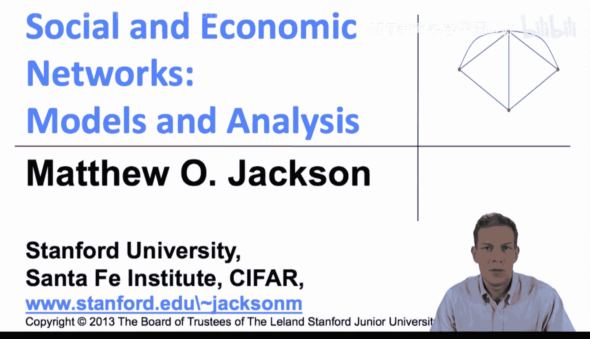

And let me just sort of reiterate what we looked at before when we looked at T to the T。Rised。

Times B。 when we're looking at the limit of this， we're looking for some vector S1 through SN。

 which when multiplied by B1 through BN。Gave us back the beliefs in terms of what the limiting beliefs are。

 And so this is essentially giving us a measure of the influence of each individual。

 how influential they are。 And let's talk a little bit about that。

 So we're trying to find out who has influence in this model。

 And you know this gave us some preview of this by telling us what this S1 through SN was a unit left hand side eigenvector of the matrix。

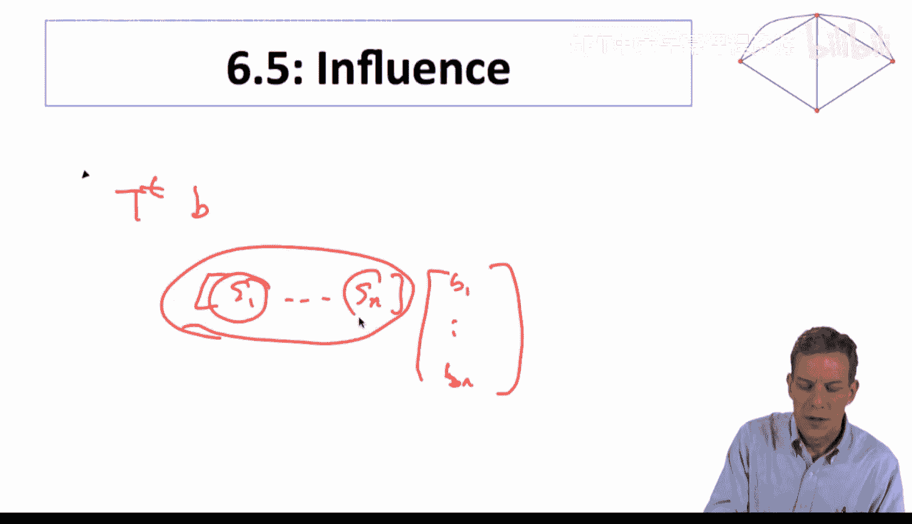

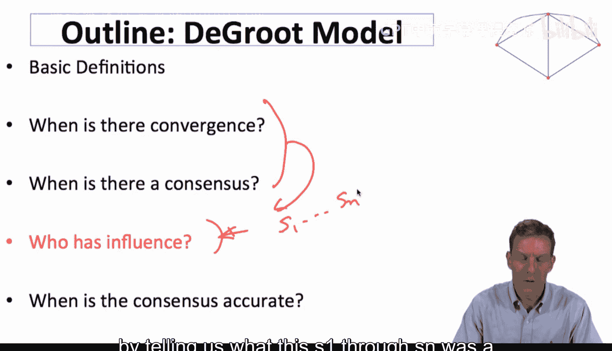

And so that tells us what we get to when we get convergence and we get consensus。

 it looks like a normalized left-hand side unit eigenvector and that gives us the weighted some of the original beliefs to figure out what the limit is So when we look at this you know let's just take a peek at one of the matrices we looked at before where person one weights2 and33 two weights one and three weights2 and as you begin raising that to different powers eventually we see after five periods that it's all non- negativegative that's with the a periodioicity that make sure that this thing turns out to be primitive。

 we get all non- negativegative entries eventually and indeed as you go to the limit we end up with these calculations of two fifths。

 two fifths one fifth as the entries in every row And so that tells us if we're trying to hit this with some beliefs B1 B2 B3 how much are we waiting persons one belief well two fifths they're going to get weighted how much are we waiting to person two beliefs。

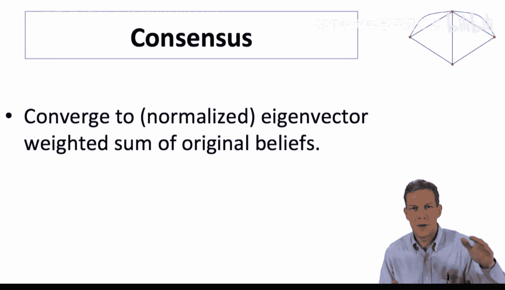

Two fists。1， fifth on person threes。 So that tells us those relative weights。

 And you can double check that this is a unit eigenvector of this thing。 So if you multiply2 fifth。

2 fifth，1 fifth times this， what do you get back， Well，1 fifth，1 times 2 fifth。

Two fifths right so hit this times this so if we multiply this thing times two fifth， two fifth。

 one fifth， we get two fifths in the first entry， a half a two fifth and one times a one fifth is a two fifth and a half of a two fifth is a one fifth so indeed we get back the same vector we started with。

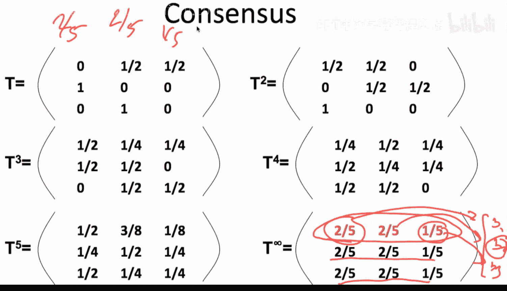

Okay， so when we look at， you know， in general， the nice thing about this is it tells us what these entries are going to be in the limit。

 which wouldn't be very easy to figure out just by looking directly at the matrix。

Right so if we look at this matrix and ask what the limit's going to be or we look at this figure。

 once we've got some fairly complicated things going on， especially for a large matrix。

 it's not going to be easy to figure out what these eventual entries are going to be。

 And so the fact that it's the lefthand unit eigenvector means you could just plug this into your favorite program。

 matlab， mathematic maple， whatever you like to use to do analysis of matrices and that would give you back a left-hand side unit eigenvector and then that calculation will allow you to figure out what the eventual influence would be and you could also just raise this to multiple powers and see where it's going in terms of a limit。

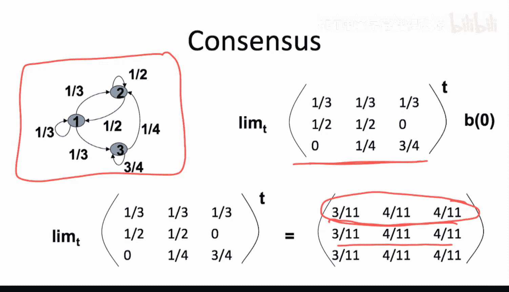

So in terms of what's going on in terms of these limiting beliefs。

 the influence is coming from the fact that these rows have to converge to the same thing for each row and in terms of what it eventually means given that we know that this is going to converge to  three1s。

411s，411th， it tells us that the limit know in terms of the weight it puts on whatever person one belief is 311 So if person one had a weight of belief of one and everybody else believe0。

 we'd go to311s if it was person two that had that belief it would go to 411s and in person3 would give411 so it's telling us basically how much eventual weight in the final belief of society that each person's initial belief have so it's a very compact and simple measure Now when we're looking at what this influence measure is the nice thing the way that we get to the fact that it has to be unit eigenvector comes from the fact that we know。

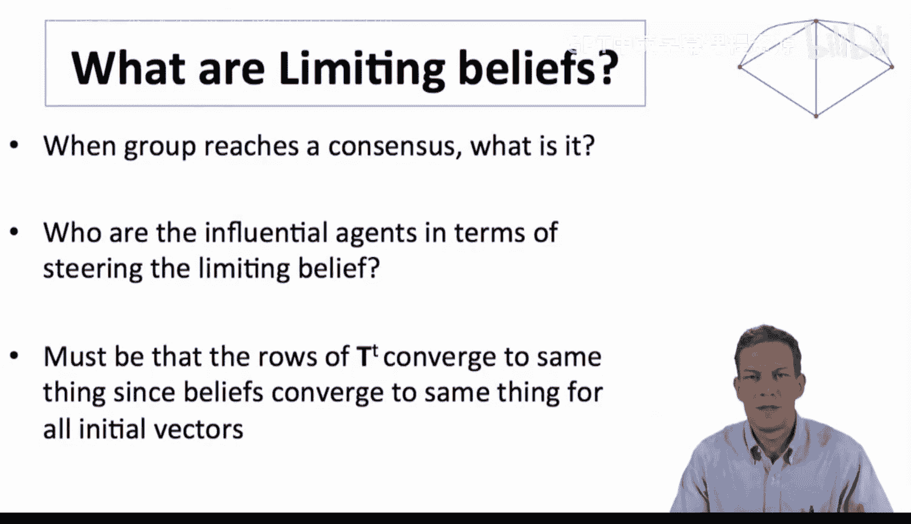

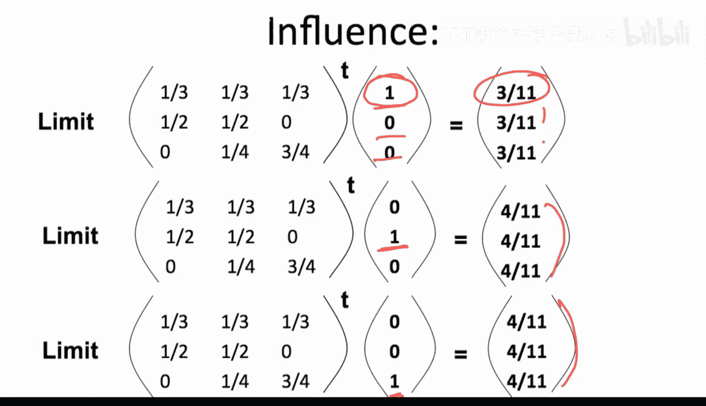

Whatever we want in terms of figuring this out， it has to be the same thing since it's a limit of doing all this updating。

 it would have to be the same thing as if we did it after one more。

 you know if we did one more updating， it shouldn't change the limit and so it has to be that S is equal to ST and that tells us that effectively whatever this influence vector is that we were trying to get to tell us what the ventual beliefs are。

 it's going to have to be a left-hand side unit eigenvector。

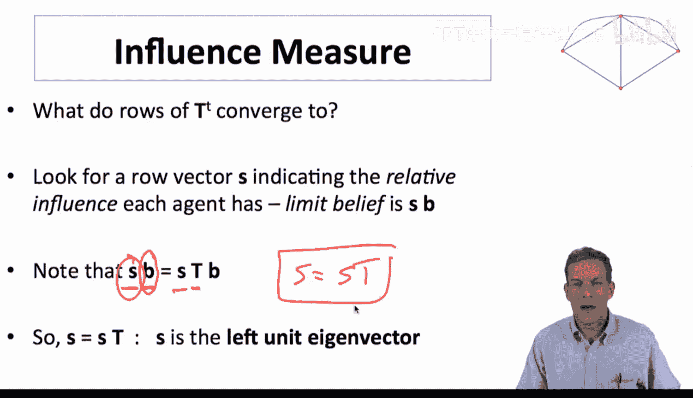

Now the nice thing about that is it ties us back to these influence measures。

 the centrality measures，envector centrality， it's seeing that the influence that person I has is awaited sum of the people who listen to I TJI times SJ。

Right so the fact that S is equal to S times t tells us that effectively the way that you get influence is being listened to by influential people。

 that means your belief is going to get into their beliefs which is going to get into other people's beliefs and the more influence they have。

 the more structure they have on the final， so you get high influence by being connected to by high high influence individuals。

And so again， that relates back to things like power measures， Google Page rank。

 eigenvector centrality， and this is now giving us a foundation for why we would want to be looking at an eigenvector as a measure of power or influence。

 It comes out directly in this model。 So it gives us a nice foundation for that。

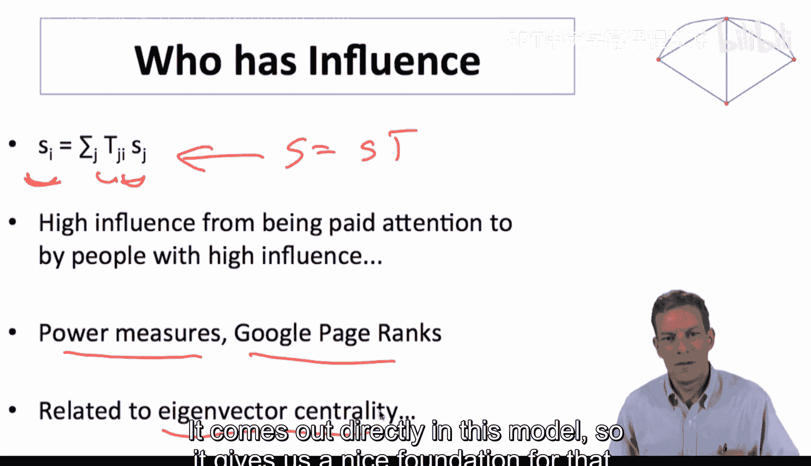

So the next thing we'll do is take a look at putting these to practice。

 so we'll take some of the deroot model， look at the lefthand side unit eigenvector now of a stochtasticized matrix。

 and then see what that tells us can it help us understand what's going on in a particular network setting。

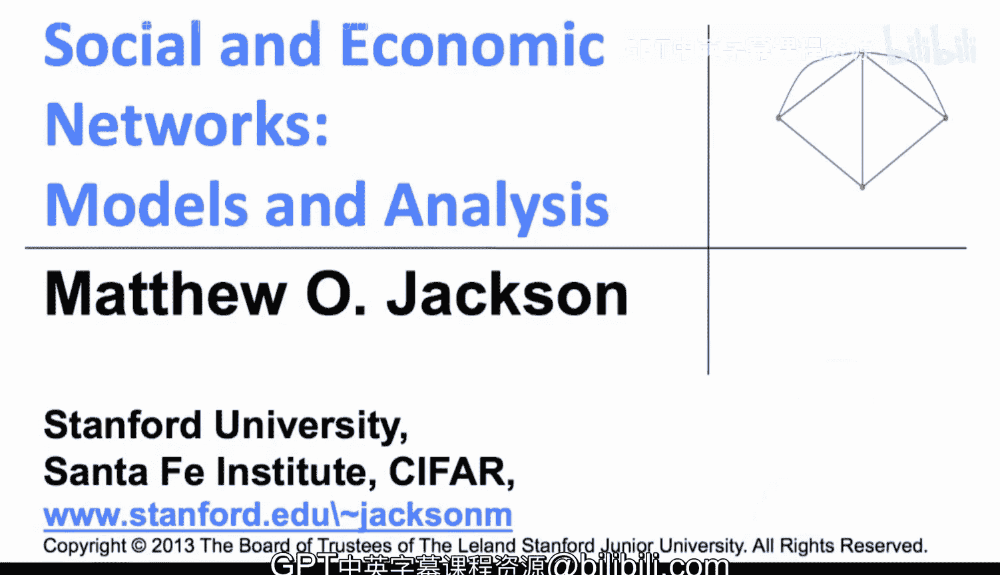