# 斯坦福大学《社会和经济网络：建模与分析｜Social and Economic Networks： Models and Analysis》中英字幕 p68 68_06_06_6-6-影响力示例.zh_en -BV1v1421U7Nk_p68-

Okay， so let's take a look now at some examples of the degree learning and the influence vector in practice。

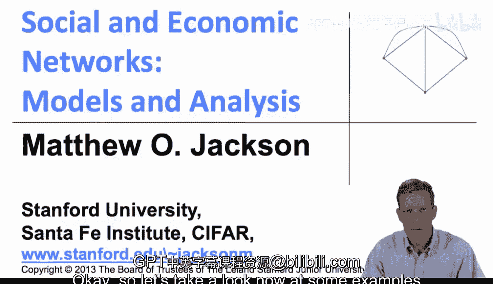

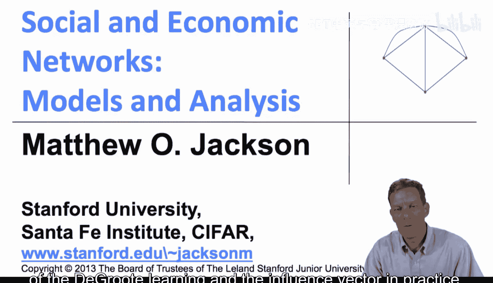

And first， we can start by just some simple situations where we see how people's position in a network translates into the influence。

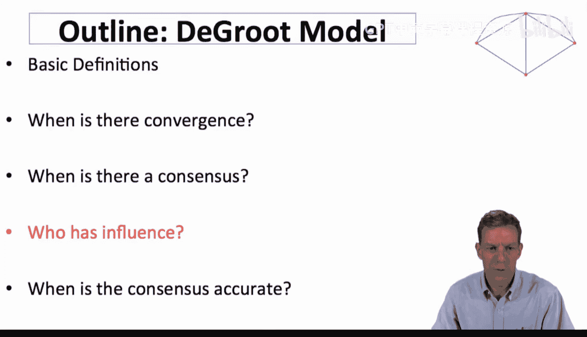

And one thing that's sort of interesting is that people who put huge weight on themselves。

 high weight on themselves are going to end up maintaining beliefs while other people are changing over time。

 and so groups that are highly introspective and get listened to by other groups are also going to end up having their weight be very high in a society so one thing that's sort of interesting about this model and perhaps a little strange is that groups that don't listen much to the outside but end up being listened to a lot by the outside end up having a large influence。

 so it's not only listening a lot to yourself， but also then having people listen to you that combination can give somebody a very high influence because they don't update their beliefs much and they end up eventually impacting other beliefs。

嗯。

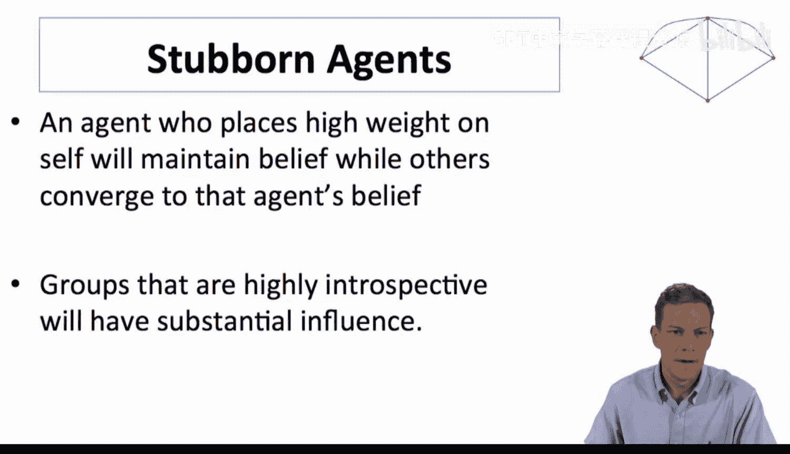

So when we look at another example of influence， suppose that actually what people did was equally weight their connections。

And let's also suppose that you know talking we think of this as friendships， so they're mutual。

 so TIJ is greater than zero if than only if TJI is equal to zero， so if I listen to you。

 you listen to me so we have conversations and I put equal weight on all my connections。

So if you think then of a situation where DI is I is out degree。

Then TIJ is going to be one over D for each I and J。

 so everybody that I'm talking to I put equal weight on， so however many friends I have。

 I give one if I have 10 friends I give one10th weight to each one of them Okay。

 so let's think of that as a very simple version of this model。

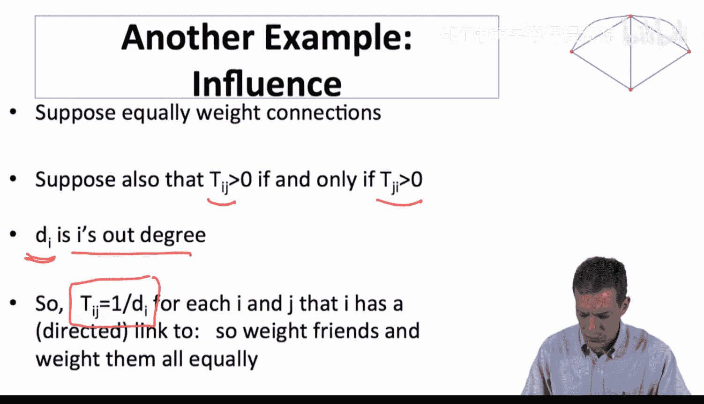

So if we let D be the overall total sum of out degrees in this model where everybody's waiting their friends equally。

 then the claim is going to be that a person's influence is just going to be proportional to their degree。

 so this gives。A foundation for degree centrality in a world where you had conversations with people and you waited everybody that you talked to equally。

Then your influence would be related proportional to your degree。

And you know recall that S is a left hand side unit eigenvector。

 so you need to satisfy this equation， and so what you need to verify is that SI is then going to be equal to this sum over Js of TJI times SJ。

Right and so let's check that this actually works， so we've got this claim that this is the eventual limit and we want to verify that this equation holds so if we plug in for SI。

 try and check that we're going to get DI out over D， well， what's this sum。

 this sum is the sum over all the people that I listens to。

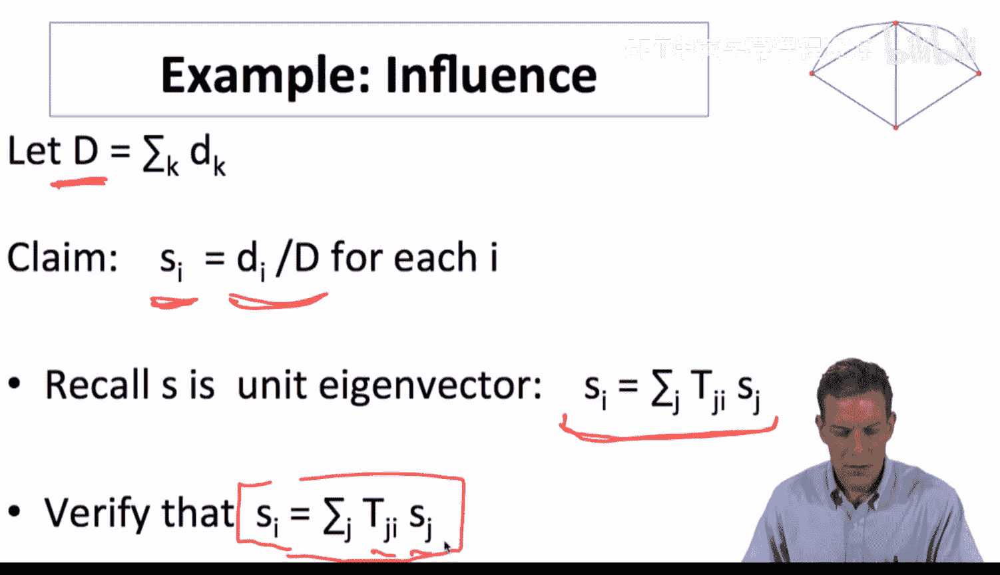

And because the listening is reciprocal right so TjiI is greater than zero。

 if and only if Tj is greater than zero。 So we're going to sum this over how many people I listens to one over DJ and we want to verify that if we stick in the Ss for this we get back the right answer So we've got DJ over D。

 Well， these two things are going to cancel the two DJs。

 and then we've got a sum which is proportional to the number of individuals that I is listening to that's directly so we've got one over D sum that many times that's going to be D over D。

 So indeed check we've got back the solution。 So in a situation where you put equal weight on all your friends and and listening is reciprocal you get back degree centrality So in that situation eigenvector satity and degree centrality actually coincide。

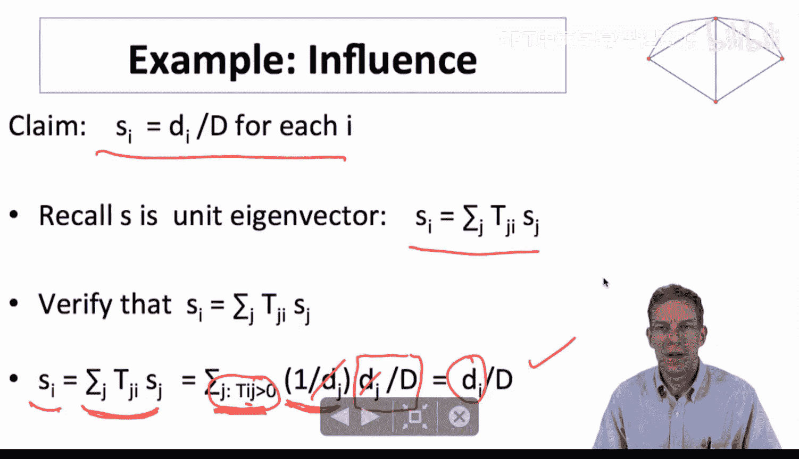

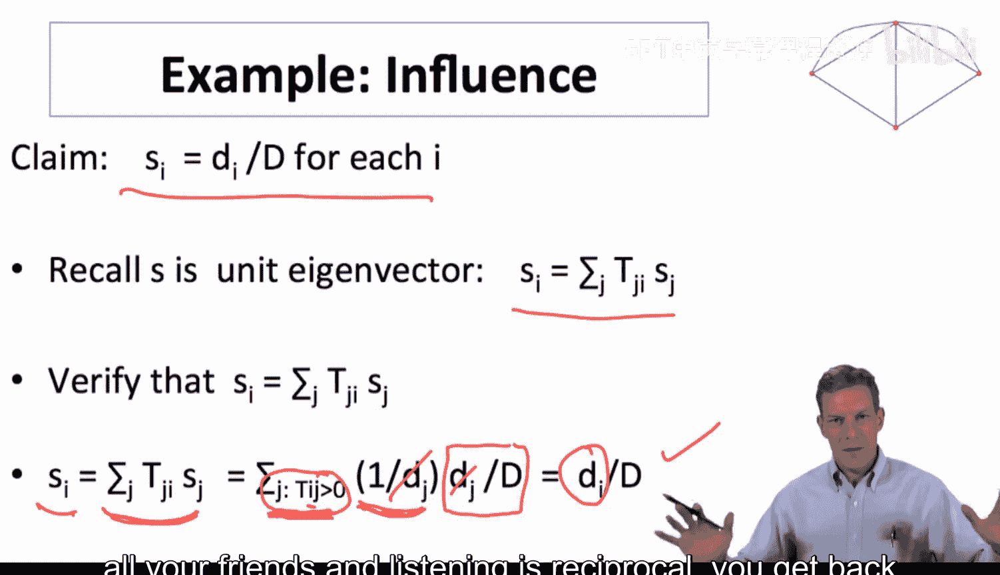

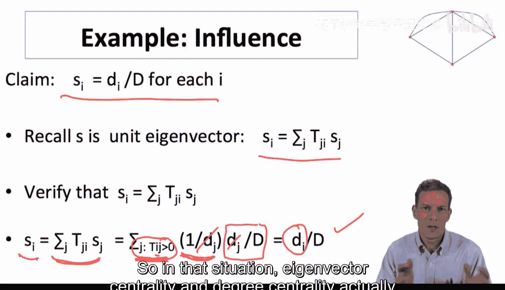

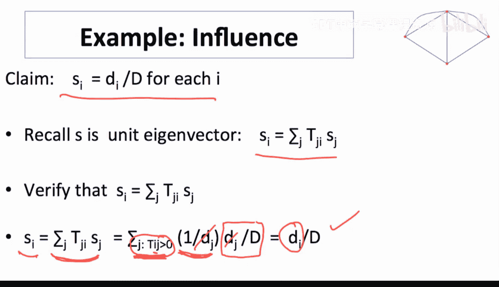

Okay， so let's have a look at an example now。 And this is a paper by David Crrackhart。

 where he looked at an advice network in a company。 a paper from 1987。

 And this is one where we've got a few enough nodes and we've got information so we can actually calculate out what the。

The Ss and in particular this is a picture of the network now it's a directed network so certain people could actually listen to others without them listening back。

 so this will be a directed network not necessarily back and forth and there are some individuals who actually aren't。

Connected， so some individuals are not getting listened to at all。

 and their influence is going to turn out to be zero in this situation。

 So it's not a strongly connected network。Nonetheless。

 the S is still going to work as the the right answer to this。

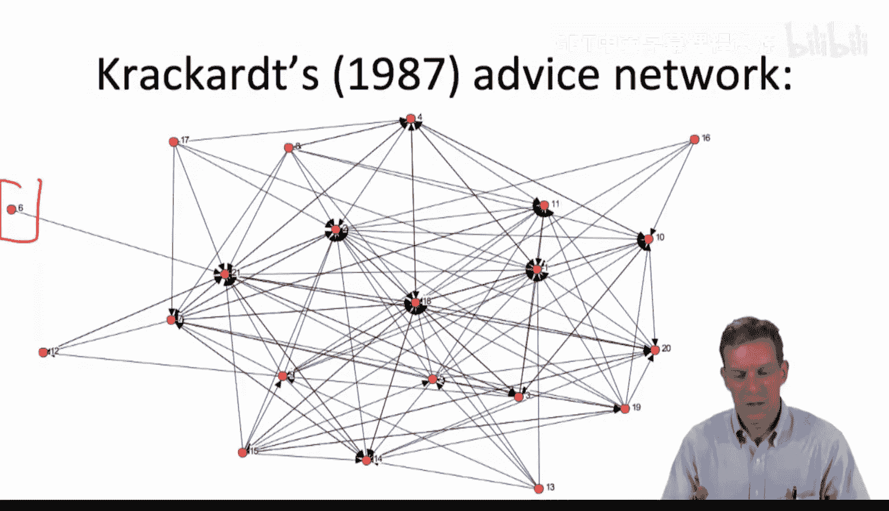

So if you go through and you figure out what the S is， so if you solve for the S of this。

 there are some individuals， for instance， six who didn't get listened to and 13 and so forth that end up with 16 and 17。

 so some people would end up with no influence， nobody listens to them it comes to them for advice。嗯。

But basically we end up with the advice levels varying from 0 up to let's see we've got a 0。2 here。

 so we end up with different levels of influence and what the other columns in this table represent is sort of these are levels of the individuals in a hierarchy in this company so level1。

 this is the CEO， the head of the company， level2 we've got people at the second highest management level than level3 is the third highest level。

 and what we see is actually there are some people who are more influential in terms of this network than the individual at the top actually one of the people at level2 has a higher influence vector than the person at the top and we can begin to look at different people。

 different people at level3 have different levels of influence。

And you know you can look at that by the different department， their age。

 their tenure and so forth and this information is going to be complementary to some of those things it doesn't just necessarily correlate with how old they are or how long they've been in the company or which department they're in these numbers are telling you something different about the relative influence that these individuals have So what that does is it just shows you one example of where you can begin to take this the group model it gives you a foundation for looking at this particular left-hand side unit eigenvector as a measure of influence and you if you ran the group process on this particular network and had people updating over time and their beliefs that would tell you what the beliefs would eventually converge to and this was done under the assumption that so we don't know exactly what these weights are that people put equal weights on each one of their friends that they said so person 17 for instance has five out arrows so they put one。

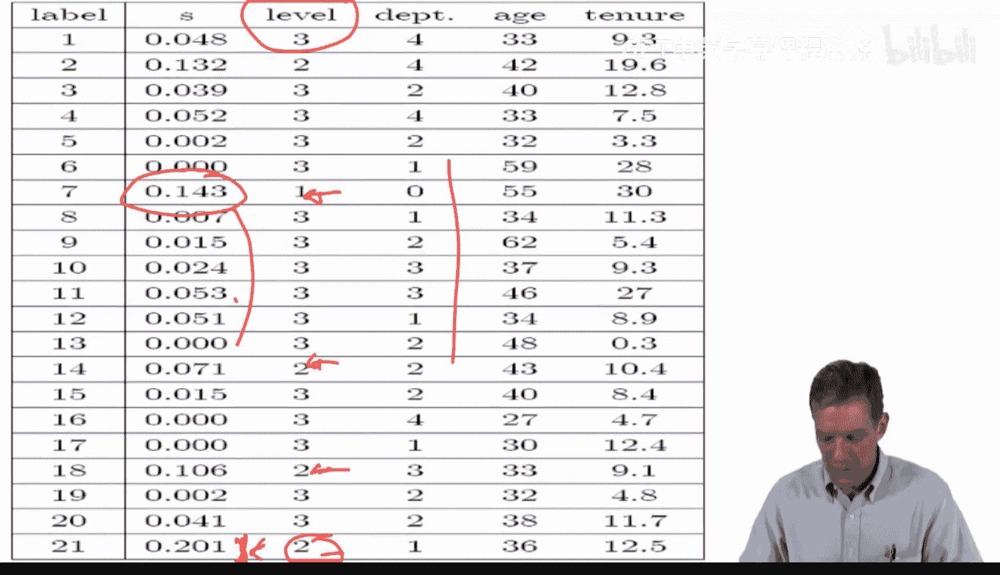

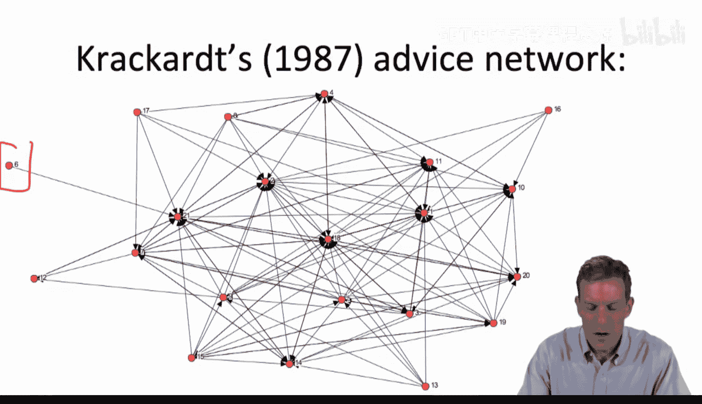

Fifth weight on each one of these。So that gives us you know one example of the influence of coming out here and again。

 know we see the relation of this to the eigenvector centrality and that's coming back from this relation of matrices to powers which was underlying eigenvector centrality so that's one of the applications of this that gives us some perspective on this to group model know we'll wrap up some of our discussion of learning next and then after that we'll start talking more about games on networks。

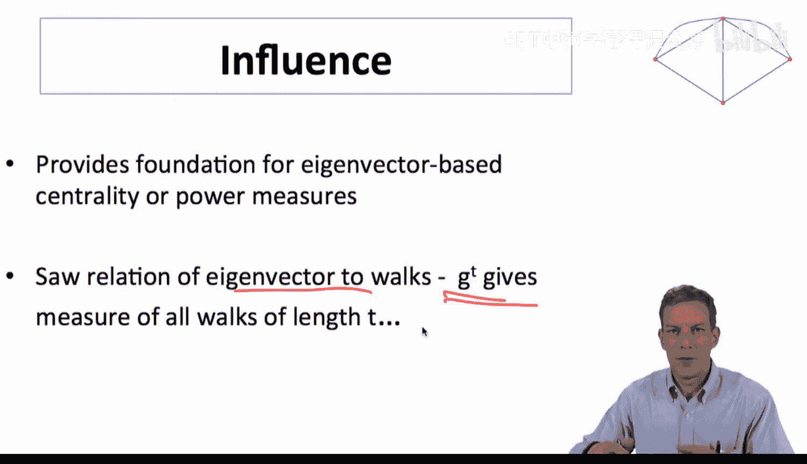

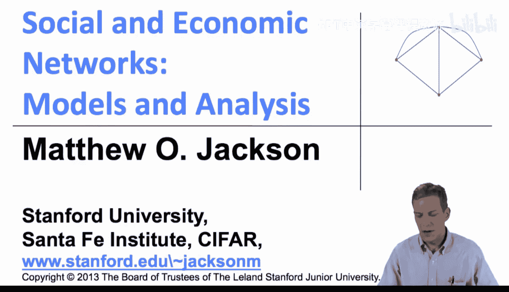