# 斯坦福大学《社会和经济网络：建模与分析｜Social and Economic Networks： Models and Analysis》中英字幕 p69 69_06_07_6-7-信息聚合.zh_en -BV1v1421U7Nk_p69-

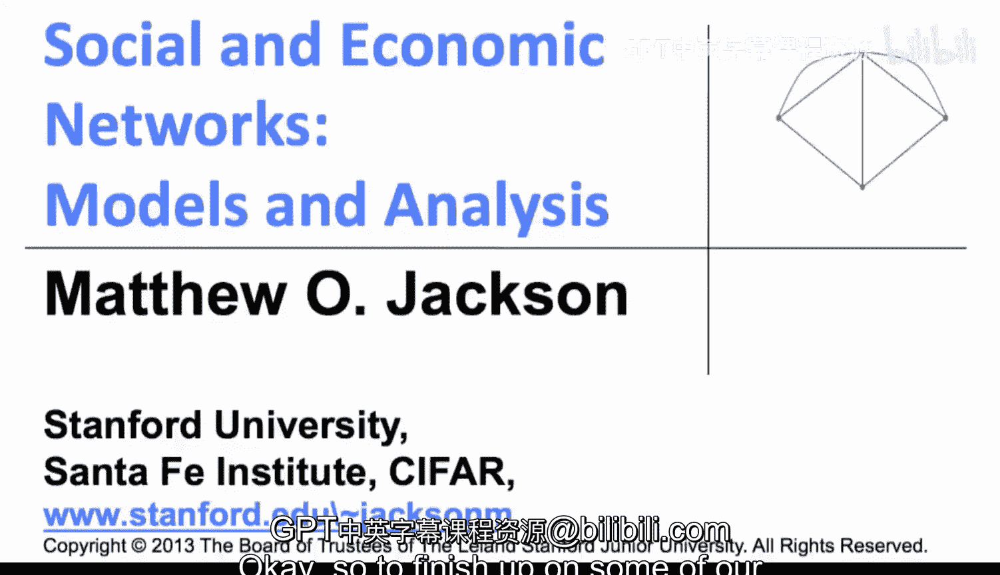

Okay， so to finish up on some of our discussion of the Du groupot model。

 let's ask a question now of sort of applying this and understanding when it is that a society of people who are updating in this sort of just weighted average。

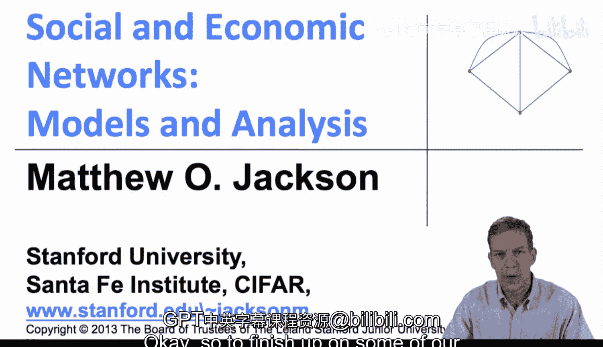

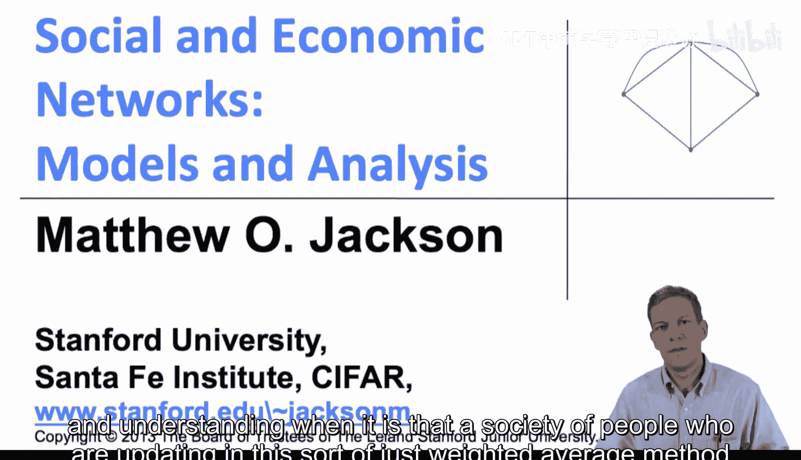

Method are actually going to come to。A consensus， which is accurate， right？

 So when is it that their beliefs will actually be reasonably accurate beliefs。

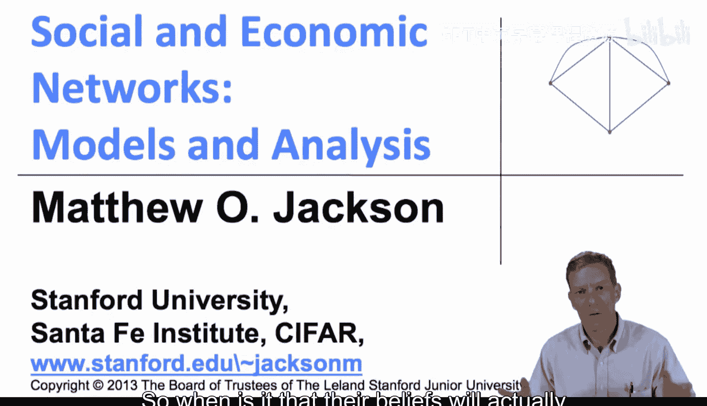

So information aggregation in this setting so is the consensus that they're going to come to accurate so we're going to have to put some structure on this and actually this question。

 the reason I originally became interested in the Du Grove model was out of conversations with a student former student of mine Ben Goub and we started asking the question of when was it that people's beliefs would actually converge to the right sort of thing。

 even if they were acting in a fairly simple form。

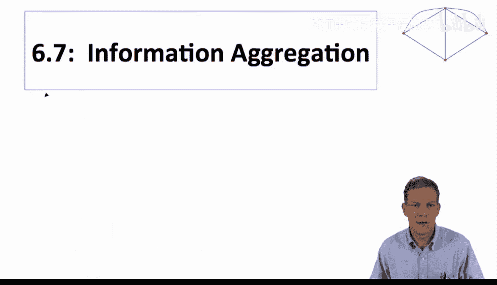

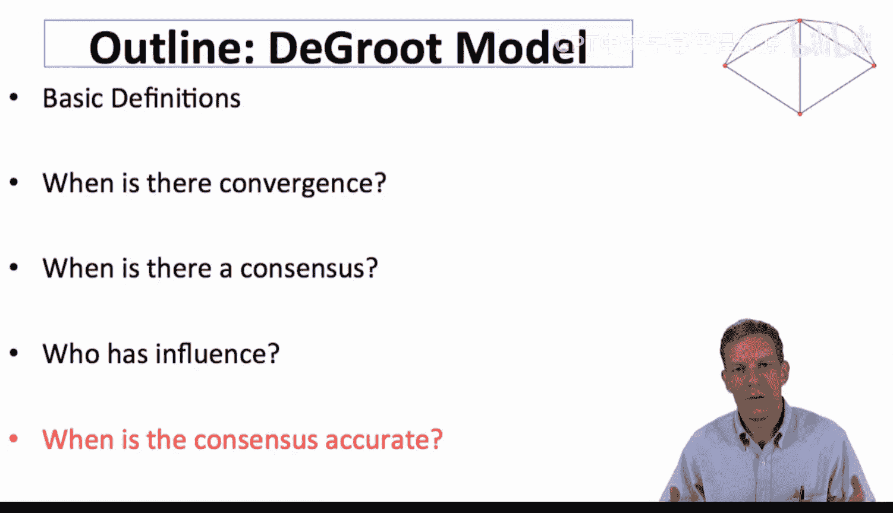

And so how does this depend on network structure， how does it depend on the influence。

 how does it relate to speed of convergence there's a whole series of questions we can ask here。

 and we'll just take a quick look at how this works in the context of the degree group model and let's suppose that there's a true state out there which we'll call mu So this nature is you know for instance。

 there's really some probability that there's going to be global warming and' something that that's true and is' out there and each person's belief at time zero is different from the true belief。

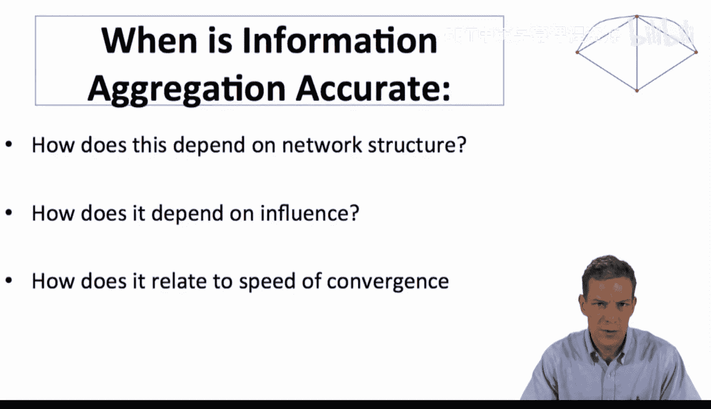

So there's some true number out there and everybody has some error and the error。

 what we're going to make sure of is that the errors of different individuals have zero mean and finite variance and if you want to keep all these things in  zero1。

 you can do that if you like， they don't have to be in zero1。

You can keep them in 01 by making sure that the variance is actually bounded so that you can't have your belief differ from mubi so that beliefs don't go outside of01。

 but that's actually not necessary for this analysis。

Okay so we've got the beliefs everybody has some error and now we run into group model and so what we'd like to have is if people keep talking to themselves。

 talking to different individuals， it would be nice if the situation eventually converge to a true mu so that by talking to people we would actually really learn what the true mu was and here we can allow these epsilon eyes to have different variances across individuals。

 but let's make sure that their independent conditional on mu so the errors that one person makes so one person might be have a high belief another person has a low belief so people are making errors but those errors aren't correlated。

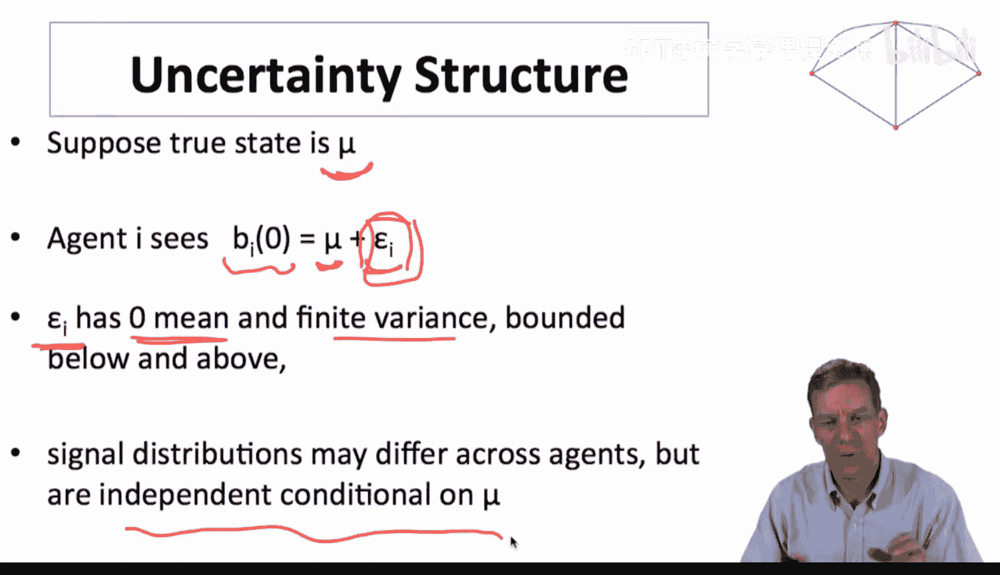

Okay so let's consider large societies so we want to ask when is the crowd going to be wise so when is it when they get together and talk to a network that they're actually going to come to a reasonably accurate mu so what we want is we want a situation where the probability that the limit as we get look at the limiting beliefs over time compared to mu the probability that that's differing by more than some delta vanishes in large societies okay。

 so there's a bunch of quantifiers here so we're looking at the limit belief。

And we want to make sure that the limit belief being bigger than some delta that vanishes。

 and we want to do that as a society becomes large。 Okay， so larger and larger societies。

 when is it that they're going to be accurate so if obviously。

 if there's only two individuals and we've only got two signals， then if we reach making an error。

 even an average of those two errors isn't going to give us a very accurate number。

 So to get accuracy when people are making errors are're going to have to average over a large number。

 But then the question is when is that the overall society can average in a useful manner。

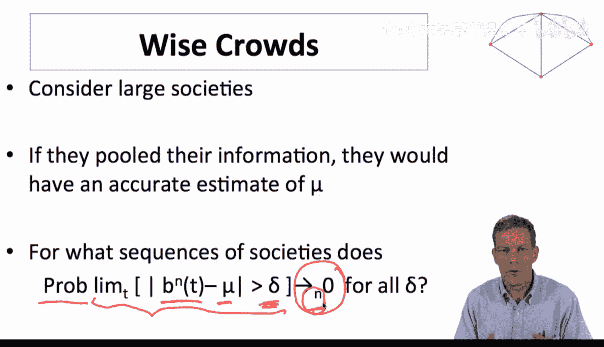

Okay。So one thing that's very useful is a variation on a weak law of large numbers you can prove this easily using chby Chevs inequality。

 so let's consider a situation where all these errors are independent so a bunch of people are making independent errors。

 each person has a zero mean in their error so they're either above or below but in expectation they have a zero so they're centered at zero and they each have finite variance。

 nobody's infinitely ignorant。

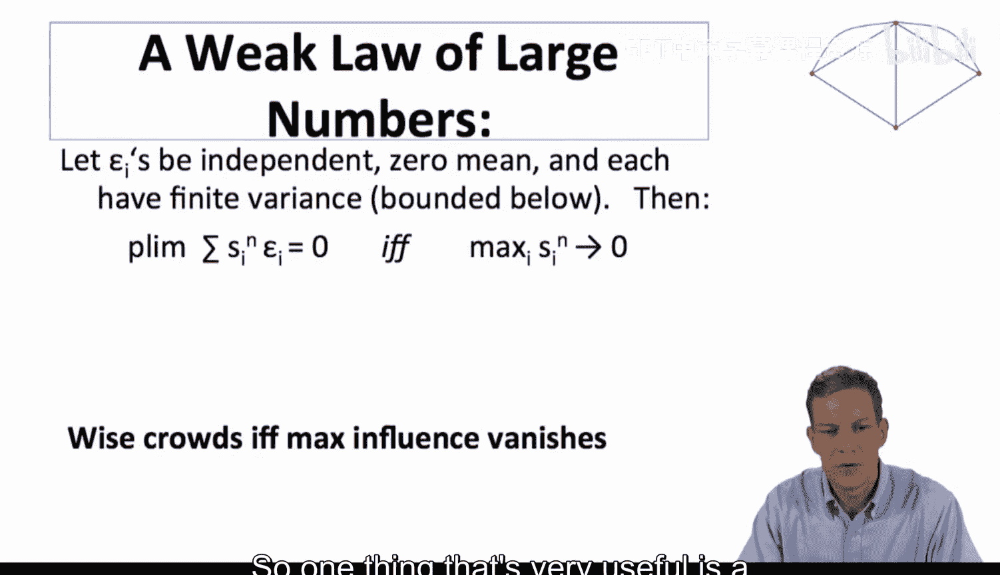

嗯。Then when we look at let's suppose that we are doing some influences。

 whatever those influences are。 So society N has a vector S1 through SN。 So we look at those。

 we'll call those the SNs right so in society N， we've got an S1 through SN and we have a different one for when we add this extra person。

 So each one of these societies has a vector。The weak law of large numbers tells us that if we look at averaging those errors。

So what's going to happen is the influence is going to capture how much of each person's error enters into the overall societal error。

The sum of the weights on those errors is going to be zero。If then only if。

The largest influence that anybody has goes to zero。Okay。So if anybody retains influence。

 then what we're going to do is end up retaining weight on that person's error。Their。

 their belief is going to be a non trivial part of the overall society's belief。

And so it's going to be necessary that everybody have a negligible weight in the limit。

 so as society aggregates， they have to disperse so that we're putting weight on different individuals if we keep all listening to the same person。

 we're going to have inaccuracy。And actually， that's going to be enough。

 so as long as a society spreads it out。Given that everybody has finite variance。

 averaging a bunch of these variables will give us a good answer。

 So wise crowds occur if and only if the maximum influence vanishes， okay。

So that's a nice simple result， which then tells us that basically we're going to get convergence if and only to the right belief。

 if and only if when we look at this in larger and larger societies。

 each one of these things is tending to zero。

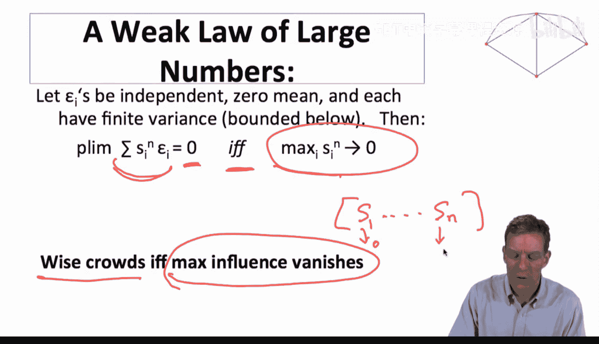

RightSo we have all the beliefs tending to0。And the max tending to 0。Okay。

 so what's a sufficient condition for this supposeuppose that we look at a situation where there' where you actually have reciprocal attention。

 so let's make t not only row stochastic but column stochastic so everybody gives some weight out but we also get the same weight in。

 everybody is getting somebody is paying attention to them so that the weight that they have out is equal then you would get s equals1 over n right so that's a situation where t would be wise。

So if everybody got weighted as much weight in as they were giving out， we'd be in good shape。

So reciprocal trust would be something that would imply wisdom。

So making sure that the trust that comes into any individual is the same as what goes out。

 that's a very strong condition though， so generally in society we're going to have some heterogeneity in terms of overall how much somebody gets paid attention to。

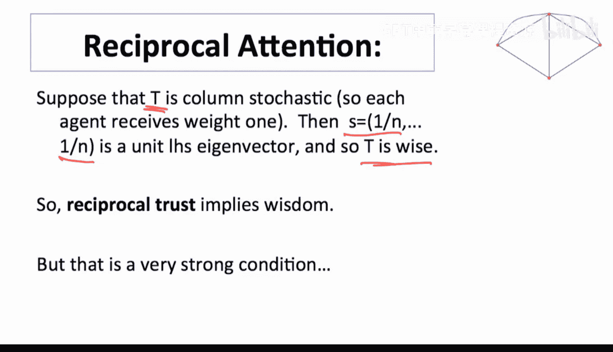

And so what's important is that when we're looking at this。

 there's no single individual that's getting too much of the weight from other individuals who matter。

 right， So there's if there was some I that had， for instance。

 everybody putting weight at least A on them， then their overall influence would be at least a。

So there can't be anybody who gets， too much attentionten。

 so you can't have too strong an opinion leader。 That's going to be an obvious condition。

 If anybody is getting too much weight in， their eventual belief is going to influence society。

 And so the network's going to have to be that as it becomes larger and larger。

 it can be that each individual is only listening to a few people So people are getting a lot of weight from a few neighbors but it can't be that overall they're getting weight from the whole society at a rate of at least a。

 So if there's anybody who's getting too much weight in。

 then that's going to be detrimental and you won't end up getting convergence。

 you can generalize these kinds of conditions。 So in the paper with Bengola。

 we give more explicit characterizations of the kinds of conditions。

 you can't have any group that's too influential， you have to have some balance across groups。

 And as long as things work out to be reasonably balanced than you end up with convergence and if not than you can end up with the wrong kinds of beliefs in the limit。

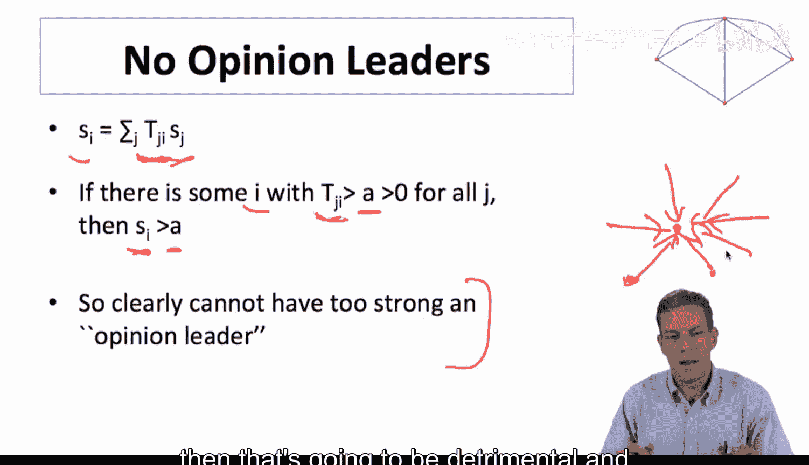

Okay， so that takes us through a little bit of understanding the the group model and learning。

 convergence and so forth， we'll wrap up some of our discussion of learning next and then we can start turning to Game networks。

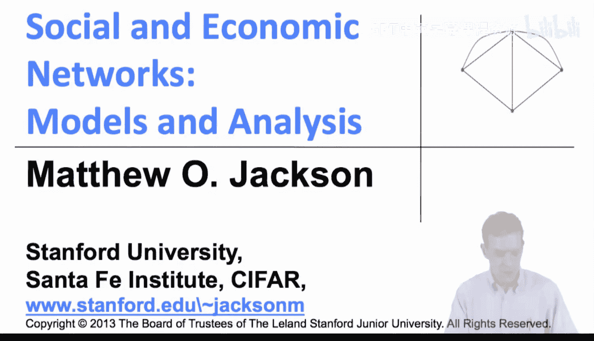