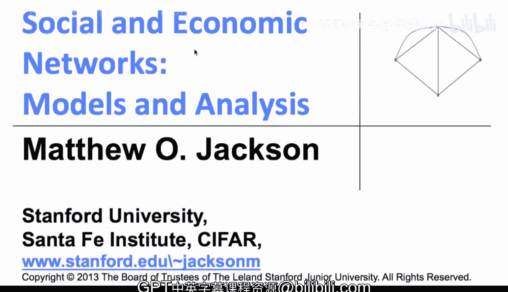
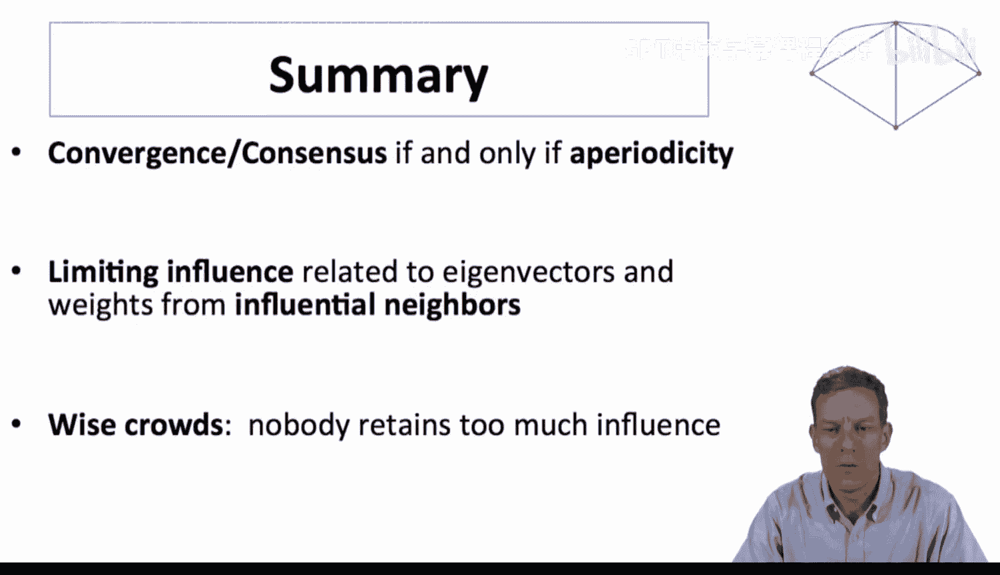
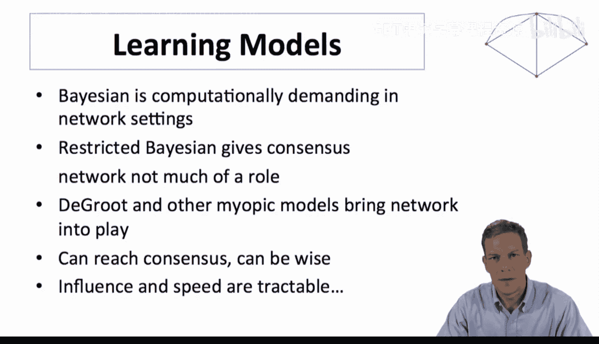
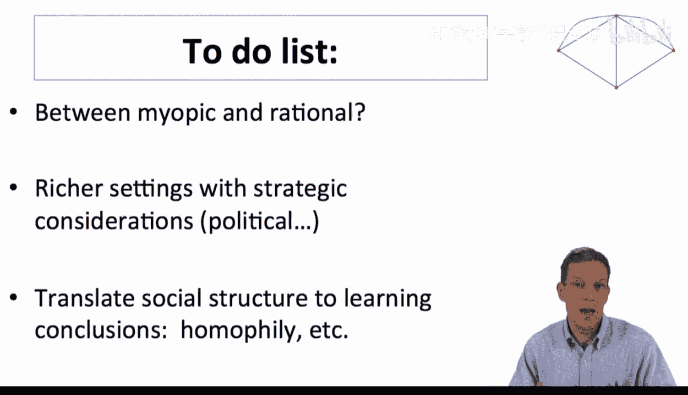

# 斯坦福大学《社会和经济网络：建模与分析｜Social and Economic Networks： Models and Analysis》中英字幕 p70 70_06_08_6-8-学习总结.zh_en -BV1v1421U7Nk_p70-

Okay， so let's just wrap up our discussion of learning and in terms of a summary in terms of what we saw in the deroot model。

 we found convergence and consensus if andly if we had a periodioicity。

 the limiting influence was related to eigenvector concepts and gives a nice foundation for that and in fact has this nice intuition that how important。

 how influential a given individual is， depends on how much weight they get in。

 which depends on how much weight the indirect weight that they're getting from their neighbors and so forth。

Getting wisdom out in terms of an overall society converging， nobody retains too much influence。

 that's going to be important。

Now， in terms of the learning models that we've gone through。

 we saw that the Bayesian model was computationally demanding in a number of setting ways。

 in terms of the kinds of calculations that people might have to do and the gaming that might go on in that kind of setting so those models can be quite difficult The restricted Bayesian version we saw gives a consensus。

 but the network didn't play much of a role understanding this sort of limits in the Bayesian setting is something that is still being studied。

 there's a number of papers looking at this。 The de groupot model is a very tractable alternative model。

 it is much more naive in terms of the way that people update， nonetheless， it can be accurate。

 So that's an interesting aspect of it as long as it's somewhat balanced in terms of the way that people are getting weights in and nobody's retaining too much influence。

 it could still be a very accurate way of updating。

 The nice thing is that the mathematics behind it are simple。It has some intuitive fields to it。

 and it can be useful in terms of working with data。

Now， in terms of the to do list， there's a lot that is missing from these models and you know there are models being developed because theyre sort of between myopic and rational that begin to combine some of these things。

 there's also richer settings that we might want to think about。

 and so obviously there's a lot of the world where consensus is not reached。 and this model。

 the models we were looking at were very simple ones in the sense that first of all。

 we're running time to infinity。We're assuming some stationity in terms of what's going on。

 It's not as if the world was changing as we were going along。

 And there wasn't any strategy involved。 So it wasn't as if people had different preferences for what other people might want to believe。

 So if you're thinking about voting in an election and you want certain you have a bias in terms of what kinds of programs you'd like to be enacted。

 then you might want to convince somebody that somebody's a better politician than somebody else。

 And so strategic communication could be very different than the kind of settings that we were looking at where everybody's just trying to estimate more or less the same thing。

 and there wasn't any strong preference involved。 So you know we could enrich things and begin to look at that。

 And there's some work being done on that。There's also a lot that we can do that I didn't talk about here。

 but that has been done in terms of beginning， So for instance。

 the group model is very tractable in understanding how the speed of learning depends on。

 say the segregation and structure of the network。 So if you bring homophily into play and trying to understand how things work。

 you can do that。 you can begin to to understand more about how speed depends on the structure of the network and how it relates to different properties of the network。

 So there's a lot of tractable things that can be done here。

 And so this is sort of an important area of research and and understanding how society forms opinions。

 And another thing that's sort of missing here is you know in terms of the network。

 we've been a little bit agnostic about what nodes are。

 And you could imagine that some nodes are news outlets， some are individuals。

 so we get our news and information in different ways。

 you could begin to enrich the model by taking into account different types of nodes and things。

So there's a lot to be done and a lot that we need to still understand about how learning works。

 The nice thing is that there are things that one can do to make things reasonably tractable and to work with models where we can begin to say something systematic about how the network structure influences the eventual beliefs and theres an active area for things to be looked at so that wraps up our discussion of learning and the next thing we're going to be taking a look at is looking at games and networks。

 So now we're going to be looking at situations where people's decisions of whether or not they're going to take an action really depends on what they think their friends are doing and that'll give us game structure and then we can try and analyze what happens in that setting。

