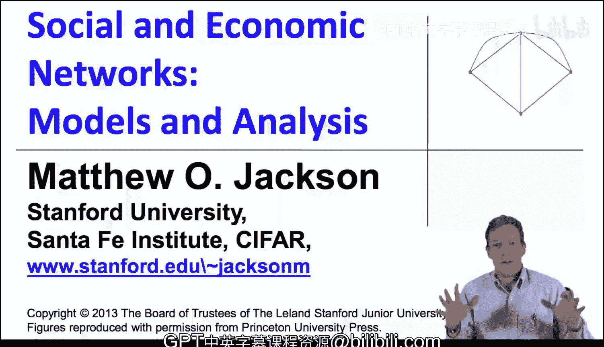
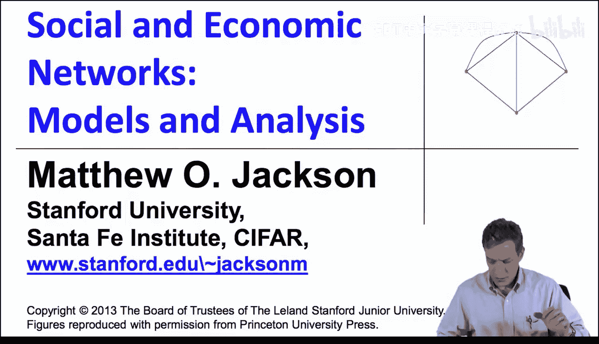
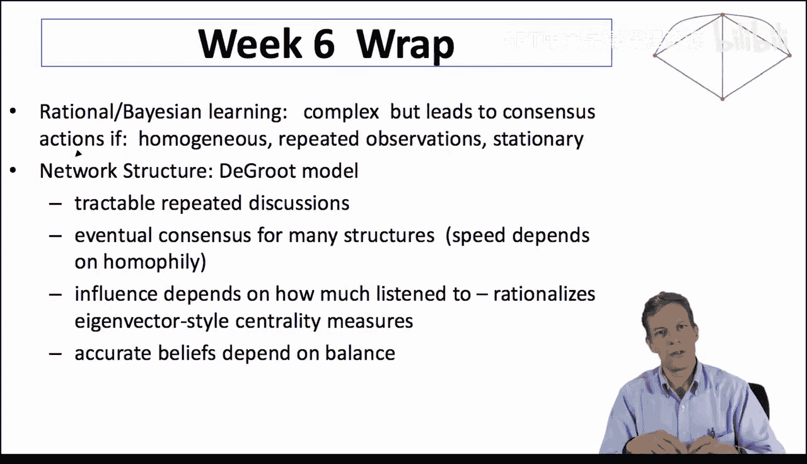
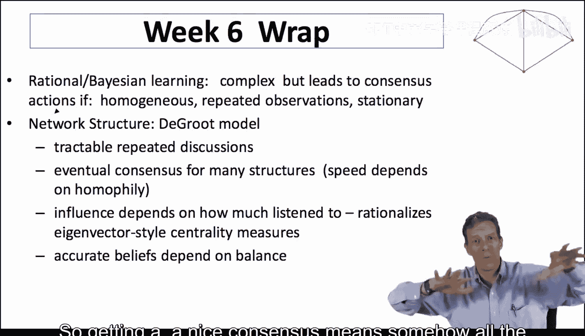
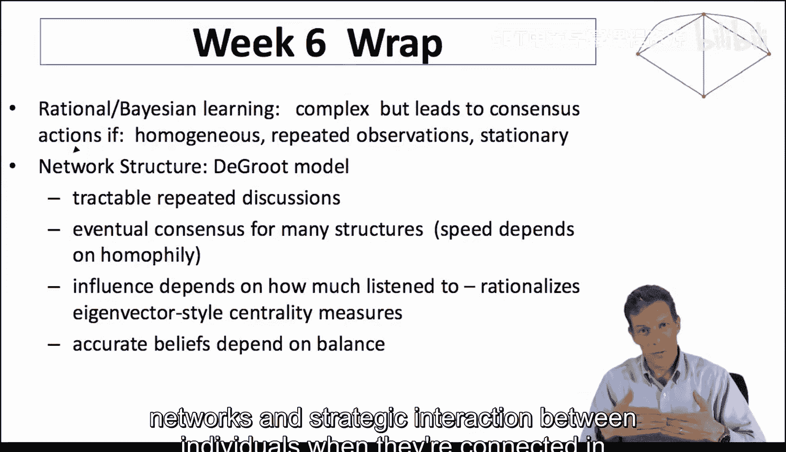

# 斯坦福大学《社会和经济网络：建模与分析｜Social and Economic Networks： Models and Analysis》中英字幕 p71 71_06_09_6-9-第六周总结.zh_en -BV1v1421U7Nk_p71-

So let's take a look back at what we've learned in week six and looked at in terms of our learning models。

So we started off with Bayesian learning， rational learning and one point we made was that this is actually fairly complicated so understanding how people are going to make inferences in a network setting where then they have to make inferences about what other people knew and who people talk to and everything can be quite complicated but nonetheless there's some simple things that can be deduced and if you've got enough homogeneity。

 so everybody's looking at the same process trying to make the same kinds of decisions。

 you get repeated observations at very stationary system。

 then that's going to lead to consensus so if somebody ends up seeing what other people are doing and they're doing well。

 just simple imitating is going to lead people to follow those actions and learn and the system will converge to people taking the same behaviors over time so that's one point that was made in terms of rational learning that didn't require much about the network structure so in order to get a better handle on the network structure we looked at a very different kind of model。

One is the de groupot model。And that model is quite tractable， it has its quirks。

 it's a very simple model where people talk to each other repeatedly average what they hear from other individuals and that repeated averaging process then leads to a situation where you going to reach consensus in many settings The nice part about it was that it's。

It can be nicely analyzed using matrix algebra and what we already know from a series of Markov processes。

So it was easy to understand some of the convergence properties and in many situations you're going to get consensus as long as you've got nice connection properties and a periodioicity。

The actual speed of these processes we didn't talk about too much will'll depend a little bit on the homophily and some aspects of how strong the ties are across different groups。

 and to the extent that things are really well balanced and people are looking to others。

 you can get fast convergence and the more segregated and introspective groups are the slower it can be for beliefs for one part of the network to get to another。

There's much more of that in discussed in the book and in other papers you can find referenced。

In terms of influence， we found a nice rationalization of eigenvector style centrality measures。

 so what's important is being listened to by other important individuals who are being listened to by other individuals and so forth。

 and so we get these kinds of recursive definitions and how influential a note is depends on that in a nice way that we can capture by doing eigenvector calculations。

And finally， the accuracy of a society here is going to depend a bit on beliefs， so how quickly。

on balance so how well distributed is the listening process in a society if too many people are listening to the same source。

 that source is going to be overly influential and if they're wrong。

 then the society will be wrong so getting a nice consensus means somehow all the information which is spread out in various parts of the society have to have a chance of being aggregated and brought together and so well balancedd networks will do well in terms of aggregating beliefs。

Okay there's a lot more to be said on this topic of learning and you can find additional references in the text here the ideas is to give you some basic feelings for these things and the models are quite are still evolving on this so people are looking at combinations of rational and nonrational learning people are looking at situations where you might have some strategic in。

incentives to distort the learning so if I have a strong belief that I want to move things in a certain direction。

 I have a policy I want to enact， then I might want to distort people's beliefs about that so that could be a setting which might begin to explain why beliefs are so different in a society people having different preferences over policies could influence the discussion so that's something for the future and here we've covered some of the basics next thing we're going to look at is games on networks and strategic interaction between individuals when they're connected in a network。

