# 斯坦福大学《社会和经济网络：建模与分析｜Social and Economic Networks： Models and Analysis》中英字幕 p72 72_07_01_7-1-网络博弈.zh_en -BV1v1421U7Nk_p72-

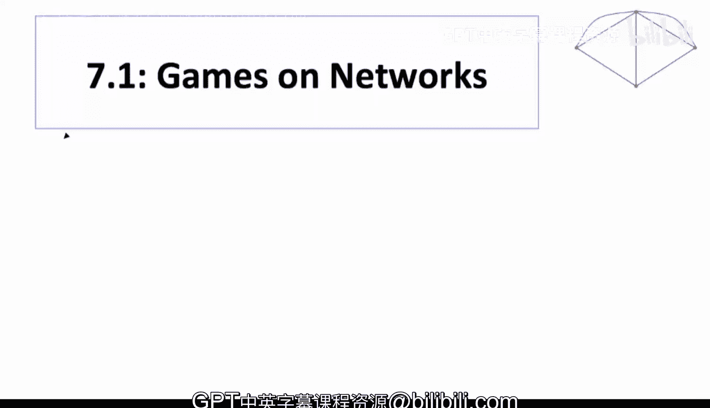

Okay， folks， so we're into the last part of the course now and we'll be talking about games on networks and in particular we're still interested in understanding networks and behavior and now trying to bring strategic interaction into play where people's decisions depend on what other people are doing。

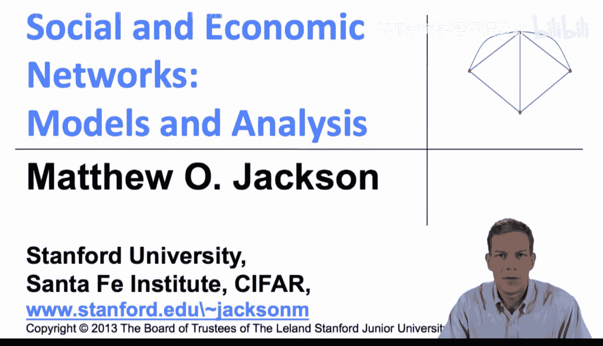

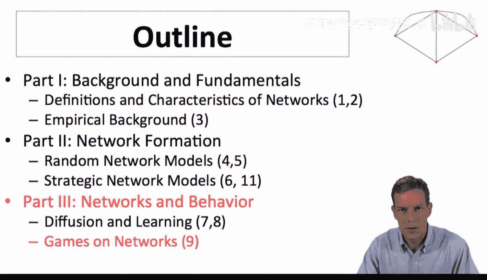

So the idea is that essentially there's decisions to be made and it's not just a simple diffusion or contagion process。

 it's not updating beliefs， it's that people care about what other individuals are doing so there's complementities I want to only buy a certain program if other people are using that same program so the way in which I write articles depends on what my co-authors are doing or I want to learn a certain language if only if other people are also speaking that language so there's going to be interdependencies between what individuals do and there could be also be situations where I can freeride so if somebody else buys a new book I can borrow it from them and maybe then I don't buy it myself so who I know that's actually bought a book maybe that affects whether I buy the book both positively and negatively so theres strategic interdependencies and you know the idea of games。

 people think of games we're not talking about monopoly or chest。Checkers， etc ce。

 we're thinking about a situation where there's interactions and what a given individual is going to do depends on what other individuals are doing。

 so there is some game aspect to it in that sense， but we're using game theory as a tool to try and understand exactly how behavior relates to network structure。

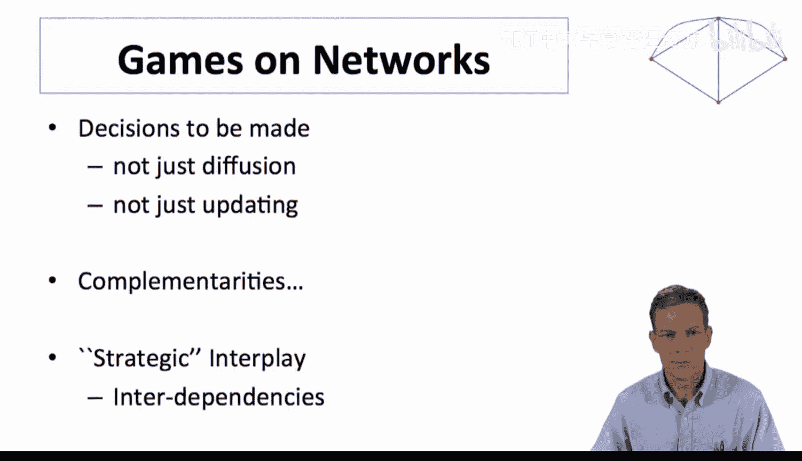

Okay， so what we're going to do is work with some basic definitions and I won't presume that you're so familiar with game theory beforehand and we'll work through the basic definitions which will be pretty self-contained in terms of the network setting。

 and work through some examples and then afterwards we'll begin to do a more formal analysis and more extensive analysis of how these things work。

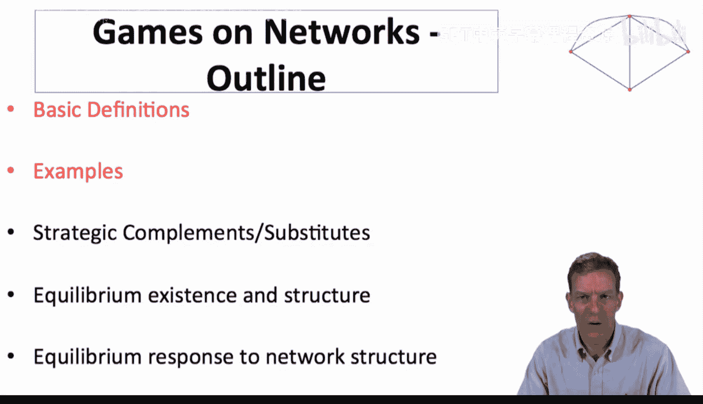

Okay， so the idea here is there's going to be different individuals they're on a network。

 they're each making decisions and you care about the actions of your neighbors。

 So the early literature on this came out of the computer science literature and what it was really interested in was how complex is the computation of equilibrium in these settings in worst case games so how hard would it be for a computer to actually find an equilibrium of one of these games in situations where there might be a lot in a case where nature was making it as hard as possible for you to find an equilibrium。

And what we're going to focus in on is sort of a second branch of this literature。

 which instead of being interested in the worst case computational issues is instead interested in applying games on networks to actually understand what networks have to say about how networks influence human behavior and one thing that's sort of nice is a lot of the interactions that we tend to have between individuals will have more structure。

 and so the games will be nice ones， they won't be the worst case games that worst case， I guess。

 worst case games that are going to be computationally complex。

 they're going to be ones where we can actually say something meaningful about the structure。

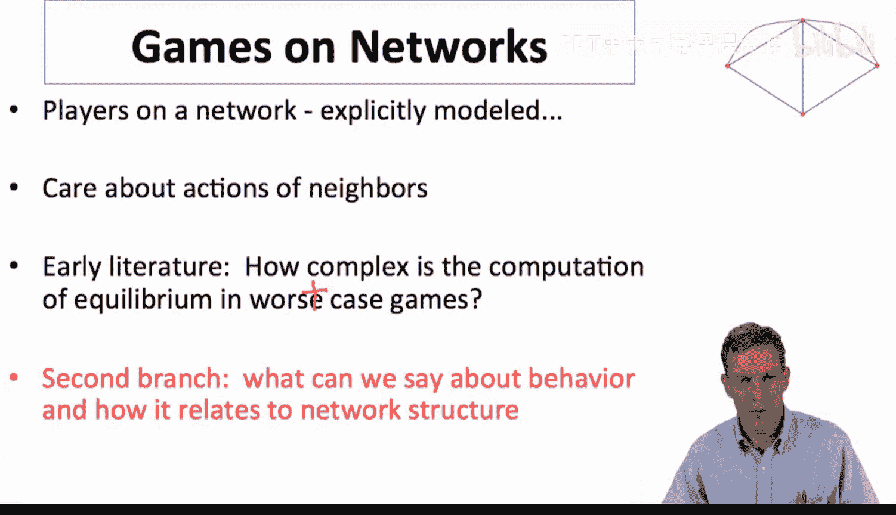

So what we're going to start with is a canonical special case。

 so it's a very simple version of the game， but one that's going to be fairly widely applicable。

And so what is true is we're looking at a situation where person I is going to take an action。

 Let's let that be X I。 and we'll start with the case where it's just a binary action。

 It's either  zero or1。 So I either buy this book or I don't buy the book or I invest in a new technology。

 I don't。 I learn a language， I don't learn a language I end up know going to a movie。

 I don't go to the movie and the payoff is going to depend on how many neighbors choose each action。

 So how many people choose action 0， how many neighbors choose action 1 and how many neighbors I have。

 So that's going be my payoff is going to depend on those things。

 Okay So we've got each person choosing an action in 01。

 and we're going to consider a situation where your payoffs depend on。

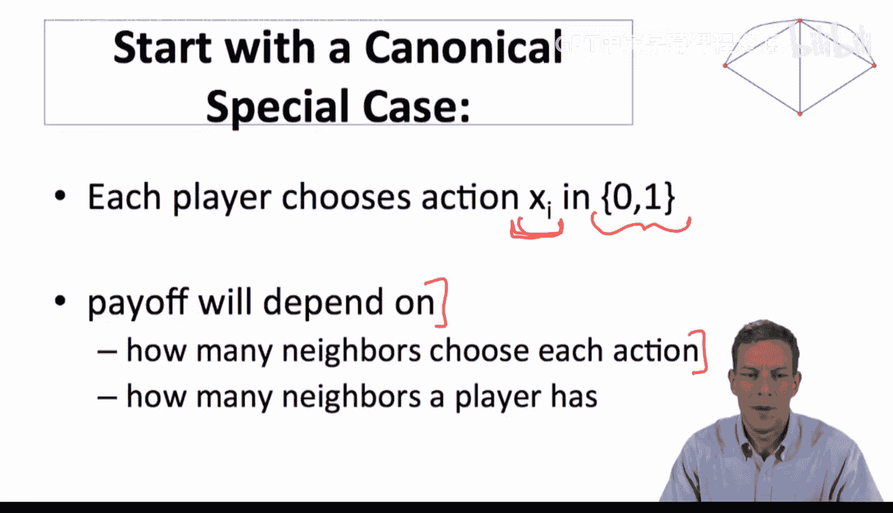

Your action。 So a person eyes payoff depends on their action。

It's also going to depend on the number of individuals。Number of neighbors of I that choose one。

 So how many of my neighbors chose one。And it'll depend on my degree how many neighbors I have。

 So if I have 100 neighbors， it might be different than if I have three neighbors and two of them are choosing action1。

 two out of three is different than two out of 100。

 So I might care differently depending on how many neighbors I have so what are the main simplifying assumptions in this setting main simplifying assumptions are that we've got just the zero1 actions。

 So we either take action or we don't。 I only care about the number of friends taking the action。

 not the identities of them。 So I don't care whether it's I don't have best friends and less best friends I treat friends equally in terms of who's taking the action。

 and it also just depends on my degree So how many friends I have I don't have a different preference than somebody else。

 So we can enrich these models later to allow for people to have different preferences and weight things differently。

 But for now let's think。of a world where everybody treats their friends equally。

 and it only matters how many friends they have， not who their friends are。

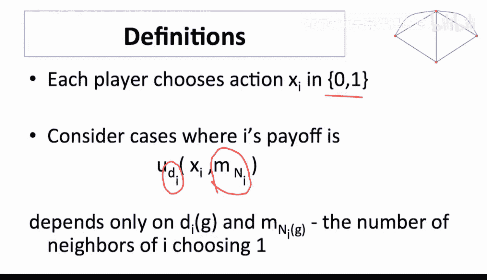

Okay， so let' let's look at an example of a simple game of compliments。

 I'm willing to choose this new technology， if and only if at least two T neighbors do。

 So this is a game， I's suppose I'm learning to play bridge a card game。

 I have to have at least three friends who play bridge before I'm going to want to learn play bridge so by payoff playing action zero。

 if I don't learn it， I just get a zero， and one example of this would be that I get a payoff from action playing action1。

 which looks like minus this threshold plus how many friends play it。 So if this threshold was three。

 then I get minus-3 plus how many of my friends play it。 So for instance。

 if at least three of my friends play it， then I'm gonna to get payoff of zero。

 if four of my friends play it， I get a payoff of one if five of my friends play it。

 I get a payoff of two and so forth。So this would be a very simple example where I'm going to be willing to choose action1。

 if and only if at least T of my neighbors do， and you could write down all kinds of different payoff matrices。

 this is just one example。

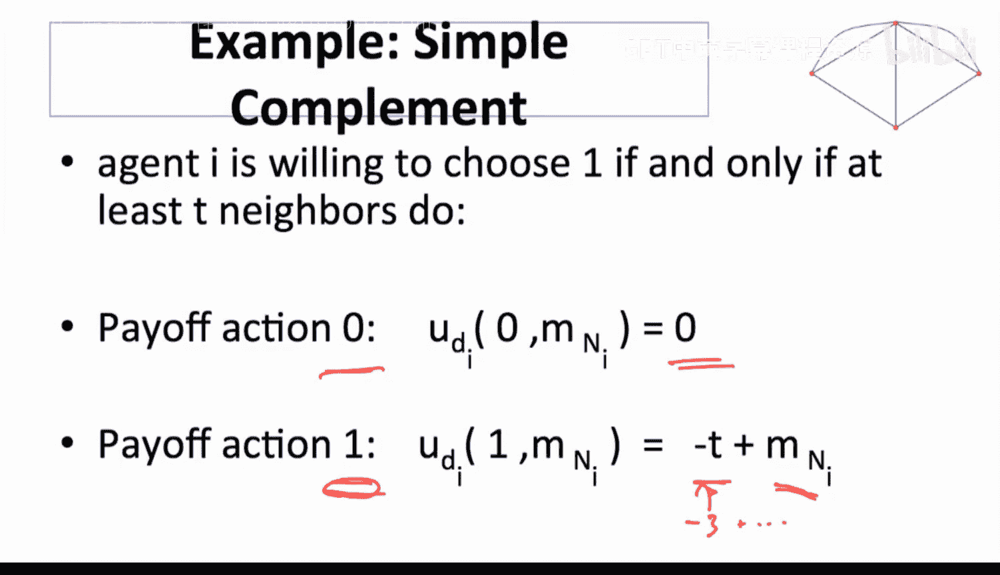

And so let's think of looking at a network now and we've got a situation where we've got a bunch of different people and a person's willing to take action one。

 if and only if at least sorry， two neighbors do， okay。

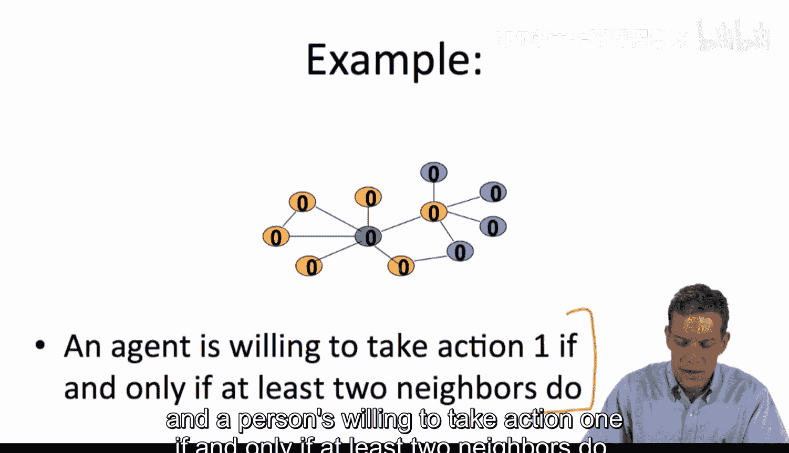

So this is a game where once I have at least two of my friends who have take bought this new technology。

 I'm willing to do it， otherwise I don't。 Okay， so what do we know first of all， well all these。

 if we look at this network，All these blue。People。They're going to take action zero because they only have one friend。

Actually sorry this person has two friends that one shouldn't be colored as a hero so these three individuals only have one friend。

 so they're definitely going to have to take action zero。

 there's no way they're going to have at least two neighbors do it。

But we can do is we can ask what about this player， right， Well。

 their action is going to depend on what their other friends do。Okay。

And one possibility is that we set， for instance， these three individuals。All to playing action 1。

So if these two individuals are doing it， then this person's willing to。

 they're all willing to because now they each have at least two friends doing it。

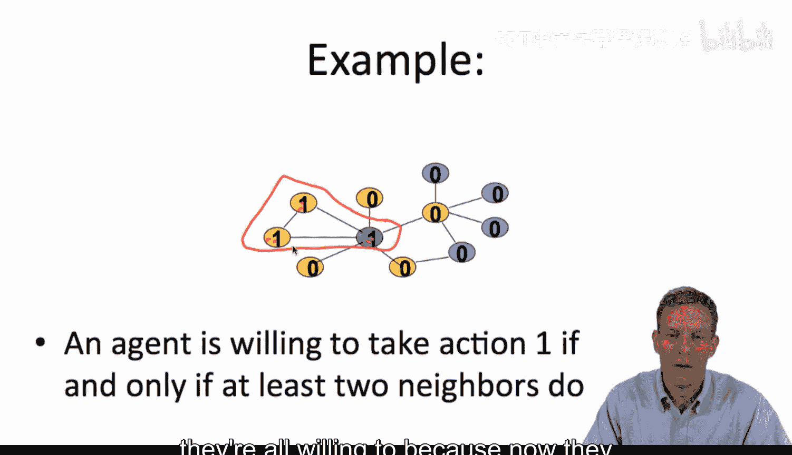

So one possibility would be to stick it where we were before。

 where nobody takes the action because nobody else does。

 and so the technology never gets off the ground。So it's possible that just if it's a technology that needs people to want to communicate with other people and to have other people do it before they do it。

 there's a possibility of never getting it seated， it never gets off the ground。

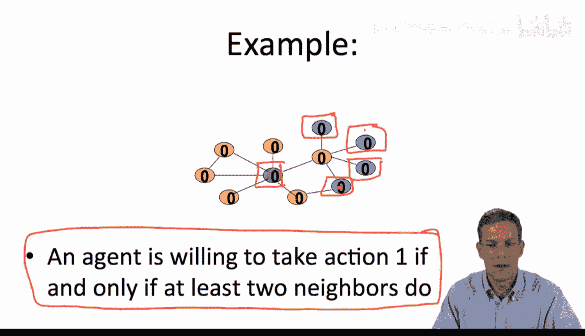

Another possibility is， yes， these three people all adopt it because they each have two friends who do it。

 And so that's also an equilibrium。 Okay， now， if these are the only people adopting。

 then nobody else actually wants to do it because all the other individuals still have at most one friend who did it。

 So nobody else is above their threshold。 And indeed。

 it's it's still an equilibrium for these three people to do it and nobody else to do it， right。

 So nobody else wants to take the action because none of the other people have two neighbors who do okay。

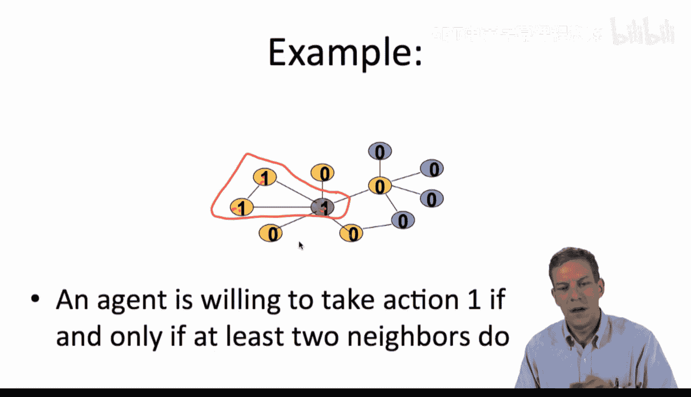

So that's one type of game。 Let's take a look at a game which is going to have a sort of an opposite feature to this。

 So this was one which had a feature that if more of my friends take the action than I'm more likely to want to take the action。

 So compatible technologies will have that kind of feature。

 but not always us think of of the example where if somebody else， one of my friends buys the book。

 I don't buy the book， because now I can borrow it from them。 Okay， so I'm willing to buy the book。

 if and only if none of my neighbors do。So for instance， if I don't buy the book， what's my payoff。

 my payoff is one， if some of my neighbors， one of my neighbors buys the book。

 if the number of neighbors who bought the book is positive， I can borrow it from them。

 I get a payoff of one， if none of my neighbors bought the book。I can't borrow it。

 I get a pay off of 0。 I didn't buy it。Now， instead， I could buy it myself。

 and if I end up buying the book myself， then what do I end up with。

 I end up with a payoff of 1 minus C where C is the cost of the book， right？

So I'm in a situation where， well， in terms of my payoffs here。My optimal payoff would be。

 I'd love to have one of my friends buy it， me not buy it and borrow it from them。

 That would be give me the payoff of one。 That's my best possible payoff。

My worst payoff is nobody buys it and I don't buy it， so if none of my friends buy it。

 then I would actually be willing to buy it and as long as C is less than one。

And the situation it wouldn't be in equilibrium is going to be one where none of my friends buy it and I don't buy it。

 so if they don't buy it， I buy it， but I won't buy it if one of my friends does。

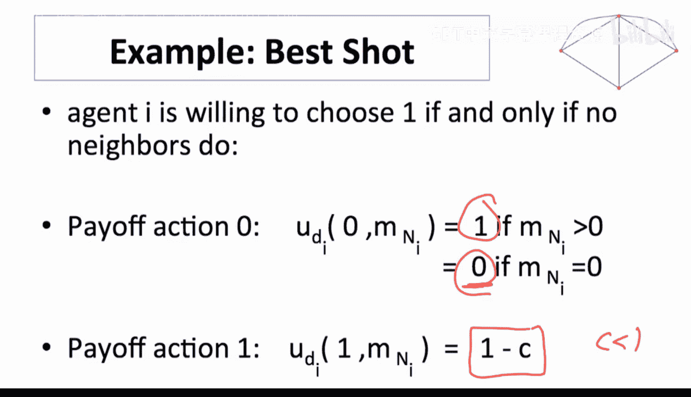

So if we look at that example， this is known as what's called a best shot public goods game。

 so what matters to any individual is sort of the max of the actions in their neighborhood。

 and so that's called the best shot public goods game。

So an agent is willing to take action one if and only if no neighbors do。

 so here would be an equilibrium of that game this person takes action one， none of the neighbors do。

 this person takes action one because no neighbors do。And so forth， right。

 that's an equilibrium of this game。That's a different game and it's going to have a different shaped equilibrium to what we had before here now we have these people taking action one。

There's multiple equilibriumria to these game， there can be different combinations of things that are equiria and we'll take a look at that in more detail。

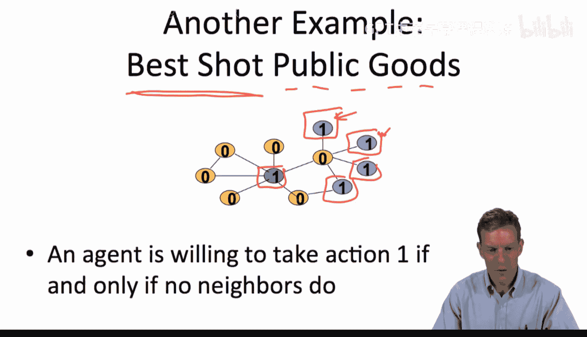

So the next thing we're going to do is now put a little more structure on these games。

 try to understand what more we can say about the equilibrium and eventually tie the equilibrium structure back to the network structure and see what we can say that meaningful about how these games behave。

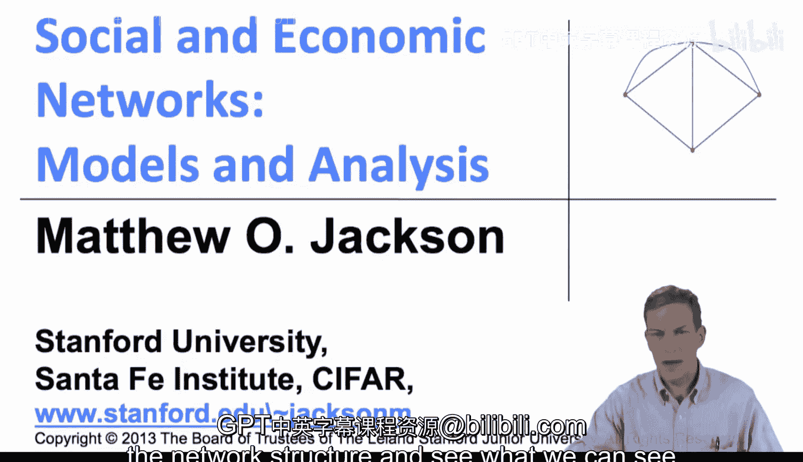