# 斯坦福大学《社会和经济网络：建模与分析｜Social and Economic Networks： Models and Analysis》中英字幕 p73 73_07_02_7-2-互补与替代.zh_en -BV1v1421U7Nk_p73-

Okay folks， so let's talk about a little more structure about games on networks and understanding how we can understand how the play in games relates to the structure of the payoffs and the structure of the network and what we're going to do is differentiate between whats are known as strategic complements and strategic substitutes。

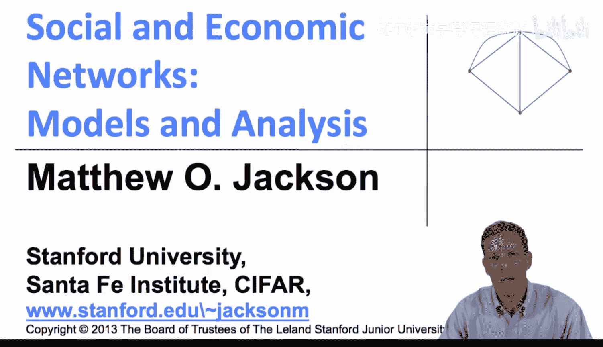

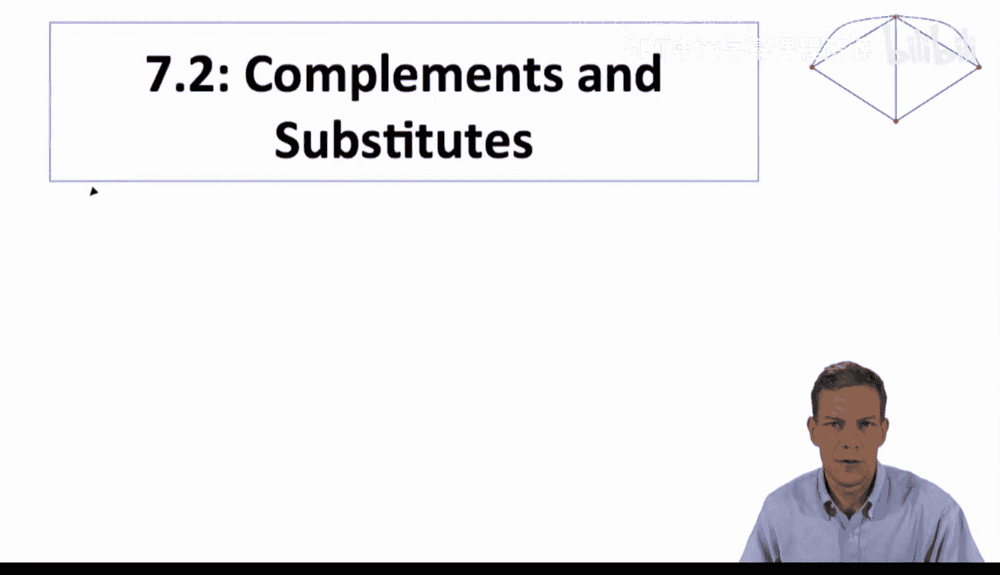

And so let me just give you a little more detail on this。

 so we've gone through just basic definitions and a couple of examples。

 and now we're going to talk more explicitly about the difference between strategic complements and strategic substitutes and thatll allow us to talk a little bit more about how equilibria behave in these games and how that relates to network structure。

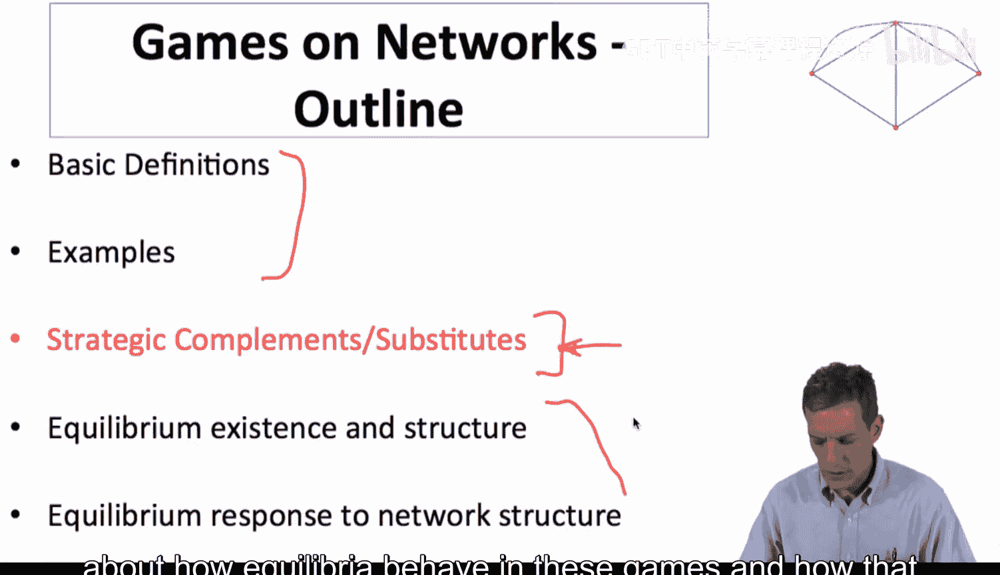

Okay， so basic idea behind strategic compliments is that these are kinds of behaviors that as more of my friends take the action。

 I'm more likely to， it's a more attractive action to me and strategic substitutes are as more of my friends take the action is a less attractive action for me to take so in particular the way that this works is we look at look at the payoff that a given individual of degree D gets from taking action1 compared to action zero。

And let's think of starting with some number of neighbors M prime taking it and then increasing that number to M。

 So we go up from M to M prime， and we ask as we increase the number of friends taking this action。

 What ends up happening to this person's incentives to take it。

 And the idea behind strategic compliments is that we end up with a higher weekly higher payoff on the lefthand side。

 So it's become weekly more attractive for me to take this action than it did before。

 So the more friends who take it as you increase the number of friends who take the action。

 then to payoff to taking the action compared to not taking the action has gone up。

 So the difference between taking the action and not taking it。

 it's more attractive than it was before。 Okay So that's called increasing differences。

 this is strategic compliments， there's a positive relationship between number of people take the action and my incentive。

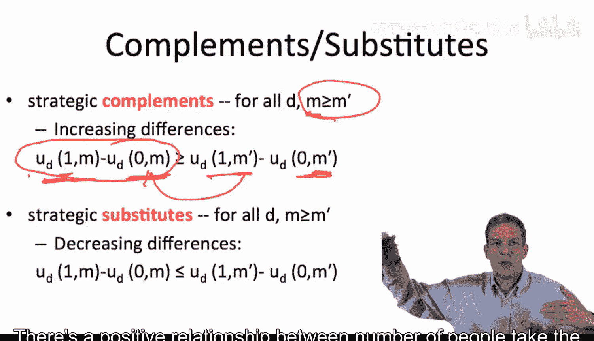

To take it strategic substitutes just reverse this。And effectively。

 as more people take the action as we move from M prime to M。

 it becomes less attractive to take the action。 So this was the borrowing the book as more of my friends have the book。

 I can borrow it。 It's easier for me to borrow it。 It's less attractive for me to purchase it myself。

More in other cases， if you know， more of my friends are learning a new language or adopting a new technology。

 it can become more attractive for me to do that。So in this case， we have different compliments。

 positive relationships， substitutes， negative relationships。And you know we can talk about strict。

 make these strict inequalities as opposed to weak inequalities。

 and then we can call say that there's strict strategic complements and strict strategic substitutes。

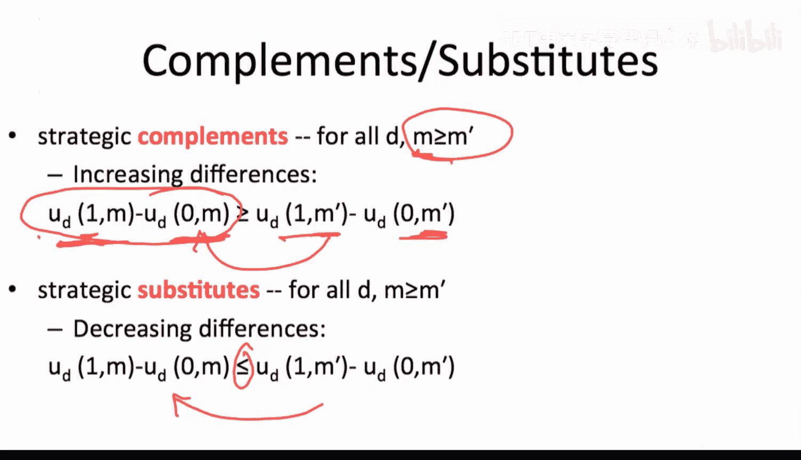

Okay， so you know， obviously this is going to be a setting where there's externalities and there's externalities because others behaviors affect my utility or my welfare。

 my choices so there's externalities present and the ways in which people's decisions are being influenced depend on what other actions other people are taking and in particular。

 what's important in this setting is not only that other people's actions affect my payoffs。

 but they affect my relative payoffs right so in order for it to affect my behavior。

 it has to affect the difference in utility I get from one action versus another。

 otherwise it just could make me better off or worse off but doesn't affect what I want to do here what's it going to be important in terms of the externalities in the game setting is that it affect the relative payoffs so it can actually change how I want to behave。

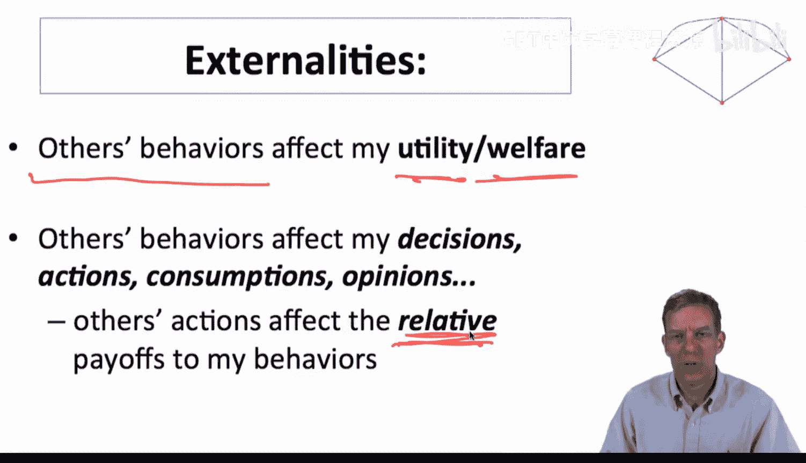

So when we think about compliments and substitutes。

 there's these externalities present because it not only affects my payoffs。

 but it affects my relative payoff， so more friends taking the action increases my relative payoff。

 so more friends playing a particular video game， it makes it more attractive for me to play that video game more of my friends buying my roommate buys a stereo or a fridge or my roommate buys a book than I can borrow it。

 those are going to be strategic substitutes。

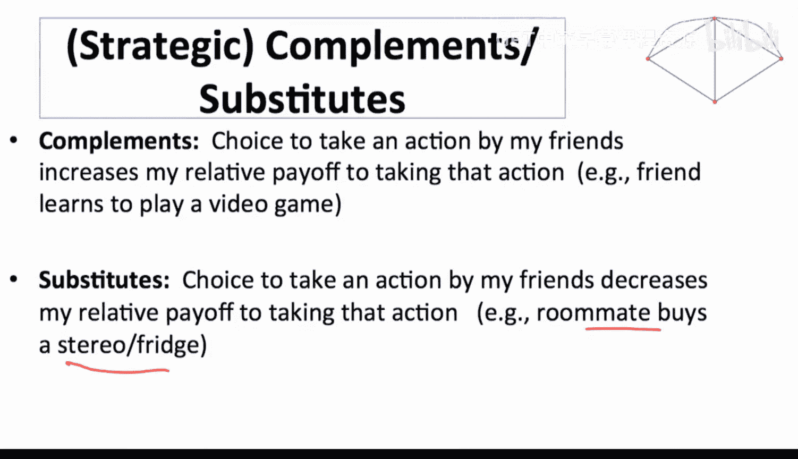

In terms of examples， examples of this abound， and that's why it's interesting to look at these things and to try and understand how people are going to make decisions in situations where there's essentially a game on a network being played。

 so let's just start with some basic examples， education。

So whether or not a person goes to university how much human capital they get。

 what kinds of courses they take， they'll care about the number of their friends who do it。

 so you could care about it because you enjoy taking classes with your friends that you know more about what classes are available if you have friends that you learn more about what the payoffs are to become educated。

 that you have increased access to jobs， so the more people that you know that are well educated and well placed in society。

 the more attractive it becomes for you to become educated and to invest in your human capital。

 So education decisions are something that tend to be compliments smoking in other behavior among teens。

 a delinquent behavior， a whole series of things where they're sort of a peer influence where the person feels more comfortable or more pressure to act in a certain way as the crowd grows technology adoption is another good example。

 So which technology you adopt， which you take。The relative attractiveness of one versus another depends on how many people are using that。

 Learn a language is another。 Now let me sort of emphasize one which I think is very interesting cheating or doping are also things that tend to be strategic compliments so if you're in competition with a bunch of people and they start you know you're in a sport in people or taking performance enhancing drugs then the incentive for you to do so goes up because if they are than in order to compete you have to too and so the relative payoff of taking the drugs versus not can go up as more people take the drug now this is sort of an important example because actually it points out the fact that you can still have strategic compliments。

 the more people do something， the more you have an incentive to do it even though it doesn't necessarily have to be true that the more people do it。

 the better off you are right so having more people take performance and。

drugs doesn't make it better for an athlete。 they're not happier because that happened。

 but it makes them more likely or gives them a higher relative payoff from doing it themselves。

So that can be a situation where you actually have negative externalities。

 but the externalities are such that the relative payoff from acting in one way versus another is going up as more people do it。

 So even though they're causing harm， it's actually giving you more of an incentive to act in the same way。

 So strategic compliments does not necessarily mean that the externalities are positive。

 It just means that the relative change in the attractiveness of a certain thing is positive as more people do it and that's a very important distinction and one that you have to think about for a while to really wrap your head around。

 but it's an important distinction。 substitutes things like information gathering。

 So if one of my friends learns how to do something， maybe they can help me out。

 I don't have to spend time doing it myself。 know local public goods， So shareable products。

 things like my friend buys the book， buy a C they download some music and I can download it as well。

Also situations where this applies in competing markets。

 so firms say competing in certain kinds of oligopolies。

 the more that their neighbors or their competitors actually act in a certain market it might make them less likely to act in that market so there can be certain situations of competition which will look like strategic substitutes that depends very much on the setting but that'll be another example that fits into this setting so these are some basic examples。

 what's important to get take away from this is that two things one is that there's an enormous number of applications where people's decisions depend on what their friends are doing。

Secondly， that a lot of these break into one of the two categories where incentives are either moving up。

 the more people take the action the more one wants to do it or down in the opposite direction。

 and so that means that there's a lot of structure on these games that we'll be able to take advantage of in doing our analysis。

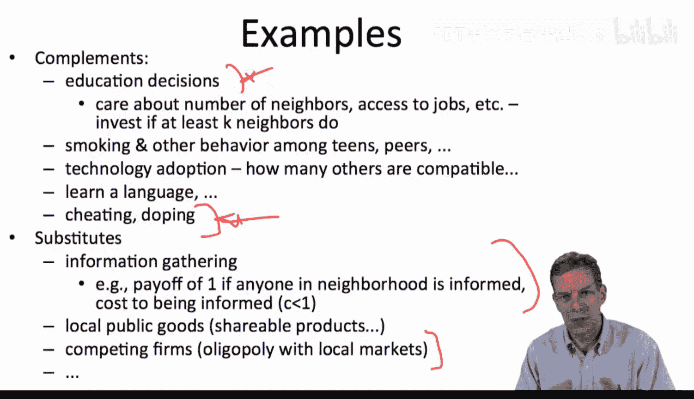

Okay， so the next thing we'll talk about then is equilibrium existence and structure。

 given that we have some definitions of strategic complements and substitutes in play。

 we'll look at those kinds of examples and understand what they look like。

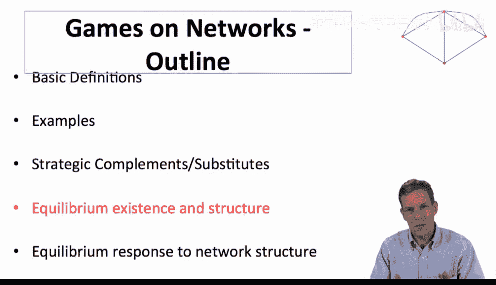

Okay， so the basic notion of equilibrium that we're going to use in understanding behavior is the canonical solution in game theory known as Nash equilibrium after John Nash and the idea here is that it's a very simple concept so what we want to look for is a set of behaviors so we want to say what is each person doing and a Nash equilibrium is a situation where each person's choice is the best that they could do given what all the other people are doing。

So if one of my friends buys the book， I don't want to。 if none of my friends buys the book。

 I do want to so that's the basic idea。 If you want to learn a lot more about game theory I've been teaching game theory online course with Kevin Leightton Brown and you have shown you can find out a lot more about Nash equilibrium there for our purposes here。

 we'll just need some fairly simple ideas and we're going focus in on Nash equilibriumria。

 we're going to focus in on situations where people don't randomize。

 So generally we're going to look for what are known as pure strategy equilibrium。

 So each person is just going to make a choice， they either buy the book or they don't。

 they're not going to be flipping coins over whether they buy the book。 And then based on that。

 we'll be able to make predictions of what is the outcome。

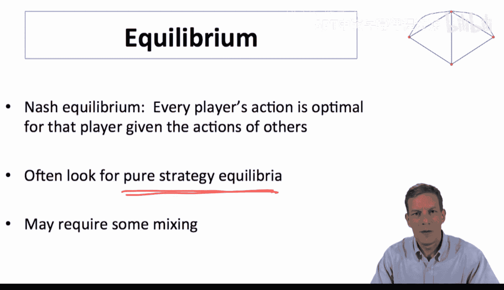

嗯。Okay， so let's have a look at here's an example of a best shot public goods game and in particular this is a game。

 so here in this network we have a situation where we have six different individuals。

And we have equilibrium peer strategy， equiria。Each person remember the best shop public goods game。

 I want to buy the book。 If none of my friends do， I don't want to buy the book if anyone does。

 So this would be a pure strategy to get Nash equilibrium。 Each one of these people buys the book。

 The center doesn't and free rides。Another equilibrium would be the theenter。Buys the book。

 And none of the。Neighbors do they all kind of borrow it and in each one of those cases。

 nobody wants to change their action right so if we go back and we look at this case over here。

 we can ask， okay， does one of the individuals on the outside here？

Does this individual want to change their action？ Well， if they change to a 0 as well。

 they're going to go get a payoff of 0。 So right now， their payoff is 1 minus C。Right。

 from the best shop， public goods they're getting。Raise that 1 minus C。

 And if they change to a 0 instead， theyd get a 0， they're better off staying at where they are。

What about this individual， they're getting a payoff of one， If they bought the book instead。

 they would get a pay off of 1 minus C。 one's greater than1 minus C。

 they're better off sticking where they are。 And so you can go through that as long as you have a neighbor buying the good。

 you're getting a payoff of one， you don't want to change your action。

 If you don't have any neighbors buying the good。 then you do want to buy it because you're getting1 minus C。

 which is greater than0， So they'll stick with it。 This is a situation which is not an equilibrium。

This one's not an equilibrium because these two people are both buying the good。

 one of them should stop and not buy the good。Okay。

So that's the equilibrium and the best shop public goods game。Interestingly enough。

 this actually relates very closely to a nice concept from graph theory。

 which is known as a maximal independent set。So what's a maximal independent set？

A maximum independent set， an independent set of nodes is going to be ones where you've got a set of nodes such that none of its neighbors are in the set。

Okay， so here what we've got is we've got each person who's actually taking the action has no ones in this neighborhood。

 so an independent set is going to be the set of people who are taking action one。

 we want to find a set which has all of those people such that none of their neighbors are in there。

And moreover， that any of the other nodes that we haven't got in the set。 So here。

 this is a maximal independent set。We put all these people in in there in the set。

 none of their neighbors are in it。 And more， if we look at anybody who's not in the set。

 they have neighbors in the set already。Okay， this is also a maximal independent set。This person。

 if we put them in the set， they don't have any neighbors in the set。

Each one of these other individuals。Already has a neighbor in a set。

 so we couldn't add them to the set without having two connected people be in a set。

 This is not a maximum independent set。Because each person already has a neighbor in the se。Okay。

 so maximum independence set corresponds exactly to the pure strategy equilibrium of this best shot public goods。

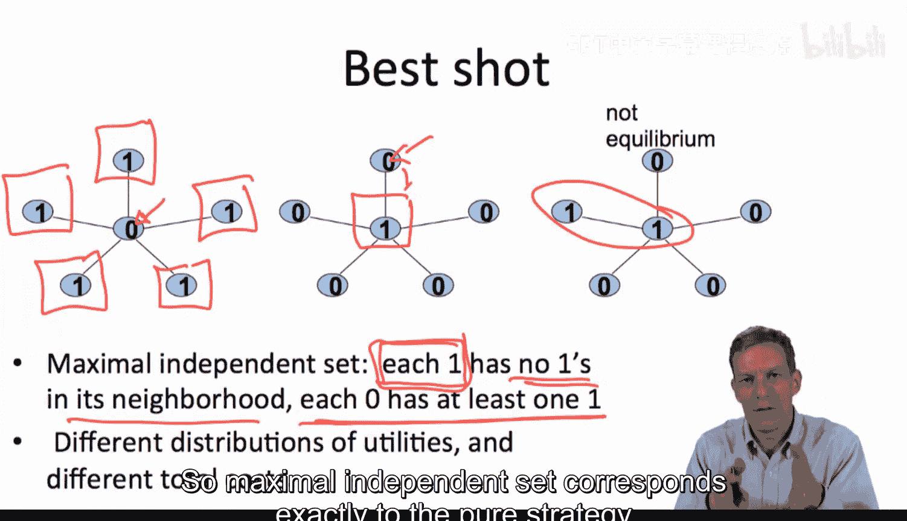

Now， one thing that's sort of interesting about this is it leads to very different distributions of utilities and different outcomes for the society。

 right， So if we look at this in this particular case， Well， what's going to happen here here。

 we have five people。Expending the cost C。 So we get five people at1 minus C in one person at a value of1。

 This case， we get one person at the 1 minus C and five people getting a value of one。

 So from a society perspective， this is a lot less wasteful， less cost is being expended here。

 I mean， unless you're the bookseller。 So here we're dealing with a situation where the overall welfare is better。

 So these can have very different distributions， even though they're both equiria。

 even though they're both maximal independent sets of the graph。

 So these games can have different payoff consequences and multiple equilibriumlibria。

 in this setting。

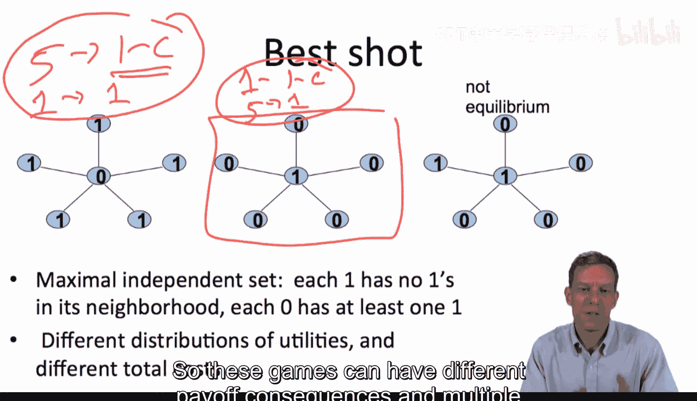

Okay， so maximum independent set again， set of nodes such that node two nodes in the set are linked to each other。

 it's maximal in the sets that we're looking at maxim independent sets。

 every node in n is either in S or already linked to a node in S so you couldn't make S any bigger and still have it be independent。

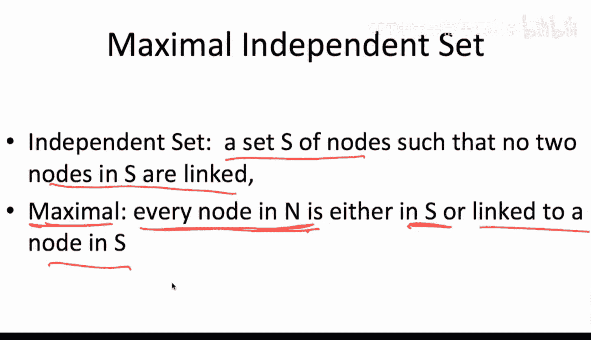

Okay， one other useful observation on Game sound networks。

When we're looking at games of compliments and games of substitutes。

 there's going to turn out to be thresholds， which are very useful。And in particular。

 if we're dealing with a game of compliments， there's going to be some threshold number。

Such that if more than that number of my neighbors take the action， then I prefer to take the action。

 and if fewer than that number of my neighbors take that action， then I prefer not to。Okay。

 so there's some number， depending possibly on my degree。

 So there's some number three that if at least three of my neighbors want to do it。

 I want to do it if fewer than three， then I don't want to do it。

 So directly from the definition of compliments， we can translate that into a threshold。

 the threshold might differ by a degree。 So if I really care about how what's the fraction of neighbors。

 So I' say it want half my neighbors， then if I have degree 10， the threshold is going to be 5。

 if I have degree 00， the threshold is going to be 50。

So it could be that this threshold is a fraction。 It could be that it's an absolute number。

 So if it's playing bridge， maybe I just need three friends to play bridge before I want to do it。

 And it doesn't matter whether I have 10 friends or 50 friends or 100 friends。

 I'll still want to do it。 if at least three of my friends do。So you can have different thresholds。

 the particulars of this are going to characterize what's special about that game。

 What is it about that game is different from other games that's going to be captured in the threshold。

 and then the network structure will give us exactly how that's going to play out in a particular setting。

Substitutes exactly the opposite， right， we're just we're going to reverse the inequality。

 So there's a threshold such that if fewer of my friends take it， then I want to take action  one。

 and if more than that threshold of my friends take it， then I want to take action  zero。

Now it's possible for me to be exactly indifferent at the threshold， so depending on the game。

 you could have me and be indifferent， or maybe I care strictly one way or the other at the threshold。

 that's sort of a more minor detail。

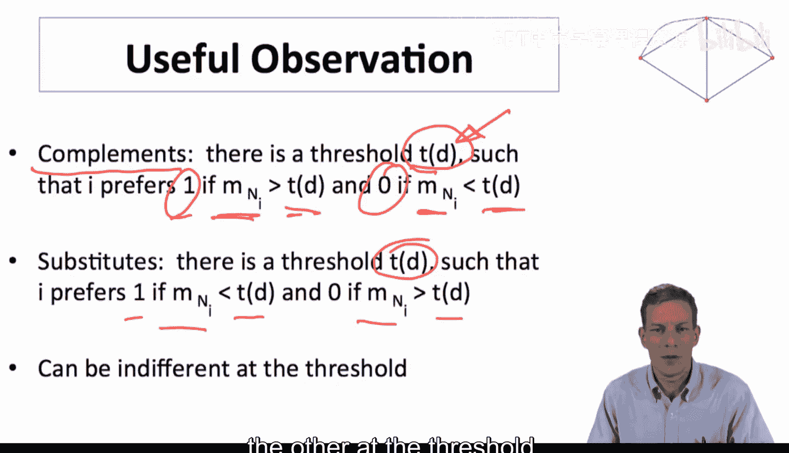

Okay。So let's have a look then at a game of compliments。

 and here's a game where the threshold is two。 and so what we've done is we've look at different examples。

 same network， and here's three different equilibrium。

So threshold is two and the threshold is the same for all of the agents here。

 so it's independent of their degree。So if at least two neighbors take the action。

 you want to take the action。Nobody taking the action。 Check that That's a equilibrium。

Three people taking the action， these three taking the action， that's an equilibrium。

 nobody else taking the action， nobody else has at least two neighbors doing it。

All of these people taking any action。So these six people taking the action and nobody else taking it is also an equilibrium。

There's three pure strategy equilibrium。嗯。See if you can find a fourth。

 there should be a fourth one here。 So look for the fourth equilibrium。

 there's four pure strategy equilibrium in this。And there's also what's known as a lattice structure of equilibrium。

 So that's something we'll talk about in a little bit。

 But there's a nice actual structure to this and makes it easy to find equilibriumria in this particular game。

 So games of complements are going be very well behave there。

 So what we've done is we've defined strategic substitutes and compliments。

 We've taken a look at some notions of equilibriumria， taking a look at some examples。

 and now we'll talk a little bit more in detail about the structure of these equilibrium and so forth。

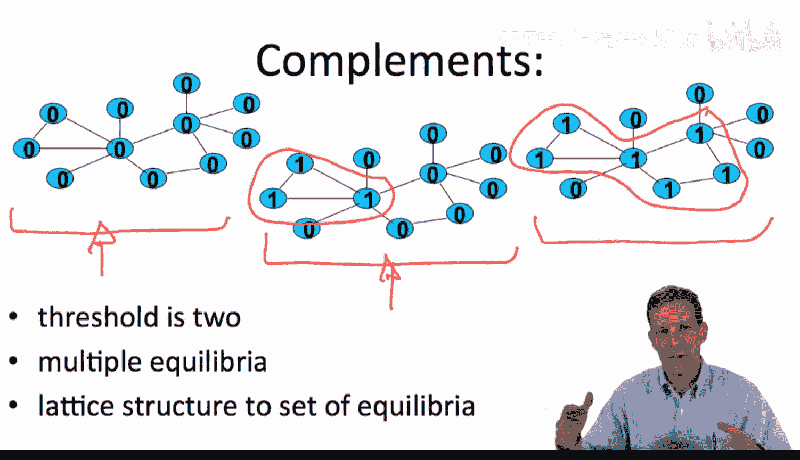

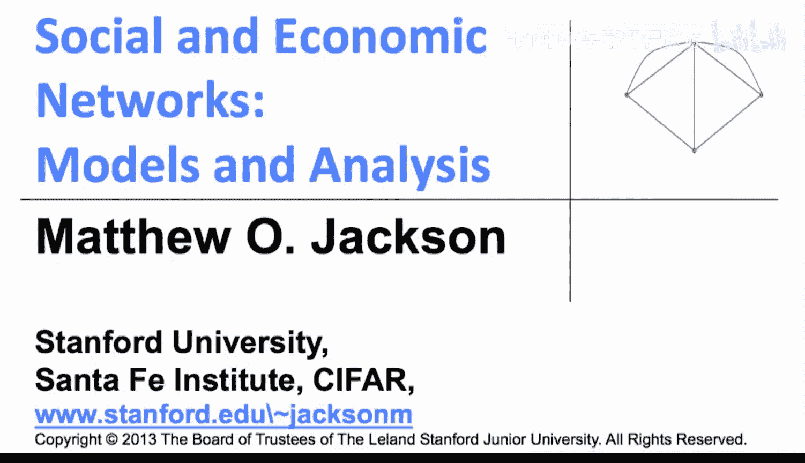