# 斯坦福大学《社会和经济网络：建模与分析｜Social and Economic Networks： Models and Analysis》中英字幕 p74 74_07_03_7-3-均衡性质.zh_en -BV1v1421U7Nk_p74-

Okay， so we're going to talk a little bit now about properties of equibriria in these games on networks and that'll give us a little bit more structure to understanding how these work and again。

 we're going to stick with the idea of strategic complements and strategic substitutes and I just want to sort of point out one really nice feature of compliments and also explain why substitutes are going to be much more complicated to work with。

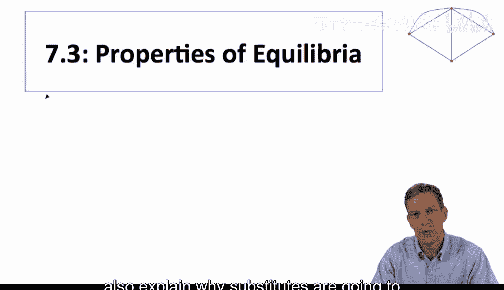

And to do this， we're going to need the notion of what's called a complete lattice。

And so you can skip this if you're not interested in the mathematics。

 but I'll give you a quick letuce quick lesson in lattices， so say that quickly a bunch of times。

 so a quick lesson in lattices and so a lattice is going to be a set of points。

So in particular what we're going to be looking at is equilibria。

 but you've got some set of objects and these are partially ordered。

 so you've got some notion of say a partial order use the sign greater than or equal to so you've got some notion that some things are bigger than other things and you don't necessarily have to be able to compare all objects but some things will be bigger than others。

And what's important in terms of having a complete lattice is that when you take any set of objects。

 in this case， what we're going to be looking at is a set of equilibria。

 but when you take any set of these。 So let's think of these as X's。 So in our world。

 what are we going to be thinking of as the space， we can think of the actions。

 So suppose that we have you know six individuals connected in a network。

 we can think of them as playing all zeros， So one possibility is that they play all zeros。

 one possibility is that they play all ones。You know some of them play ones。

 some of them play zeroes。Okay，And we'll say that one vector is bigger than another。

 If all of its entries are at least as big as the other， right。

 so we'll say that this one is greater than equal to this one。

 This one is also greater than equal to this one。 This one is greater than equal to that one， Okay。

 but we couldn't compare this one。These two you can't compare。

 so neither one is bigger than the other。It's because some of the entries of this are ones。

 some of the entries of this are ones and so forth。 So these two don't compare。

 but the other ones you could rank and you could rank this one compared to the other two right So you could say that this one is bigger than this one and this one is bigger than this one and so forth。

 So we have some rankings but not all possible rankings。

 So we're going to be working with a space of zeros and ones。

 but the notion of a complete lattice in terms of equilibrium basically is going to be that if we look at any set of these things。

There exists some object， which is at least as big as all of them in the set。Okay。So in this case。

 you know， if we look at the set， you know， if we look at these three objects。This one， this one。

 and this one， we've got something which is as big。

 and there also exists something which is smaller than any of them。Okay。So the， the。

Something is going to be a complete lattice if when we take any subset of objects。

 we've got something which is at least as large as all of them and something else which is at least as small as all of them。

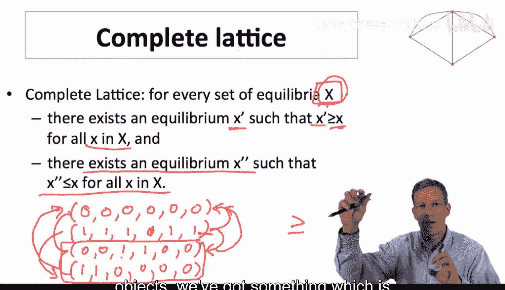

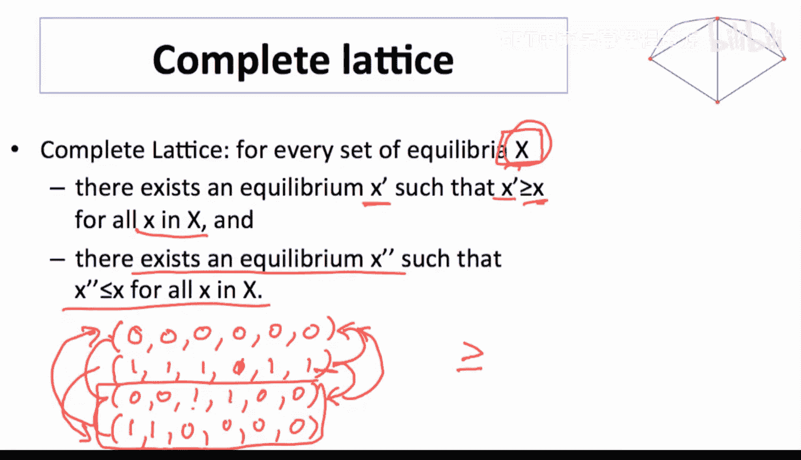

And why is that going to be useful， Let's think of our equilibrium structure。

 So our six objects of zeros and ones。Our six dimensions of zeros and ones in terms of equilibriumria。

 so in the game where we had that people wanted to do something if at least two of their neighbors did。

 we have a situation where one possible equilibrium is all ones。

 another possible equilibrium is all zeros。It could be that these three people take action one。

 it could be that these four people take action one。

These are all pure strategy equilibrium of this game， and they form a lattice。 There's。

 in some sense， a biggest equilibrium， everybody taking one。There is a minimal equilibrium。

 a smallest one。 everybody taking action 0。 And for any set。There's something， you know。

 so if we take this set to be our x， our set X。There exists something else。

 which is at least as large as either of these， where every entry here is at least as large as every entry in here。

Okay， so that's the notion of a lattice。 We can find a biggest equilibrium。

 a maximal equilibrium for any set， we can find a minimal equilibrium， so give me any set。

 I can find something which is at least as big as all of its elements， I can find something else。

 which is at least as big as at least as small as all of its elements。

And so that's going to be quite useful in terms of the structure of games of compliments。

So games of compliments are going to have that。

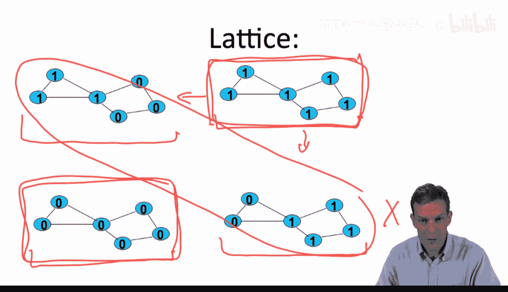

Property and in particular， there's a proposition that says if we're looking at a game of strategic complements where the individual strategies sets are each complete lattices。

 then the set of pure strategy equilibriumria are a nonempty complete lattice。

 So this is a theorem which follows fairly directly out of standard game theory。

 But what it does is it says that when we're looking for equilibriumria。

 there's going to be a nice mathematical shape to these things。

 and the complete lattice is a nice object to work with and what that also tells us is that that directly in games of complements。

 there exists in equilibrium as a corollary to this。

 there always exists a pure strategy equilibrium because complete lattices have to be nonempty。

 So that's something that comes for free。 So they'll be nice properties to these things that also means it's going to be nice ways of finding these equilibrium。

 And I'll say a little bit about that in a moment。 So the idea。

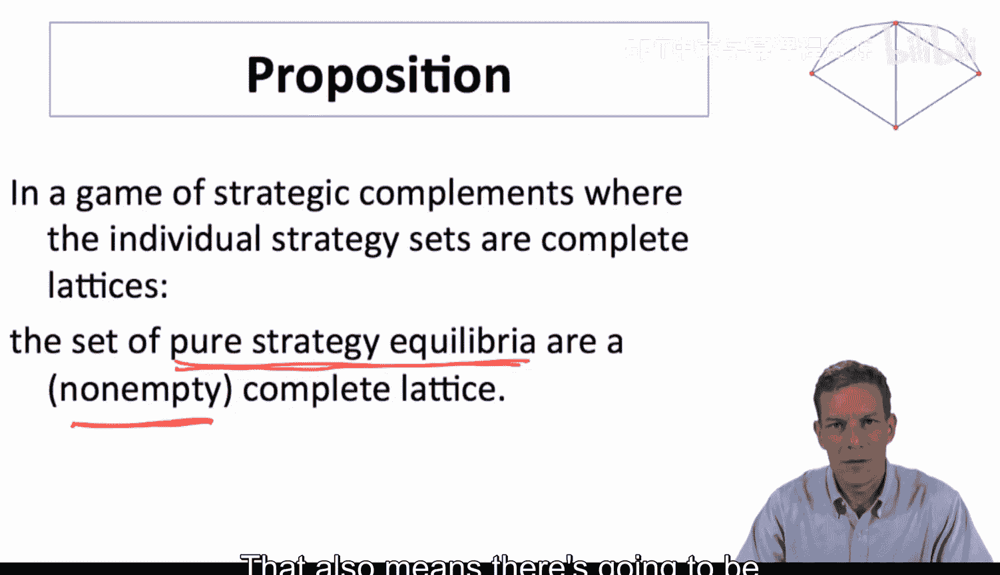

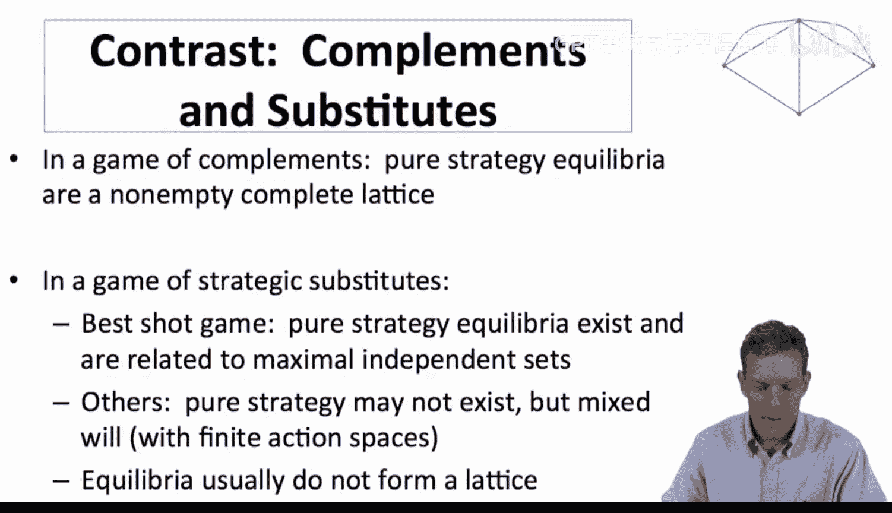

Before I go on to contrasting let me say a little bit about that finding you know an equilibrium。

 so suppose that we've got a world where we're dealing with strategic complements and people can take zeros or ones。

 action zero or one。And we want to find the highest equilibrium possible。Okay。

So what could we possibly do， so let's suppose that there's a society and we start with that society and they say seven individuals。

 what we could do is just start and check first of all， whether this is an equilibrium。

 just start everybody at one。 That's the biggest possible point we can imagine being an equilibrium。

 so try that out。Okay， so what this says is if everybody was taking one。

 would everybody want to take action one and maybe not， maybe some individuals wouldn't want to。

So if this is an equilibrium， then that's our maximal equilibrium。 We found it。

If it's not an equilibrium。Well， then that means that somebody。

 even when everybody else is taking the action， doesn't want to take the action。

RightSo let's suppose this person didn't want to take the action。 So instead。

 we say that if everybody else was taking the action， all these other people would have been happy。

But this person would really rather not take the action。Okay。

 so if they given that this is a game of strategic compliments。

If they don't want to take the action when everybody else is taking it。Then no matter what happens。

 they're never going to， even when some subsets are taking it。

 they're not going to want to take the action。 So this person is always going to be 0。 Now。

 we never have to worry about that person flipping back up to be a one。 They didn't want to take it。

 They're going to be stuck at 0 forever。 If they didn't want to take it when everybody took the action。

 Given that this is a game of strategic compliments。

 That means that threshold is above the highest possible threshold。

 That means that they're never going to take the action。 So we can count this person as a 0 forever。

 We know that any equilibrium has to have them as a 0。Okay。

 so they're going to take action zero no matter what。So now we just go back and repeat this。 Now。

 see if anybody else wants to take action 0。 now that we've put this person at action 0。

 either this is an equilibrium or maybe now somebody says， oh， well。

 given that the last person is taking action 0， now I want to take action 0。 And if that's the case。

 maybe this person says now， I'm going to go to a0。Well， given that this person was always a zero。

 then this person is always going to be a zero， the same kind of logic。

 they're never going to move back up because it's the game of strategic compliments。

 We know that this person always has to be a zero and so forth。And we just keep following this。

 And either eventually we stop in an equilibrium or we reach all zeros。 And if we reach all zeros。

 then that has to be an equilibrium。So now there's a very simple algorithm that takes at most and steps to find an equilibrium。

So in the game of strategic compliments。They exist in equilibrium。 They form lattices。

 They're very easy to find。So this is a wonderful structure of these games and think about it for a moment。

 try and see if you can name an algorithm that finds the minimal equilibrium。

 so find the minimal equilibrium， How would you do that？

So think about a variation on this equilibrium instead of trying to find the highest equilibrium。

 try and find the lowest possible equilibrium， what would that algorithm look like？

So you can find the max the min fairly easily。Very nice structure to these things。

 Game of compliments are really nice to work with。

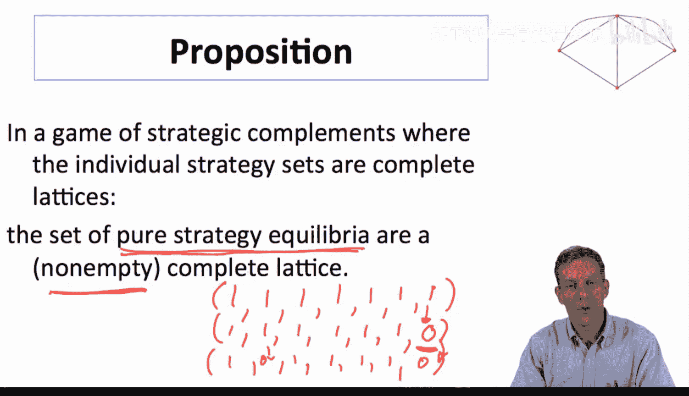

Okay， contrast， games of substitutes， not so nice。In the Game of compliments。

 we found that this nice structure， games of substitutes， well。

 for the best shot public goods that we looked at， that example。

 pure strategy equilibrium exists and the related to maximal independent sets。

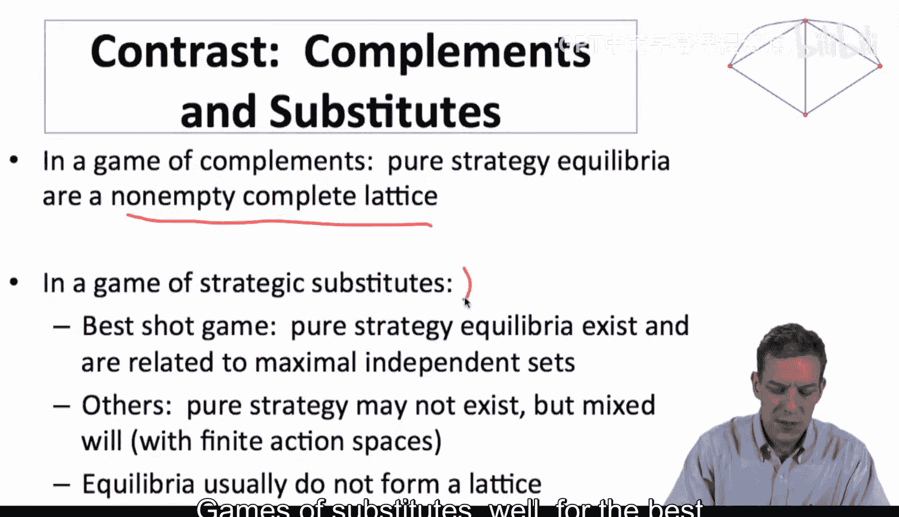

Other cases equilibriumria may not exist in peer strategies。They will exist with some randomization。

 but that's going to be a little tougher in this kind of network setting。

 E generally will not form a lattice structure unless you're in a very trivial case。

 equilibrium will not form a lattice and generally you're going to have problems because when one person wants to take action one and other people go to zero and vice versa。

 So you get this flipping condition rather than conditions where everybody goes up or everybody goes down。

 So the fact that everybody's preferences are moving in the same direction gives us the nice structure and compliments。

 But the substitutes means that when we change one person from one to0。

 other people can flip and then things can flip back and forth。

 and it's going to be very hard to find an equilibrium in a lot of these games。

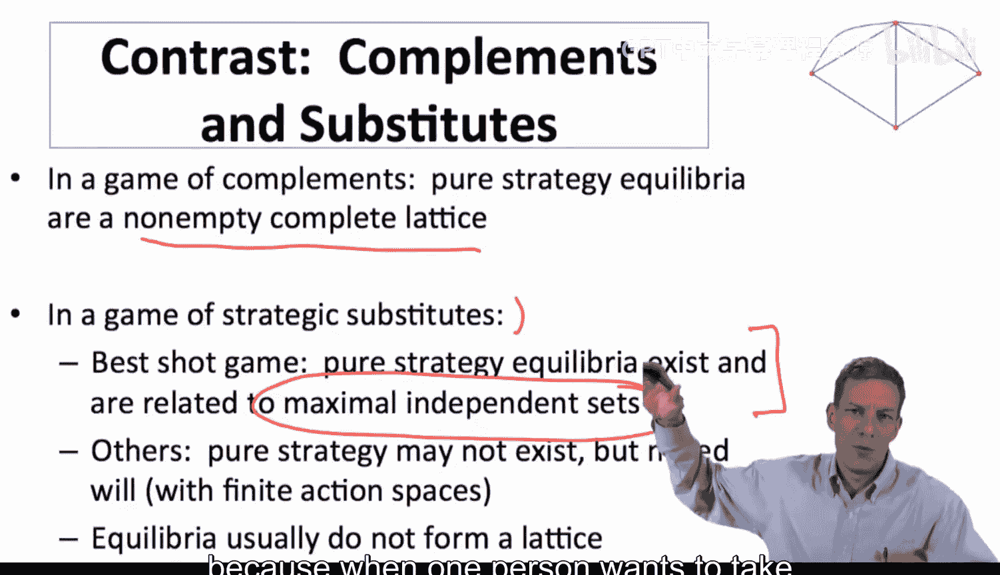

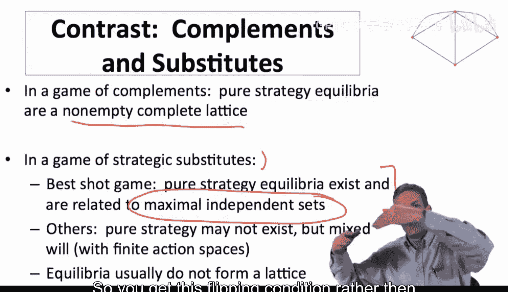

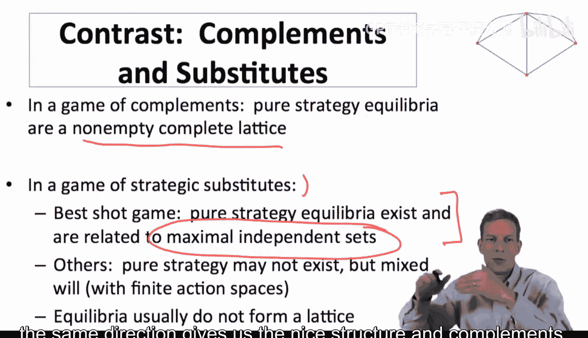

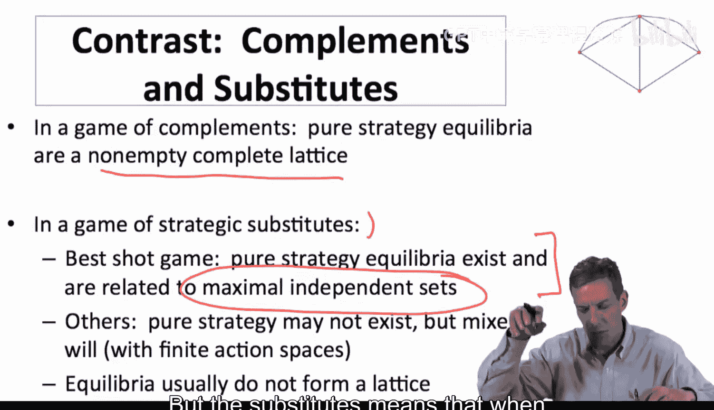

So games of strategic substitutes are going to be more difficult to deal with。

 more difficult to say things about than games of strategic complements where there's this nice structure。

 mathematical structure to the equilibriumlibria。

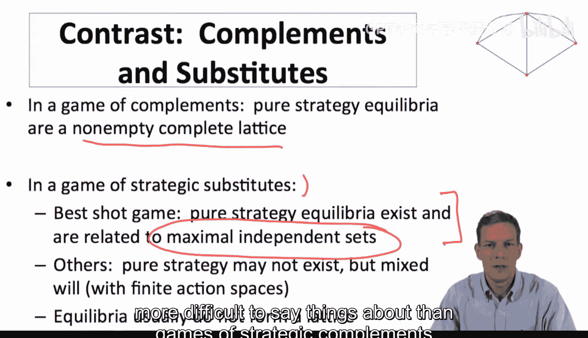

So for instance， when we look at the best Shop Public goods game。

 you know we can sort of as we flip you know give an individual on or off that's going to affect what's happening and you we get this person doing one。

 this person doing a zero or vice versa， but we're not going to be able to order these things so we can't have them you know there's not going to be a better equilibrium or lower one and actually finding these things finding all the independent sets can be quite difficult。

Finding one maximal independent set in a best shot public goods game is not hard。

 findinging all of them can be very difficult and in fact， is a difficult computational problem。

 as known in computer science， but there can exist multiple equilibriumlibria and no lattice structure。

Okay， so before I end let me say a little bit more about you know generally so bus shop public goods are going to be the one of the cases in the public goods case where we actually can say something about finding them。

 so let's suppose you wanted to find one equilibrium say find one maximal independent set。Well。

 it wouldn't be there's one algorithm that's fairly easy。One possibility is I just pick some node。

And I make that a one。 so I'm going to say this person is definitely。

 I'm going to have them choose the action。Okay， how am I going to make sure that this person wants to take the action if it's a public goods game。

 so they only want to buy the book if none of their neighbors do。

 So now I'm going to have to take all of their neighbors have to be zeros。

So I picked this person to be one， now I fill in all the zeros for their neighbors。

Now I've got a bunch of people who are still left。Pick any one of those people who are still left。

 They're not one of the neighbors of the first person。

 So they still don't have any neighbors who have taken the action。 Put them as a one。

Now all of their neighbors have to be zeros。Okay。Now， pick anybody who's left， make them a one。

Their neighbors become zeroes， and so forth。That algorithm will give you one of the maximum independent sets。

Now， if you did that over every possible ordering， you could pick nodes and you could find all the maximum independent sets。

 the difficulty is that there's many possible orderings I could have done that in， right？

So you've got n factorial。 you've got a huge number of possible orderings you could you could think of in sort of running that algorithm。

 And so the difficulty in finding all the maxal independence sets is going to be much more difficult。

 And there's not。 It's going to be very hard even to find the best one in terms of having most or fewest actions。

Whereas that was easier in a game of compliments where we could find a very quick and simple algorithm for finding equilibriumria。

So compliments， nice structure， substitutes， there's also a nice structure in terms of payoffs。

 but not as nice structure in terms of equilibriumria。Nonetheless。

 these are interesting games to look at in both classes will be interesting in terms of applications。

So we'll talk more about understanding equilibrium structure next。

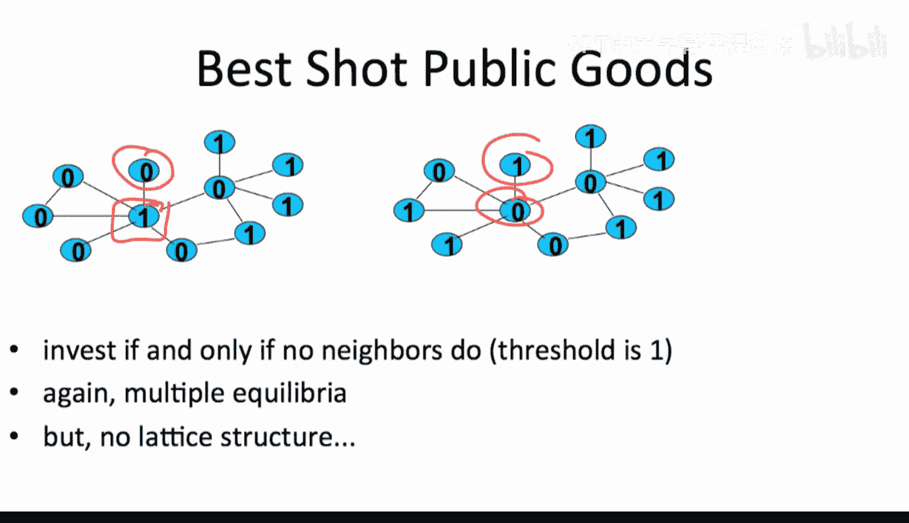