# 斯坦福大学《社会和经济网络：建模与分析｜Social and Economic Networks： Models and Analysis》中英字幕 p75 75_07_04_7-4-多重均衡.zh_en -BV1v1421U7Nk_p75-

Okay， so we've got some basic definitions and ideas behind us in terms of understanding equilibria in network games。

 and now we can look at a little more structure。

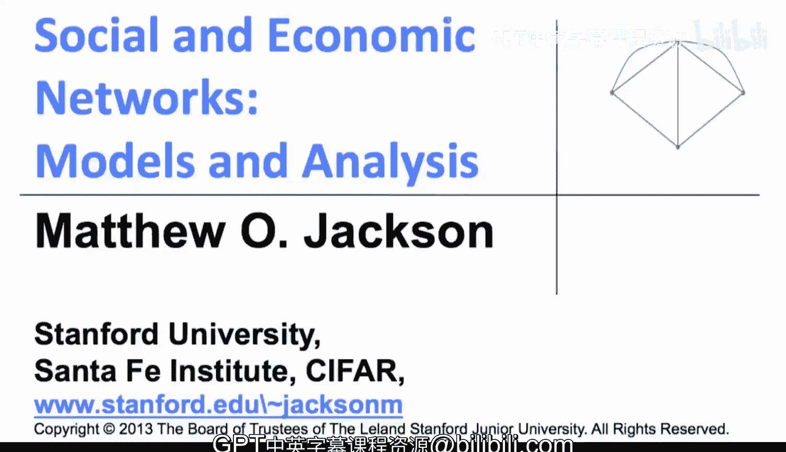

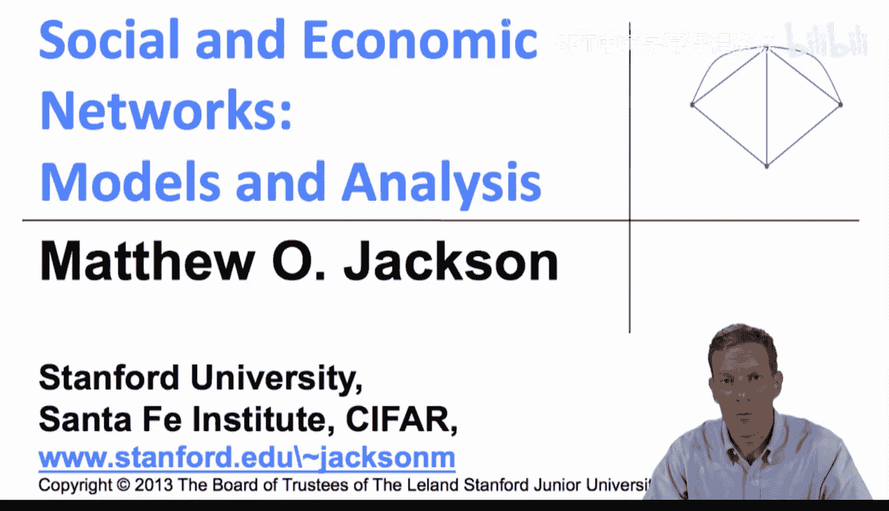

And what I want to do is talk a little bit about when it is that there's multiple different actions that can be sustained in a given network。

 so when is it that it's possible that some people adopt new technology and other people don't or that some people are becoming educated。

 other people are not and so forth， So when is it that we actually can sustain multiple actions。

 even when we've got a lot of homogeneity in the society。

 so even when anybody has a same preferences and so forth。

 we still end up with different people taking different actions based on their position in a network so this is just sort of an interesting question conceptually to understand when this can happen and so let's take a look at it and what we're going to do is is look at a paper by Stephen Morris a simple coordination game and this is going to be a game where you care only about the fraction of your neighbors taking a given action。

 so you prefer to take action one if a fraction cu or more。

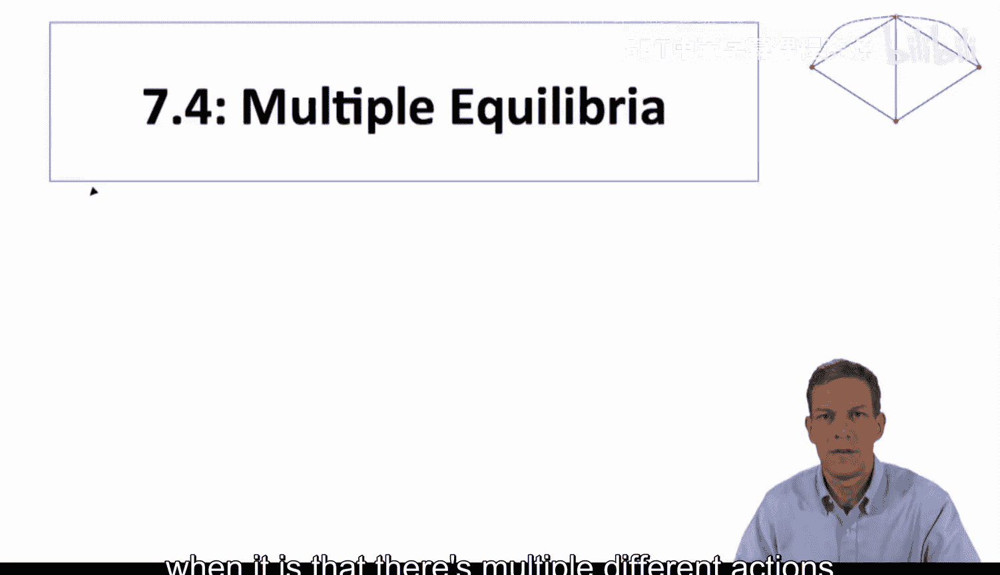

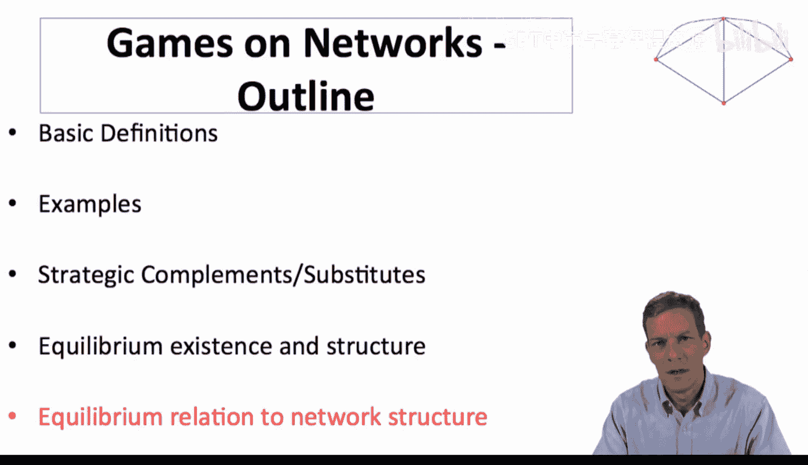

Your neighbors take action one。 So suppose that Q is a half。

 then if you just want to match the majority of your friends。

 So if the majority of your friends take action one。

 you want to do that if the majority of your friends take action  zero then you prefer to take action  zero okay so this is a game of strategic compliments and a very simple one where everybody just cares about the fraction。

 So everybody's threshold is just a fraction of their degree， it's the same fraction。

 but we could have Q be a half it could be two thirdds。

 So maybe you need two thirdds of your neighbors to take this action before you know this new technology before you're willing to adopt it and so forth。

 so very simple coordination game and let me say a little bit about the background of this game。

The game where it's actually a half is also what's known as the majority game。

 and this is a game which has been studied quite a bit in the statistical physics literature and has some background in the physics and agent-based literatures and part of the reason is that there's certain kinds of particles where the particles might be sitting in some sort of lattice structure and the particles react to what other particles are doing。

 so if other particles end up in one state， then they end up trying to match the state or they could end up going in opposite directions。

 but in certain situations they'll flip to be in a certain state if more of their the other so as more of their neighboring particles become excited。

 they become excited， for instance。And depending on what that threshold is。

 then that ends up having a percolation so that you can end up having this move through different kinds of。

Materials， and so that's been an area of study in physics and this actually has a nice interesting relationship to these kinds of games on networks where a given node cares about what its neighbors are doing and would like to match actions to the neighbors and in this case we have this simple cue which describes what's the fraction that have to take action one before I want to take action one。

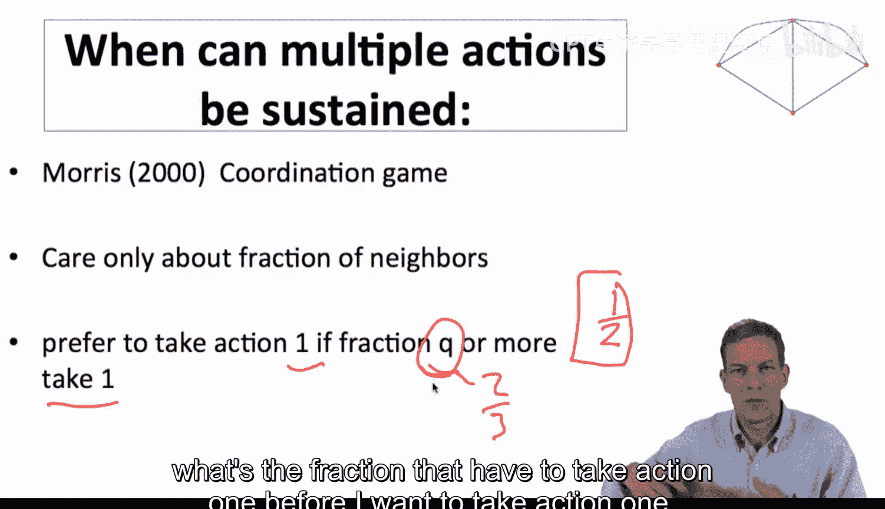

Okay。So let's， let's think about what equilibrium look like in this game。

 So we're going to look at pure strategy， Nash equilibrium in this type of game。

 And let's let S be the subset。 So we've got these N agents， one through N。

They're connected in some network， right， So there's some network describing which。

People are connected to which other ones and so forth。

 And what we want to do is we want to color them so that some of them take action1。

And we'll let S be the set of individuals that take action1， okay？

So what can we say about an equilibrium in this game where S is the set of people who take action1。

 Well it's going to have to be that every person in S has a fraction of at least Q of its neighbors in S okay so the only way that they're going to want to take action1 is if at least Q of their neighbors or in S。

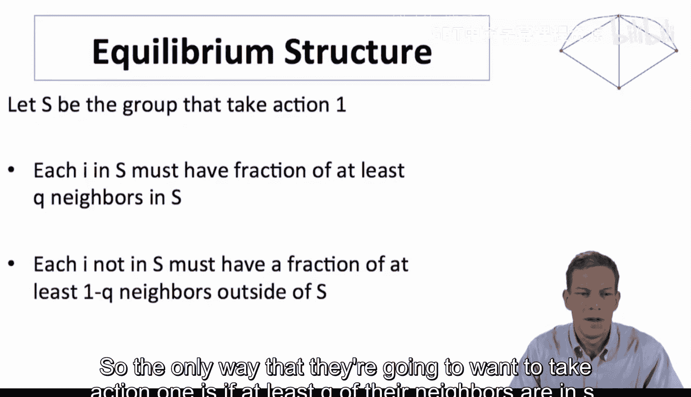

RightSo that just follows directly out of the fact that you only want to take action one here if at least you your neighbors do。

 and it has to be that everybody not in S doesn't want to take action1。

So it has to be that everybody who's not in that set。

Has to have a fraction of at least one minus Q of their neighbors outside of S。

 so that fewer than  Q of their neighbors are in S。

 more than one minus Q of their neighbors have to be outside。 Okay。

 so for any for for the set S to be the group that take action one， for that to be an equilibrium。

 these two things have to be true。 Okay， and basically that characterizes the set of equilibrium。

 So S is going to be an equilibrium， if a pure strategy equilibrium。

 if and only if this is true in this game。

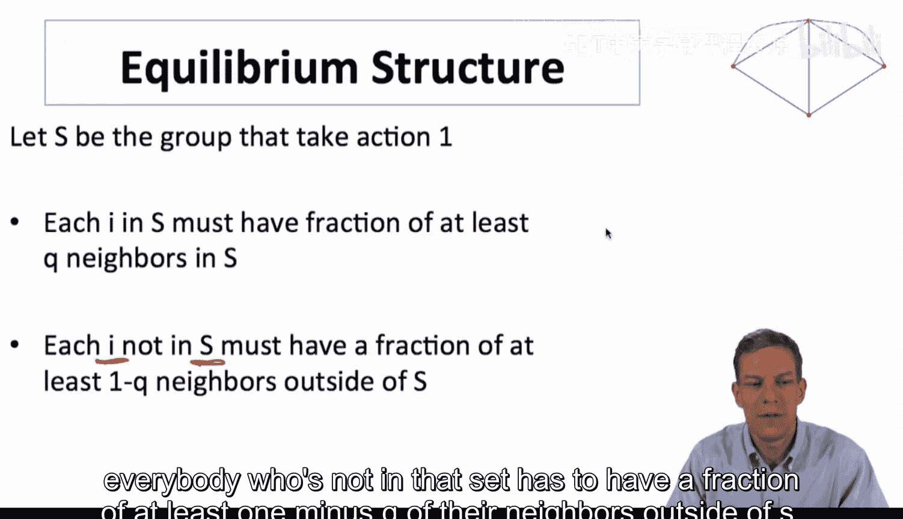

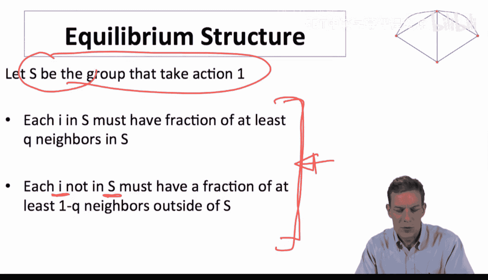

Right。Okay。So now a definition， which is actually an interesting definition in terms of a network。

 what's known as cohesion following Stephen Morris's definition， and we'll say that a group S。

 some group of nodes， S is R cohesive。Where R is going be something。

 R is going be some number in 0 to 1。So we've got some number in 01。

 and we'll say that S is R cohesive。If。When we look at everybody in the set， right。

 so look at all of the people in S。And look at what fraction of their neighbors are in S。

 So here's how many neighbors they have。 Here's how many of their neighbors are both neighbors and in S。

The fraction， everybody who's in S has at least a fraction are of their neighbors in S。

So that means that the set R S is R cohesive， everybody in that set has at least R of their neighbors in the same set。

Okay， so that gives us a definition， and then we'll say that the cohesiveness of a given set。

Is just going to be the lowest fraction that you can find out of all the individuals in that set。

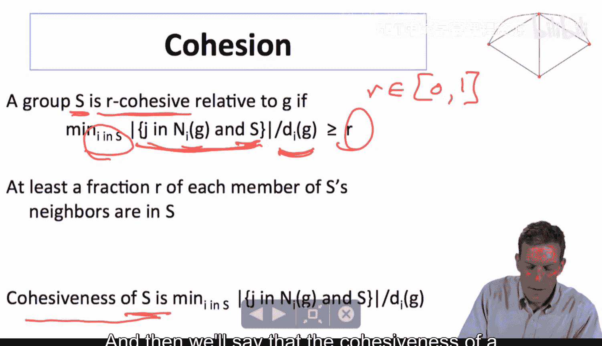

Of their， how many of their neighbors are in that set。 Okay， so this is the cohesiveness is this。

 the the minimum across S。 This is also sort of the maximal R that you could have and still satisfy this。

 right？ So it's the maximal R。Such that s is at least is are cohesive。Okay。So either way。

 we've got a definition which says how cohesive a set is。 So how。

 what's the fraction of everybody's neighbors who are inside that set。

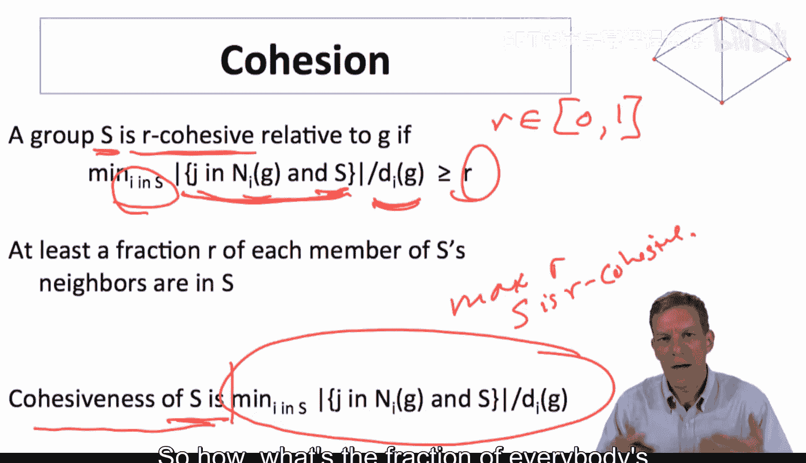

So here's an example of the network and here's a set S。Here's another set， it's called S prime。

Both S and S prime are two third cohesive。Okay， so as is two third go。

 he at least two third of this person's neighbors are in the set。 In fact。

 all of their neighbors are in the set。This individual has exactly two thirds of their neighbors in a set。

 right， So they have two neighbors in one neighbor out。

 So this person has two thirds of their neighbors in S。 Everybody else has a fraction。

 This person has a two third。 These people have fraction 1，1，1。 So this set is two third， cohesive。

It's also one half cohesive， right， So it's at least one half cohesive。 But in fact。

 the cohesiveness of this set is two thirds。 That's the maximal level at which we can find that everybody has at least that fraction of their friends in the set。

 And similarly， if you go look at this one。 this one also has two third。 Now， if we added。

 say extra friendships here。 these two people also had friends here。

 then this one would become three quarters cohesive。Right。So depending on the network structure。

 different sets are going to have different cohesiveness。

 but what's interesting here is we get a split in this network。

Such that we've got two different sets。Of individuals who each are having a good portion of their friends。

 their friendships inside the set and fewer of their friendships outside the set。

 So when we divide this network here and here， if we were playing a majority game where you just care to match your the actions of your friends。

 we could have all these people play one action， say these people all play zero。

Of majority of their friends are all playing zero。 and all these people play action 1， right。

 That's one possibility。So now we have a situation where we can have different actions played on the same network。

 partly because we have a split in this network， a segregation where each of these groups is sufficiently cohesive。

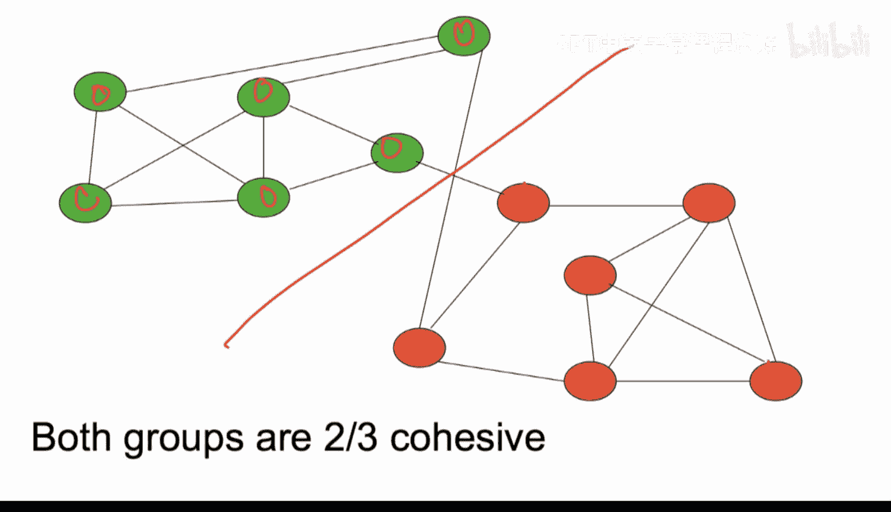

Okay， so equilibrium where both strategies are played， we go back to Morris's paper。

 there exists a pure strategy equilibrium where both of the zero and1 actions are going to be played。

 if and only if there's a group S， such that that group is at leastq cohesive。

And such that its complement is at least one minusq cohesive。

So it has to be that everybody in that set has at least Q of their neighbors。

 so this group S is going to be the group that plays action1。

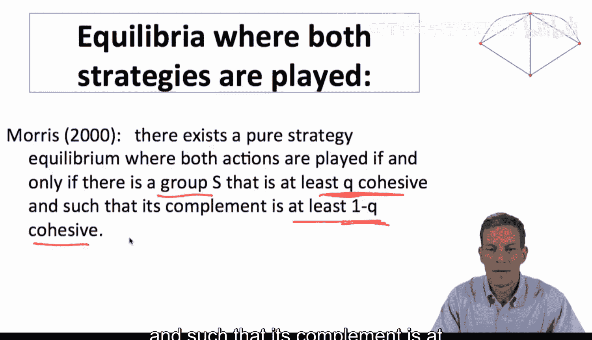

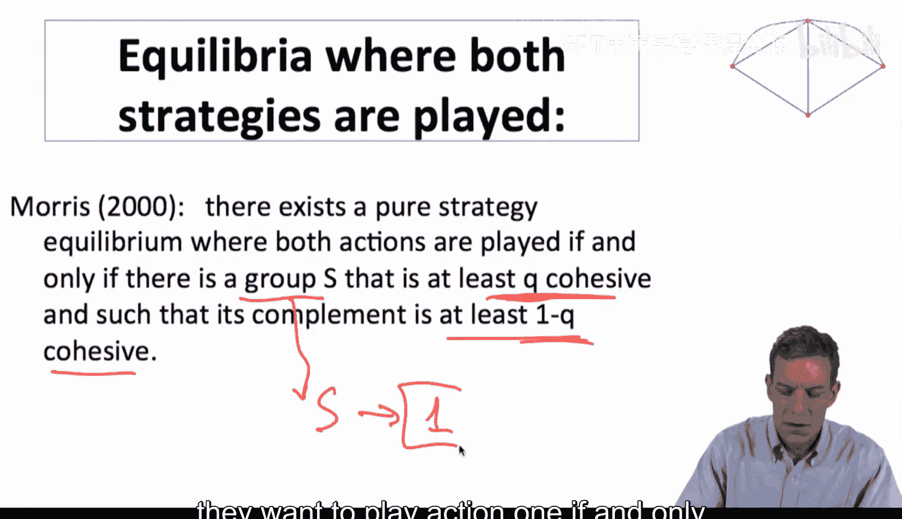

They want to play action1， if only if at least queue of their neighbors do。

 so that set has to be Q cohesive， everybody has to have at least cu of their neighbors in that set。

The complement of S has to be the people playing action 0。 So none of them can have。

More than Q of their friends in in this set。 So that means that they have to have at least one minus Q of their friends outside。

 So this proposition just follows pretty much directly from the definition of the game。

 And it's a very simple， straightforward calculation。

But what it does is it shows that this now we've got a notion of cohesiveness of groups inside a network。

 which is going to be very useful in identifying when you can sustain multiple equilibriuma in a game。

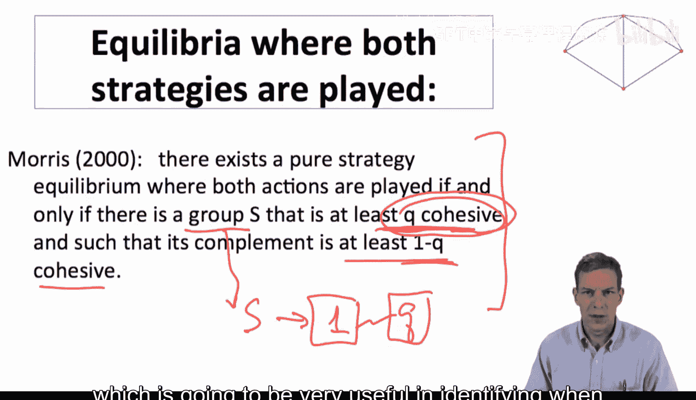

Okay。So let's talk a little bit about how this relates to homophily， so for instance。

 if Q is equal to a half and players want to match the majority。

 then two groups that have more self ties than cross ties。

 that's going to be sufficient to sustain both actions in equilibrium。So when we're looking， you。

 at games where we've got， you people really caring about matching most of their neighbors。

 we can get different actions played in different parts of a network if the groups are sufficiently splintered。

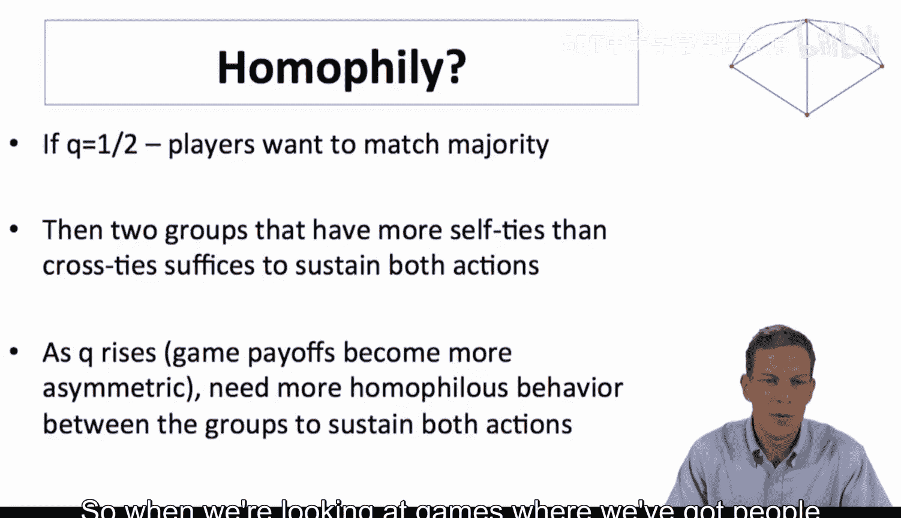

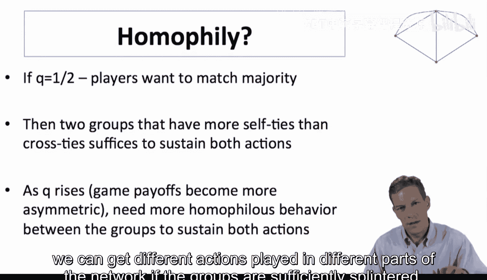

Now， as Q rises。So you need a higher and higher fraction of your friends in the set。

In order to want to play action1， then you're going to need more homophily。

 more of a stronger split in the structure， so you have to have some group which is really highly cohesive in order to sustain both actions。

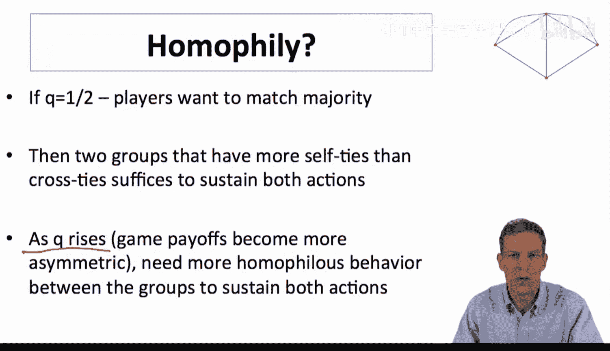

So for instance， if we go back to what we saw in the ahealth dataset。

 this is a situation where you basically have a strong split between a group of nodes over here and another group of nodes over here and so this would be a situation where you could imagine different behaviors in particular largely categorized by race。

 being sustained here， even if the people started out identically。

 but except they paid attention to who their friends were。

 if friends here tend to be correlated with race and if they then wanted to match the behavior of the majority of their friends。

 you could end up with a situation where they had very different behaviors sustained by different groups within the same network and so that's what we get out of that theorem。

Or proposition so so here we've got， you know so far we've looked at understanding equiria strategic complements。

 there's a lot that has nice structure to it and we can begin to understand things。

 It relates back to the network structure， it begins to relate back to things like homoopfoly in terms of when is it that we can sustain multiple actions and so forth。

What we'll begin to do next， we'll take a look at one quick application of this and then we'll start looking at games with richer action spaces so mostly what we're looking at here is sort of01 games we'll look at some other games that have richer actions but before that we'll take a quick look at an application of this。

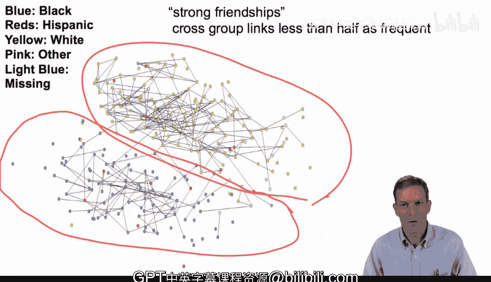