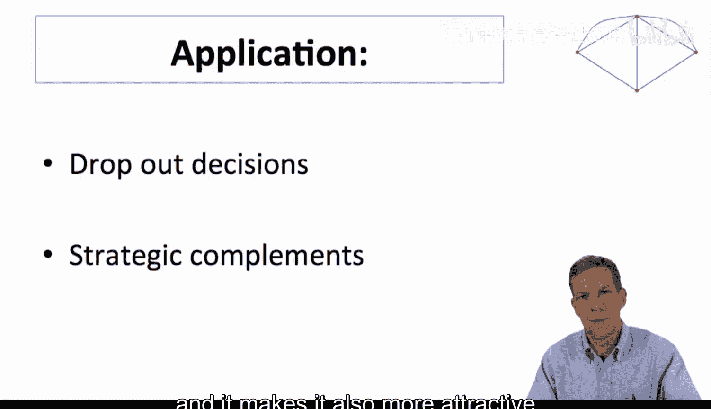
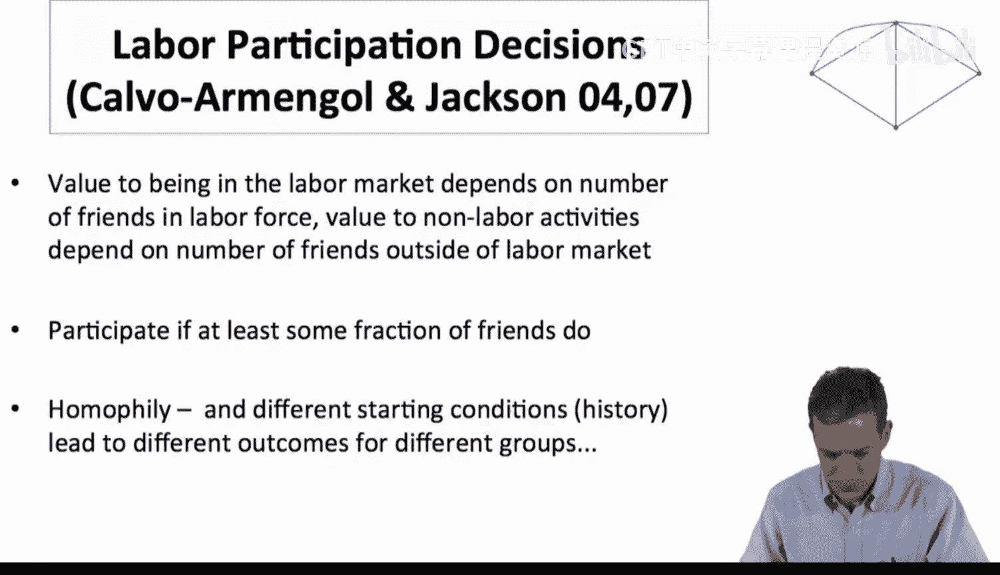
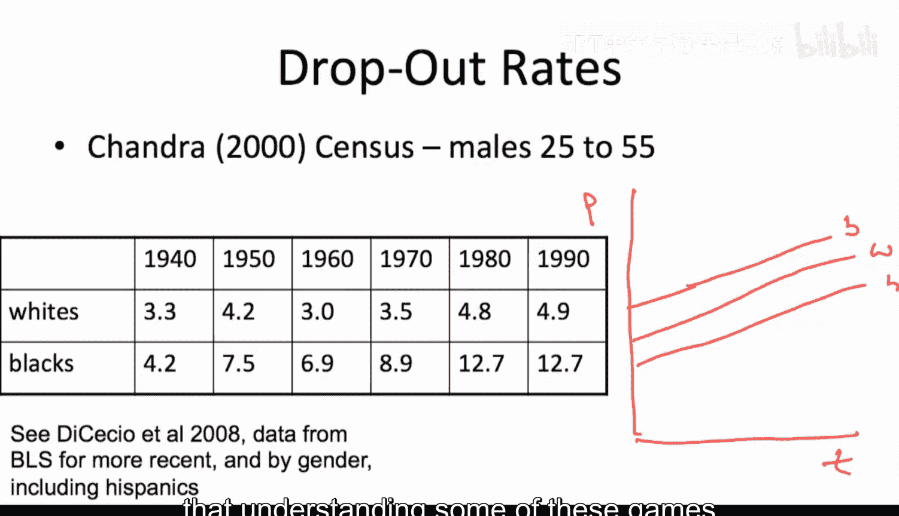
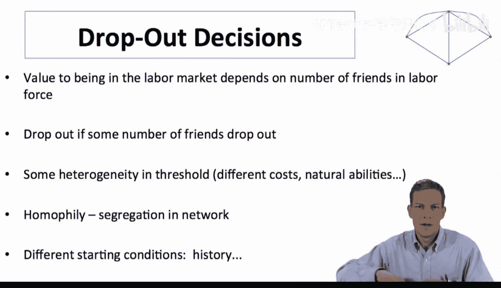
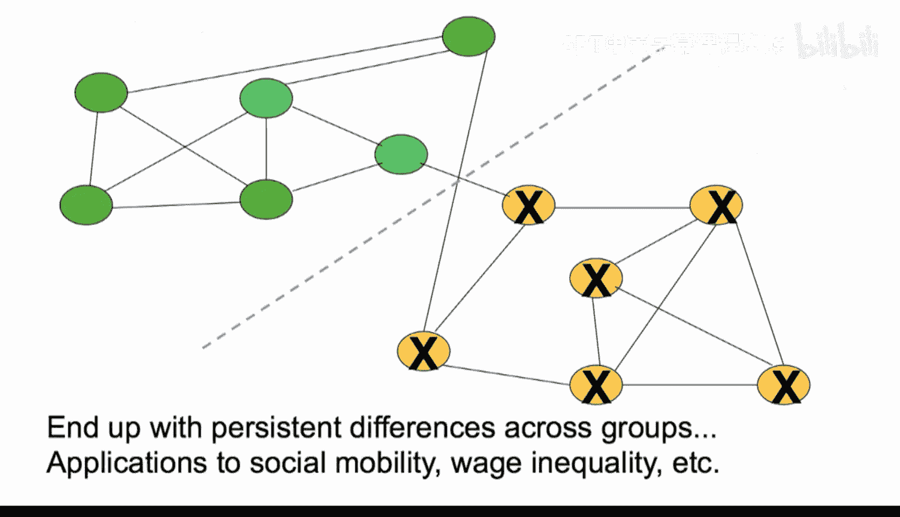
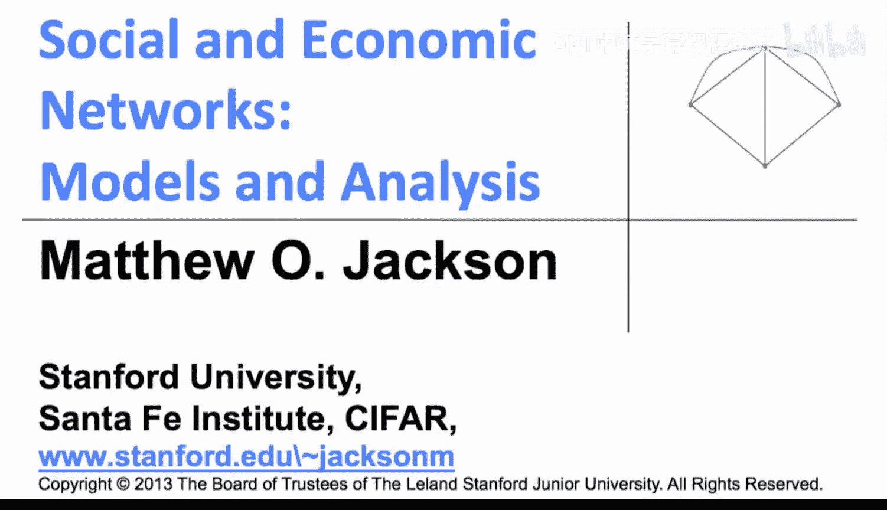

# 斯坦福大学《社会和经济网络：建模与分析｜Social and Economic Networks： Models and Analysis》中英字幕 p76 76_07_05_7-5-应用示例.zh_en -BV1v1421U7Nk_p76-

Okay， folks so we're talking about games on networks and I just want to take a quick moment to talk through some of the implications of some of the things we've seen so far before we two talk about Richarder games in terms of expanding the action spaces。

 so in particular let's look at an application to dropout decisions。

And what do I mean by dropout decisions。 in particular。

 we'll think about dropout decisions in terms of being active in a labor force。

 And this is an area of economics， which has received quite a bit of attention。

And the important thing here is that these things are going to be strategic compliments。

 So the more of my friends who drop out of labor force and are no longer employed or actively seeking employment。

The harder it is for me to find jobs， the harder it is for me to get employed and it makes it also more attractive for me to drop out of the labor force and in particular I'll talk just a little bit about I wrote some papers with Tony Calval Armenal where we looked at labor participation decisions inside a network and the basic ideas here are that these things work out to be strategic complements so the value to being in the labor market depends on the number of friends that I have in the labor force and that that gives me access to job information。

 it gives me better access to information about how to educate myself and so forth and also the value to non-labor activities depends on the neighbor number of friends outside so if I want to become a criminal and I have more friends who are criminals than it's going to become more attractive to do that and so we can think of this as a network game where going to。

knowParticip in the labor force of a certain fraction of my friends do and on top of this we want to layer the idea that there's a lot of homophily in these networks。

 so there's strong segregation patterns in a lot of the networks that we observe and when we put these things together for whatever historical reasons that we see one group starting with a higher level of participation in another we'll end up seeing strong patterns here。

So let me just do a little bit of background in terms of dropout rates。

 so this is old data actually from Chandra in the 2000 census looking at males 25 to 55 in the US and what it does is it just looks over time 1940s。

 50s， 60s through 90s and whites and blacks and gives numbers for what's the fraction the percentage of that group that had dropped out of the labor force and dropped out of labor force means that're they're not employed。

 they're not seeking employment， they're not in prison， they're not in school。

 so basically there's not a reason that they can't seek employment but they're also not actively seeking employment and when you look at this over time。

 you begin to see that there's some increase in both groups。

 whites and blacks but there's a much higher increase in blacks actually。

If you expand further on this black males， those numbers have gone up even more I don't have the graphs here partly due to copyright reasons。

 but there's some interesting data， if you look at the Bureau of Labor Statistic。

 you can get numbers which go up through 000 mid 2000s on these things and it's actually very interesting it has also by gender and including Hispanics and basically what you see is if you look at labor force participation rates among males。

Among males is actually dropping over time， so the figure would look something like this。

 so if you look at participation in the labor force and the opposite would be dropping out and you look over time what you see is you see these things dropping and in particular blacks。

 it's going to be dropping most rapidly whites is dropping and Hispanics actually for males it drops less so you have Hispanics at the top whites here and blacks。

And what's very interesting is if you look， so part of this is you could tell a story about socioeconomic background and a whole series of other things。

 which correlate with these decisions。 But the interesting thing is that even after you're correct for a lot of that。

 the kinds of patterns that you see in this still persist。 and in particular。

If you look at females and you look at time and you look at participation。

 it's going up over time and there things are reversed So you have say Hispanics down here。

 whites here and blacks here so blacks， whites and Hispanics So the pattern that you see in males is actually flipped over for females。

 And so part of what that says is it's not simply just socioeconomic backgrounds。

 there's other cultural interactions that are important in determining what's going on here。

 And what I want to do is just make a really quick point that understanding some of these games on networks can help us figure out why there'd be persistent in long-term differences。

 say among groups And again， know it's due to these complementarities。

 you want to drop out if some level of your friends drop out there could be some heterogeneity and the thresholds so not everybody takes the same action。

Add that with homophily， segregation in a network， different conditions。

 And then when you look at this， one group， once it starts getting more dropouts。

 is going to tend to have more dropouts。 And so if we begin to go back to our two groups exhibiting homophily And then for whatever reason。

 we start with let's suppose we do a majority game where you want to drop out。

 if at least half your neighbors do， and one group happens to start historically with a higher dropout rate than the other。

 then what begins to happen， you know here you want to drop out if at least half your neighbors do。

 well， once these two people have then this person is going to want to drop out right So so we that person drops out。

 Well， now this individual has more than half their neighbors these two neighbors compared to this one。

 this person is going to drop out。 And so you know similarly， this person has actually two neighbors。

 So as we go through these people drop out then this person drops out。

But the interesting thing is， when we go back to that notion of cohesiveness。

 the fact that there's homophily here and it splits means that this one group could have much higher dropout rates。

 and that doesn't cont It doesn't have contagion across the to the other side。

 So we can begin to understand why there's sort of persistent differences。

 So understanding these network games can be useful in understanding why we're seeing differences that persist over time and how that relates to network structure。

 So it's a very simple point。 But I think one that can begin to show how these models might be useful in going forward and and adding more understanding to the dynamics of things like labor force participation。

 welfare overtime， education， decisions on health， a whole series of very important decisions that people make technology adoption might be different in one group than another。

 How can it happen， How does it persist， These games are going to be very useful in answering those kinds of questions。

 So， there's a little bit that's been done on this。 But I think a lot more that can be。

Okay， so that takes us through our basic understanding of games on networks where we've got two actions possible the next thing we'll do is start to enrich those and look at situations where there's multiple actions and not just a binary set。

