# 斯坦福大学《社会和经济网络：建模与分析｜Social and Economic Networks： Models and Analysis》中英字幕 p77 77_07_06_7-6-超越0-1选择.zh_en -BV1v1421U7Nk_p77-

Okay， folks， so now we're going to talk a little bit about games where we have richer action spaces so people can take some level of action。

 but beyond 01。

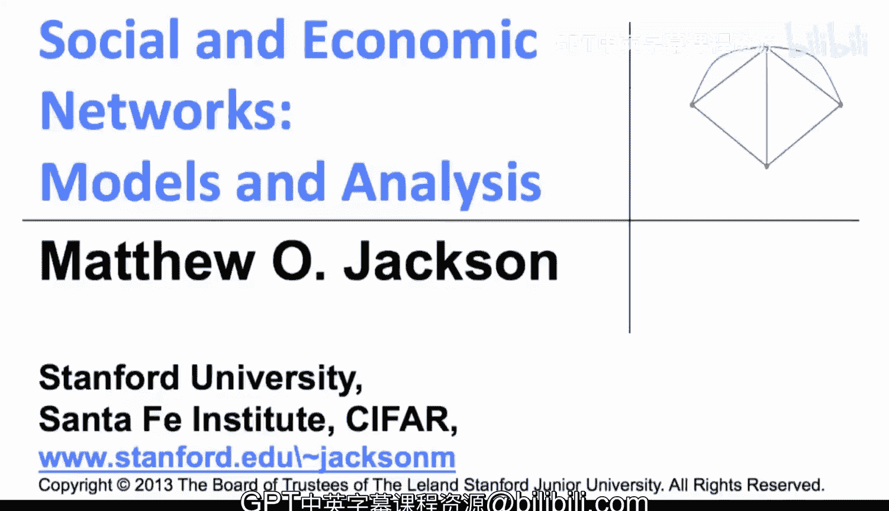

And I want to talk about just two examples of this that give some illustration of these things and one is going to be basically a game of substitutes that's going to have a lot of relationship to the bestshop Public goods game that we looked at before and another game is going to be one where there's games of compliments and that'll be a different one and it'll tie back to network structure more easily so let's have a look at these things and trying to understand a little bit about them So the first one is game on networks also known as a graphical game where we're choosing now levels of actions we could have it in01 we could have the action it could be XI and zero to infinity So some people are taking some level of action and this we' look at as in work by Jan Bramley and Rachel Crrenon and the game that they're thinking about is one where people are choosing。

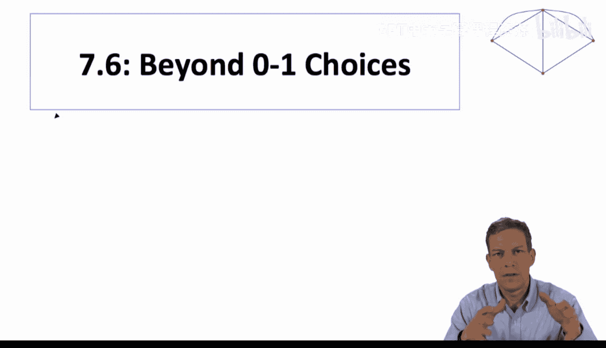

Some level of information to acquire about something。

 Okay so you're expending some effort and this effort is learning about something and how much time do I spend learning about this。

 So it might be learning about you know in California we vote on things in terms of propositions how much time do I spend learning about this and then maybe my friends can just ask me and free ride on the fact that I do the research or maybe I free ride on them and so forth。

 Okay so the structure that they look at is a classical public goods structure So the payoff for any given individual is going to look as follows。

 So what are you're getting you're getting some F some function。

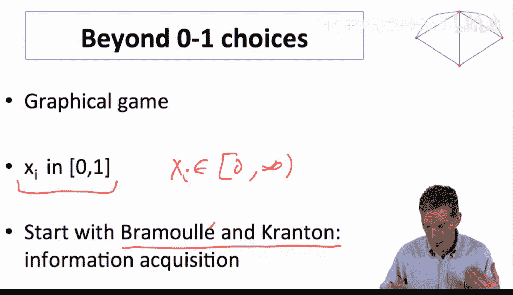

Of your own action， X I， plus the action of your neighbors。

So you've got some of J in your neighborhood。And what those J people are doing。 Okay。

 so that's the benefit you get。 You get some benefit from the overall level of public goods thats being gone。

 And generally， this is going to be a concave function。 So initially there's high benefits to this。

 but it is going to tail off with the level。 So as we think about the total level that's being provided。

 the total level of these sum of x's。 as it goes up。

 we're going to think of this as being a concave function。

 So eventually you know more and more learning， it's just not worth any more information。

 So information， a little bit of information is really valuable。

 a little more is a little more valuable。 Eventually just， you know is overload。

 it's not worth anything to me。Okay， so we've got a concave F and then each person pays a per unit cost of their effort okay and then we pool our information so I get to learn my information plus everything that my neighbors learned and we pool that together that's the value I get and then I get a nice concave function of that and then I pay some cost per unit of effort that I have。

So that's a very simple structure and once we have that kind of structure we can let so let's assume this things nicely differentiable。

 we can take a derivative of it， we can also look at the maximizer of this。

 so suppose that I just look at the function where I look at the total effort that's provided and look at the total cost。

Okay， and I want to look at a situation where I maximize this thing with respect to x。So。Maximizing。

 let's suppose I want to choose the x， which maximizes F of x minus c of x。Well。

 maximizing that I'm going to set F prime of x minus c is equal to 0 or F prime is equal to C。

 So let's let x star be the solution that if a given individual was choosing how much total effort should be provided and they had to pay the cost for that whole effort。

 they would choose X star。 So we'll call X this level。Okay， so what's true about X star。

 if you look at any pure strategy Nash equilibrium。

 now let's suppose that each person chooses the x's and they look at what their neighbors are doing。

In all pure strategy Ash equilibria， the total amount that any individual is getting in their neighborhood has to be at least X star。

Okay。And why is that true， suppose that the amount that was being provided in somebody's neighborhood was less the next star？

So say x star over2。Well， if given that this is a concave function。

X star is the point at which this derivative is exactly equal to C。

 So when we look at where F prime is， that's equal to C。 the slope is exactly equal to the cost。

 So if you were seeing less action， then you would still have。

 you would have F prime be greater than C。And so that means a little bit more action by one person。

 so if I add a little bit extra X。The gain I'm going to get in terms of my F。

Is going to have a more rapid gain than what I'm going to lose in terms of cost。

So if anybody is seeing less than X star in their neighborhood， they would like to increase Xi。

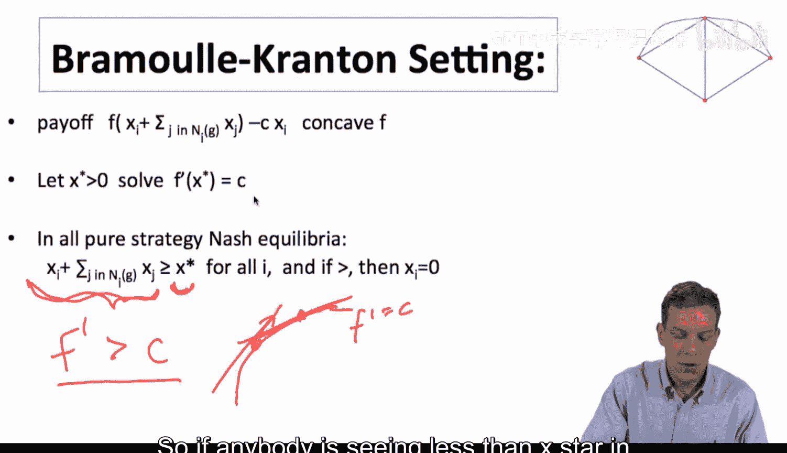

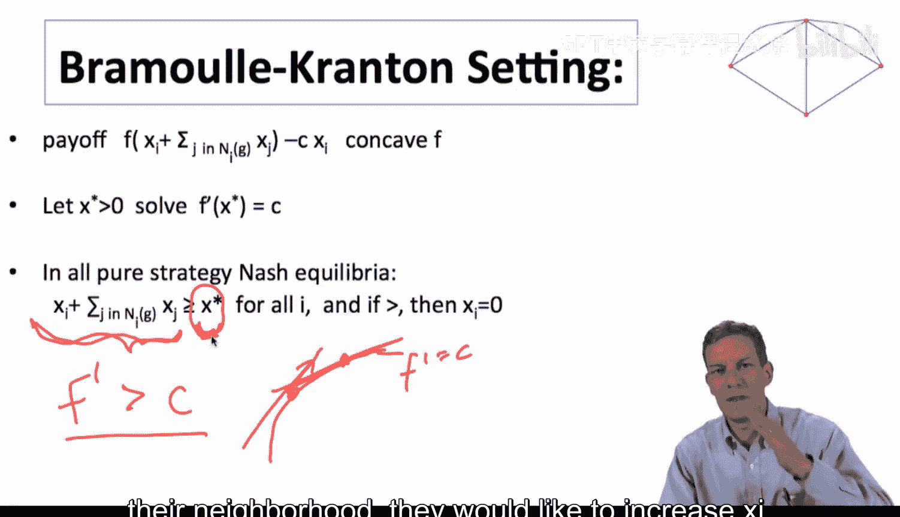

So if the total， if this sum。If that was less than X star。Then， you should increase。X I。

 And so that could not be an ash equilibrium。 Id， I'd strictly want to increase my activity because I want to push us up to this level where the trade off begins to be just equal to the cost。

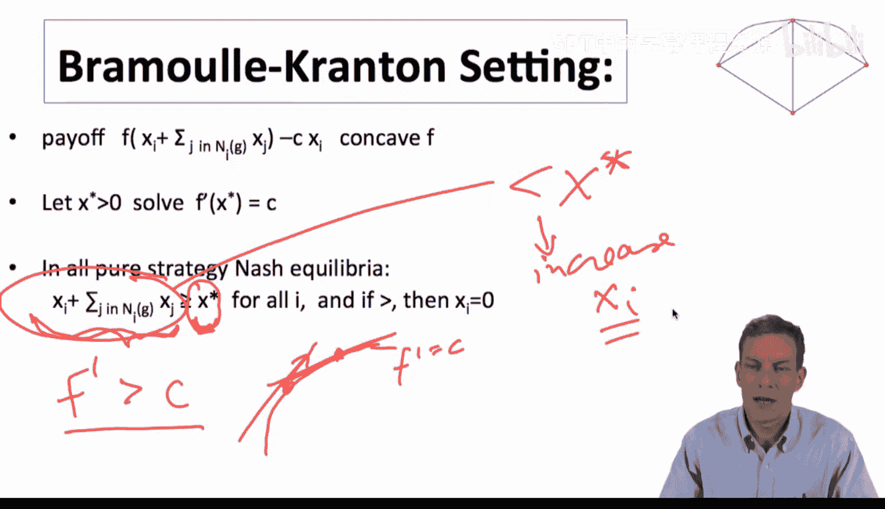

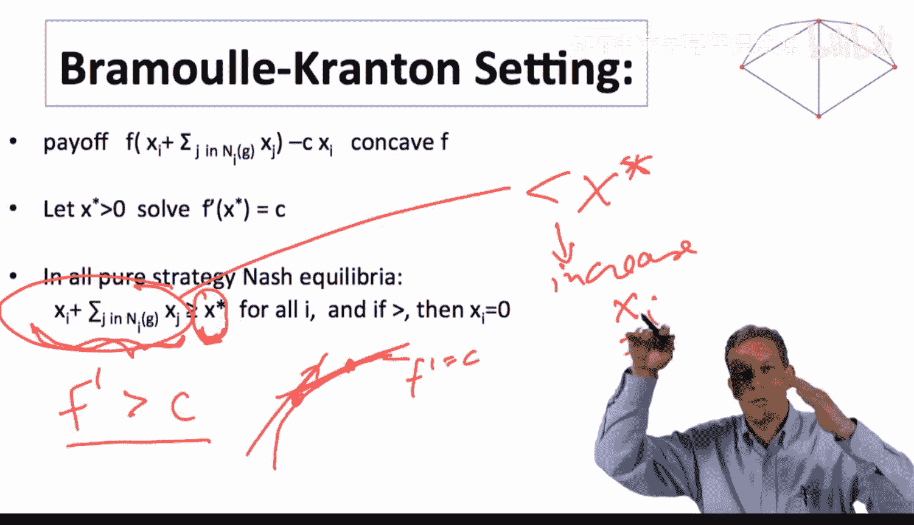

Okay， so what that tells us is that in an Ash equilibrium。

 if it has to be that everybody's getting at least that star。And if I'm getting more than X star。

It could be that there's lots of people that happen to be providing public goods for me。

 So my neighborhoodhood is really full of people providing lots of public goods。

 If we're in a setting where I've got extra activity going on in my neighborhoodhood。

 then it should be that I'm not providing any action。 And why is that， Because if we've gone too far。

 than by decreasing my action， if I'm providing positive action。What I get in terms of the decrease。

 So again， this F prime is a situation where by decreasing what I'm doing， I'm actually。

 so if we're in a situation where I've gone too far。

 So this is the X star where things are exactly equal， if we've gone too far。

 then what I would lose by decreasing my action。Would be。Less in terms of the slope than the C。

 So there would be a situation where F prime is less than C。

 So actually decreasing my action would save me cost。

 and the loss and benefits would be less than that。So it has to be that if， if we're over。

 then I'm providing nothing。 Okay， and that is possible in some of these situations that if I have lots of friends providing public good。

 I'm getting too much。 I just， I free ride completely。 Okay， so that's a basic structure。

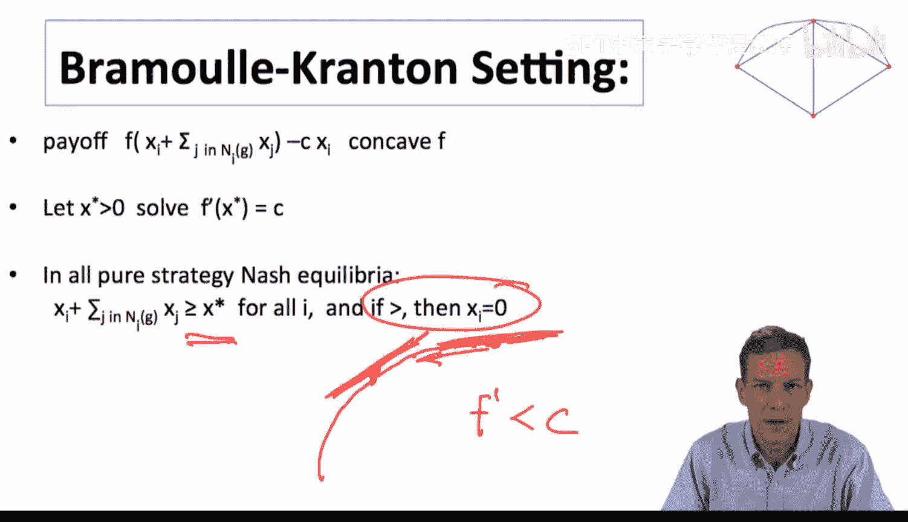

And so what that means is that then equilibrium are going to boil into situations where we can talk about two different kinds。

 one is where we're in a situation where theres things are distributed where everybody is providing some action。

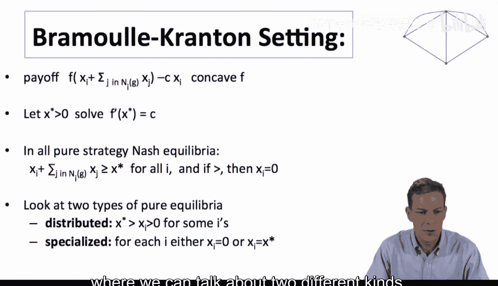

And the total actions are just balancing exactly up to these X stars。

 Everybody's seeing exactly X star in their behavior in their neighborhoods and everybody's acting enough to just balance these things and then there's specialized equilibriumlibria where some people take actions and other don't and where basically the people who take actions are are just going to specialize and produce the public good。

 just like in a best shop public goods game and then those people around them are going to free ride completely and so to get a feeling for this let's have a look so let's suppose that we're just normalize X star to be one。

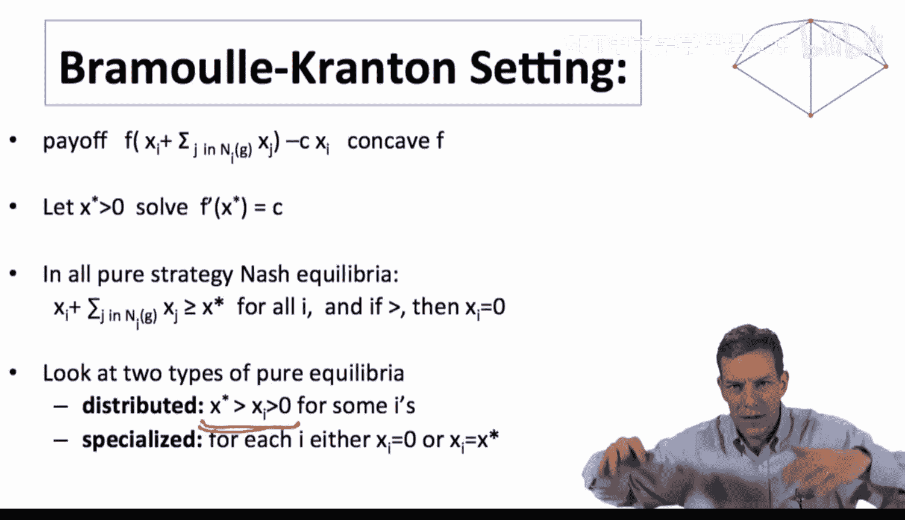

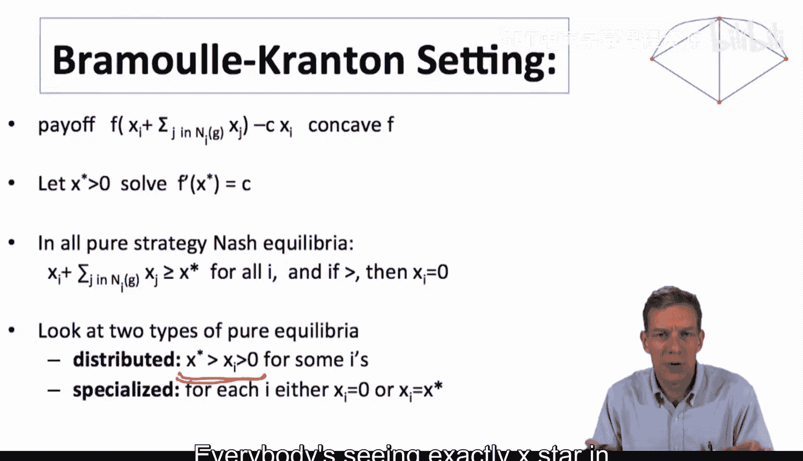

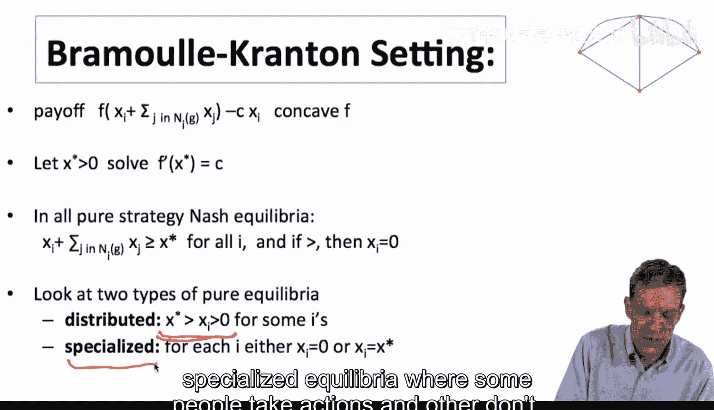

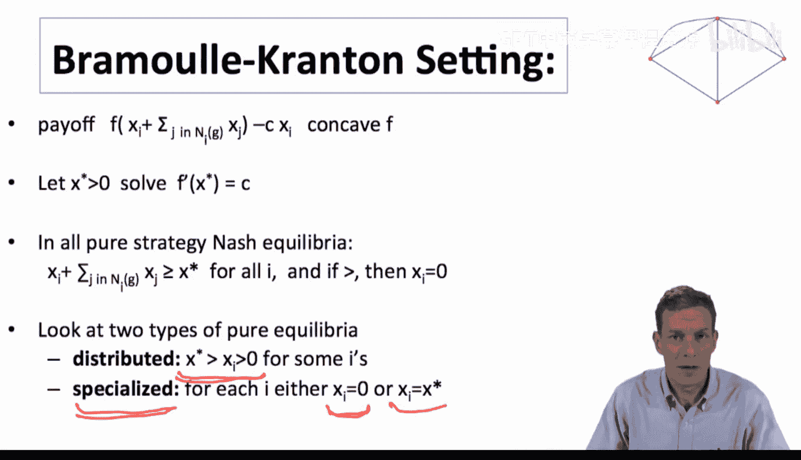

Let's look at， you know， here's a few different equilibrium different networks。

 Here's a situation where we've got a specialized equilibrium。 These people provide the full action。

Their neighbor's free ride。 Everybody gets exactly X star in their neighborhood。

 Nobody wants to increase their action。 In fact， sorry， some some people。

 these individuals get more than X star。 They get two times。So they're happy。

 they're getting double the provision of public goods。

 they certainly don't want to contribute anything。Okay， and these people are getting exactly one。

 they're providing it because their neighbors are not providing anything。Here's another equilibrium。

Everybody provides one third。And that balance is because we're in a situation where each person is seeing exactly X star in their neighborhood。

So nobody wants to increase or decrease， right， So this is a distributed one where we've got an exact distribution。

Okay， and this one is similar to the first one， but just with roles reversed。

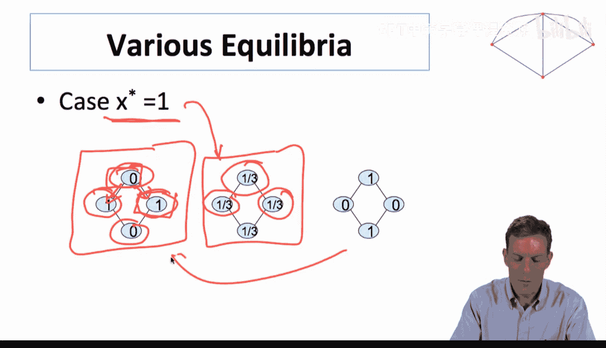

Okay， so you could generally， you know， if if we had disconnected individuals theyd each have to provide one。

 there's nobody else to free ride on。 You could have situations like this where the isolated person。

 their friends provide。They don't have any friends so they provide the public good here。

 you could have either person provide it， you could also have an equilibrium like this where they do a half a half。

Right， or it could do one where you've got three， fourths and one fourth。

So you could have a whole series of different equilibria and then in each of those cases。

 the other person would be providing one。 you could have situations here that look like the best shop public goods。

 you could have ones with these distributions you could So there's a whole series of different equilibria。

 some of them are specialized where certain people end up doing one， other people end up doing zero。

 and then there's other ones where distributed where you've got some actions by different players but they're adding up to one okay。

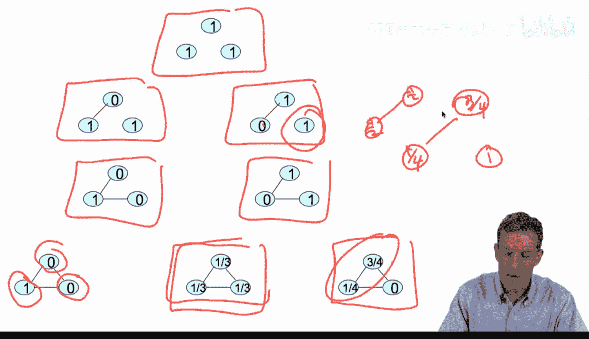

Okay。So。We can begin to see the connection between this and the bestshop public goods game that we saw before。

 if you look at the specialized equiria here， those are going to look like maximal independent sets。

So you have the people， some people just provide the full public goods， their neighbor's free ride。

 and no two nodes that are connected can both be providing the public goods。

 so you end up with every node and N is either in this set of S that provides the public goods or linked to somebody。

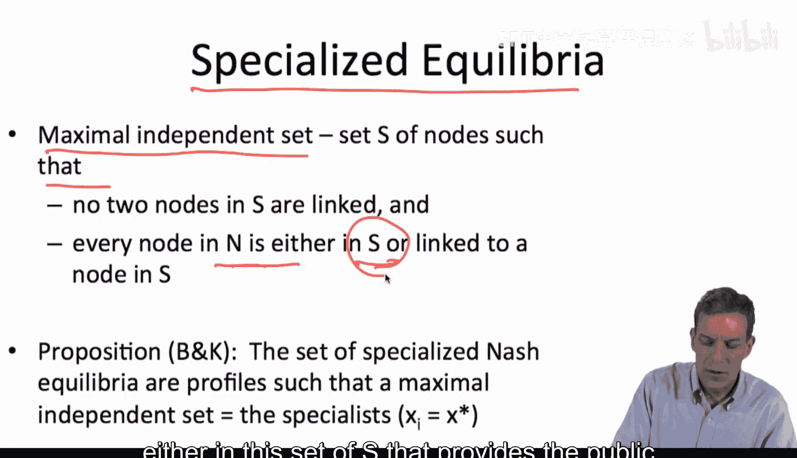

And proposition by Bro Lean Crranton then is the set of specialized Nash equilibriumria here。

 are profiles such that the maximum independent set is a mash maximum independent set is exactly equal to the set of specialists people providing the public good Okay so that's just a straightforward extension of what we saw before in the public goods game the best shop public goods。

 but now we're actually allowing people to take multiple actions and we see thats a specialized equilibrium correspond to that。

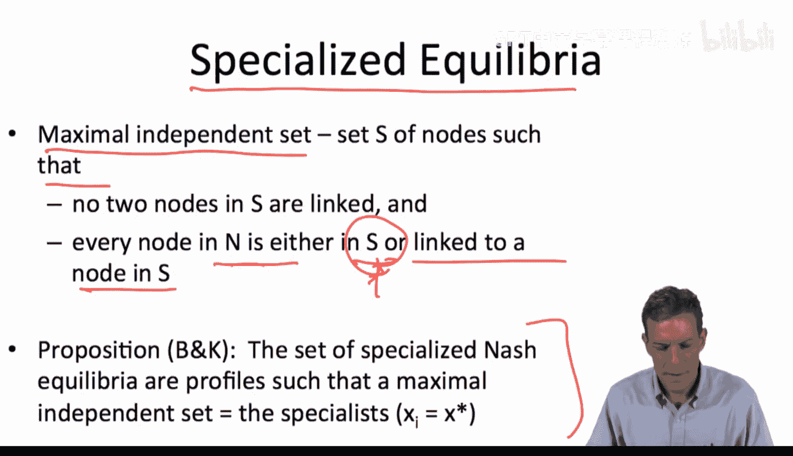

Okay， so what's interesting in in terms of the environmental and cranton analysis is they show that these。

 the。Specialized equilibria are actually ones that have a nice property。

 and it's a sort of a stability property。 So imagine what you do is you start with some strategies set of strategies that people are playing。

 So let's look at our equilibria and ask which ones are sort of stable to perturbations。

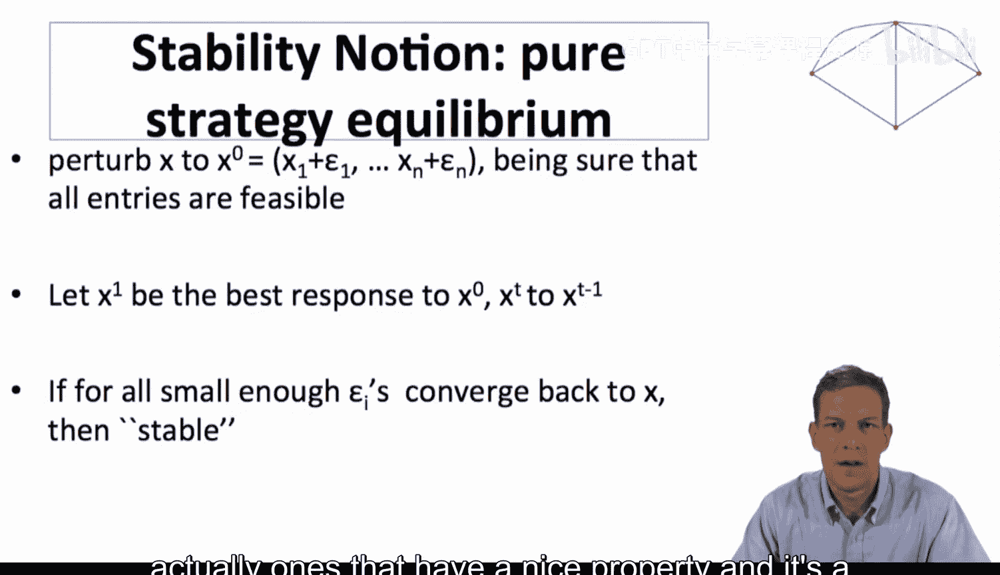

And what we'll do is that we're going to perturb this by changing everybody's actions by little epsilon and epsilon could be positive or negative so we could know move some some people。

 we bounce some people up so they'd provide a little more information。

 other people down so they provide a little less information。

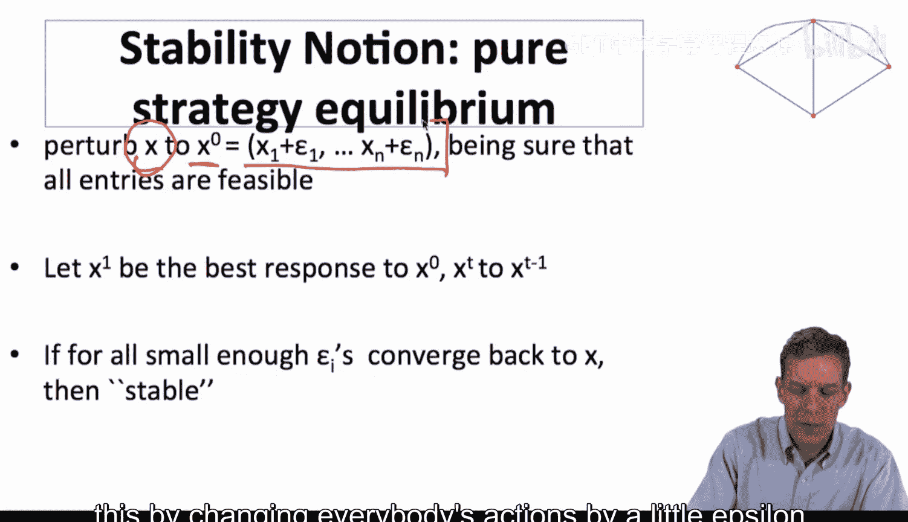

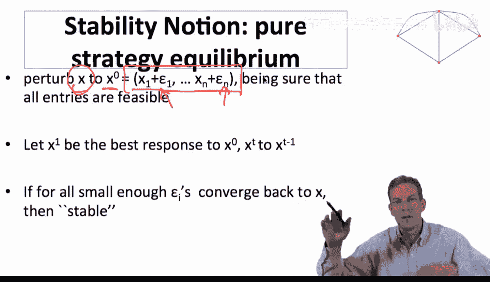

So we start at some point， which might be an equilibrium。 We want to ask， is that stable。

 We perturb it a little bit。 And then what we do is we look at， okay， what's the best response？

 So if everybody was choosing their maximal action。

 given what everyone else is doing under this perturbation， what do we get。Okay。

 so we go from x0 to x1 and then x1 goes to x2 and so forth。

 and what we would like is that if you perturb things by some small epsilons。

 if you always converge back to X， then we'll say that the equilibrium is stable。Okay。

 so that's a notion of stability。

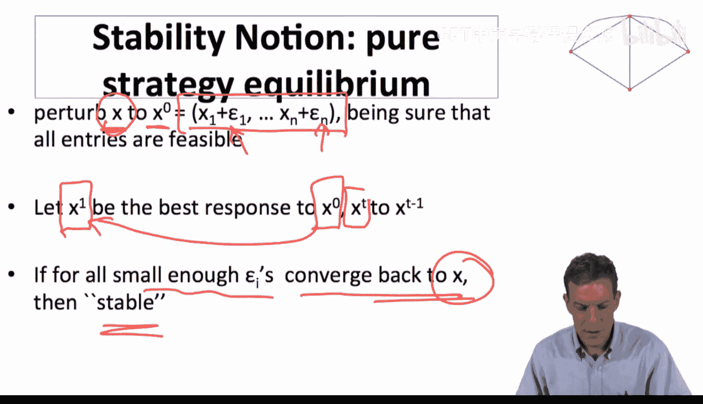

And let's first think of a Dyad， so we've got two individuals。These two individuals。

And let's suppose that， you know， person one is doing something， say。

 like a third and person two doing two third。That's not going to be stable in the sense that if we perturb this a little bit。

 so suppose we move this down to one third minus epsilon and this up to two thirds plus epsilon。Well。

 that in fact， is also an equilibrium， so if we did that perturbation。

 it wouldn't go back to the original one， it would actually stay at this one。So in a Dad。

 no matter what numbers you put in there， you know we could put in zero and1 and have this go to0 plus epsilon。

 one minus epsilon， so no matter what numbers you put in as you perturb this， it would stay there。

So as long as x1 is less than equal to x2， add a little bit to x1 and subtract a little bit from x2。

 you would stay there， so you're in a situation where you end up not having any movement in terms of the perturbation。

 nothing stable。嗯。But when we look more generally，ria。

 the only stable equiria are necessarily going to be specialist equilibria。

 and are' going to be such that every non specialist has exactly at least two specialists in his or her neighborhood。

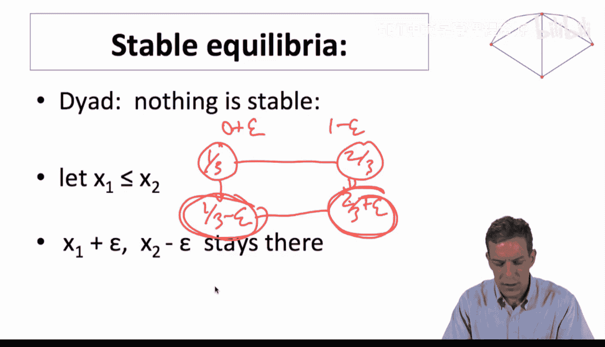

So for instance， if we look at three nodes and again， our x star is1， this thing is stable。

These three are not stable。Okay， and let's just go through and try and understand why is this stable。

 What's the logic here。 So let's suppose that we pertuurrb this a little bit。 So， for instance。

 we take a little bit of an epsilon away。 So we take this person down to 1 minus epsilon。

And we bump this person up to salon。And let's just keep this person constant for now。If we do that。

 and now we look at the best responses to this。Well， this person。

Has already a neighbor providing at least one， they're still at two minus epsilon in their neighborhood。

 they're way bigger than the X star of one。They're getting too much action。

 They can get rid of their epsilon and go back to 0。 So they're going to tend to go right back to 0。

 Once they go back to 0。 This person is going to go back to 1。

 and we end up going back to the to the situation that we have。 So here。

 the fact that I'm already getting too much means even if you perturb that。

 I'm going to want to go right back to0。 So the people that are in the neighborhood of these specialists are going to stay there if they have at least two specialists in their neighborhood。

 they're going to go back to zeros。 And that means the specialists are going to be forced back to one because all their neighbors are providing zeros。

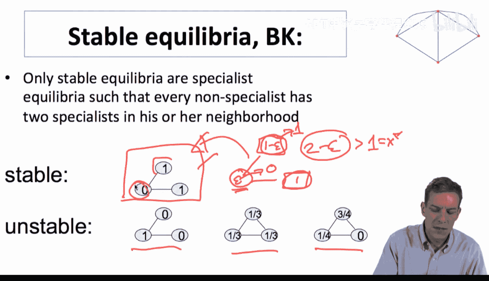

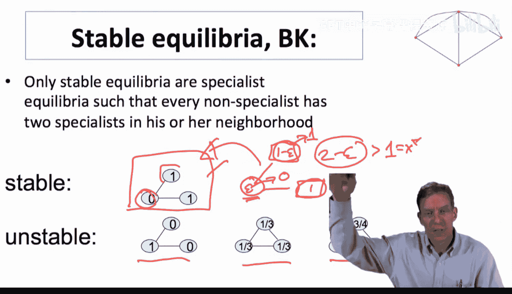

Where is this one？Is unstable， and it's unstable for the same reason the Dyad was， right。

 We could make this a 1 minus epsilon and you know， then move this guy to epsilon。

 this guy to epsilon。 once that happens。 Well， then these people are happy。

 but this person is going to want to decrease more and it would actually move eventually towards this equilibrium。

You know， we could change this by moving this to minus epsilon。

 add an epsilon over here that would still be an equilibrium and so forth。

 so the only ones that turn out to be stable turn out to be the ones that every specialist has specialized equilibrium and such that every non-spec has at least two specialists in their neighborhood。

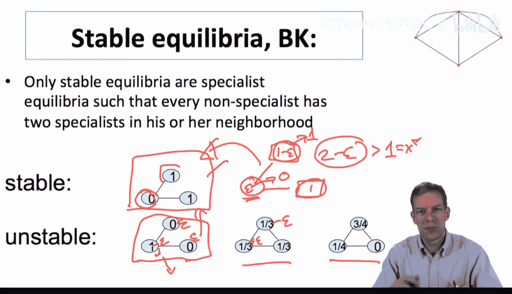

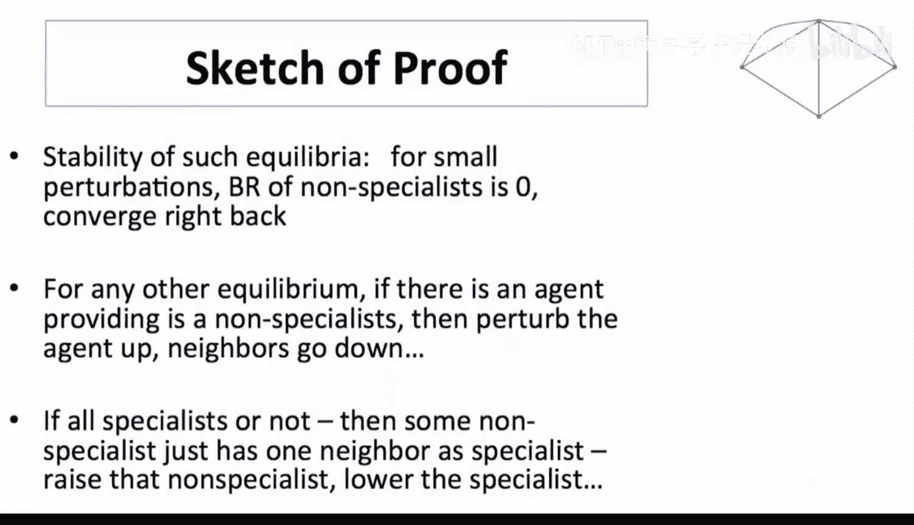

Okay so you can go through a sketch of the proof of this。

 basically the stability of such equilibrium for perturbations of this for the nonspecialists。

 the best response， they go right back to zero and you converge right back for any other equilibrium。

 there is somebody providing goods as a non-specialist and then you perturb that agent and up and the other neighbors down just the way we did and basically you can work through that kind of logic。

 so the idea of the proof is much similar to what we just work through in terms of the examples and you can deduce this proposition in that manner。

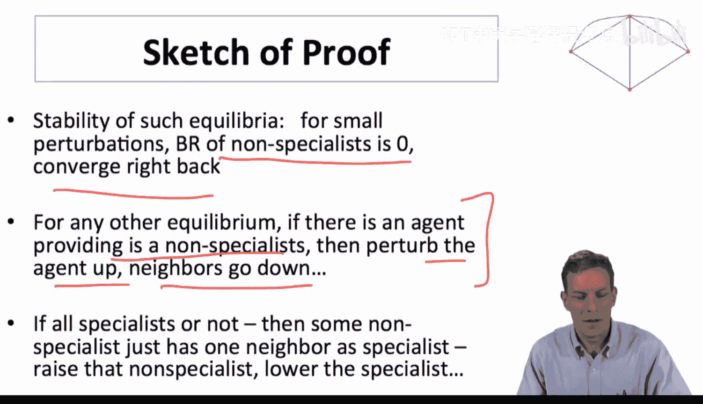

Okay， so so what that says is that these specialized equiria are somehow special in this model。

 So you get they're stable in the sense that if you do perturbations。

 then you're going to get pushing people towards that。

 let me just sort of make one comment on this and sort of an interesting contrast。

 Another way we could think about， you know so here we've got a game with multiple equilibriumria。

 there's lots of different equilibriumria in this game。

 And you know part of the reason that one's interested in applying the stability concepts is just to find out are some of these more natural equilibriumria than others。

 And so if we pertuurrb them and we get back to them， we say， well。

 that seems to be a more natural one than another one。U。

Another way we could think about stability is instead to say think about pairwise stability， right。

 So suppose your links are costly。And if I'm specializing。

And I've got a bunch of friends who aren't specializing。 I'm providing all the good。

 They're not doing anything。 I would start dropping links to the nonspecialists， right。

 So in some sense， in that world， what you would have is the only reason people would be willing to maintain links would be if their friends are also providing some of the local public goods。

 So I only want to keep these friendships if they're actually providing some value。

 And so there what you're going to get is the nonspecialized equilibrium。

 they're going to be the only stable ones。 So what this says is you know。

 it depends very much on what kind of stability notion you put in as to what you might select out。

 And whether you think about perturbing the network or perturbing the actions。

 you could get very different kinds of conclusions。 And so you know， ultimately。

 I think what this says is there's still a lot we need to understand about these kinds of games。

 They are tractable games， They have some interesting features。

 Some of them tie back to some of the things like the best shop public goods games and so forth。

 and they can be。You know， interestinging to analyze further。

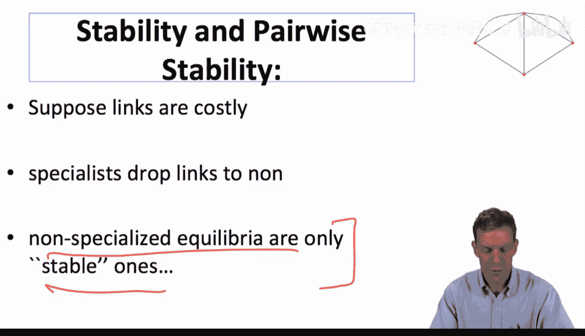

Okay so so that's one example of these kinds of games。

 If we begin to introduce heterogeneity to these kinds of things that's going to change the nature of equilibrium。

 we could begin to enrich things that way， there's a lot of enrichments we can make in these kind of games and what we're going to do next is look at another class of games and this other class of games is going to be one where we allow for strategic complements and there the games again are going to be nicely behaved in a sense that it'll be much easier to get a full characterization of what the equilibrium look like and it'll be nice well have some nice relationships to the network structure and that'll allow us than to。

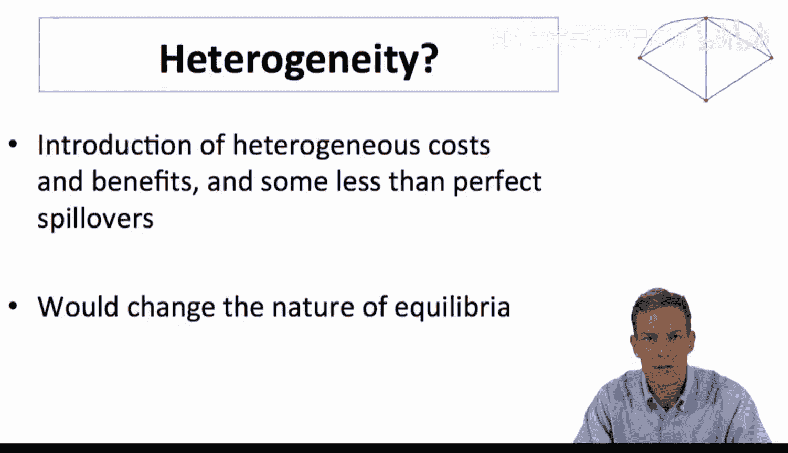

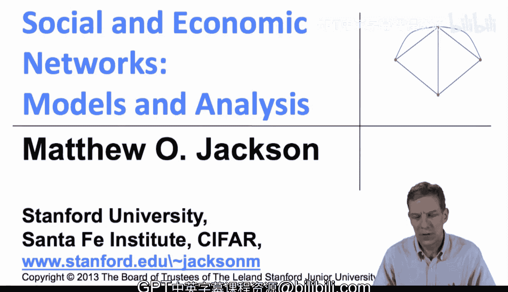