# 斯坦福大学《社会和经济网络：建模与分析｜Social and Economic Networks： Models and Analysis》中英字幕 p79 79_07_08_7-8-重复博弈与网络.zh_en -BV1v1421U7Nk_p79-

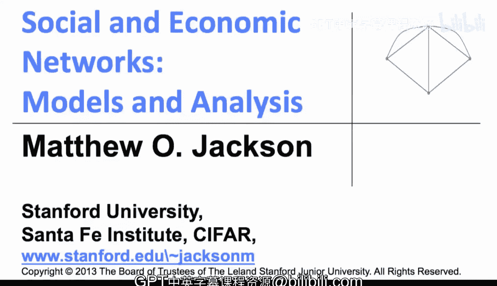

Okay， so in terms of our network formation models， I want to talk a little bit about now about repeated games and networks so we've been talking about games on networks and now what we're going to do is sort of wrap things back and in particular will be looking at a very special application in order to talk about this that of favor exchange。

 but the idea here is going to be to understand the codetermination of network structure and behavior so the network structure affects what behavior goes on but the behavior actually affects what the link structure looks like and so here when we talk about favor exchange。

 the links are actually going to be defined by the fact that people are trading favors and so the behavior and the network structure are going to be determined in one。

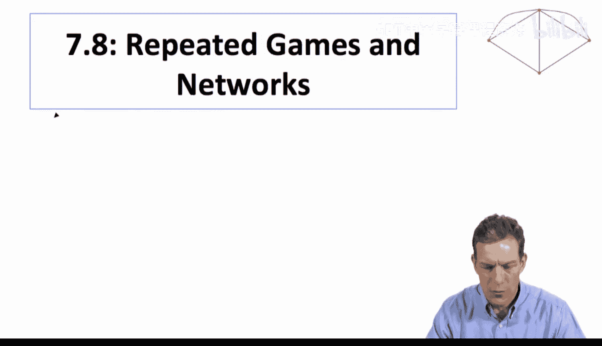

Equiilibrium notion together。 And what we'll do is is look at a simple model of this and then try and understand what the predictions are in terms of。

Data and have a quick look at some data that goes along with that。

 so I'm going to talk a little bit about a recent model by myself and Thomas Rodriguez Baraker and Shuan。

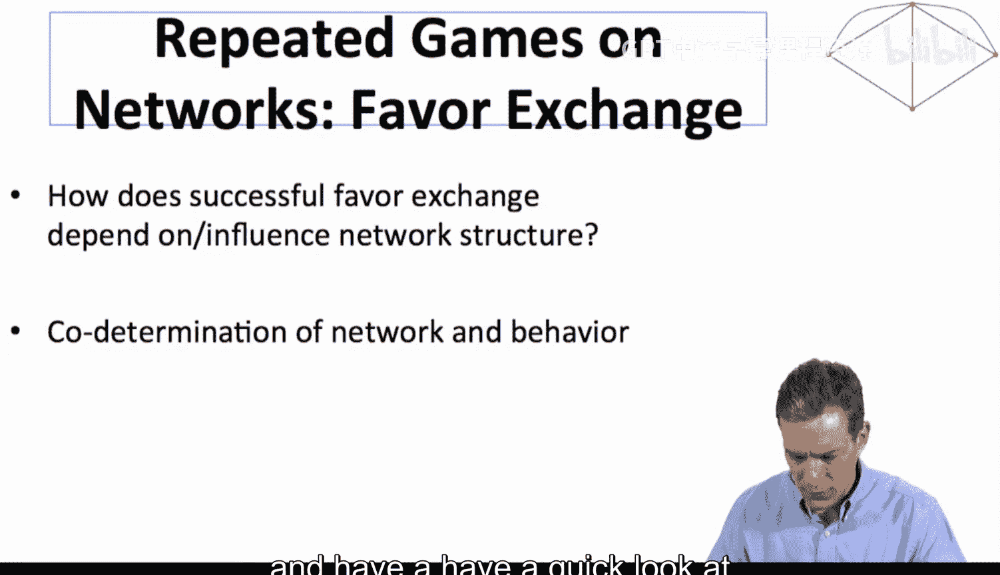

And you the idea here is that when we talk about favor exchange， a lot of different kinds of。

 you know interactions by people are not contractable if someone comes in to ask to borrow a book or CD from you or something you don't write down a contract generally you lend it to them and you anticipate that reciprocation and repeated interaction means that they'll return the favor at some point in time so things are going to be selfenforcing and in particular know we'll be looking at different kinds of favor exchange borrowing and lending money。

 kerosene， rice and so forth in the Indian villages that we've talked about before。

 and know the idea here is going to be how does successful favor exchange depend on and influence in that work structure so how are these two things intertwined。

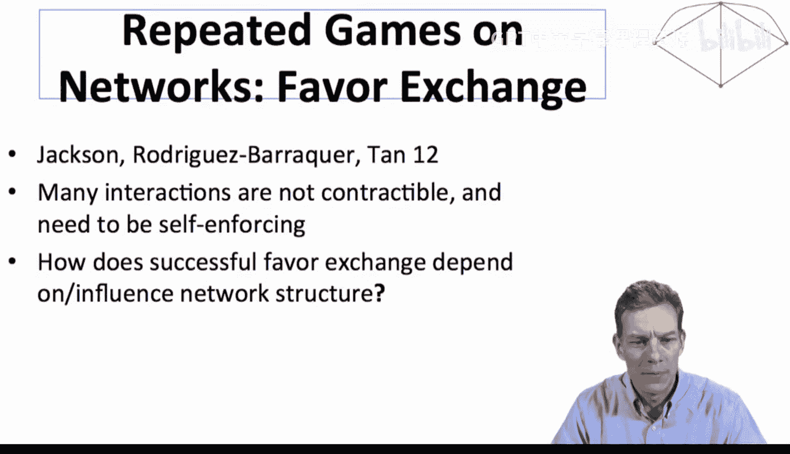

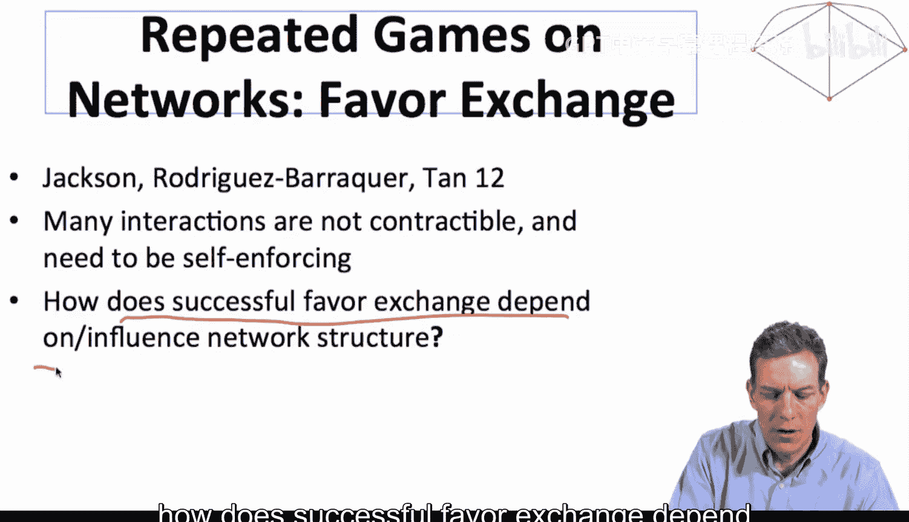

So again know we have these different borrowing， who would you go to if you needed to borrow 50 rupees for a day。

 so we have a network of different borrowing relationships who comes to you for kerosene。

 who you go to for medical help and so forth so we've got a set of networks we can look at and what we're going to try and do is make sense out of what's actually going on in these networks which might be hard to understand otherwise。

And just in terms of background。One one thing that has been looked at when we think about social enforcement。

 so the social capital literature Coleman Borrgio Putin on a whole series of authors have talked about how enforcement depends on the structure of interactions and the idea if one's in strong positions than that leads to better behaviors and one interpretation of that has been in terms of clustering。

 so the idea and actually this was best articulated by Coleman in paper in 1988 and what he was talking about is saying you know if we look at a given individual I and we sort of ask what are the incentives of I to behave well in a society Coleman's point was that if J and K if two of I's friends know each other and are friends with each other。

 then that helps them put pressure on I and can help them enforce behavior and make sure that I behaves okay and so one thing we want to do is just。

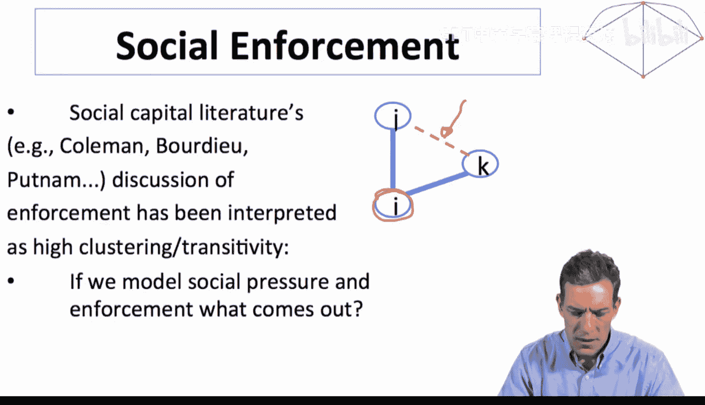

Look at a simple model to see whether that prediction comes out of when we look at this and in particular this was suggestive of the different when we looked at clustering coefficients earlier in the course know we found that these clustering coefficients tended to be quite high relative to a random network and so the idea was that there was some structure going on in terms of clustering that was really being represented in the data and so what we're going to do here is actually explicitly model favor exchange and then look at those networks and try and understand will come out what's the predicted structure according to the model and then does that relate to clustering does it relate to something else what kind of sense can we make of things。

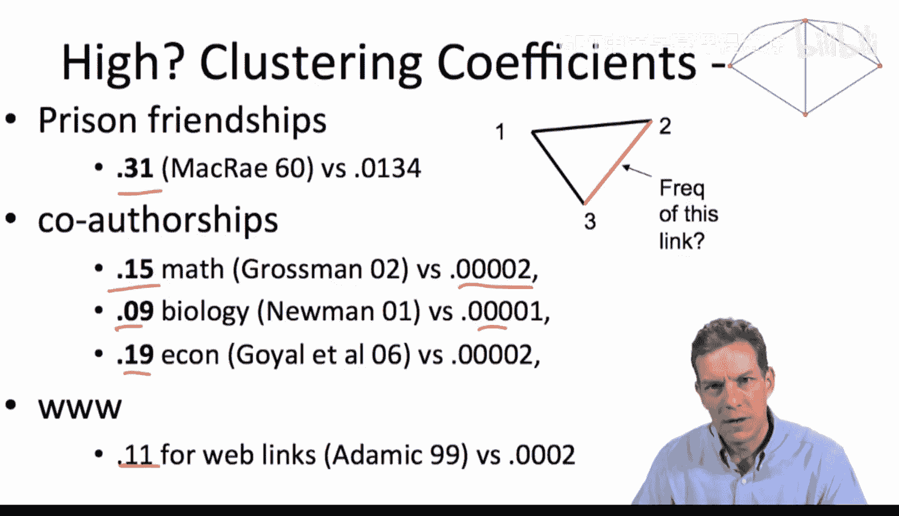

We're going work with a really simple model。 You can enrich this substantially and we actually do in the paper we wrote so there's a much richer version of the model there。

 I'm going to give you the simple vanilla version of the model so in this simple version basically favors are worth some value V they cost some value C it's socially valuable to do a favor so the value of getting a favor is more than the cost of doing it。

 so it makes sense for society to be doing favors for each other。

 the person who needs to borrow something really needs it more than the person who's got it and so there's a net positive value for lending something from one person to another or doing a favor for a given individual。

We'll have a discount factor so people will look at values over time and today a favor today is worth more than a favor tomorrow which is worth more than a favor and so forth so each day the value goes down by some delta favor in a week from now as worth delta to the seventh and so forth so we'll also have these favors and the needs for favor arise randomly so there'll be P a probability P that some individual I needs a favor from J in a given period and generally we're going to treat this as instead of having multiple favors all needed at once we'll treat this P as being very small so that the probability that more than one favor is needed in a given period is basically negligible and so we'll look at the favor arrival process and so you can think of this as a personal arrival process with very small time windows。

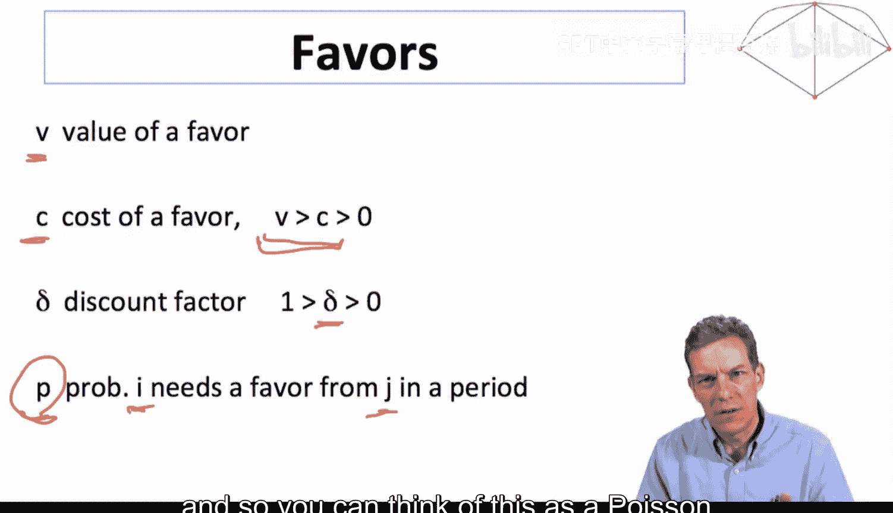

Okay so favor needs arise at random to at most one of two people at a time other the agent who is called on to do the favor decides whether to provide it or not if it's provided value V to the receiver minus C to whoever gave the favor and otherwise if they decide not to do it then there's a value zero so if we begin to think about the favor exchange between two agents if we were able to do this and we ask what's the expected value in a given period of you know us doing favors for each other。

 well the value to me of that relationship is there's a P chance I'm going to be needing the favor and then I'm going to get a value v there's a P chance I'm going to be giving a favor and then I've got a minus C so in net the value is p times v minus C right so it's in net it's valuable for me to be in this as long as I have this probability of being on either side of the favor。

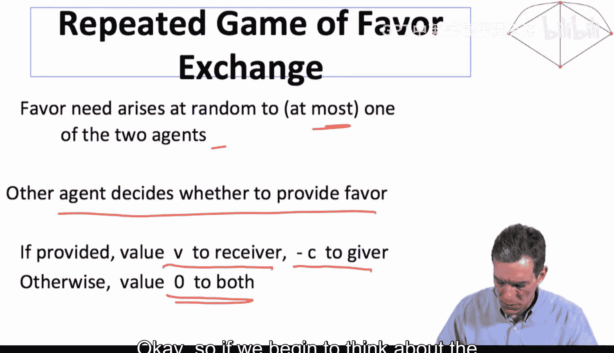

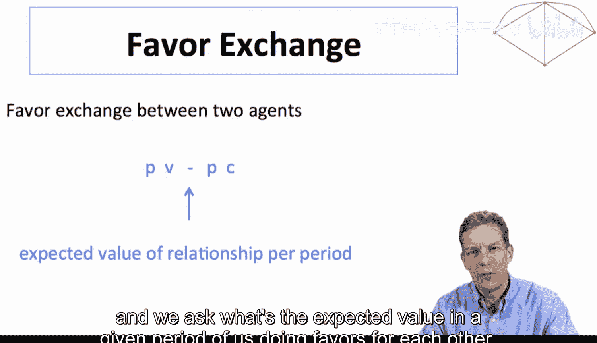

If we do this in perpetuity， so we expect these things to keep rising over time。

 then you know we just summing a series of these things times delta times one minusl delta squared delta cubed and so forth。

 so the value of this in perpetuity is just going to be one minus one over one minus delta times this so this multiplying this things by one over one minus delta is just capturing the fact that we've got this you know in the first period so this is just equal to one plus delta plus delta squared plus delta cubed so we're getting this today tomorrow the next day and so forth in perpetuity so this is the value of perpetual relationship is exactly this okay so when can you sustain favor exchange well now if somebody's called them to do a favor。

They can look at what's the value。 the worst I can do by not providing a favor is lose this relationship。

So what's the value of the relationship in the future Well it's delta times the value in perpetuity。

 so the value from tomorrow onwards， what's the cost Well I have to pay this today。

 so as long as the cost is less than the value of the future relationship。

 then you would want to provide the favor， but if the cost is bigger than the value of the future relationship you couldn't sustain it。

And indeed， you can check that you know if you write this down as a repeated game and people can provide favors for each other。

 you can enforce favor exchange if and only if the cost does not exceed the value of the future relationship okay so that's with just two people exchanging favors。

 fairly simple idea， as long as the value of the future relationship sufficiently high。

 people provide favors with the threat of losing a relationship otherwise。

 so we could have the situation where we'll keep providing favors as long as everyone does it in the past。

 somebody stops the relationship dissolves we're no longer friends and so you're going to lose a value of that in the future。

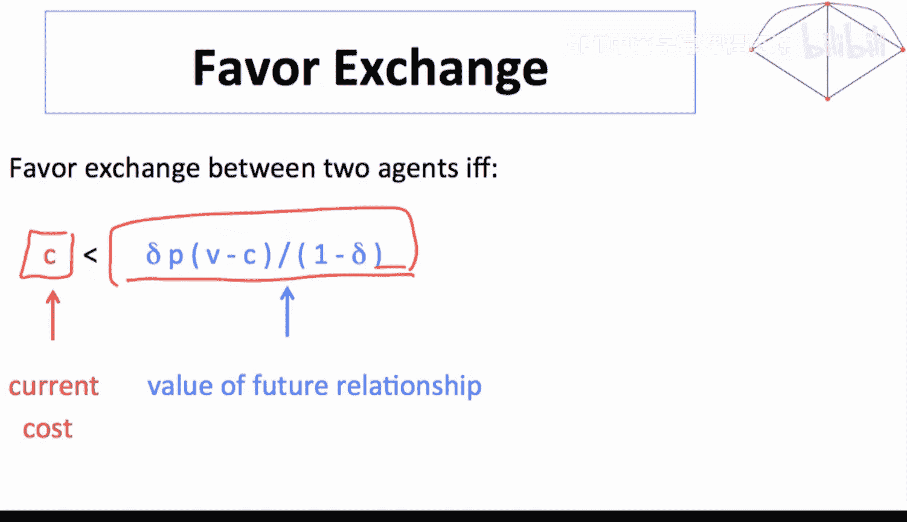

Okay， now what's the value of putting this in a network or the value of putting this in a network is sometimes these favors can be quite costly。

 so it could be that somebody has a crop failure and I have to lend them a lot of money or you know do give them a lot of help in that situation what's the incentive to provide the favor。

 well if we're in social network， then it can be that the value of providing a favor is。

Increased by the fact that instead of losing just one friendship if I don't behave well and follow the you know keep providing favors when I'm asked。

 I could lose multiple friendships So let's look at a situation where we have three people in a triad here and what would do is ostracize anybody who does not perform a favor。

 So if anybody's called on to do a favor and they say no， then both friendships are severed there。

 So in this case now the cost only has to be less than two times this value of a virtual friendship So it's easier to satisfy this relationship or incentive constraint now because the value is increased in terms of how many friendships I might lose in the future I could be ostracized by both of the other agents So in this case if one is called on to do a favor for two if one doesn't do the favor for two one loses two friendships and therefore this incentive constraints is。

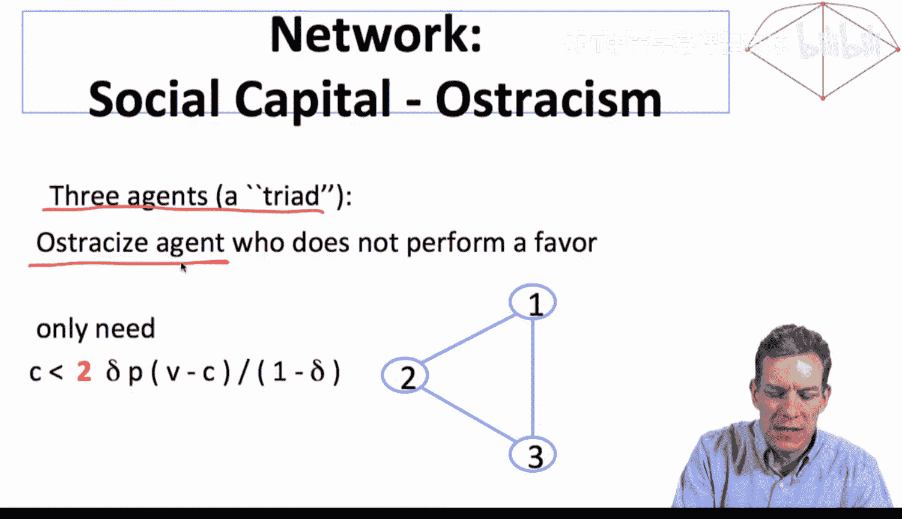

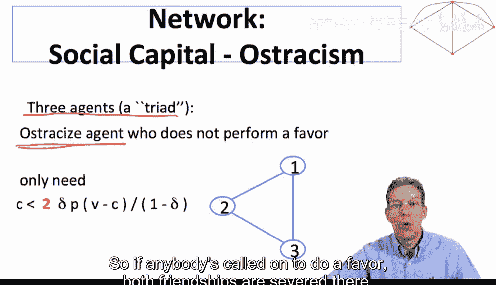

The cost only has to be less than two times the value of the friendships Now of course in this situation once these two relationships are gone。

 then it could be also that two and three are no longer going to be able to do favors for each other because if they couldn't satisfy if C was greater than one times this。

 then they're no longer going to be able to sustain favor exchange that in this case the whole triangle would collapse because once one is ostracized than two and three no longer have enough of an incentive on a bilateral basis to keep the friendship going and so the whole thing collapses so this whole triangle。

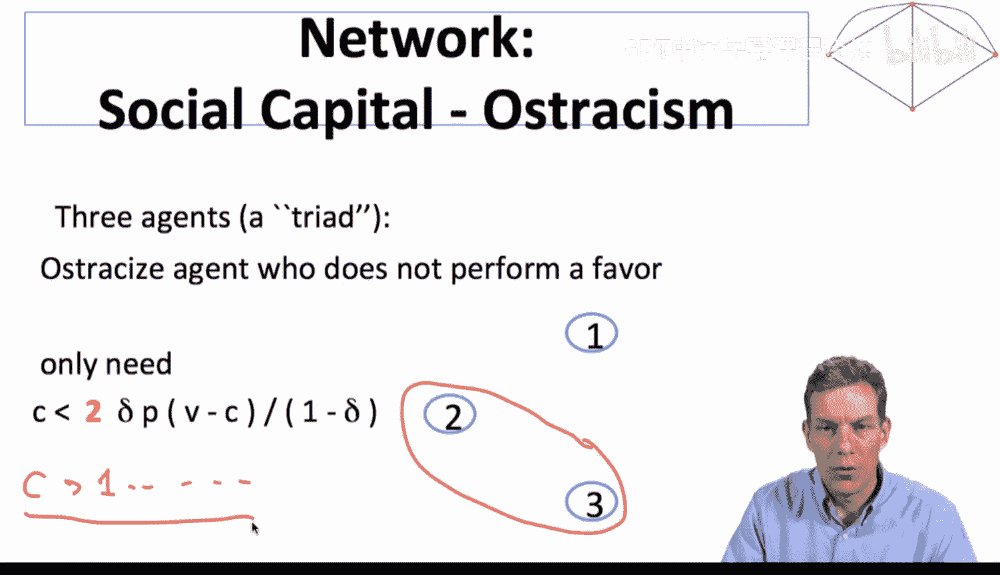

Disintegrates。Okay， so when you can just define this as a game and so let's look at a simple game where basically at any given period。

 at most one person is called on to perform a favor for somebody else in their neighborhood。

 so we'll think of Pas being small， so somebody in their neighborhood of the network at a given time。

And then the idea is that I is either going to keep the relationship going。

 meaning provide the favor and keep it going or can just say sorry it's over。

 I'm going to sever this relationship and not provide the favor so here we' have you either keep the relationships meaning you keep providing the favor or you sever the relationship meaning no favors between those two individuals in the future okay so to make the game simple we'll just have that be the choice。

 either maintain the relationship， do the favors or stop the relationship don't do the favors。

Then others can respond so they can announce， others can react so suppose I don't do a favor。

 others can see that and sever their links to me， or it might be that I do the favor and they can decide to keep their relationships。

 whatever。So links are maintained if people mutually agree， and so after this process。

 depending on what everybody does， we end up with a new network， GT+1。

 and then the process repeats itself okay。And so then we can ask which networks will be equilibrium networks if we look at this process over time。

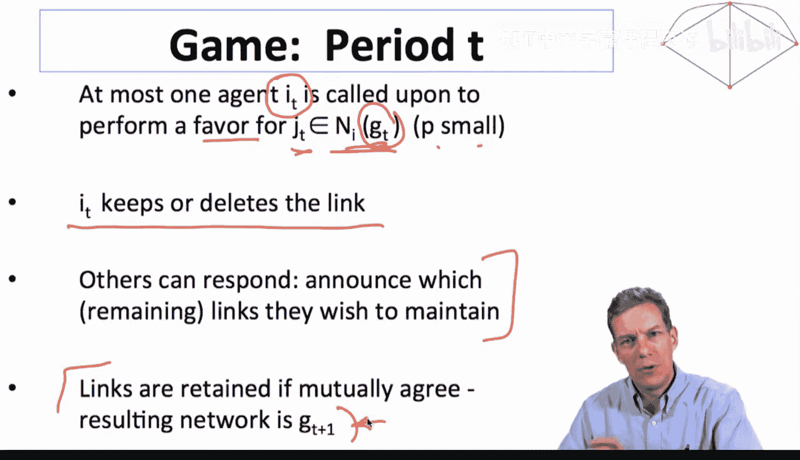

So let's take a quick peek at two different networks that could be sustained in Elibo in situations where losing two friendships is bigger than the cost of doing a favor。

The cost of doing a favor is bigger than the value of one relationship。

 so you need two friendships lost to give incentives。

 so we've got two different networks here which are both going to support favor exchange and the idea is basically going to be that if somebody doesn't perform a favor they're going to lose two friendships instead of just one and so imagine for instance that this person one here is called on to do a favor for a person say two right so we could do it in either of these two different ways。

Now， if they fail to perform that favor， they're going to actually be losing two different relationships。

 not just one， and that's what's keeping them making sure they provide the favor。

But then we can look at this， what's the subsequent implications of the fact that we've lost this now okay so if we look at this。

 now these two individuals， this person for instance。

 can't be trusted anymore because they only have one friendship left。

So the next time they're called on to do a favor， they're not going to do a favor。

 so effectively this relationship is going to have to disappear because it's not enough it can't。

Maintain itself any longer。 Similarlyly， this ones going to have to disappear。

 right This person can't be trusted and this one and so forth。

 right So what we end up with is effectively those disappearing。 And then over here。

 we can see that that's going to have further implications right we're going to have other relationships which are no longer sustainable。

 given that we've lost part of our network。 And so in this setting。

 we have a widespread contagion so that the fact that this person did not perform a favor ended up having consequences for people actually quite far away in the network and it reached somebody that was the distance three away from them in terms of the network in this situation it stopped right here effectively this part was lost but then the rest of the network。

Is maintained。

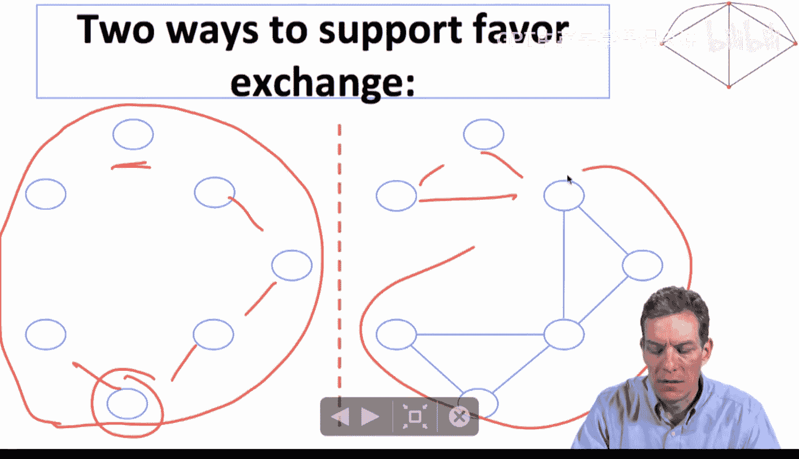

So this is a situation where we could define robustness against the contagion to say that a network will be robust if the favor。

 the failure to perform a favor， only impacts the direct neighbors of the original players who did not perform or lost links。

 so we don't have a widespread contagion， it's only people who are actually directly connected to that individual originally。

 who are going to end up losing relationships， so the impact of some sort of deletion or perturbation is local。

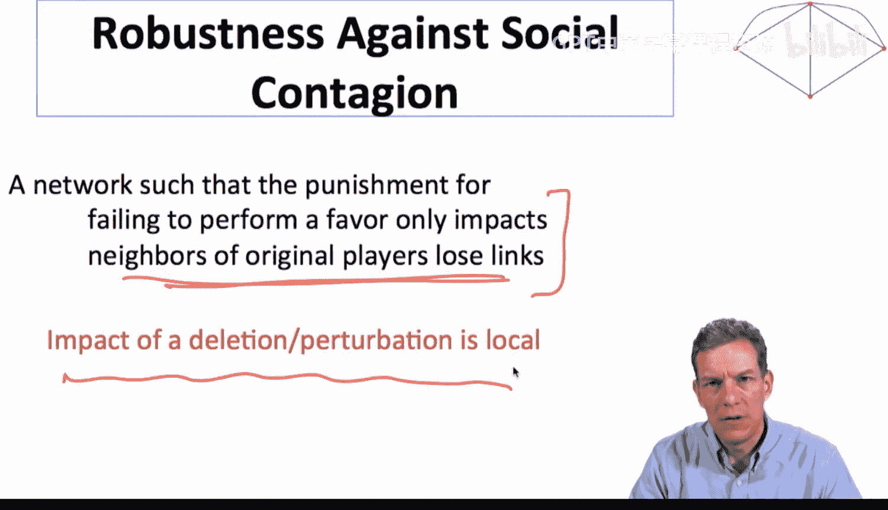

So that would say that when we go back to these networks， this one is going to be robust。

This one is not。In this in this。

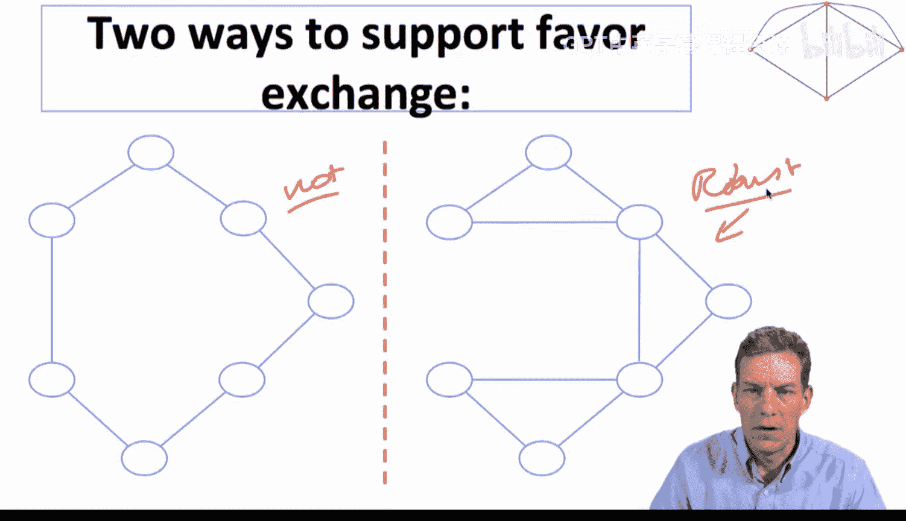

Particular manner， right。 So one of them fell apart。 The other one had only local things。 Okay。

 so now a quick definition and then a result on this。

 So we'll say that a link in a network is supported。

IJ is a link that's supported if there's some K such that both IK is in G and JK is in G。

 so having a friend in common so support means that two individuals have a friend in common。

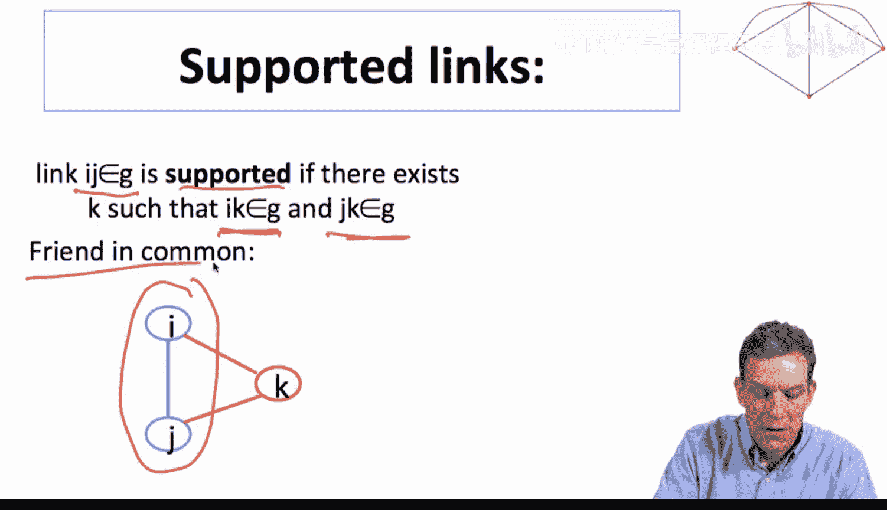

So the implications of this game are that if we look at a situation where there's no players。

 no pair of players could sustain favor exchange in isolation。

 so you need at least two a threat of two or more link deletions in order to keep somebody honest。

 then the networks that are robust have to have all of their links supported。

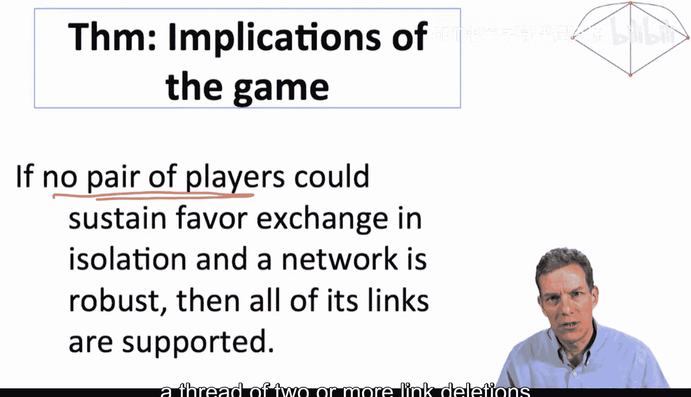

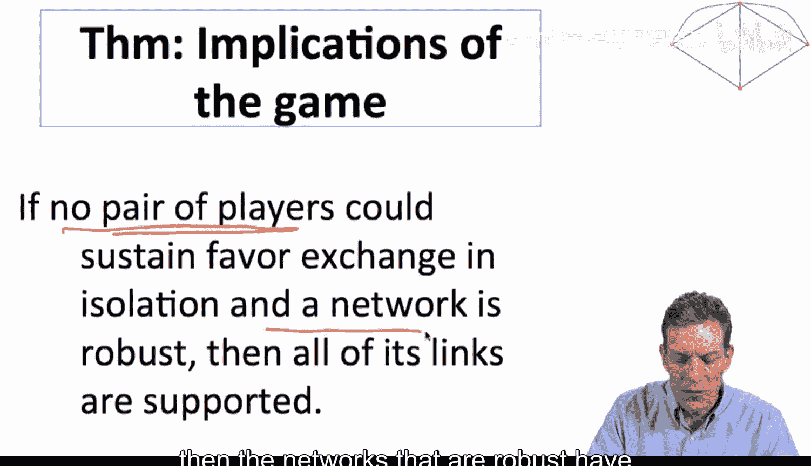

Okay， so every link is going to have to have at least one friend in common and sometimes if we're looking at situations where we've got more。

 you might have to even have more than one friend in common。

OkaySo so this says that support is actually a property that's going to come out of this particular favor exchange game So if you look at it this favor exchange game。

 the networks that are stable are going to have a very particular structure to them and in particular when we're looking at two individuals A and B they're going to have to have a friend in common and that's different so let's just emphasize the difference between this and the usual measure which involves clustering where we are looking at a given individual and saying how many of their friends are friends of each other here we're just saying if two people are friends they have to have a friend in common okay so even though both of these involved triangles they're having different implications。

 one saying if you have a link you have to have two other links present and this one says that you could have if you look at friends they have to be connected to each other and so for instance。

 know here's a network where every single link is supported so every time you look at a link there's a friend in common。

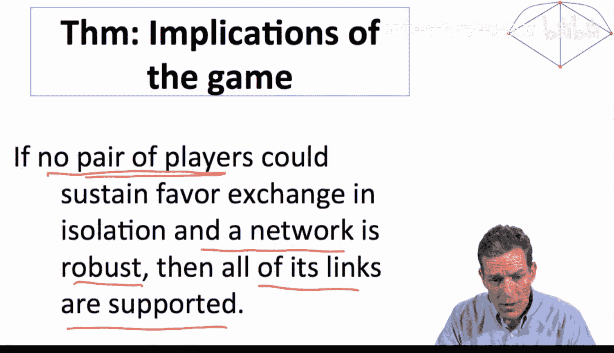

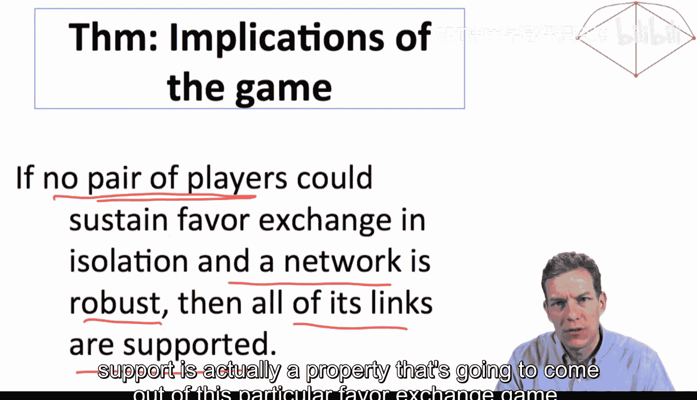

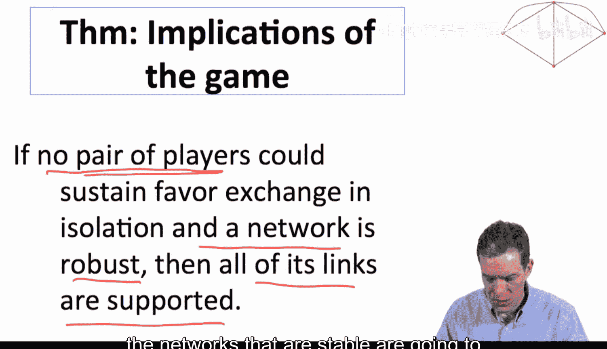

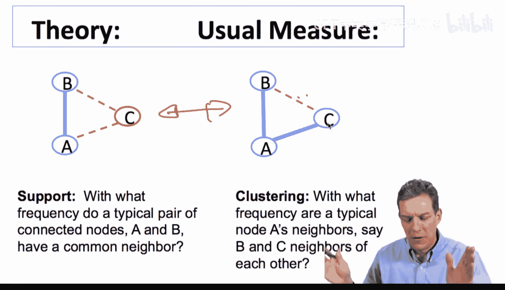

But the clustering in this network is only less than 50% because there's a number of individuals。

 for instance， this individual who has friends who don't know each other right so' if we look at person one。

 two and three， two and three are not connected， so the clustering is going to be lower。

And so basically what this says is we ought to see high support， that's what the theory says。

 but it mean provided that favors are costly enough then you should see high support。

 so a joint hypothesis。

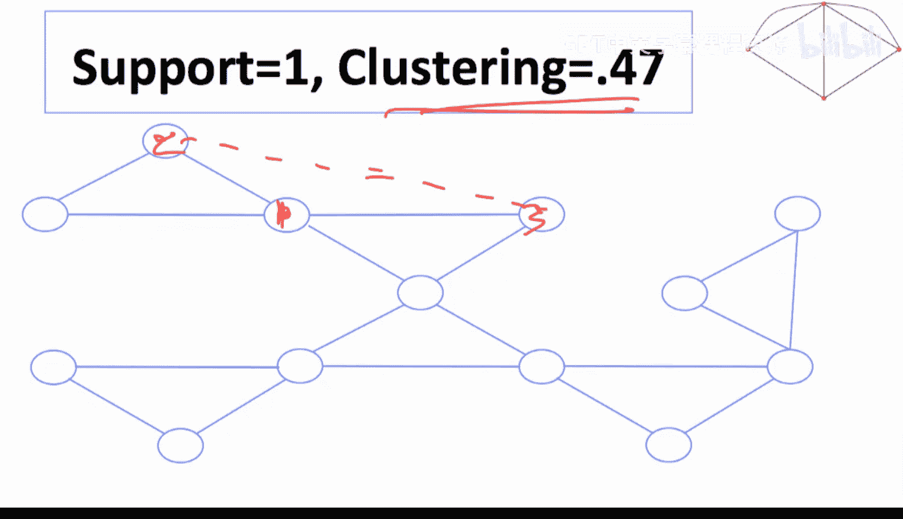

And if we go back to our Indian data and we actually look at the fraction of links that are supported。

 so here we've got 75 villages， so these are villages。

And we have different kinds of networks we can look at。

 so the ones that explicitly involve borrowing kerosene or rice and so forth。

 those are the green line， ones where you just have friends coming over for dinner or friends coming to your house。

 etc， that is the lower line here， and then we can compare to what the clustering rates are。

 and the clustering rates here very depending on which networks you're looking at but basically somewhere between five and 35% and here you're going basically from 60 to 95%。

 so support is quite high here many of the links are supported and the clustering coefficients are higher than at random。

 but actually much lower than the support number。

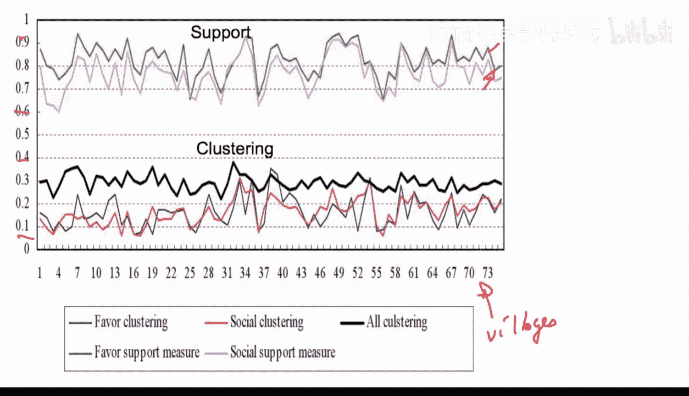

If you look at one measure， one thing we can make sure of is maybe the support is just coming up at random and so the network gets dense enough so that every time you look at a link it's likely to have a twopath a friend in common。

And so we could actually ask， you know when we look at links where favors are exchanged。

 borrowing lending kerosene rice or money， etc cetera， we look at that。

 then we can look at what's the rate of support across the different villages so fraction of villages that have at least that level or below that level and then we can look at unlinked support so suppose that we're not doing that what's the chance that we have a friend in common。

 so if things were just happening because of the density of the network。

 then unlink support would be high and you can actually correct this for observable characteristics and fit an exponential random graph model to this and test it and so forth and you'll still get similar results。

 basically the support is much higher than would be just at random so it's not occurring from that level you're seeing this for some other reason。

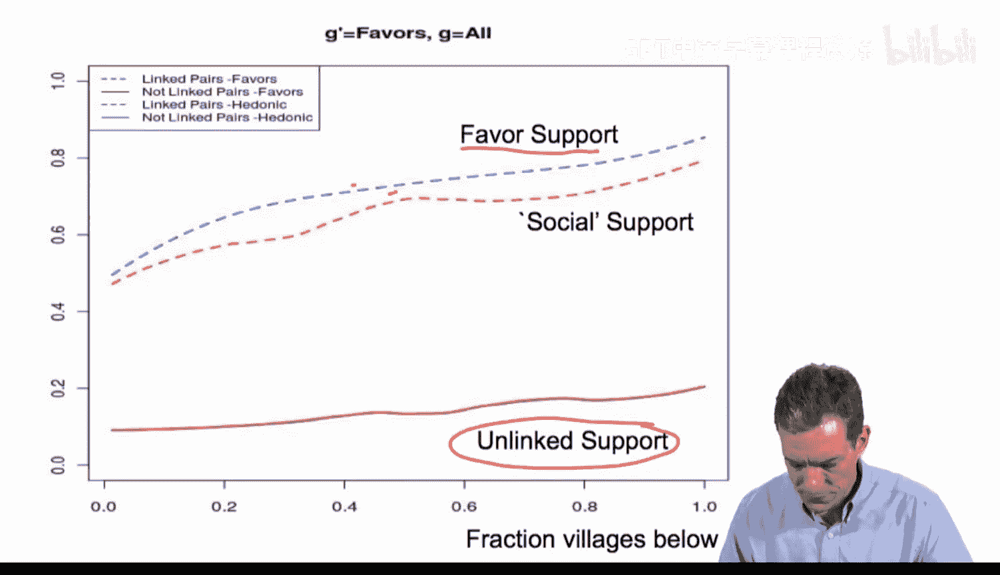

嗯。Just to take a quick look at another set of data where we can test for support。

 so this is again the Florentine marriage data by Paget and Ansl and when we look at those data。

 what do we see here we see clustering at about 46% support at about 88% and so this is the both the marriages and business dealings among these families。

And interestingly enough， if you look at the fraction of business dealings that that are supported。

 it's actually 100%， so every time you have a business dealing。

 those are supported it's not all the marriage links are supported but every single business dealing is supported by some other combination of business dealings in marriages and so that tells you that in some sense the marriages help fill things in to make sure that every time there's a business dealing between two families。

 they have a family in common that is linked to both of them either through business or marriage。

So here you know it's a small network so I'm not sure to take 100%。

 but here's a network where you get actually every single business dealing had family in common and so you know when you look at the support level just by businesses it's actually 80%。

 but then when you add in the marriages it goes up to 100%。

 so the marriages are actually filling in to make sure that some of the business dealings are have friends in common so for instance you know here's a business relationship that doesn't have a friend in common in terms of business dealings。

 but then once you go back and fill in the marriage dealings。

 the marriages then you end up having a friend in common for these two and a node in common。

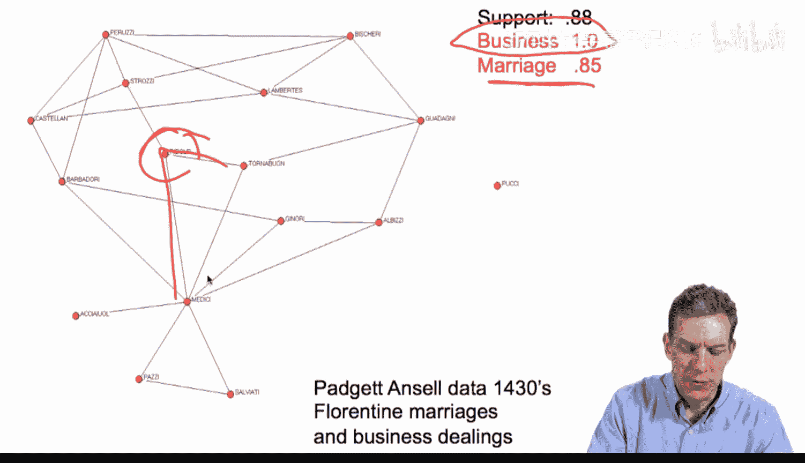

Okay conclusions， this robust enforcement gives us what we call social quilts。

 we have these links that are supported on a local level。

 it gives us some theory for friends in common which differ significantly from clustering so it's a different measure of a network and the support at least is high in the favor exchange data。

 this isn't a test of this because we're not quite sure what the costs and benefits of the favors were this could be arising for other reasons。

 but at least what we see is that there's a prediction that comes out of the theory and we see that that prediction is reasonably sustained in the data。

I think more generally the kind of thing that we should take away from this is that you know we can begin to build models more explicitly of what we think is going on in the network and not only take into account how the network is going to affect that behavior but also think what that means in terms of the behavior impacting the structure of the network。

 what kinds of network structures do we need in order for certain behaviors to be present。

 so here this is done in terms of favor exchange but you could also think of people maintaining relationships in a business setting to make sure that they're going to have information flows or be able to call on other individuals to do trades and so forth。

 what kinds of networks do we need in those settings。

 how does that impact both the behavior and the network structure so there's a rich set of settings in which this kind of technique can be used this is just one example of that。

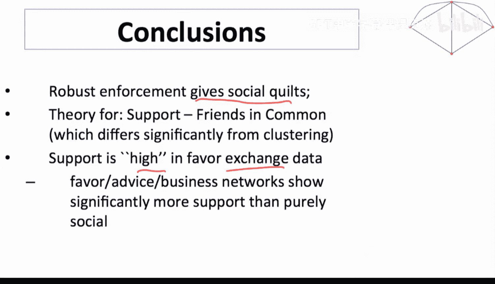