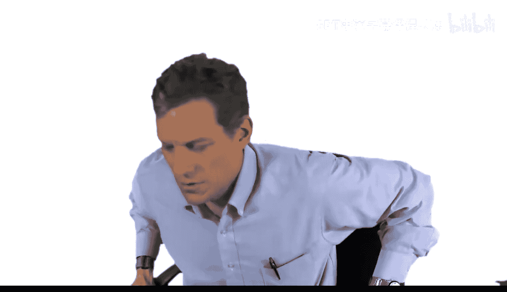
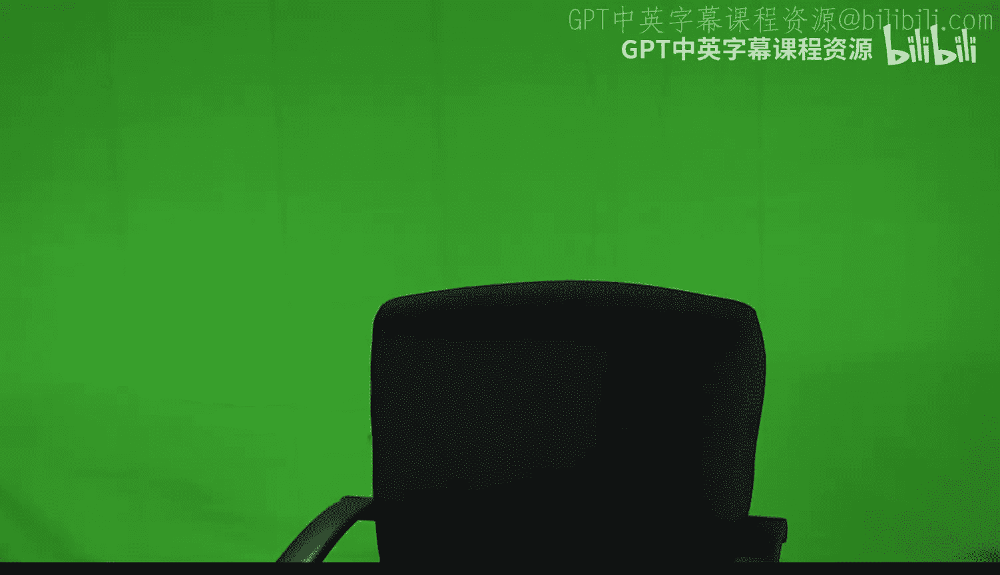
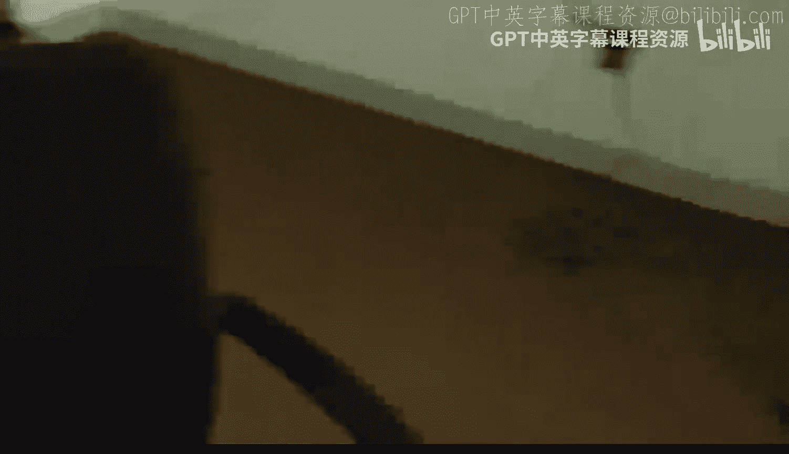
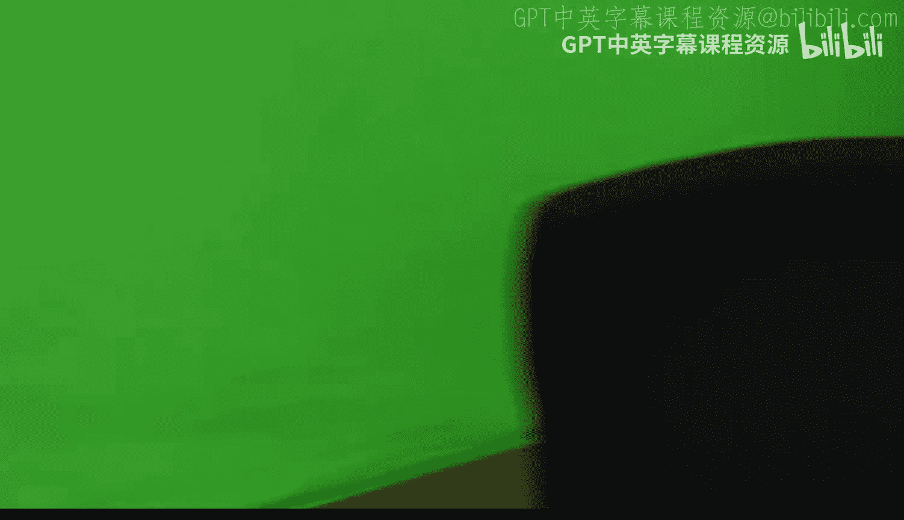
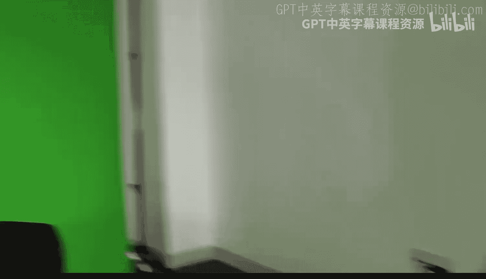
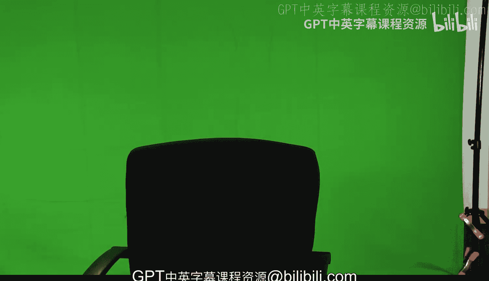

# 斯坦福大学《社会和经济网络：建模与分析｜Social and Economic Networks： Models and Analysis》中英字幕 p80 80_07_09_7-9-第七周总结.zh_en -BV1v1421U7Nk_p80-

Okay， folks， let's just take stock of what we have talked about in this week 7 of lectures。

And in terms of。The content we were looking at games on network。

 but basically trying to understand any situation where individuals or particular nodes are making decisions when their decisions have some interaction with the decisions of those around them and we had looked at two different basic kinds of structures here。

 strategic compliments where the more other people take the action。

 the more I want to take the action as well， so situations where there's compatible technologies。

 languages， etc， then the opposite of situations where more people take the action。

 the less I want to take it， so substitutes public good provisions。

 so somebody else does something I don't have to do it。

The compliments provided a nice structure to the generally the games of compliments have very nice equilibrium structures since you get either all people taking actions or fewer people taking actions。

 you've got a nice lattice structure， substitutes， it's harder， some people when one person goes on。

 next person goes off and you get a very chaotic kind of system and slight changes can actually lead to very difficult things to predict in terms of how things are going to move。

We talked briefly about some comparative statics， there's much more that's actually known in the literature than we have time for。

And here the idea is if you increase the density， if there's complementarities。

 if you sort of increase the density between relationships。

 if I care about the total number of people learning a language and now I'm connected to more people。

 I have more of an incentive to learn a language， so making those connections more dense gives people more incentives to undertake these actions and so you can get results like that。

 bringing in changes in the network to understand how that's going to lead to changes in behavior。

Multiple behaviors， so when is it possible that you can have different technologies survive and different groups taking different actions。

 well homophily， cohesion， segregation patterns in a network。

 things that we talked about earlier and of course come back now to be very important in understanding whether or not you can have different actions surviving in different parts of the network。

 and that has to do with how introspective different groups are。

We looked at a couple of classes of continuous action games and in particular these linear quadratic games gave a very nice。

 simple solution where the intensity of behavior ties back to the position of a node and to centrality measures。

 boes centrality and so forth， so that's a very tractable model。

 a simple model where you can get a closedform solution for how people are going to act as a function of a few parameters。

 so obviously it makes lots of assumptions parametrically but it ends up giving you very tight and simple predictions of what's going to happen。

 which then can be taken to data and so these kinds of models are being used increasingly in understanding pure effects and modeling。

 behavior， diffusion and things when people care about what else is going on so we can begin to marry these kinds of models together with diffusion models。

 learning models and so forth and we'll end up with a very rich set of predictions for behaviors。

Okay so that pretty much finishes week seven， we'll take a next we'll do a quick wrap up of the course and one thing let me do one thing really quickly so a number of people have been sort of curious as to what it looks like to do these videos how do we kind of what does the studio look like here。

 what does the technology look like so let me take you on a quick tour of our studio room so excuse the jerkiness of my camera work。

So here is what the desk looks like where we do the recording。

So you can see there's a microphone here， we have a quick。

This is the screen that I actually write on so if I have my pen here I can be doing writing and you can begin to see how these the screen works。

 and then I've got a screen here where the camera sits up here and I can be looking at what I'm looking at and writing while I'm talking to you series of lights。

 green screen here so that my image can then pop up on the。

ccreen that you're looking at， and it's a fairly simple stark place in the basement of a building at Stanford campusus。

 but this is where we've been doing our recording。

So that's a little bit of a tour behind a MOC。Take care and we'll talk to you again soon。

