# 斯坦福大学《社会和经济网络：建模与分析｜Social and Economic Networks： Models and Analysis》中英字幕 p81 81_07_10_7-9b-课程总结.zh_en -BV1v1421U7Nk_p81-

Wow， so that's been quite a trip we've taken through the analysis and modeling of social networks。

 social economic networks， so this is just going to be a wrap up of the course and so let me say a few things in terms of before we get to the overall course just on games and networks sort of our last topic what have we learned well we've learned that one useful distinction is going to be in terms of what kinds of peer effects are there in terms of behaviors。

 what really what kind of influence does one individual have on another and strategic complements and strategic substitutes are going to have different properties。

 understanding that is going to be important in understanding what the implications of network structure are for behavior position matters so people that are more connected are going to take higher actions and compliments and earlier theyre lower actions and substitutes you can say certain kinds of things in certain settings about how position matters and。

or structure is going to matter so some networks are going to lead to more diffusion of behavior or wider spread behavior than others。

 homophily and cohesion are going to be critical determinants of whether you can sustain diversity of actions。

 what kinds of actions might be going on in different parts of the network so there's a literature that's sort of growing on this top topic at present。

 there's a lot more to be done in terms of understanding how network structure and。Behavior coevolve。

 how they are related to each other and how that depends on the type of interactions that are present。

 what more can we say systematically about this， so it's a very interesting area and it has obviously many applications and ultimately is one of the most important questions we can ask here because it's why the real consequences of networks are in terms of the behavior of the individuals and the resulting welfare that comes out on the network。

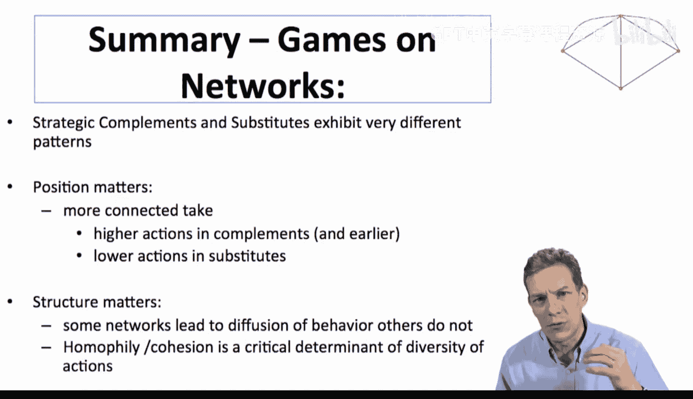

Okay to do list， you know， studying homophily clustering other kinds of network characteristics。

 how does that impact behavior， more integration of behavior with network formation。

 So we saw one glimpse of that in terms of this favor exchange。

 but there's a lot of other settings where we can begin to do that。

 It's been looked at to some extent in trading networks。

 There are other settings where there are codetermination kinds of analyses that have been done。

 but that's going to be important and really understanding。

Why networks look the way they do and ultimately that's going to involve taking models of games on networks to data to really understand whether we see the kinds of structures that we predict whether we' seen the behaviors we predict what's the implications of the network structure for behavior a whole series of issues and I think one thing to sort of add here is that often we think of networks one dimension at a time and in fact there's a lot that goes on in networks and so understanding there's interrelations between different kinds of things could be important so somebody might be a colleague a co-author but we might also exchange information or do favors for each other of different types or there's a whole series of different relationships。

 risk sharing information sharing that goes on on the same set of relationships and so understanding how all of those different things play into each other and how they depend on network structure and how they determine network structure is still a wide open field。

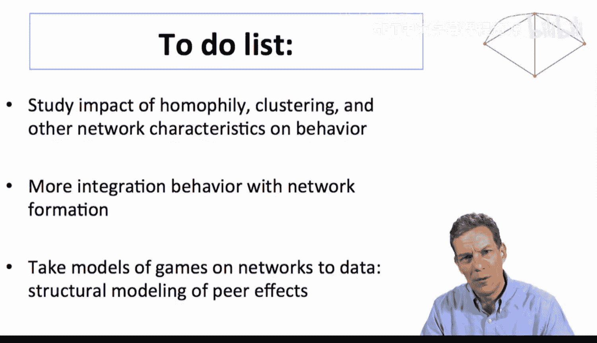

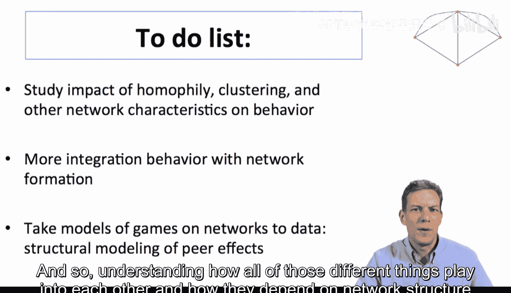

Okay。

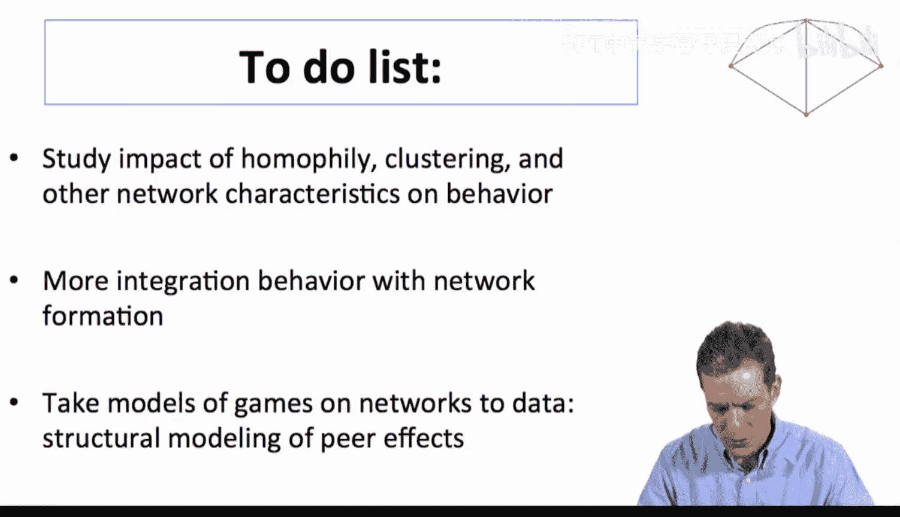

So in terms of the overall course， I think what was the intention here。

 the intention was to expose you to a whole series of different ways of thinking about networks and different empirical facts and different and types of analyses。

 different types of models so we've pulled things from random graph theory from sociology from economics we've looked at statistical models。

 we've looked at some of the models coming out of statistical physics so we've looked at a whole series of different types of models and the idea was not to make you experts on any particular model but to give you a general feeling for the lay of the land。

 the types of models that are being used we've looked at some in more depth than others and the idea here is just to give you a toolkit so that you have a feeling for what's out there what the questions are how these different tools can be used to answer questions and so in terms of I think wither now and again wither is where not withering so the idea here is。

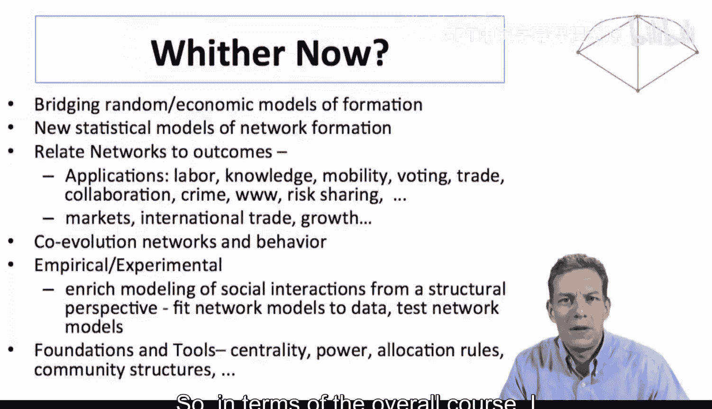

What do we do next， I think part of the reason that network analysis is so exciting these days has to do with the set of open questions there are。

 so it's a pretty wide open landscape， there's a lot that's still to be learned both in terms of the structure of networks and the impacts that's had for societies and it's also a very interesting area because of its interdisciplinary nature。

 so it's not just。Having activity and questions popping up in one area but it's popping up all over because these things are such an important part of our life and so we're seeing a lot of different literatures coming to bear on one thing and it's an interesting area in terms of the interaction between these now in terms of what to be done bridging these random and more strategic models is important because the strategic models have welfare implications。

 behavioral implications the random models allow you to fit to data so we need these kinds of things and associated with that as sort of enriching the stable of models that we have where we can really do careful statistical analysis and we can answer questions of did this happen at random or do we have some belief that this is a a significant finding in some particular setting relating networks to outcomes I think there's a lot more to be done here so there's a lot of case studies over the years that have been done。

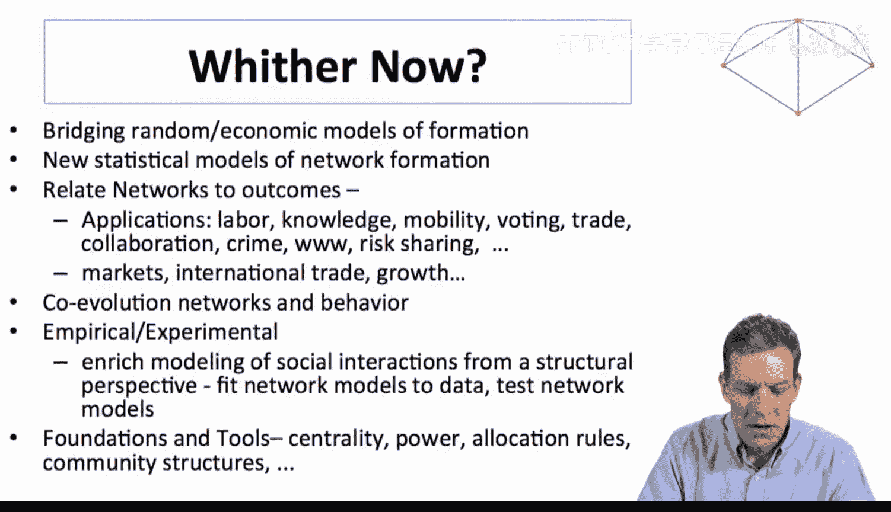

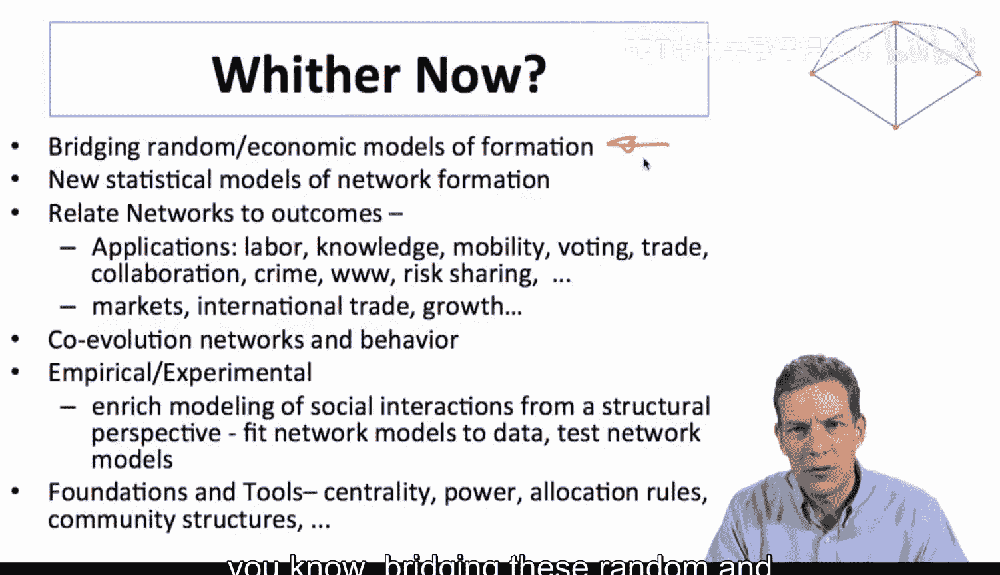

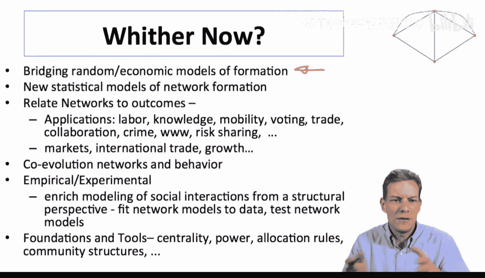

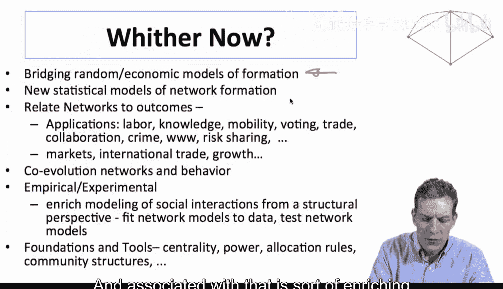

Case studies tend to fall into a couple of different categories。

 often they're looking at network structure itself。

Or they're looking at situations where you're studying some peer effect and it's only recently that we've seen a lot of analyses where we've got a combination of the networks and some of the behaviors diffusing over those the diffusion literature had some of that early on。

 but the availability of data has exploded in the last decade。

 especially with internet kinds of data sets and other things。

 so that the amount of data that's there to be analyzed is much larger。

 and the applications here are very wide and very important。

 So things like labor networks who you find jobs from basic communication and knowledge。

 social mobility， voting， who you trade with collaboration networks， crime networks。

 how the worldwide web's evolving risk sharing understanding markets， international trade。

 growth and developing countries， all of these things involve relating networks to outcomes。

 and so there's a huge set of。Important areas for study。Again。

 in terms of understanding these formation things co-evolving behavior and networks is going to be critical and in terms of empirical and experimental you know when we're working with models that gives us more of a feeling for what should be going on in different empirical applications so having structural models that we can take to data is important and so building these sets of models is important。

 there's also important areas both in terms of laboratory experiments which have been growing over time and field experiments which are also starting to grow more over time where one can actually control carefully what what's happening on the network and then see what are the implications in terms of various behaviors so this is another area which I think will be expanding over time and one thing to sort of know say in closing in terms of the course as we develop a richer and richer set of tools。

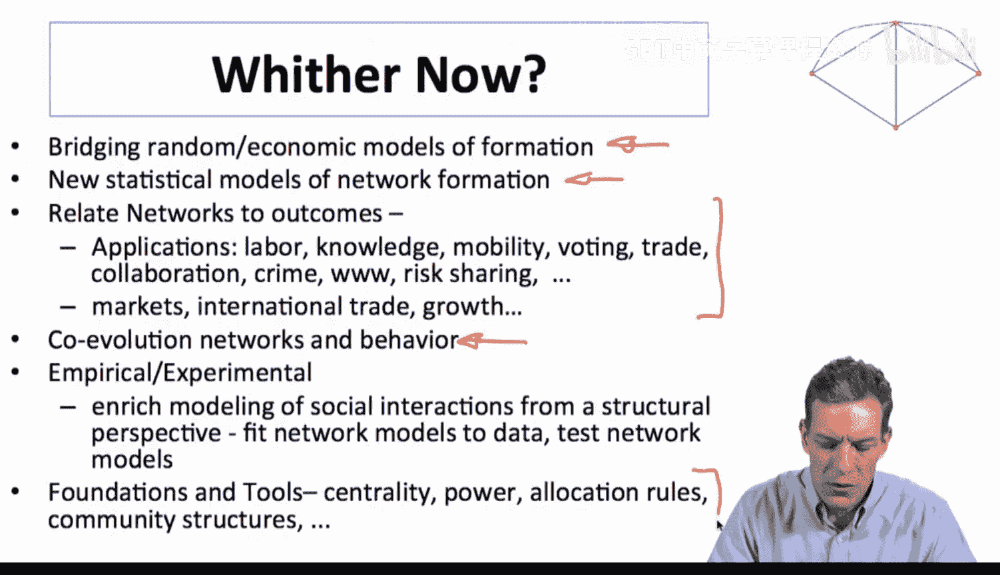

Models and so forth。 a lot of these things are developed for particular applications or with particular questions in mind and there's very little that's been done systematically to say。

 okay， look we've got now10 to 20 different centrality measures。

 which ones would I use and which context， which ones are the right ones so I can apply them all and see which ones work best。

 but is there something systematically systematic that we can say about which ones should be applied in which situations So understanding how this how things work there's an area that we didn't talk about which is fairly rich in terms of detecting community structures。

 so you're given a network and you're trying to uncover who are the individuals that sit in communities that are more likely to be interacting with each other than others so can we identify communities There's many different algorithms for doing that which are the right algorithms。

 what's the right techniques for doing that how is value allocated over a network There's a whole series of questions that can be addressed technically。

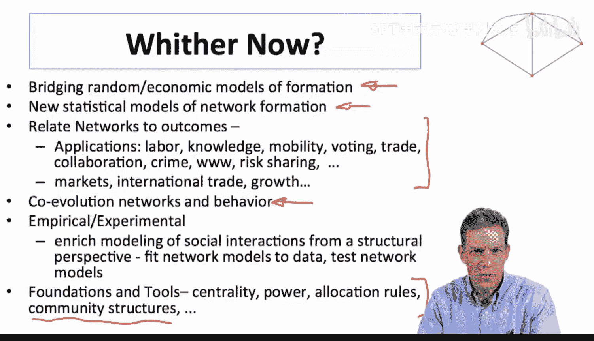

modeling but we would want to understand which approaches should we use in which situations and so there needs to be more foundational work done just in understanding what are the properties of different say centrality measures。

 which ones which ones react in which ways to different network changes What are they measuring what are we getting out of this So there's a very rich set of research topics and social and economic network analysis the idea here has been to give you an introduction and overview of some of the things and introduce you to some modeling and techniques that you're aware of the way that this literature works and some of the main questions that have been answered。

It's a great area for research， it's been fun talking with you and hope you have enjoyed the course and best wishes for your future analysis of social and economic networks。

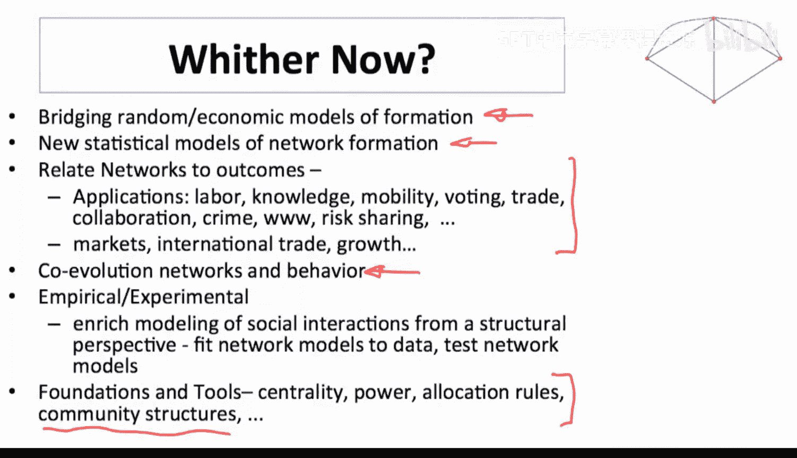