# 生成式AI：从初学者到专家：14：RAG架构深入解析 - 检索与生成

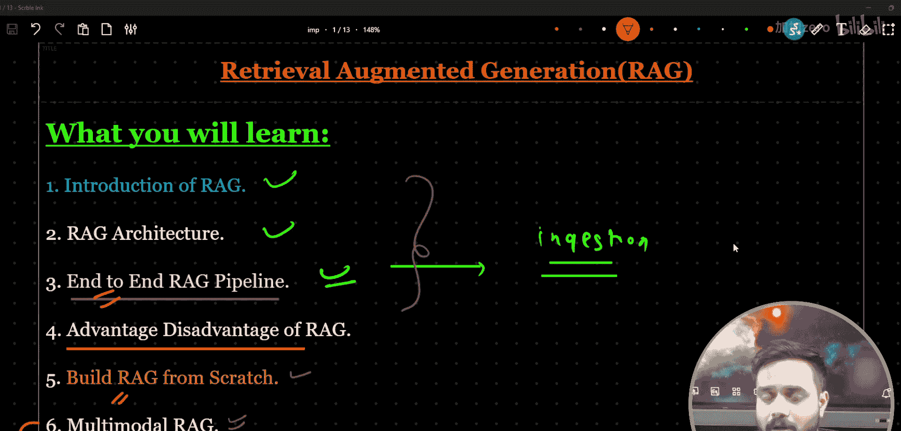

在本节课中，我们将深入学习检索增强生成架构中的**检索**与**生成**部分。我们将详细探讨检索过程的工作原理、其优势与局限性，并介绍基础的RAG流程。

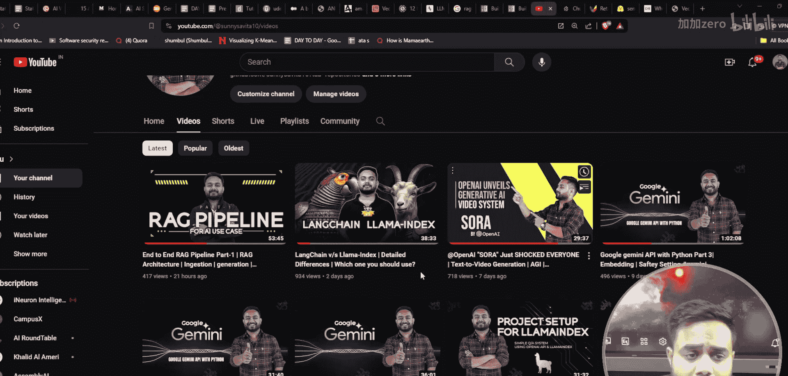

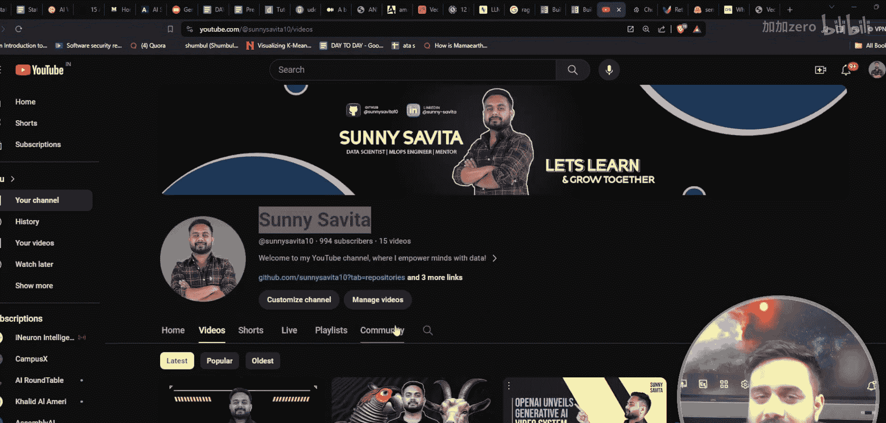

上一节我们介绍了RAG的架构概览和**数据摄取**过程。本节中，我们来看看RAG流程的核心环节：**检索**与**生成**。

## 检索过程详解

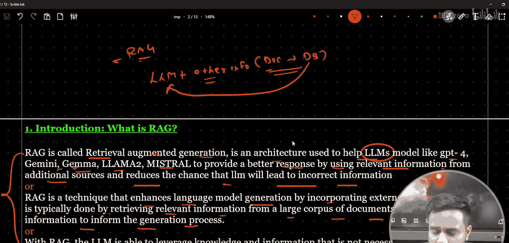

**检索**是RAG架构中连接用户查询与知识库的关键步骤。其核心目标是：根据用户问题，从向量数据库中找出最相关的信息片段。

以下是检索过程的基本步骤：

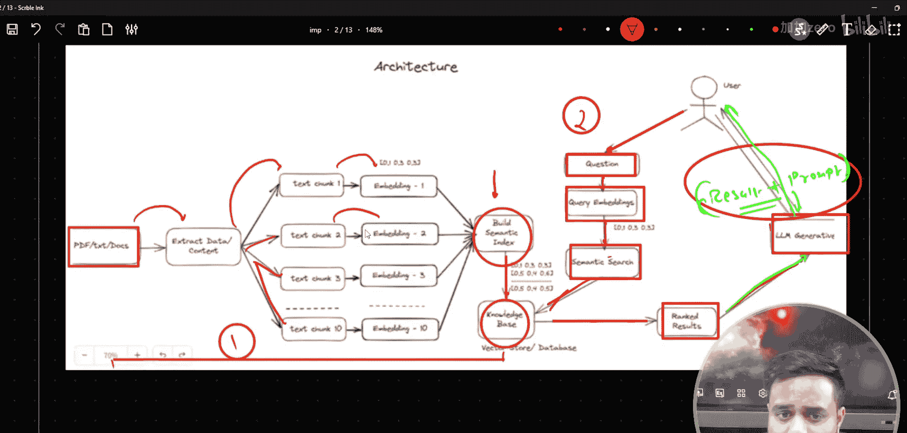

1.  **用户发起查询**：用户提出一个问题。
2.  **查询向量化**：将用户查询文本通过嵌入模型转换为向量。
3.  **相似性搜索**：在向量数据库中，计算查询向量与所有已存储文档块向量之间的相似度。常用的相似度度量方法包括**点积**或**余弦相似度**。
    *   **余弦相似度公式**：`similarity = (A·B) / (||A|| * ||B||)`
4.  **获取Top-K结果**：根据相似度分数，返回排名前K（例如，前3或前5）的最相关文档块。
5.  **信息传递**：将这些检索到的相关文档块（即上下文）与原始用户查询一起，组合成提示，发送给大语言模型。

这个过程可以直观地理解为：系统在庞大的知识库中，快速“检索”出与当前问题最“匹配”的几段信息，然后将这些信息作为补充材料交给AI模型，帮助它生成更准确、更有依据的回答。

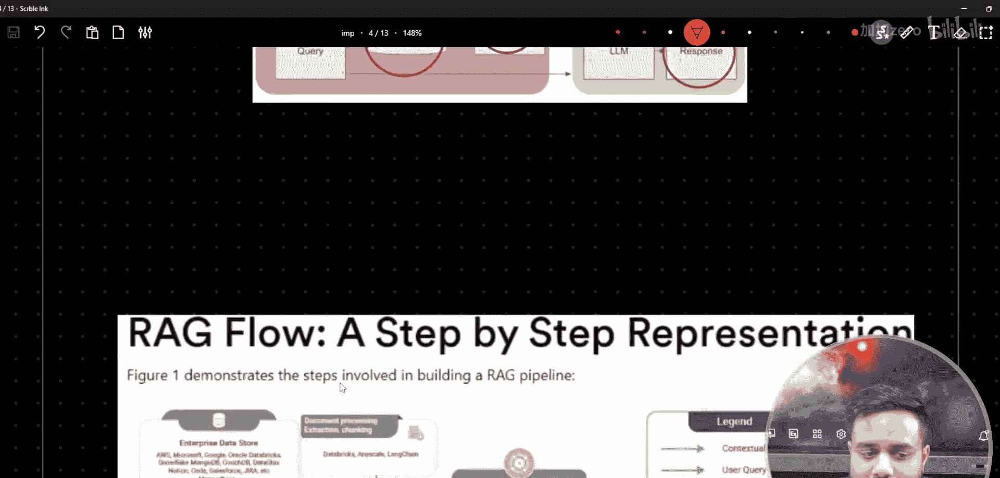

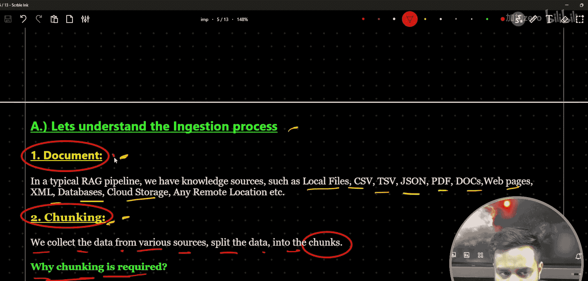

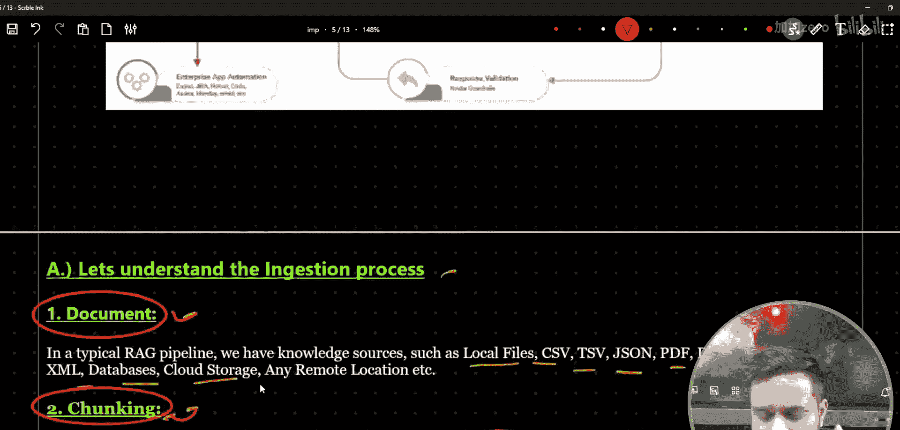

## 基础RAG流程：优势与局限

现在，让我们将检索过程放入完整的RAG流程中审视。一个基础的RAG流程通常遵循以下步骤：

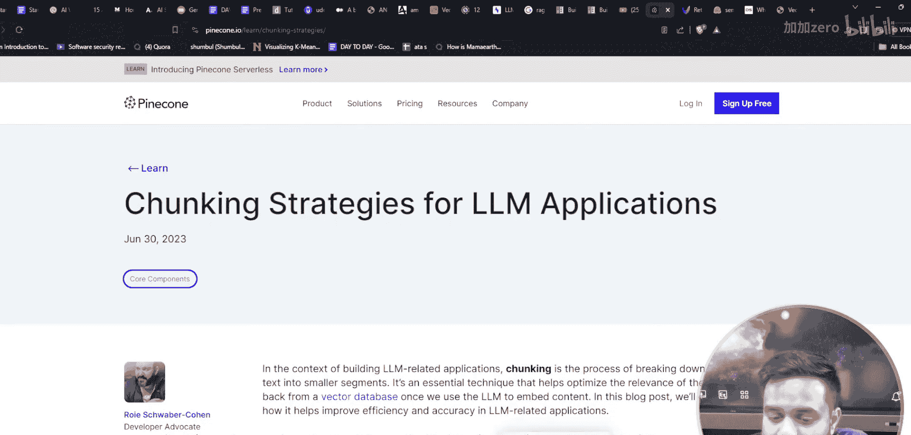

1.  **文档收集**：获取原始数据。
2.  **分块**：将长文档分割成较小的、有意义的片段（块）。
3.  **嵌入**：使用嵌入模型（如Sentence Transformers）将每个文本块转换为向量。
4.  **索引与存储**：将向量及其对应的原始文本存储到向量数据库（如Pinecone, Weaviate, Chroma）中。
5.  **检索**：如上一节所述，根据用户查询检索相关块。
6.  **增强与生成**：将检索到的上下文与用户查询结合，发送给LLM以生成最终答案。

这个简单流程有其明确的优点和缺点。

以下是基础RAG流程的主要优势：

*   **简单高效**：架构清晰，易于理解和实现。
*   **数据处理统一**：用于创建嵌入的文本块与最终传递给LLM进行合成的文本块是相同的，流程一致。

以下是基础RAG流程的主要局限性：

*   **上下文理解有限**：检索到的独立文本块可能缺乏更广泛的文档上下文，影响答案的连贯性和深度。
*   **更适合小规模数据**：当处理海量数据或大型文档块时，简单的相似性搜索可能无法精准定位最核心的信息。

## 课程总结

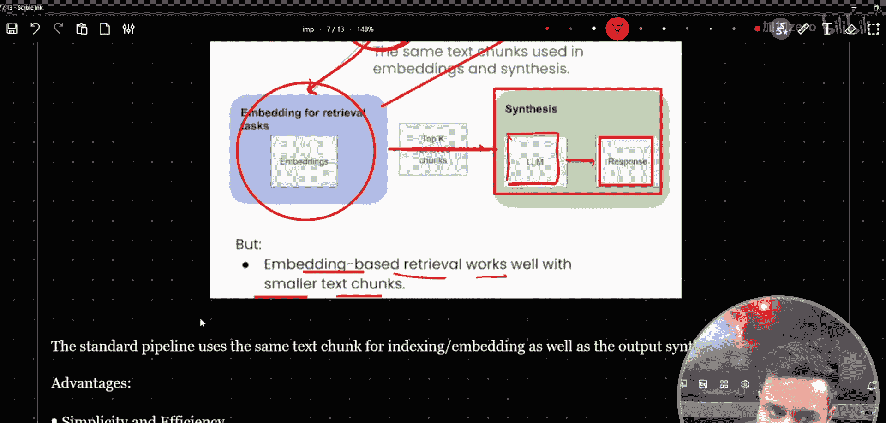

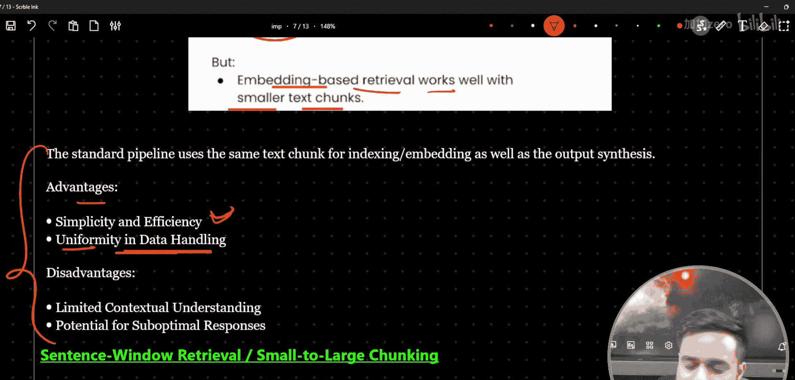

本节课中我们一起学习了RAG架构中的**检索**与**生成**环节。我们明确了检索的核心任务是从向量数据库中查找与查询最相关的信息，并回顾了从数据准备到最终生成答案的完整基础流程。同时，我们也分析了这种简单方法的优势在于其简洁性，而局限性则体现在对复杂上下文的理解和处理大数据集的能力上。

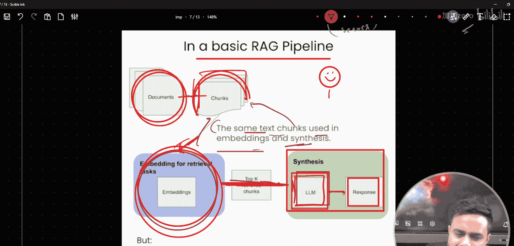

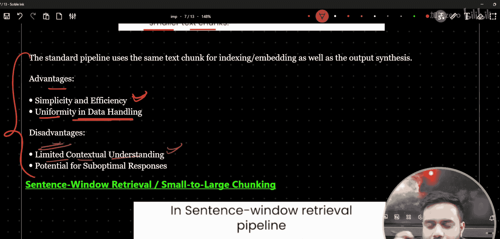

理解这些基础概念和权衡，是我们后续探索更高级RAG技术（如优化检索策略、微调模型、多模态RAG等）的重要基石。在接下来的课程中，我们将深入这些进阶主题。