# Sunny Savita【中英⚡生成式AI：从初学者到专家｜Generative AI In-Depth Roadmap from Beginner to E】 p01 P1 Generative AI In-Depth Roadmap from Beginner to Expert #generativeai #artific [BV1Uht8zDENA_p1]

Hello guys， welcome to my YouTube channel。 My name is Sunny Savita and in this video we'll discuss the complete and detailed roadmap for the geneative AI so recently I have started my YouTube channel and I have uploaded my introduction video if you haven't check that please go and check inside that video I have already discuss that what all thing we are going to discuss in this particular channel and I talked about myself as well so if you don't know if you haven't check then please go and check with the introduction video so let's start guys let's start with the roadmap of the geneative AI Now here I have designed the roadmap in such a way that everyone can follow it I designed this geneative AI roadmap from basic to advance and here I already mentioned that here is a step by step guide design for absolute signal looking to acquire a skill in geneative AI Now this roadmap I have designed for the a different different position。

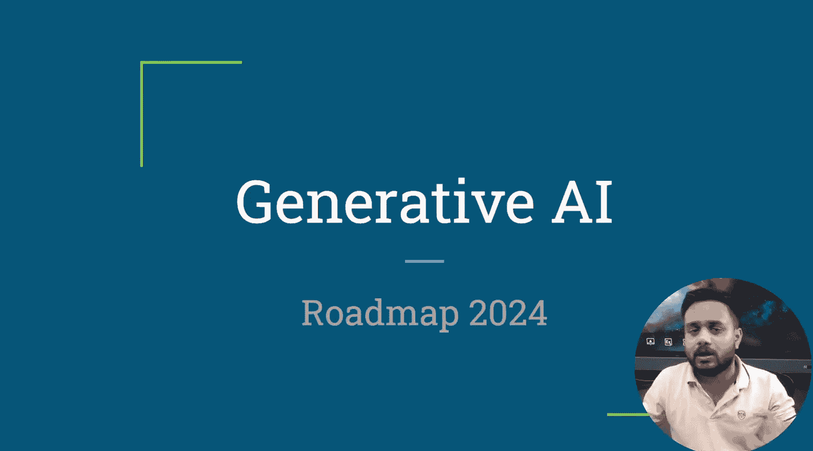

For the developer one means if someone is begin developer two means someone is on senior level and I have designed for the research person as well so if someone is working in R D that what all on what all topic that person need to focus so lets start with let's start with a roadmap so here guys this road mapap I have divided into many section。

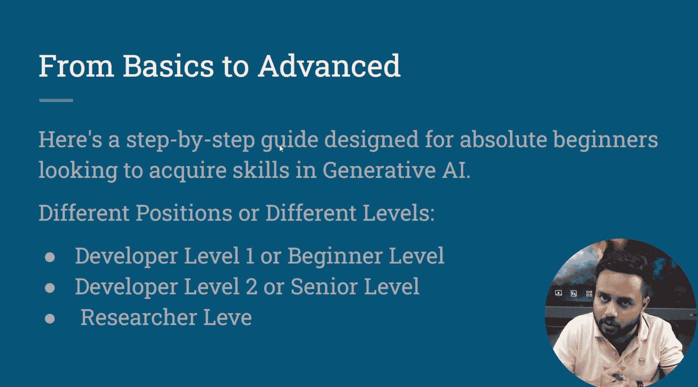

The very first section which is a prerequisite so well try to discuss the prerequisite what a prerequisite is required before is starting with a geneative AI the second thing is fundamental we'll discuss about the fundamental also that what our fundamental is required what all thing we should learn before starting with a geneative AI then I will talk about the core geneative model and then well understand that how we can develop application which is powered by the LLM so well try to understand all framework right so。

LLM like framework for designing LLM application framework for designing a web application and all right each and everything I have included over here in this particular topic then I will talk about that from where you can complete your project and from where you can you can you can solve the practical and all you can take a practical experience and all then I have kept few miscellaneous topic over here inside this video then advice for the productive learning So I will give you the advice that like how you need to do the productive learning what all is step what should be the path for your productive learning and then we'll discuss the fQs as well So that is my agenda for these video and now let's start with the video So first guys let's try to understand the definition of the geneative AI what is a geneative A So geneative AI generate new data based on training sample geneative models can generate images。

 text， audios and video So's a simple definition of the geneative A and here I have divided。

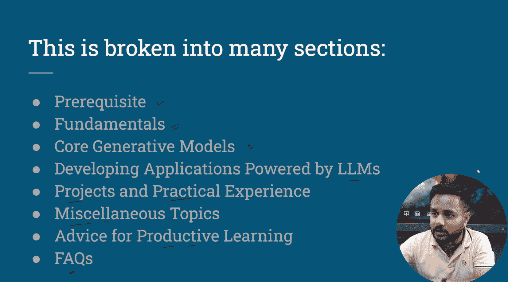

This geneative AI into two part first is geneative image model and the second is geneative language model。

 So specifically I will talk about the geneative language model in this video in this roadmap I will more focus I will pay the attention on this geneative language model I'm not going to discuss the detailed roadmap about this geneative image model like Ga and the diffused model but at the end I will give you some guide I will try to discuss few models and all I it I already kept it in the misceous topic so let's start here with a geneative language model。

 So geneative AI with large language model or geneative AI with language model。

 So when I refer to large language model I mean natural language processing NLP forms the foundation of massive language genetic model that is what that is a Lm So whenever we are talking about the large language model So from where it is start tell guys So it is start from the it is start from the R。

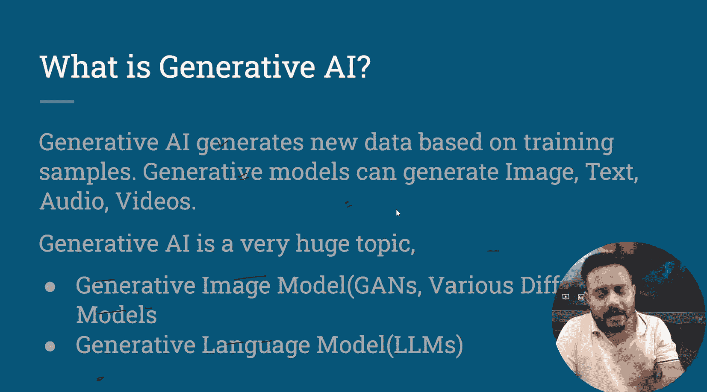

okay the root of the LLM is nothing。 It's a natural language process so I will keep this thing in my mind and based on that only I will guide you throughout this video so here in this in the next slide I kept the prerequisite so the prerequisite the very first thing which you need to learn if you are going to prepare for the geneative AI and if you are going to learn the geneative the very first thing which you need to learn that is what that is a programming language so Python is a most commonly used programming language which we use for the data science machine learning and for the AI domain why use Python so here I have mentioned couple of reason so the very first reason is community support Python is having a very huge community support and that's why we use this Python for the AI development now the second one is library and framework Python is having huge amount of library and framework which support the AI development。

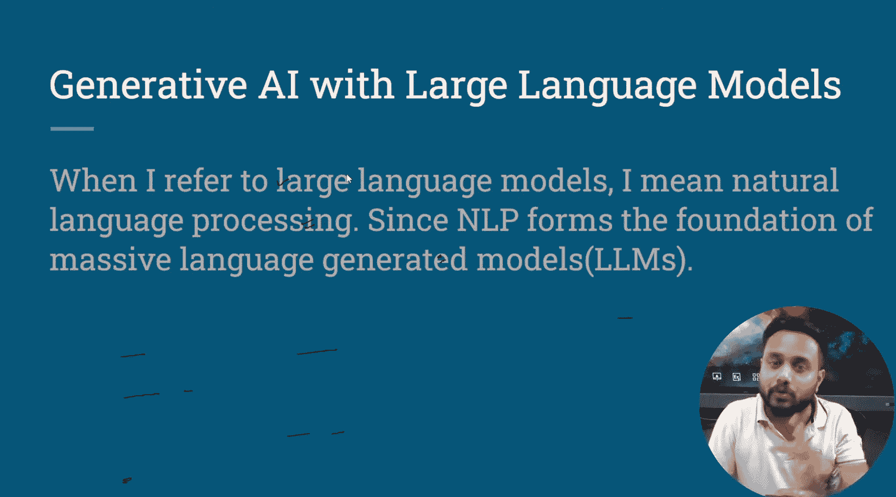

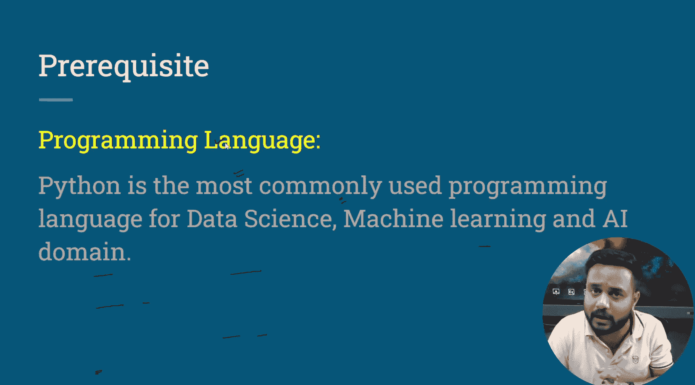

It is having visualization library computing library it is having like other different different library related to the computer vision natural language processing machine learning for everything whatever is required you will find out over here and why and how because of the community only it is having a vast community support it is flexible and productive you will find out this python is very very simple you will find out that like there are many prototype basically basically which is already given inside the python you just need to use it。

Okay， so Python is a very important language if you are thinking to develop something in geneative AI now the last one is data analysis visualization yes I already mentioned that well guys yes or no I think yes so here I think this part is clear to all of you that why Python is required now let's try to understand the next thing so what all topics you need to learn whenever we are talking about the Python whenever we are talking about the programming language so what topic basically which is required right on what topic you need to focus the very first thing variable number is list dictionary set up set if condition for function lambda and all right and module how to like use the paper read write exception handling classes and object these are the fundamental topic these are some fundamental topic definitely you should learn this topic if you are if you are starting if you are start learning this Python so the next thing is what next thing is a nosQL data。

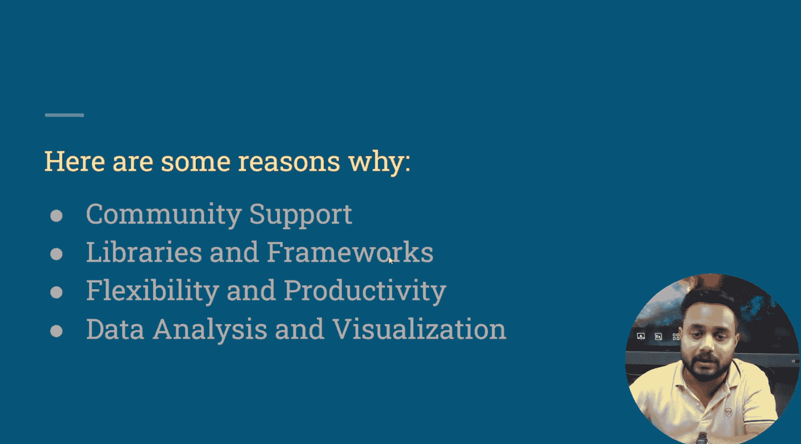

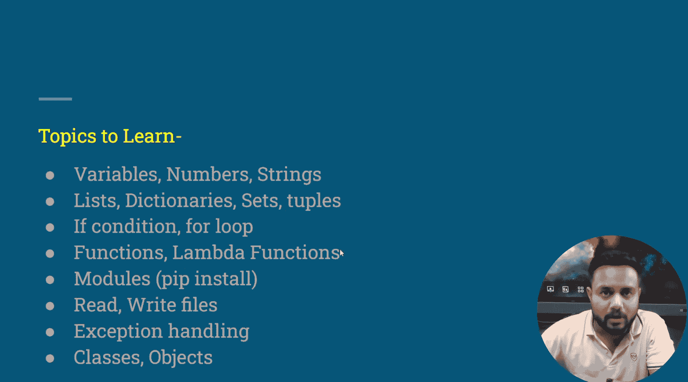

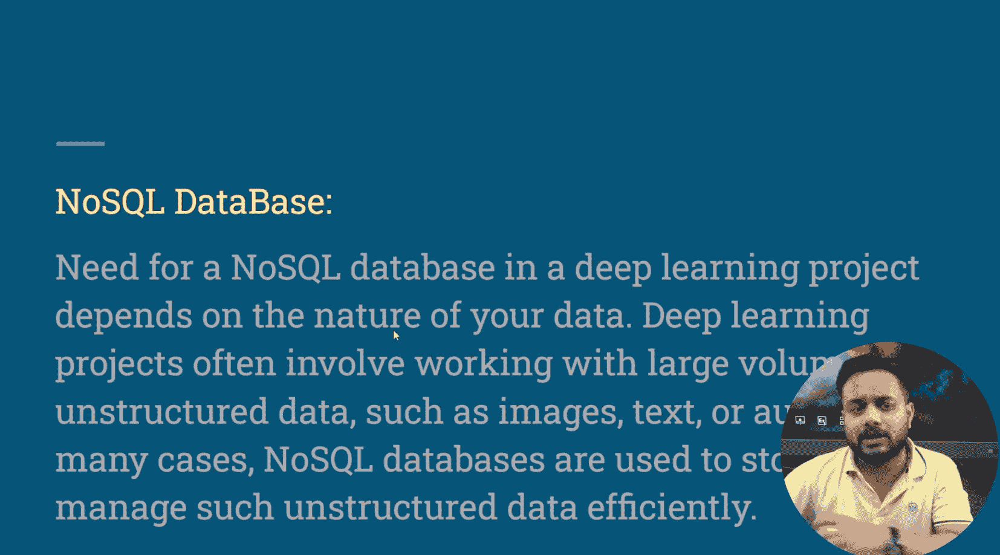

So I kept this node SQL database intentionally over here why what is the reason behind it because in pipeline in the in the nLP pipeline。

 the deep learning pipeline， people are using this snow SQL databases。

How where So for keeping the unstructured data actually see whenever we are talking about the deep learning or the natural language processing。

 So generally we deal with the unstructured data like images， voice text videos。

 So those type of database we can easily keep inside the NosQL databases we have a different different type of NosQl database like document based database column based database graph based database there are different different type of database you will find out here I have given you the suggestion as well that which database you should learn don't worry in the next slide I have mentioned that Now first of all。

 read the definition So need for nosQL database in deep learning project depends on the nature of the data As I told you in deep learning we use the unstructured data deep learning project often involve working with large volume of unstructured data such as images texts audio and all in many cases。

 nosQL databases are used to store and manage such unstructured data I hope the thing is clear why we should learn the nosQL database Now next in the next slide I have mentioned that。

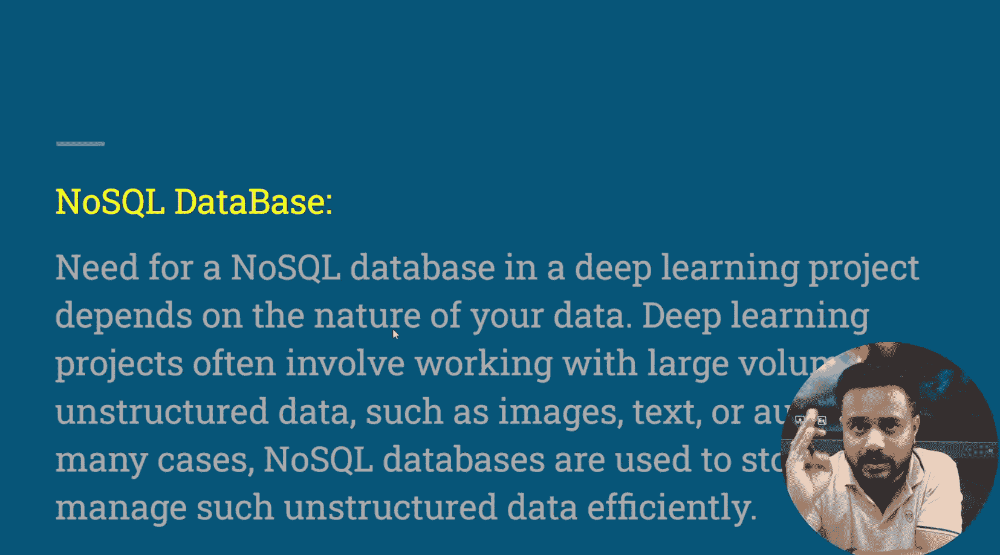

Daatabase you need to learn。 so here you can give the preference to the Mongo Db and cassandra。

 It is being used in the industry。 People are using it and here is a reason that why you should use the Nosql database If someone is going to ask you definitely you can explain that thing so scalability is one of the reason flexibility variety of the data we can store the right of the data realtime instion is possible distributed computing is possible is schema less design means we know need to design a schema dynamically we can dynamically we can store the data to the Mongol TV I hope this thing is scia I think the prequis prerequisite scia now let's discuss the fundamental so the fundamental the very first thing which comes into the picture that is math and statistics for the data science math and statistics plays a very important role if you are going to understand the pattern of the data right so for understand the pattern of the data or finding out meaningful information from the data。

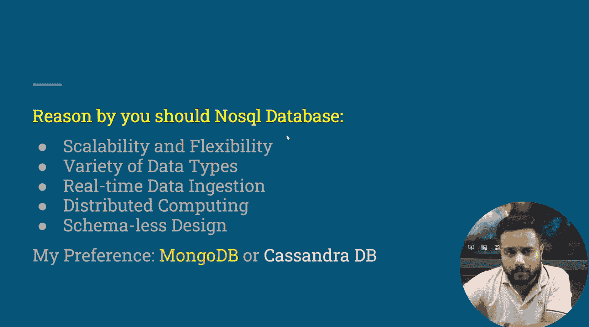

This math and statistics plays a very important role here I mentioned the reason that why this statistics and math is required math and statistics are fundamental for data science and AI that drove meaningful insight from the complex data here specifically if I'm talking about the statistic so yes with the help of statistic basically we can find out the meaningful insight from the complex data set Now why math is required。

Although this statisticstistic is a branch of the mathematics although statistics is a branch of the mathematics。

 but in the mathematics also in the mathematics here we have a specific topic which you need to learn so here I mentioned see this is the topic of the statisticstistic descriptive statistic inential statistics basic plot in statisticstistic measure of central tendency type of distribution。

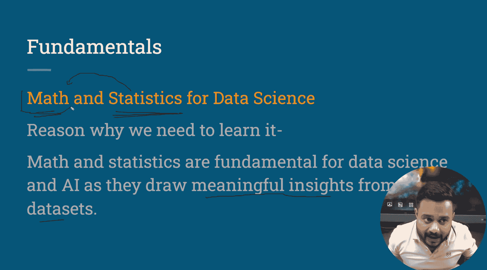

Central limit theorem correlation co and the hypothesis testing This is a core topic of the statistic you cannot deny with this topic Anyhow you have to learn it for understanding the pattern of the data now coming to the mathematics in mathematics this probability linear algebra and calculus plays a very important role why because let me tell let me tell you one example over here we are talking about the machine learning So whatever model is there in the machine learning like a linear regression logistic regression or maybe decision decision or maybe like。

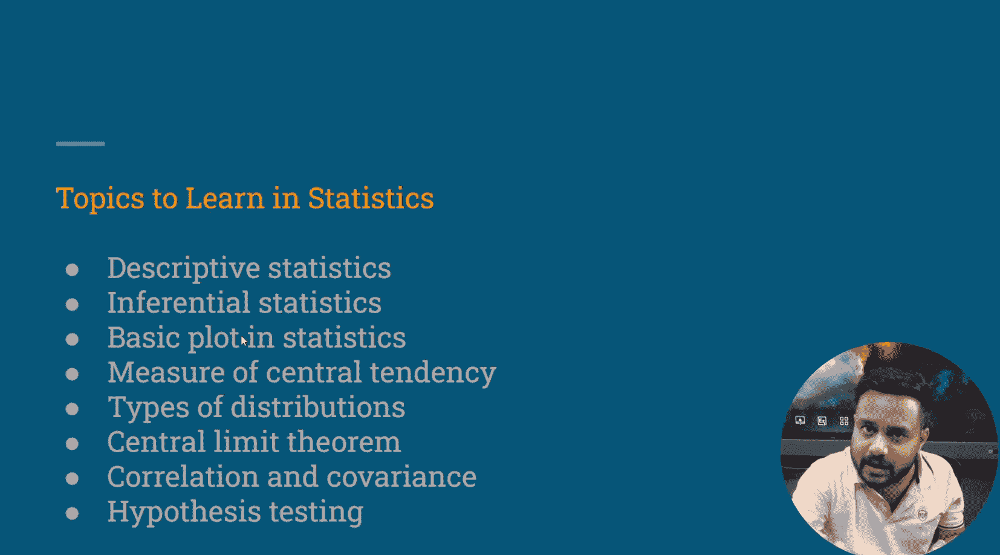

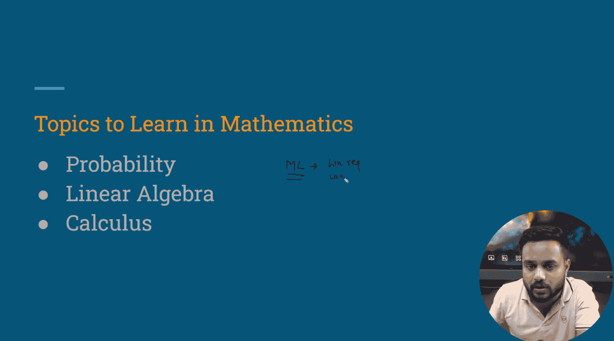