# Sunny Savita【中英⚡生成式AI：从初学者到专家｜Generative AI In-Depth Roadmap from Beginner to E】 p02 P2 Generative AI Complete History Part-1 ｜ Classical AI vs Modern AI ｜ AI vs ML [BV1Uht8zDENA_p2]

Hello everyone welcome back to my YouTube channel my name is Sunny and in this video we are going to discuss the detailed history of the Geneative AI in the previous video I already discussed about the roadmap of the geneative AI so if you haven't checked please go and check guys because that video is very very important if you want to make a career in the field of Geneative AI so you must watch that a particular video your most of the concept your most of the doubt will be clarify okay。

Now， guys， one more thing I would like to discuss to all of you。

 So recently I started my YouTube channel。 I am preparing a lot of content and the playlist。

 If you have any suggestion for me so you can fill out the Google form if you want any specific contain。

 any specific topic， whatever right so you can fill out that form。

 So based on that I will get to know that Okay so my audience。

 this is what this is the thing basically which my audience want。 And according to that。

 I will create my content and the playlist。 So yeah， let's start。

 let's start with the video now So in this particular video will try to discuss the detailed history of the generative AI So here。

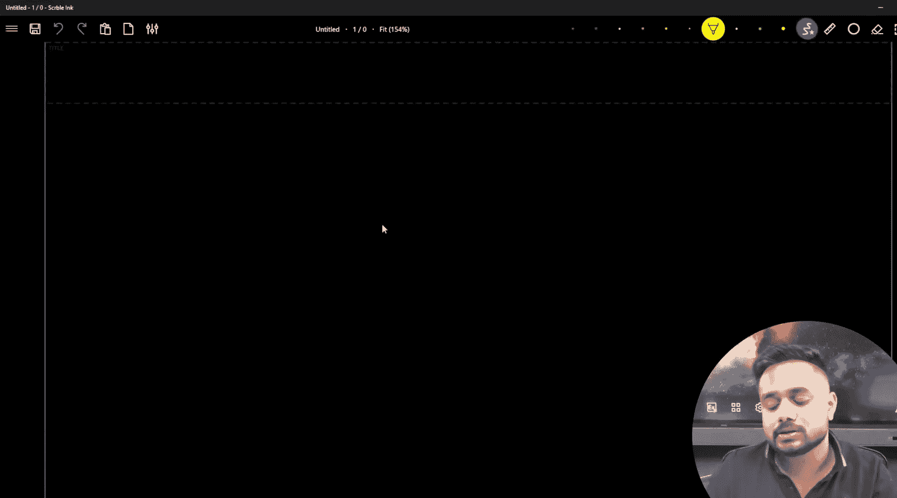

I can write it down this。 so we are going to discuss the detailed history of the Gen AI genei or the geneative AI。

 Now before starting with the geneative AI guys。 let me explain you about the artificial intelligence because see guys one more thing here I'm going to discuss each and everything and very detailed way。

 So this video is going to be a quite long。 So what I thought that I will create a two part of this video So this is the first part where I will discuss the primary history of the AI willll discuss the like few deep learning concept and the method。

 and then in the next video I will discuss some advanced topic Okay advanced topic related to geneative AI history。

 So here you will find out two part。 and this is the first part of the video。

 So let's start with the AI。 So what is a full form of the AI。

 So the full form of the AI is nothing It is artificial。Intelligence， artificial intelligence。 Now。

 what is the meaning of the artificial intelligence， What do you think， So here， the intelligence。

Okay， the intelligence which we are creating artificially。

Now here what is the meaning of the intelligence right so what is the meaning of the intelligence So intelligence is a like the greatest gift of the God Okay so intelligence is the greatest gift of the God。

 which humans God。I think you are getting my point what I am trying to say over here so intelligence is a greatest gift of the God which humans God and that intelligence we are going to create artificially how how so the simple answer or the simple simplest answer over here mathematically。

😊，Okay， mathematically thats it right So here we want to create a mimic intelligence or we want to create a mimic human so that so that our machines also so here we are going to create artificial intelligence and that is nothing that is a mathematical model and now so we are creating it why we are doing it so that our machines also our machines also can learn okay can learn。

😊。

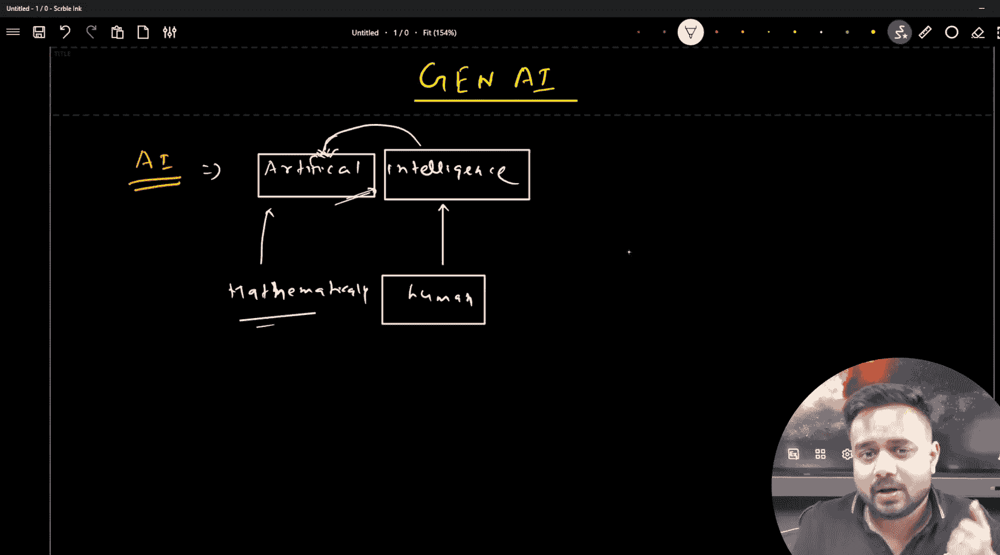

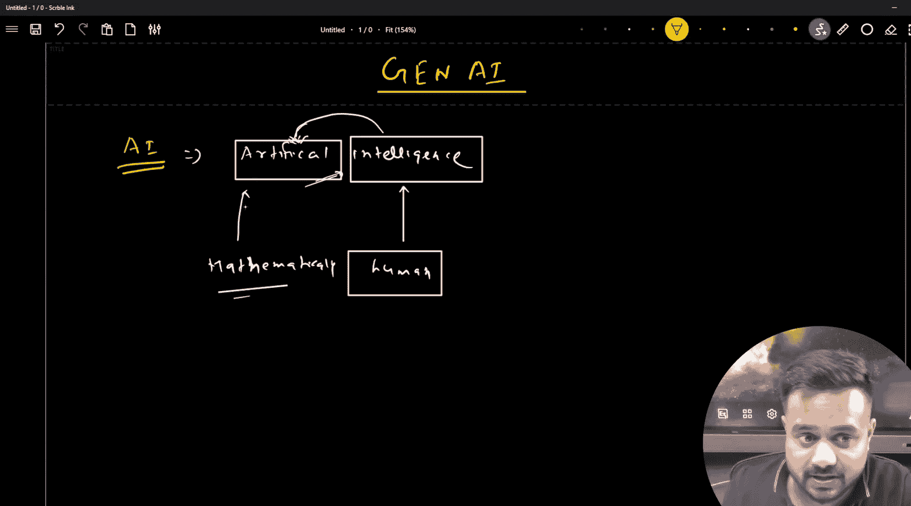

Ting。😔，Ting。Can learn thing and apply logics and apply logics like a human like a human right so there is a main aim or that is a main motto of the artificial intelligence Now where this artificial intelligence is being used so this artificial intelligence is being used in every domain。

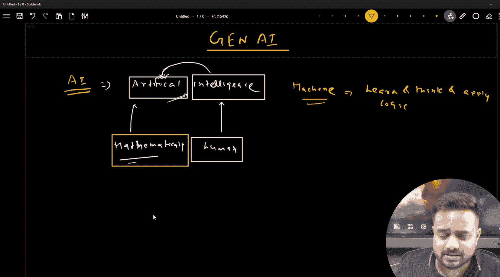

In every domain you will find out the use of the artificial intelligence so let me highlight some points over here let me highlight some domain so here let's say ecommercecomce domain in emerce domain you will find out the use of the artificial intelligence there are many chat board and there are many system which has been built up by using the AI。

In the education domain， also。You'll find out the user AI in the like transportation。

Transportation and logistic， logistic or in the transportation， logistic and supply chain。 Also。

 you will find out the use of the AI， right， So you will find out the AI based product。

 Then in the medical domain， Okay， medical domain， you find out the AI Li product。

 Bank finance everywhere， everywhere， machine learning， AI deep learning is dominating。 Now here。

 guys， if I am saying。Artificial intelligence so what is the meaning of the artificial intelligence so artificial intelligence actually it is representing to everything it is representing to everything how so this is artificial intelligence actually it is a super set it is a super set if if if I am saying machine learning。

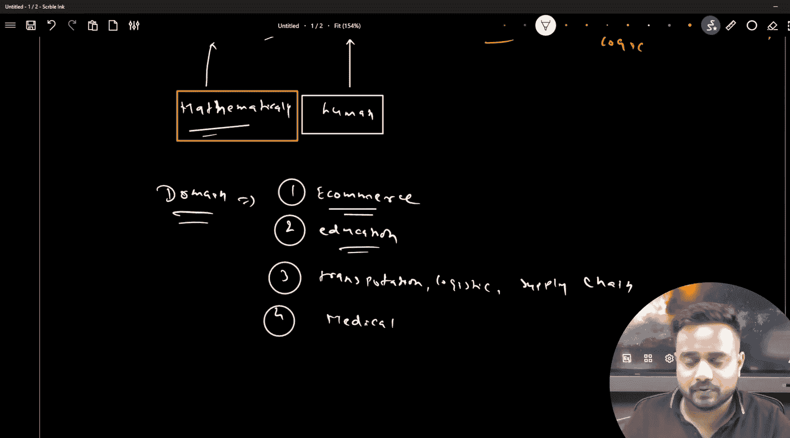

If Im saying machine learning so it is also representing to the artificial intelligence。

 if I'm saying deep learning deep learning， it is also representing to the artificial intelligence if Im saying generative AI right if I'm saying the generative AI So this Gen AI Gen AI is representing to the artificial intelligence means artificial intelligence is a super what is artificial intelligence tell me as if artificial intelligence is a superet everything is belonging to the artificial intelligence only means we are achieving the artificial intelligence by using the machine learning or deep learning or the generative AI right so artificial intelligence is having their own history right so I have divided this history into like into the different different ear So first is the early history which is from 1950 to 960 the second is the like middle history or this was also the early history。

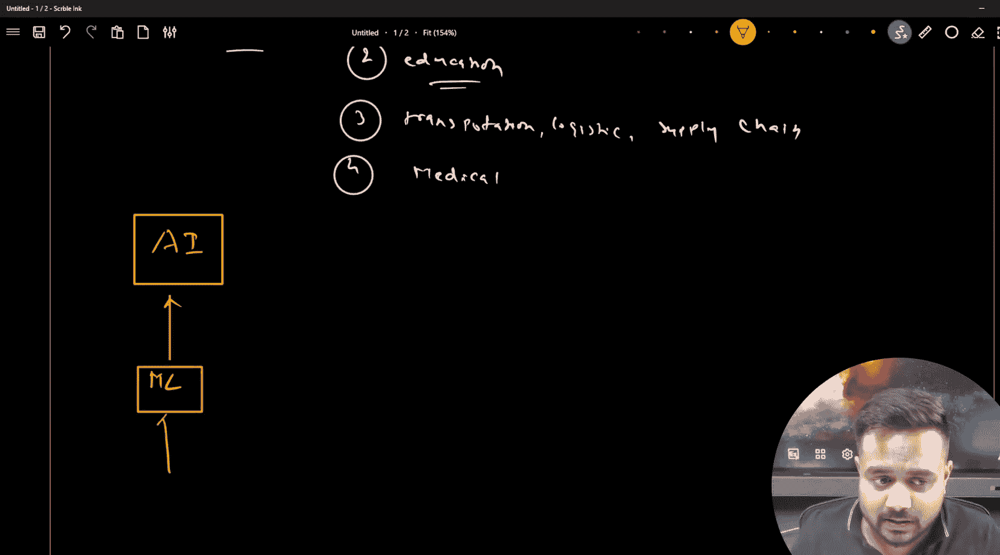

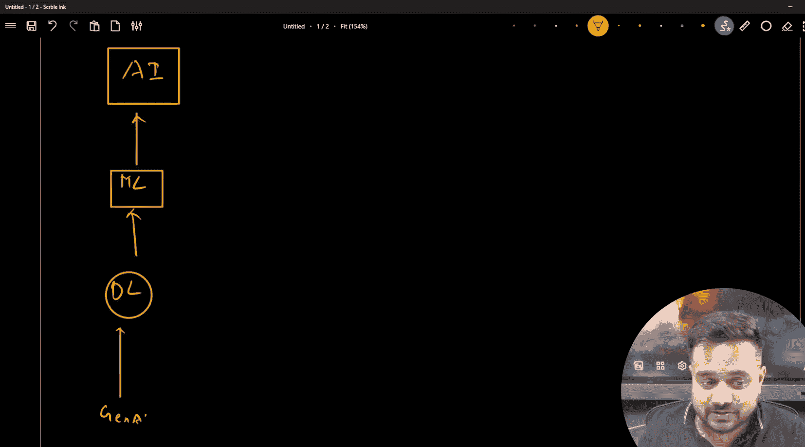

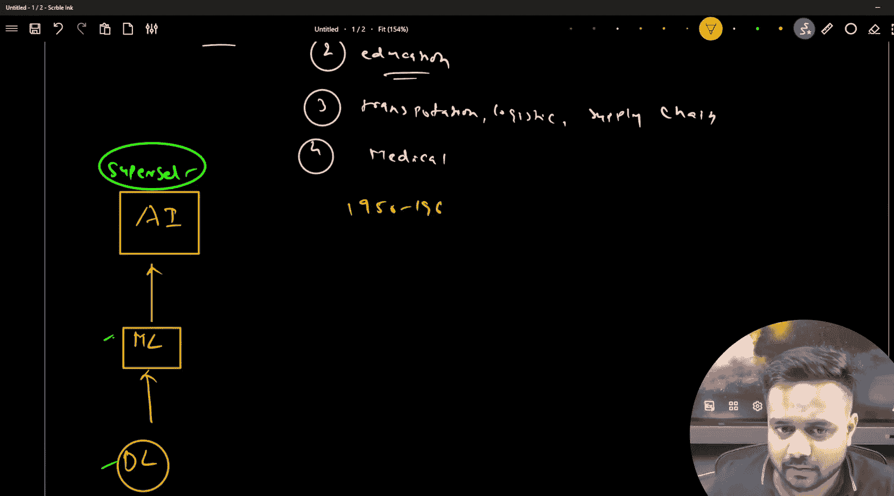

The artificial interval between 96 to 1970。 So this this is called the middle one。

 this 1982 1990 and 199 to 2000。So， it is a me medieval history of the artificial intelligence and then you will find out the modern history of the artificial intelligence so here from 2000 to present。

Now， one more thing I would like to show you over here。

 So if we are talking about artificial intelligence。

 we are talking about the artificial intelligence machine learning。

 So you must have seen this type of architecture。 So this is representing to the artificial intelligence Now there is one more circle which is representing to the machine learning Now there is one more circle which is representing to the deep learning inside this itself Now inside this inside the deep learning actually you will find out the geneative AI So the pink circle is nothing it is representing to the geneative AI So here this is nothing this is my artificial intelligence。

 this green circle this orange circle is representing to my machine learning this is my deep learning and this is my gene AI So guys for achieving the AI for achieving the artificial intelligence we have for achieving the artificial intelligence we have a machine learning。

 deep learning and the geneative AI at the end everything is belonging to the geneative AI means whether we are talking about the machine learning deep learning or genetic。

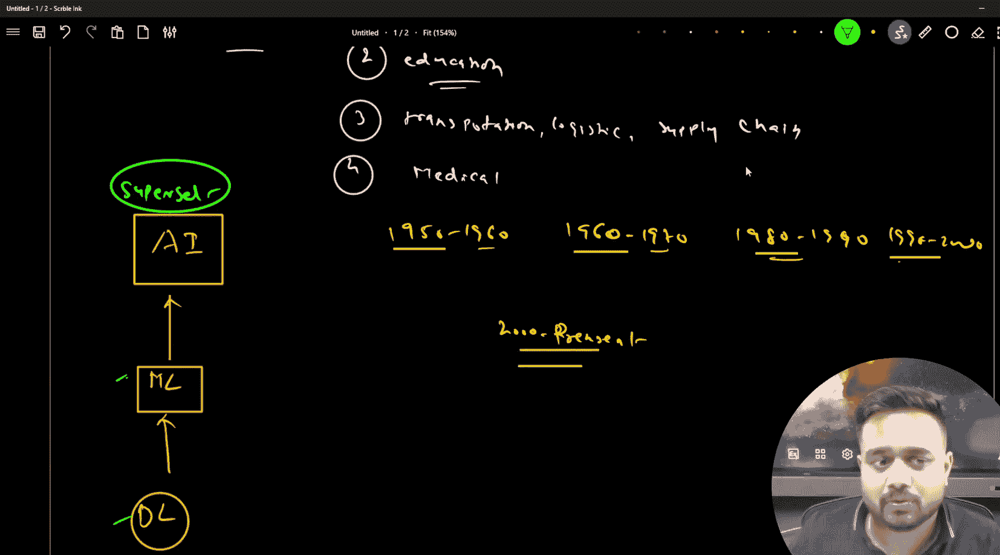

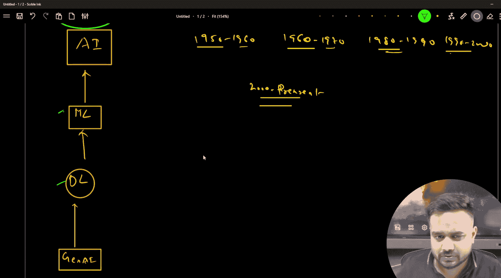

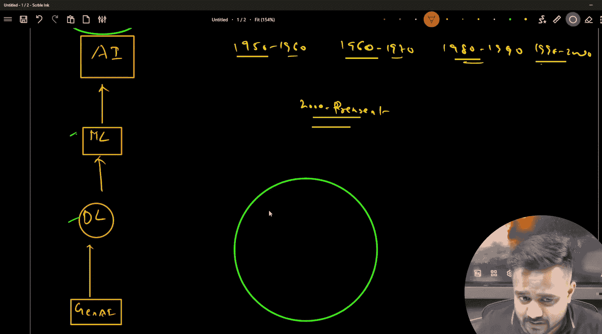

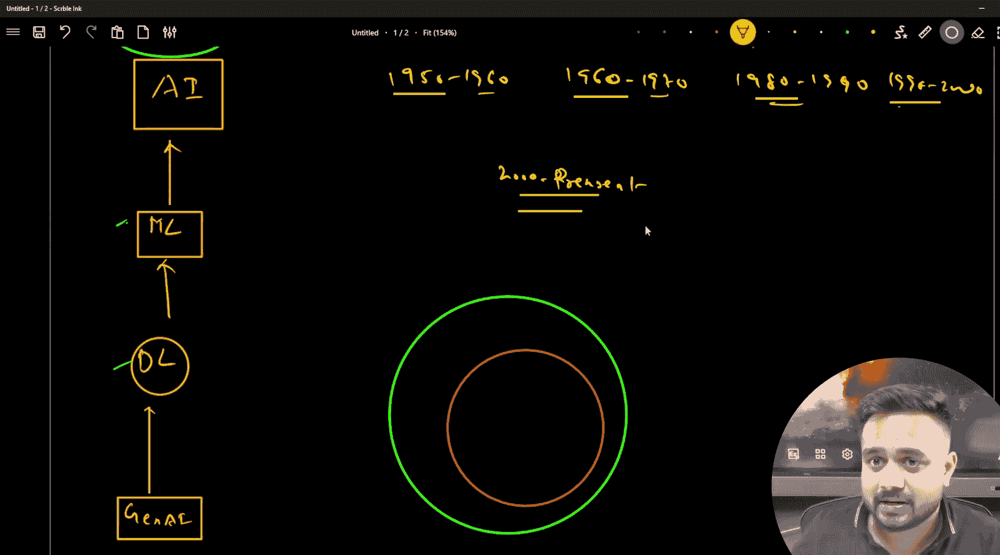

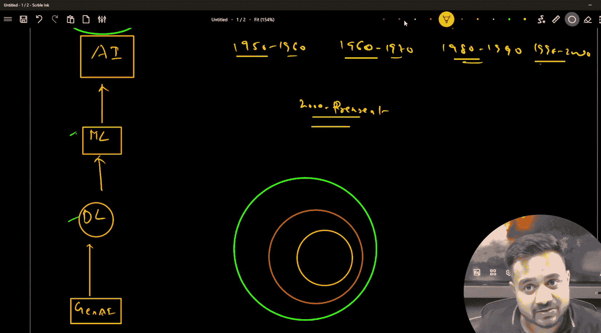

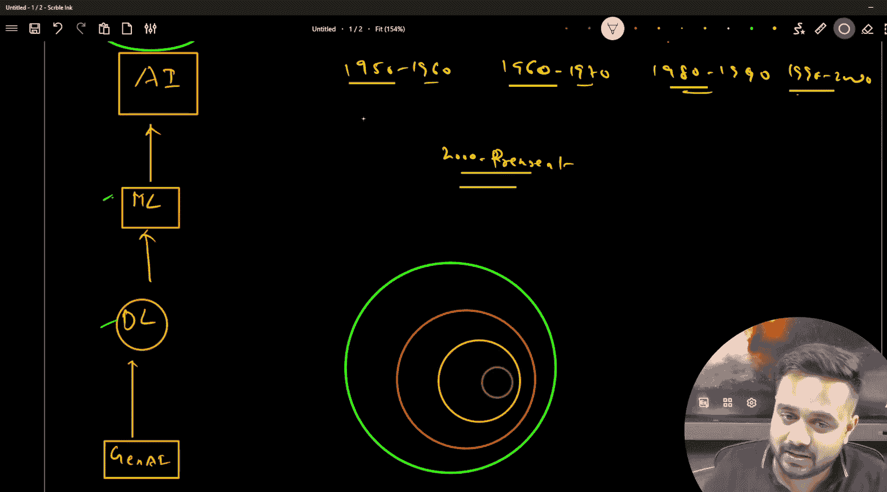

ビ？We are creating an intelligence。 We are creating an intelligence intelligence model which is able to take a decision which is able to like which is able to understand the pattern。

 which is able to predict something getting my point I think yes okay now here what was the early history of the artificial intelligence So here in this in between 1950。

 1960， you will find out that there was an invention of the there was an invention of the rule based system there was invention of theceptron perceptron I will come I will discuss it in a detail way don't worry I'm just giving you the overview between 1960 and 1970 you will find out the export system I will talk about what was the export system between this 980 and 9090 you will find out the evaluation of the machine learning algorithm or the static model between this 1990 and the 2000 will find out the evaluation or or you will find out the evaluation of the deep learning techniques right the different different type of neural net。

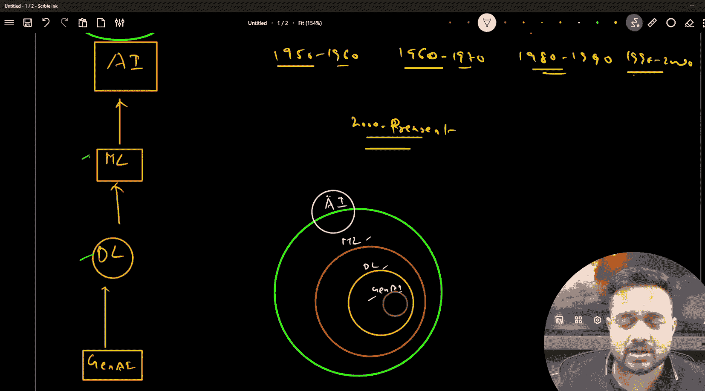

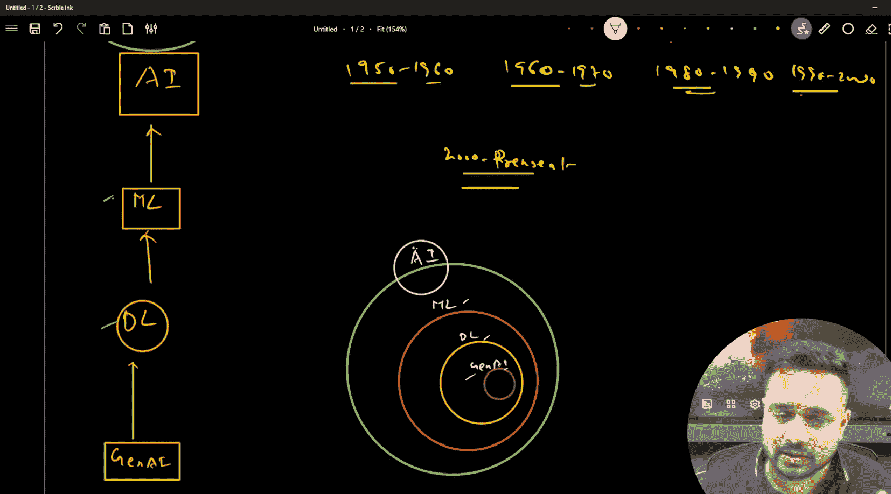

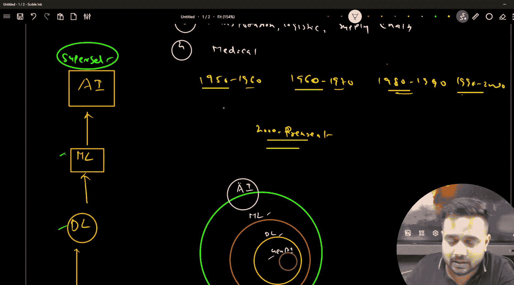

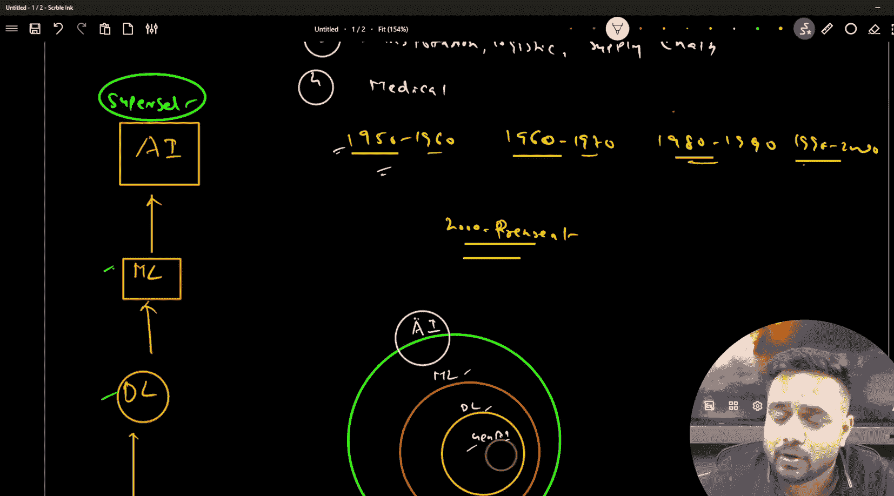

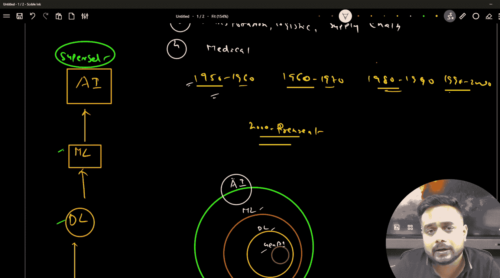

Like LSTM and the CNN then from 2000 to present。 So it is completely deep learning error okay from 202024 like to the present time。

 it's completely a deep learning based era So yes in the detailed way we'll try to discuss each and everything over here Now if you are talking about 1950 and the 1960 So between this 950 and 1960 let me highlight some sort of a point over here and see my main agenda to explain about the geneative AI to explain you the geneative AI the concept of the geneative AI which comes from the AI itself which comes from the machine learning deep learning itself right so the roots of the geneative AI is nothing the roots of the geneative AI is deep learning machine learning and the AI itself the earlier 6 of the AI So here if we are talking about the earlier of the AI between 1950 to 1960 So there you will find out the very first thing So the very first thing is rulebased system。

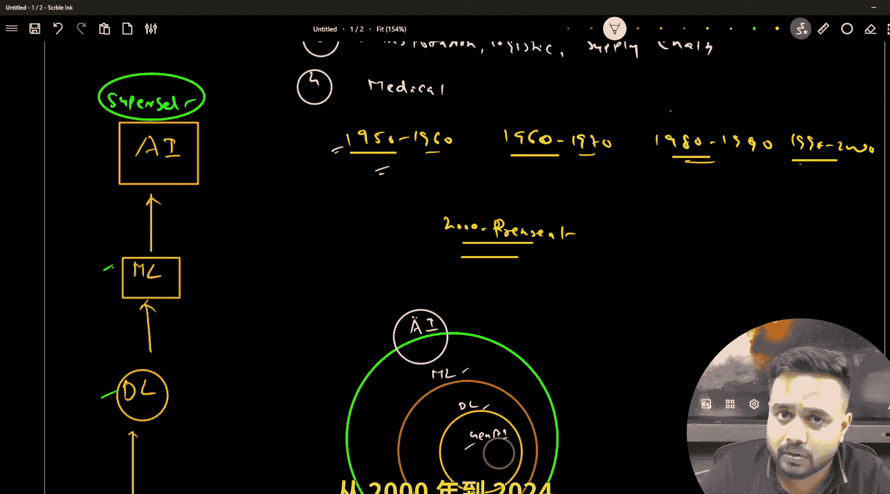

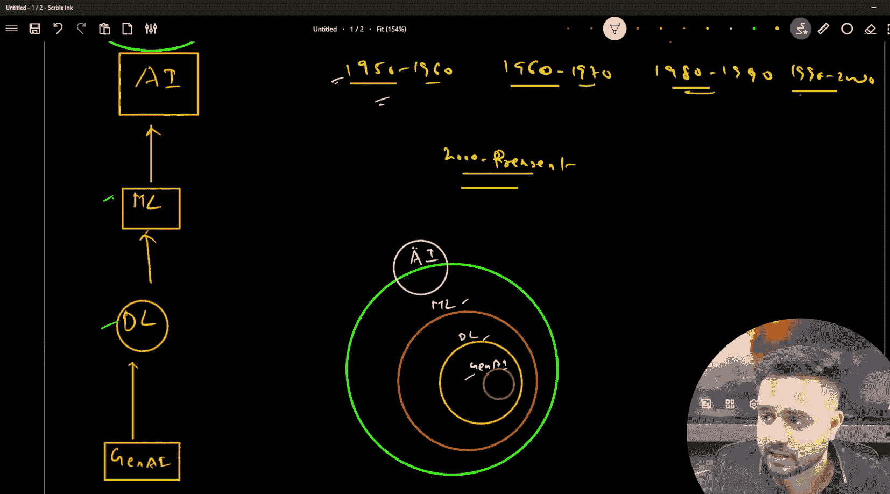

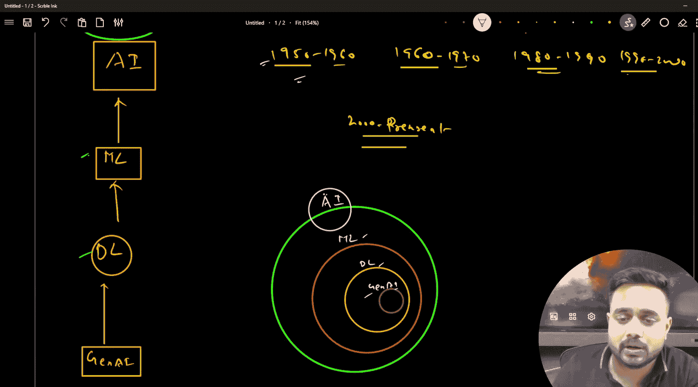

Now what was the rule based system if Im saying the rule based system so what is the exact meaning of this rule based system so here we are defining a rules right so manually we are defining a rules over here。

People are defining a rules over here manually are doing that rules is nothing Its a condition itself like we write it on the condition if as a and all right。

 so that condition people are defining and based on that they are taking a decidence okay but the second thing is what the second thing which was invented between this 1950 and the 1960 which was the perceptron perceptron actually it is nothing it is inspired from the human neurons itself I know I think basically you have seen the image of the human neurons and the perceptron。

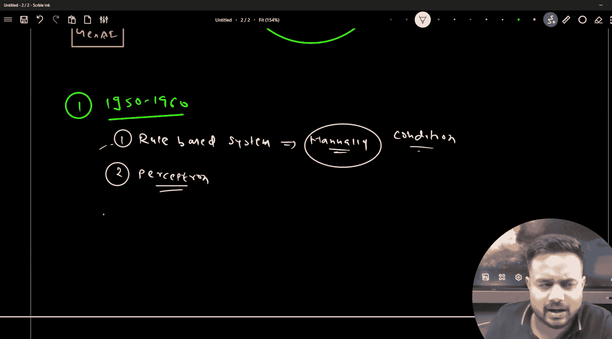