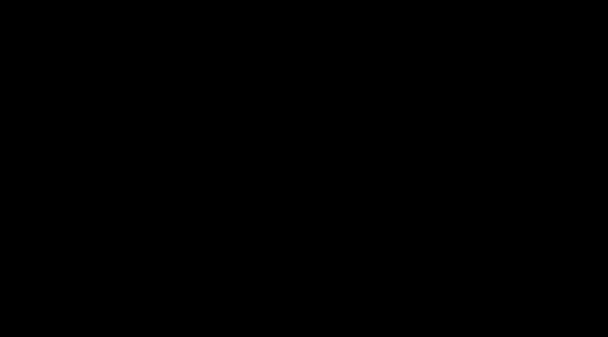

# Sunny Savita【中英⚡生成式AI：从初学者到专家｜Generative AI In-Depth Roadmap from Beginner to E】 p03 P3 Generative AI History Part2 ｜ Language Modelling ｜ Seq to Seq model ｜ RNN ｜ L [BV1Uht8zDENA_p3]

Hello everyone， welcomee back to my YouTube channel。

 This is the second part of the generative AI history In the first part I have already discussed so many things related to the geneative AI and the history of the AI in the first video I discuss the early history of the AI from early history to modern history and then I discuss that where this machine learning deep learning geneative AI lies inside the artificial intelligence itself。

And apart from that， I already discuss the roadmap of the Geneative VI。

 if you haven't checked those video guys， so please go and check because those videos are very。

 very important If you want to make a career in the field of Geneative AI so please go and check those a particular video and then you can proceed with this video as well。

 So let's start with the discussion let's start with second part of the geneative V So here I have already written a couple of points on my blackboard and step by step one by one we are going to discuss each and everything。

 So in the first video guys， I already discuss the definition of the Geneative V even though I have written here as well in my blackboard So I will show you that most of the part I have written over here and first of all。

 let me give you the overview that what points we are going to discuss throughout this tutorial。

 So the first thing。Which are we gonna talk about here that's going to be a language modeling。

 We'll try to understand the definition of the language modeling。

 What is a language modeling and all then we'll try to see the complete timeline from Rnn to transformer we'll see that how this RN has been invented then how this transformer came into the picture then how this LLM has been created and then we'll see the specific architecture like board and the G like what is a special thing in these particular architecture like board and the G and then we'll see the training of the chat GPT that how this chat GPT has been trainedd GPs application behind the Chad GpT the G model is being used So we'll see the complete and the detailed training history or the detail like detail well try to on the detailed knowledge that how they have trained the chatd GP then we'll understand the transform learning and we'll try to understand the concept of the fine tuning also fine tuning in the NLP specifically I'm talking about。

NLB so step by step one by one will try to understand each and everything over here。

 So let me start the discussion from very basic。 So here guys in the previous video also I told you that we have a different different type of neural network So specifically we are talking about the deep learning if we are talking about the deep learning So we have a different different type of neural network So neural network is a fundamental unit of the deep learning as I told you that neural network is nothing it's a fundamental unit of the deep learning and even I told you that when this neural network has been invented when this back propag came into the picture when this R and all right if you don't know about it。

 please go and check with my previous video Now here this neural network we can divide into three part the first part is called the first type of neural network is called artificial neural network the second type of neural network is called convolution neural network and the third type of neural network is called recurrent neural network。

 So in the artificial neural network you will find out three layer。

So the first layer is called input layer right input layer The third second layer is called hiddenal layer hidden layer and the the last layer is called the output layer Now the hiddenal layer actually it's a hyperparameter we can add as many as hiddenal layer right we can add as as many as hiddenal layer as well as we can we can like create as many as node inside the hiddenal layer this is up to you Now where we use this artificial neural network we generally use this artificial neural network for the structured data Now what is the meaning of the structured data So structured data is the data basically which we can arrange into the row and the columns right in this row end columns generally will find out the categorical data right categorical data and the numerical data So we have two type of the categorical data the first type of the categorical data is called。

Continuous data and the second is called discrete data。 and we are talking about categorical data。

 So the one type is called nominal and the second type is called ordial。

 I think I already discuss about it。 So yeah that type of data on top of on top of that type of data basically we use this artificial neural network now we have one more variant of the convolution neural one more variant of the neural network that is called convolution neural network So convolution neural network in that actually you will find out three thing the first is convolution operation where we have image and this image actually we are going to multiply with the features right with the kernel basically and this operation is called the convolution operation and then we are going to perform the pooling pullinging why we perform the pooling we perform this pooling for the optimization right so we perform this pooling basically for the optimization and or for the feature extraction。

 both technique is also called the feature extraction we are going to extract the important feature from the from the images from the data now here。

At the end， we are going to use the fully connected network and fully connected network is nothing。

 It's an artificial neural network only this particular network。

 So on which type of data we use this CNN So the CNN we use on the image data on the video data and videos is nothing it's a collection of the image is only it's a collection of the frames only now the third type of neural network is called R recurrent neural network So this is a combination of plus feedback loop So what is a feedback loop So whatever output we are getting from the hidden layer again we are passing to the hit layer don't worry Ive discussed this architecture in a very detailed way right I already kept the overview of this R So don't worry about it Now here if we will find out that why we use this R we use this R for the sequence data sequence data like audiot right so audio text or any time series based data where the sequence metal where the sequence metal on top of that data we use this R I think this fundamental is already clear to all of you now here。

I'm going to do here。Let me explain the next concept。

 So in the previous video I already talked about the definition of the descriptive model and the geneticative model。

 So this descriptive model here if we are talking about the descriptive model guys So the classical model in machine learning the model like linear regression logistic regression SVm right or in deep learning like or the CNN different different type of CNN R LST and GR these are called the geneative model or sorry these are called a discriminative model or the classical model where we are going to train this particular model on a specific task right where we are going to train this particular model on a specific and the data also will be limited So I given you different different example let me give you one more example let's say you are going to train one model to identify that the person is having diabetes or not let's say here you are going to train the logistic regression model Now you are going to train this model that person is having the diabetes or not Now guys can you use the same model So here how many categories we have。

wo categories the person is having the diabetes and person is not having the diabetes right So we have two categories over here。

 So guys here we are going to train the model now can we use the same model for the malaria detection。

 the person is having malaria or not no can we use the same model a same model to identify that the person is having pneumonia or not no we cannot do that because we have trained this model for the specific task right for the classification only and even we cannot perform the regression with this particular model only we can do the classification task right and here we are using a limited data So specific task。

 we have a specific task we have to identify the person is having diabetes or not and here this model is just for the limited this model has been trained on a limited data only right So this is called a disc model where we are going to do a discrimination means we have two result We have two category over here Yes or no or we can have multiple category we can have the regression task as well can we can train our model for the regression task as well right and this。

leearning is called the supervised learning。 the same thing we can do with the unsupervised learning Also。

 Get is my point。 I think yes Now other hand， we have this geneative model。

 Now this geneative model actually in the the task of the geneative model is what so to generate something So here it is going to be generate a different different kind of data like images tag videos audio it is going to generate that now here basically it is not for the specific task its for the general task means if we have train one model So we can use that particular model for any sort of a task whether it's a classification or regression doesn't matter right whether we want to generate image text we can do that also nowadays nowadays I'm saying right now here like whether we want to do like some specific say if I'm taking a language based task sentiment classification sumization generation or basically quot answer everything we can do by using the single model only So here this particular model the geneative model is for the general task it is for what guys。

meIt is for the generic task and here it has been trained on a huge amount of data So this is a major difference between this decscriptive model and the geneative model got it now guys if we are talking about this generative model type so basically we have three types four types over here so this gene model type the first is called image to image generation the second is called text to text generation。

And this is called homogeneous task， right， So we are passing the image and we are generating the image。

 We are passing the text and we are generating the text。 Now， the other side， on the other hand。

 we have this like two more tasks that is called image to text generation and text to image generation。

 Now this task is called heterogeneous task right this type of model this called the heterogeneous model。

 Okay， our heterogeneous task。 basically this is also called。

