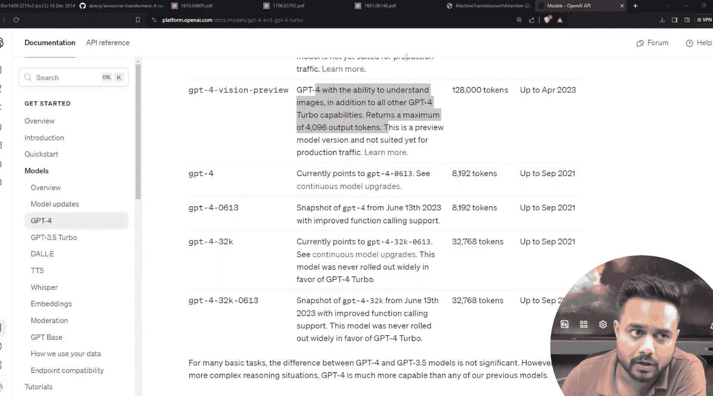
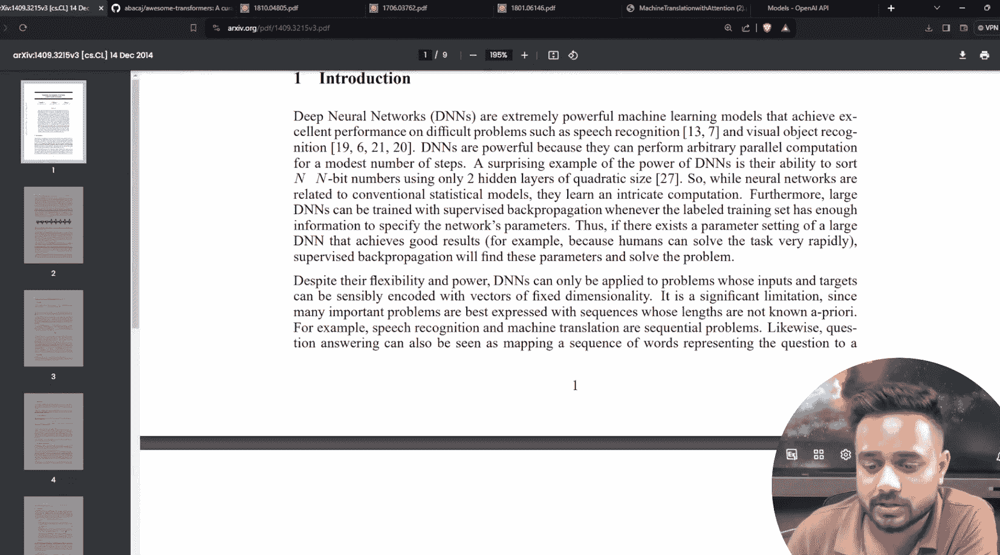
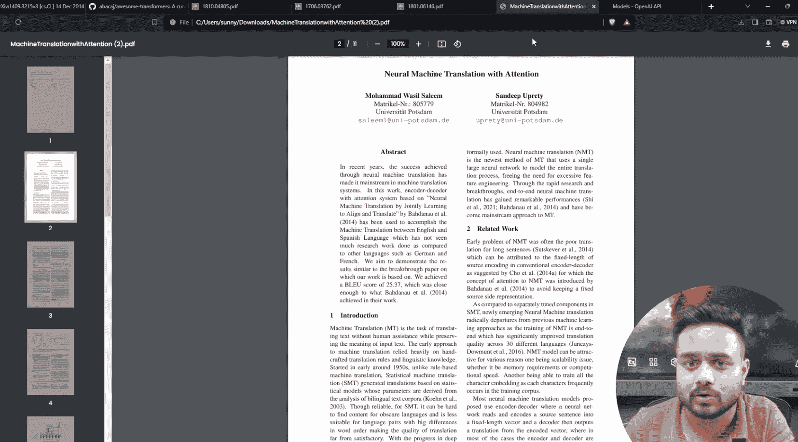
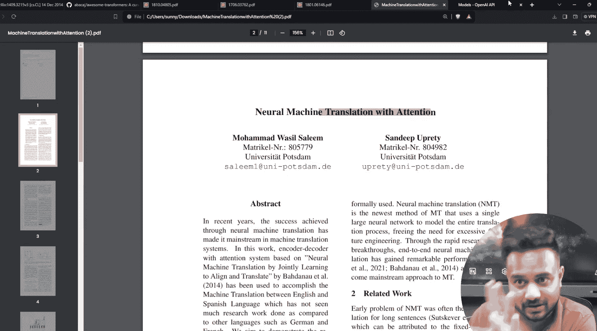

# Sunny Savita【中英⚡生成式AI：从初学者到专家｜Generative AI In-Depth Roadmap from Beginner to E】 p04 P4 Generative AI history Final Part (part3) ｜ Transformer ｜ LLM ｜ Chatgpt Traini [BV1Uht8zDENA_p4]

Hello everyone welcome back to my YouTube channel this is the last and the final part of the generative AI history so so far I recorded two videos in the first video I talked about the earlier history of the AI and in that I talked about the AI versus MLDL and the geneative AI。

😊，In the second video I mainly discuss the language modeling I discuss about the Rnn LSTM GRU andd decoder and all and even I talk about the computer vision CNN and the use cases related to the CNN and the computer vision apart from that I talked about transfer learning and the fine tuning so if you haven't check those part so please go and check now let's start with the video so here in this particular video I will more focus on the transformer encode deco attention than transformer then both and G and the chat G training So guys here this is a notes basically don't worry I will provide you this notes I will keep it in my Github so that from there you can download if don't know about the descriptive learning if don't about the genetic model and all right So everything I already discussed in my previous video please go and check guys you will get a clear cut understanding Now in this particular video I'm going to start from this encoded decoder encode decoder although I already discussed。

But yeah I will give you a quick overview。 I will give you a quick recap of this encoded decoder。

 then I will come to this encoded decoder with attention and then finally this U fit transformer board and this G so this is this is today's agenda and yes let's start with the encoded decoder and all but before that I would suggest you go and check with the previous session where is specifically check with this mapping technique because this is going to be a very very important we have a different different type of mapping why we use it okay how to process the data in all what is a sequence to sequence model right and what all task is related what use cases related to the different different mapping everything I talked about in my previous session in my previous video so please go and check now let's start with the encodeder and the decoder So here guys this is the architecture of the encodeder and decoder you can see in this particular architecture we have two section So the first。

ctionI called encoder。The second section is called decoder。Now in between。

 you will find out this context vector or encoded vector。

So this is the architecture of the encoded decoder。

 Now I have written some sort of a points over here。 So with that point。

 you will get a clearcut idea。 Al， Ive discussed this thing in my previous session。

 I'm just giving you a quick quick recap now here in this encode decoder architecture。

 the first thing which we have over here。 So let me highlight those particular thing。

 the first thing is called encodeder the second thing is called decoder。 So here we have a decoder。

 Now in this encoder and decoder either you can you can have this R or you can have this LSTM or you can have this G anything you can have over here。

 but in the original research paper。 If you will check with the original research paper。

 So in that you will find out that they are using LSTM architecture。

 and they are not using a simple LTM architecture actually they are using bidirectional LSTM architecture。

 So bidirectional means what what is the meaning of the bidirectional So bidirectional means。

Bydirectional is nothing。 So bidirectional means you can process the data in both direction from left to right and right to left。

 so you can get a precise concept， right you can get a precise concept of the word right。

 which is affected by the future word。 So that is a concept of the bidirect。

 Don't worry I will soon I will come up with the dedicated video of this RTM and GR here I'm just discussing the history and I'm just discussing the architecture and the overview that said if you want to understand in detail。

 just wait for some time。 I will come up with a detailed architecture and the mathematical explanation now here if we are talking about the encode decoder architecture。

 So here you will find out so let let me show you that in the encode decoder architecture So you will be having an encodeder you will be having a decoder in between actually you will be having this context vector right you will be having this context vector Now guys。

 why this encode decoder architecture was required So the main region behind this encode decoder architecture was the。

Many too many mapping， right， Men too many sequence mapping。

 So this is the architecture of many to many mapping。 This is architecture。

 which which you can see over here。 this one， many too many mapping。

 Now here in this many too many mapping。 So actually， we have two type of mapping。

 The first is called synchronized mapping， synchronized mapping means what synchronized mapping means a same length。

 So here you can see the example of the same length。 same length means what see many too many。

 we are talking about many too many。 So what is a meaning of many too many we are passing a sentence from here。

And we are getting output over here， right， We are passing a sentence over here。

 and we are getting output over here。 So both architecture is fine。

 both architecture is many too many。 and it's a synchronized one。

 synchronize means what So let's say from here we are passing in Hindi right So here I am passing。

 I am Sunni and here I am getting Mah Sunni who in Hindi right So many to many mapping we use for the language translation。

 Why we use it， tell me we use for the language translation。 and there's a better use。

 this like a best use case。 many many a best use case。

 this language translation is a best use case of the many to many mapping So guys here you will find out that So in this synchronized example you will find out the same word right same input word and the same output word Ma Sunni who I am Sun3 input word and three output word But here in the a synchronized one。

 So this is the example of the a synchronize a synchronized means what are synchronized means different length right in translation actually we。

😊，Have a different length。 So here in Hindi sentence you will find out that you will find out the three word punka bun and here in English you will find out switch of the f。

 So this sentence， the translation actually it is representing to the as synchronized translation and mainly for solving this task mainly for solving the as synchronized translation。

 they have invented the architecture of the encodeder and decoder。

 So let me show you the research paper of the encode and decoder。

 So here is a research paper of the encodeder and the decoder。

The research paper name is sequence to sequence learning This research paper has been published by this three person Elilia Suskeva orle Benalius kke right and it was the paper from the Google actually at that point of time they were working with the Google layer itself and if you will read the introduction in all you will get the kcut idea that this was the reason right before earlier we were able to solve the synchronized problem by using the like LSTM on the R architecture but here we were not able to solve the a synchronized problem。

 the different length problem and because of that they have created this encode and decoder architecture and the meaning was simple first we are going to compress everything in context vector and then we are going to pass it to the decoder for the processing that was the that was like a base concept and which architecture they were using over here so they were using the LSTM architecture by directional LSTM architecture I hope。

Thing is clear to all of you now。 So I hope this thing is clear now here in the research itself。

 So each and everything I have written so that I will like take a less time to explain you everything。

 That's why already I written few sort of some sort of a thing over here and I have already written it don't think that I copied from somewhere and all right I written based on my experience based on my learning。

 So research only in the research itself， they find out that it was this encoded decoder architecture was not for the longer text。

 what is the meaning of the longer text。 So longer means if in the sentences。

 I'm getting more than 30 to 35 words right So the translation was not that much effective like we were having the issues in the translation。

 the translation was not accurate。 so here I written a reason。

 So who was using this encoded decoder architecture。

 So Google was using this encode and decoder architecture and they have invented this encode and decoder architecture for their own product and the product name。

the product name was Google translator which we all are using so at that point of time in 2014 15 they were using this encoder and decoder architecture correct now what was the solution now so what is the solution actually。

If this encode decoder is not able to perform well right here it is not able to perform well。

 then what is a solution， The solution was the encoder and decoder with attention encodeder and decoder with attention Now let's try to understand the meaning of attention over here because this was the game changing thing and based on that one more architecture came into the picture and the architecture name was transformer is all your sorry attention is all your need that is transformer Okay so let's try to understand the meaning of encoder and decoder So in the research paper。

 So first of all， let me show you the research paper of it。

 So this is a research paper this is the bird research paper attention universal language modeling yeah guys So this is a research paper and what is a research paper name neural machine translation with attention right translation with attention which task is translation with attention right encoder decoder encoder decoder with attention now here。

you can see so attention what is attention oh let us try to understand this attention in this architecture。

 you will find out that we have this encoder and we have this decoder。

