# Sunny Savita【中英⚡生成式AI：从初学者到专家｜Generative AI In-Depth Roadmap from Beginner to E】 p05 P5 @LlamaIndex  Introduction ｜ RAG System ｜ LlamaIndex Doc Walkthrough #generati [BV1Uht8zDENA_p5]

Hello everyone。 welcomelcome back to my YouTube channel。

 My name is Sunny and in this video I will discuss about the Lama index。

 So guys in my previous video， I discuss the complete and detailed history of the large language model from is starting to end if you haven't watch those session So guys please go and check with my YouTube channel let me show you where you will find out So here in this particular section in this video section you will find out all the video related to the geneative AI。

 So in this video I discuss the detailed roadmap of the geneative AI and the detailed history of the geneative AI。

 So here you will find out the playlist as well。 So inside the playlist I kept the same video So yes now it's time to discuss or it's time to build some application and I'm starting from the Lama index Lama index is a framework which we use for building the application by using the Lm。

 So I already given you the enough amount。

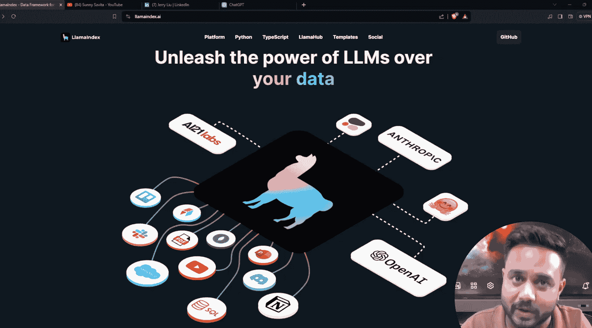

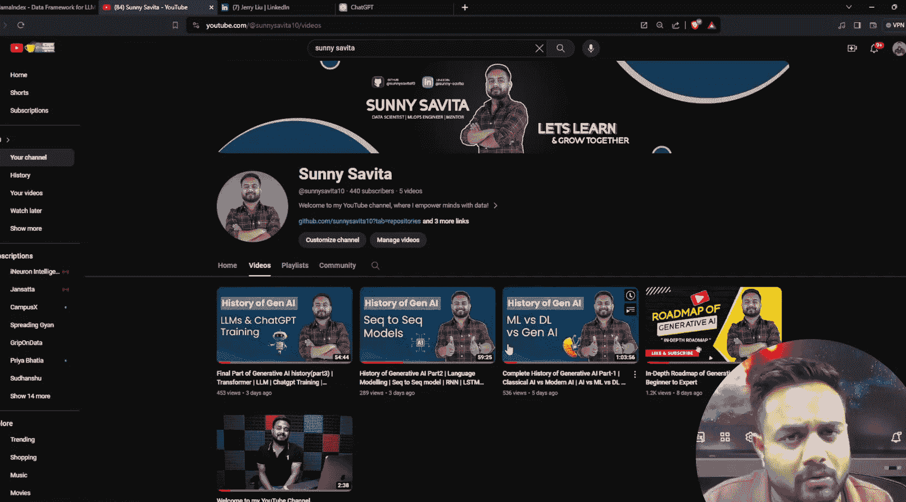

Ida related to the LM and all so if you don't know about the large language model。

 if you don't know the history of it， please go and check with this video and now let's start with the Lama index so guys what is the Lama index why we use this Lama index and what is the idea behind this Lama index each and everything we are going to discuss here itself in this particular video so in this video actually I will just give you the introduction and I will show you the project setup and in the next video basically we are going to start with the project development so guys don't miss this video because it's going to be a very very important if you don't know that how to create application by using the Lama index right so definitely will get it now you will get the complete and detailed introduction because each and everything Im exploring in very very detailed way and here I will show you that how you can do the project setup as well for this ama index and from next class onwards or from next tutorial onwards I will like show you the project and all and here。

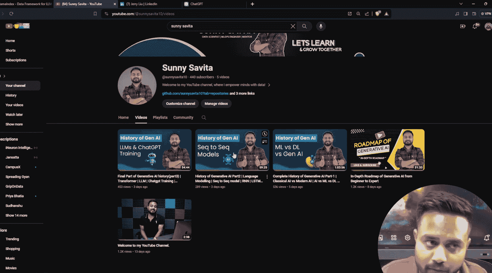

You will get around five to six video from my side each and everything I will discuss from basic to advance means I will create some rags and all some advanced rag basically so yeah let's start with with the video lets begin now so first of all here。

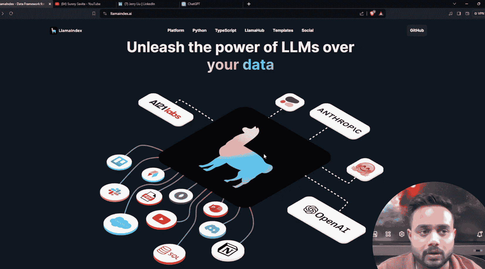

Let me show you that what is a Lama index。 So each and everything I have kept over here if you will look into this like if you look into my blackboard。

 So each and every definition， each and everything I have kept over here So step by step1 by1 I will explain you so first of all guys what is a Lama index so Lama index is nothing it was the open source project right Lama index was the open source project and it is a framework it is a framework for creating LLm based application So I think you already know about the LLM that what isLLM is called large language model So by using this large language model we can create application right so I can show you the best example。

 the best example isd GpT itself So here you can see so chat GpT is there now let me create a new chat basically So here you can see so this chat GpT is nothing it's an application which has been built on top of the G which is application。

It's a application which has been built on top of the which has been built on top of the G itself。

 G is a model。 If you don't know about the G board and different different large language model。

 you can go and check with my previous videos Now we can build this type of system by using the Lama index by using the Lama index and we have one more variant we have one more like a framework similar to Lama index that is called L So in upcoming video I will talk about the as well because it's a more advance and it is having more functionality compared to this La index。

 So here you can see I did like so many chat I did so many talk with my G and all and I know that you have also done that So yes now let's understand a few more thing about the。

Like a Lama index and all so I already kept it over here I already like written it over here So what was the main purpose behind this Alma index So we are talking about the Lama index guy so to connect custom data resources with your large language model right if you want to connect the custom data resources with a large language model for that actually they have created the Lama index now who has created this Lama index。

 the very first quot which come in which will come in your mind that who has created this Lama index whether Facebook。

 Google or Microsoft or Openi or any any other big giant no so this Lama index has been created by this person the person name is Jerry Liu so let me let me show you the profile of the Jerry Liu so he's the guy actually who has created this Alma index now if you will look into the profile of this person So here you will find out many more experience and all so this person worked in Uberra robust intelligence。

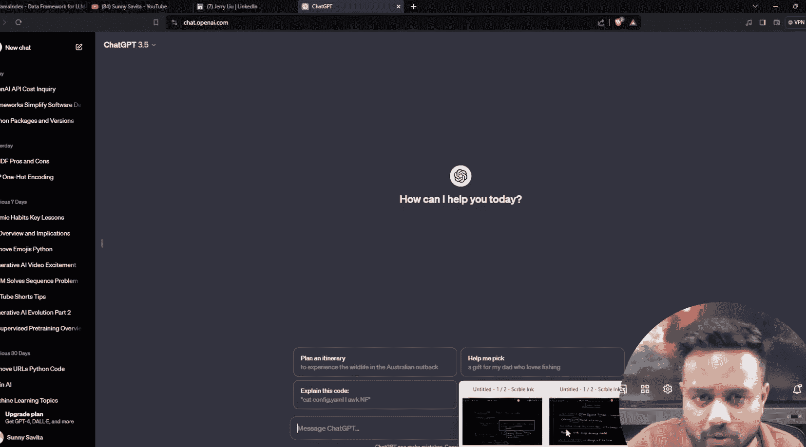

Then finally he is a co founder in the Lama index so the person name is what Jerryri Liu he and his team actually they have created this particular framework now this person just passed out in 2017 and you can see that the kind of work basically has done okay so it is like very much inspired now here。

If you will look into this particular like in this definition。

 So here I've written that to connect custom data resources with a large language model。

 So I think youve got to know that what is a Lama index and what is a primary work of the Lama index。

 I think I told you about that also Now let me show you what is a meaning of it to connect custom data resources with a large language model and definitely will get to know that So here is my GP guys now to my GP Now let me show you one more thing。

 So here is my invoice。 So this is my invoice and in this invoice actually you can see in this invoice So this is like this much of amount basically which I got from the openai side I was using the open API and this is what this what is nothing this is my invoice。

 Now to my chat GP I'm going to ask that what was my what was my。

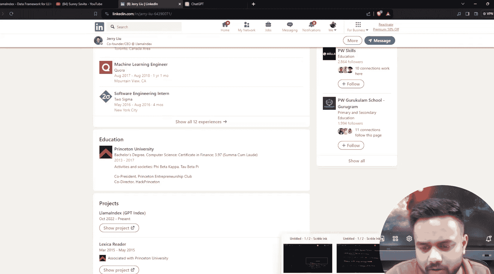

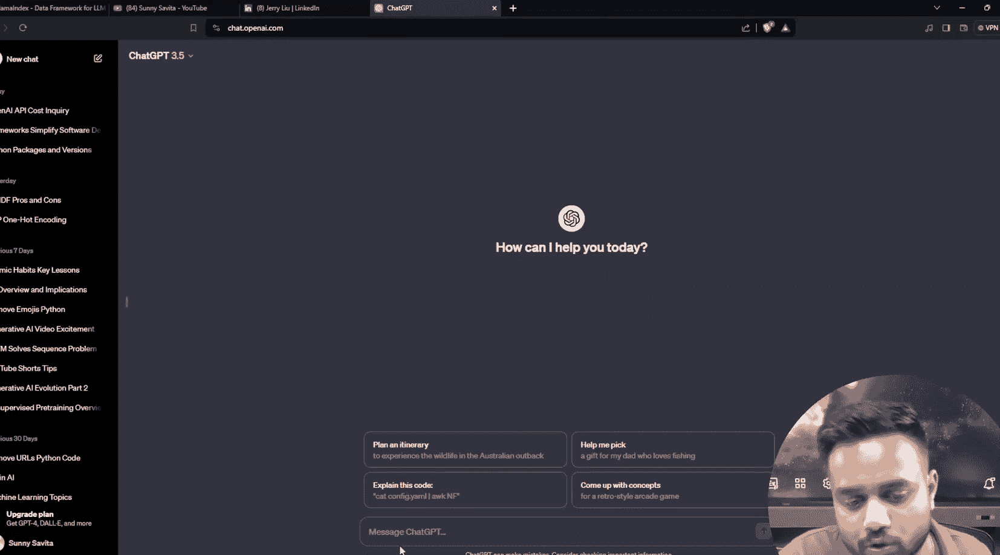

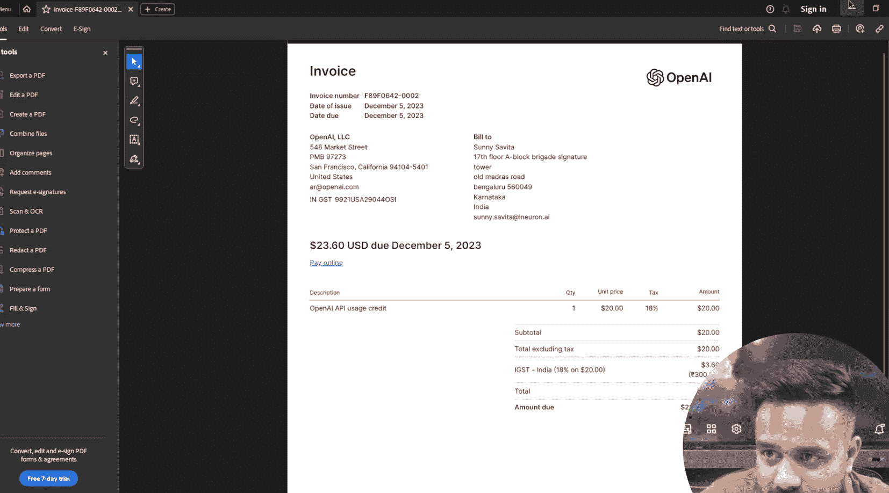

Open air。 Open air amount。From last month。 So now see what was the answer。

 which I will get from here。 So here it is saying that I'm sorry， but I don't know。 Okay。

 I don't have access your personal data in all。 So I cannot tell that what was your amount from the previous invoice from the past month basically Yes。

 definitely it won't be able to answer But guys if we are passing this invoice as of now Im using Gp 3。

5 but let's see I'm using this Gp4。 So Gp4 actually it is having some sort of a charge is 20 per month or $25 per month。

 something like that So if I'm using this Gp I can provide this invoice to my Gp4 and if I'm going to ask if I'm going to ask that so what will be what is my amount from from the past month right what is my total IgSt or what is my subtotal and all definitely it will be able to answer you can check don't worry I will show you that。

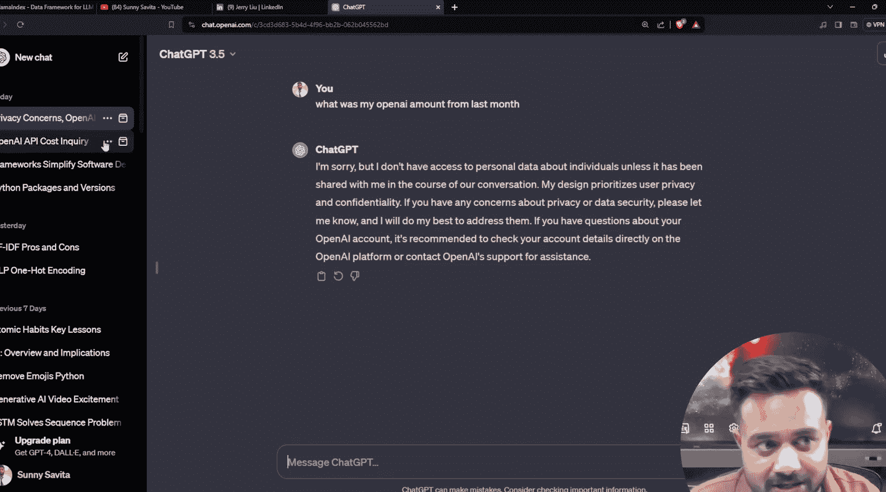

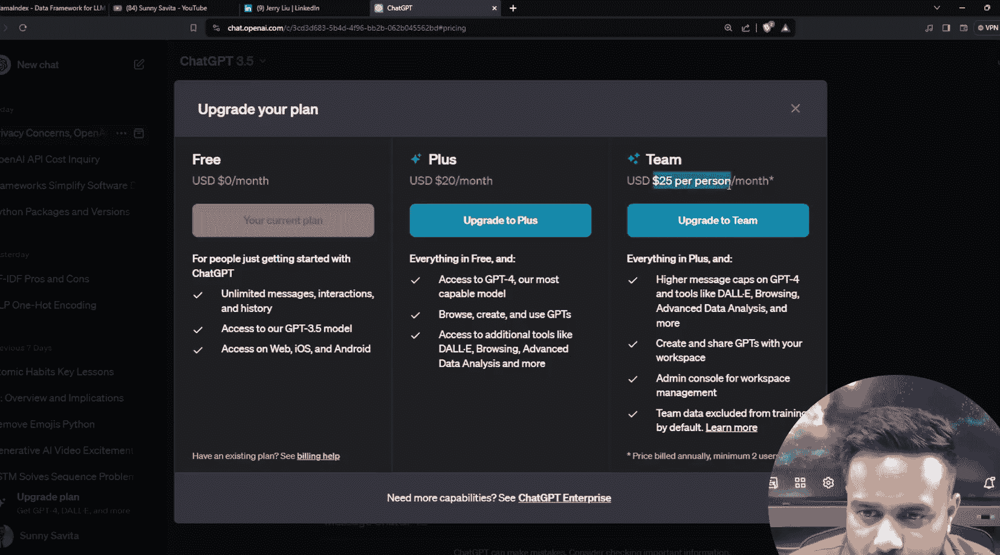

Those type of application in the coming days right and here definitely is possible。

 So how this thing is happening。 So here here if we are talking about this Lama index， yes。

 by using this Lama index by using this Lama index and this LM okay by using this Lama index and this LM okay what we can do we can create those type of system right where we can connect the custom data resources this pdf is what it's a pdf now it's a document now we can load this document we can read the information and then we can get the answer from the large language model and that is possible because of this Lama index getting my point what is a use of the Lama index and what was a main purpose behind this Lama index Now here guys I was using one term frequently that what is a framework right so here is a term basically framework framework for creating large language based model So first of all let's try to understand about this framework and let's try to understand that。

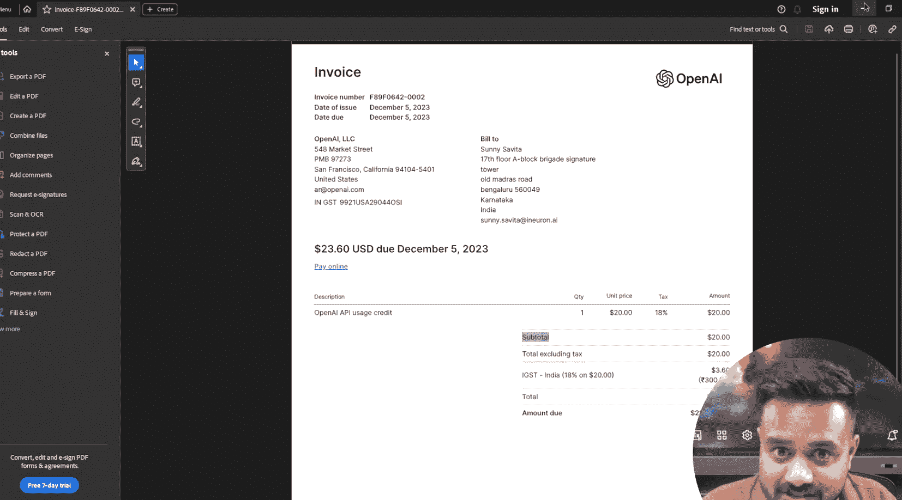

If the primary work of the Lama index is to connect with the data resources how we are using it for creating an end to an LLm based application so let's try to understand that thing so here guys you can see if we are talking about the framework so I have already written the definition of the framework right so what is a framework guys so framework is nothing it's a set of tools convention and tools right tools for developing the application right framework is nothing one framework is nothing it's a set of tools convention and tools for developing the application I can give you very good example here so I think you all you know about the python right I think everyone is familiar with the python so Python is what Python is nothing it's a programming language we all know about the python and Python is nothing it is a programming language okay。

Now if you want to create a web application by using the Python so Python has provided some sort of a framework like flask right flask andjango so here guys this is nothing this is a framework now why we are using this framework tell me guys why we are using this framework we are using this framework for creating a web application right so this Django and flask is nothing this both actually it is called framework right framework means framework is nothing which is having some sort of rules right some sort of a rules some sort of a conventions and it is supporting some tools as well and by using this framework by using this framework actually we are creating we are creating the web application so this flask and Django is nothing it is called wave framework right so similarly we have Lama index La index is also some it is also having some sort of a rules some sort of a convention and it is supporting some tools right so by using those thing what I'm doing。

