# Sunny Savita【中英⚡生成式AI：从初学者到专家｜Generative AI In-Depth Roadmap from Beginner to E】 p06 P6 @LlamaIndex Project Setup ｜ Simple Q⧸A System using OpenAI API and LlamaIndex [BV1Uht8zDENA_p6]

Hello everyone。 welcomelcome back to my YouTube channel。

 My name is Sunny and in this video we'll see that how we can do the project setup for the Lama index and we create one basic QA system using openi and Lama index。

 So guys let's start with the video before this video I uploaded couple of video related to the Lm history related to thegpT training related to this roadmap and all。

 So if you haven't check guys， please go and check with my YouTube channel you will get enough amount of understanding that what ism is like how thisgp has been trained。

 and even I have uploaded the video related to thisma index also in that I given you the clear cut introduction about the Lama index。

 So guys lets let's begin with the session。 So here each and everything I will show you from very sketch。

 So first of all， let me open my command prompt。 So here in the command prompt you can see that Im currently I'm inside this c。

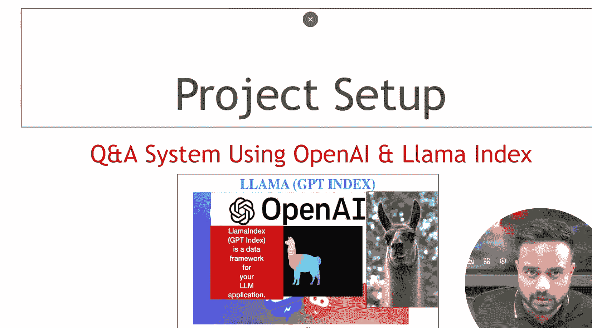

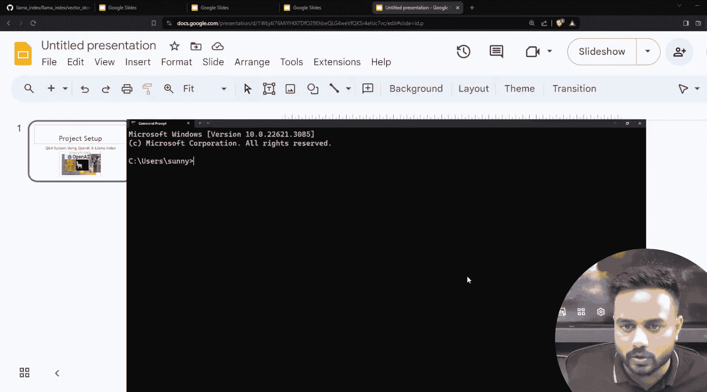

Inside the C user Sun。 So here I'm going to create one folder。

 You can create folder inside any directory。 I don't have any issue。 So here for creating a folder。

 the command is very， very easy。 The command is MD I。 and here I'm writing a name。 the folder name。

 So my folder name is going to be a Lama。indexdex， Lama index project。 So here。

 my folder name is going to be a Lama index project。 Now。

 I just need to change the directory with the C D command。 and here， Lama， Lama index。

Project so currently you can see that I am into this Lama index project directory。 Now from here。

 I am going to launch my Vs code。 So for launching the Vs code， there is a very easy command。

 The command is code is space taught。 So here I am going to execute this command into this particular directory and you can see that Im able to launch my Vs code。

 So guys here is my Vs code。 and here you can see currently it is empty。

 I don't have anything inside my workspace。 So step by step。

 I will show you each and everything step by step， I will like teach you each and everything that how to create the。

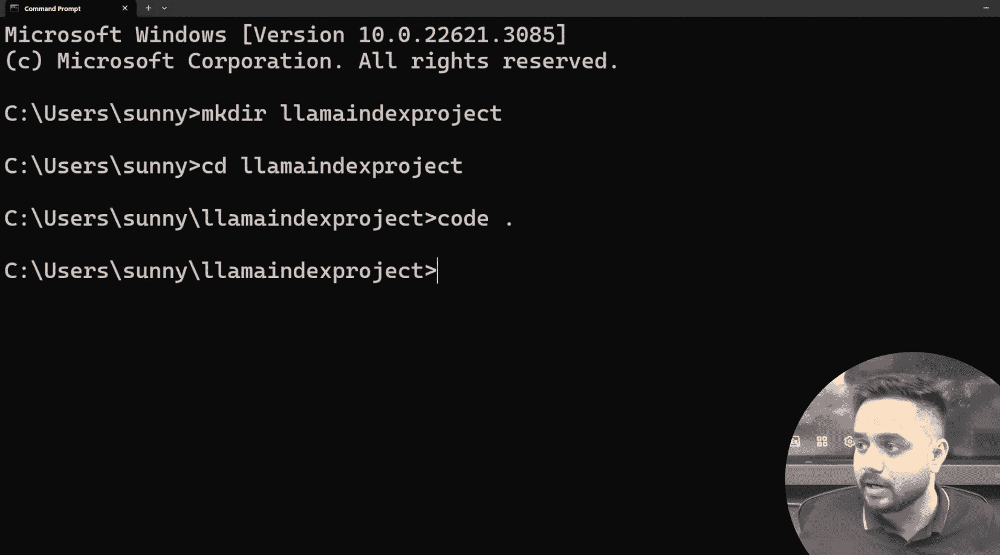

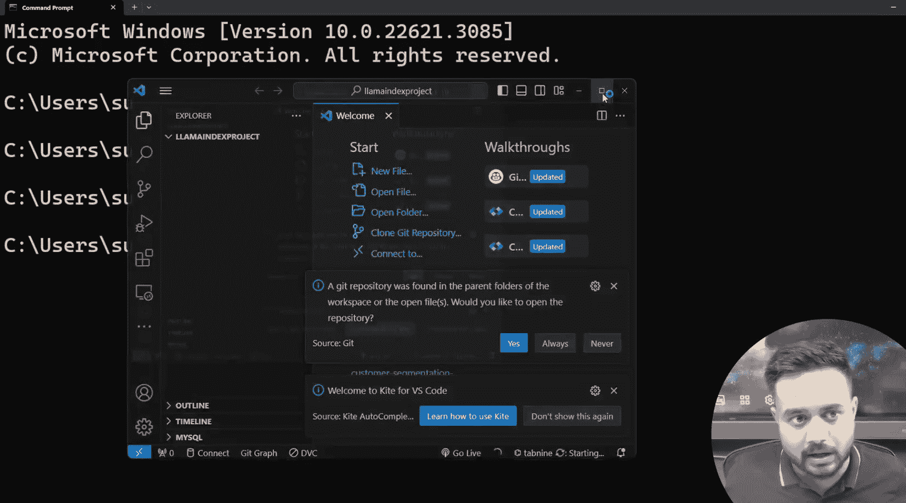

Like how to create the environment and all and then how to install this required or THD and then how to create your QA system。

 it's going to be a basic like a project set for the Lama index and will try to see that how we can run that Q system So first of all guys what you need to do here you need to open your terminal so here is a terminal let me open the terminal Now guys what I'm doing here so after opening the terminal I will create the environment So the command is very。

 very easy for creating an environment you can simply select getb command from anything from here whatever is fine for you So here Im selecting this command from now you can see already I'm in a base environment So here I'm using the annaconda for the project development and all。

 So if you don't know about this aconda or this python virtual environment and all so I will create one dedicated video for it so that you can refer it and you can create the and to end project setup for machine learning and for deep learning and even for the gene。

As well and don't worry in future I will be coming up with many advanced project in。

 so no need to worry about anything if you are on my channel now here what Im what I'm going to do Im going to create the virtual environment and the command is very very easy。

 very， very simple for it the command is conduct create iPhone P and here the environment name is V and B What is the meaning of V andmb here V and me is virtual environment Now here。

Phen is equal to 3。8， but here Im given this V and B， but you can write any name。

 I don't have any issue。 You can write any custom name also。

 And then here slash y means yes okay so whatever like whatever process is going on after this after running this command So in between it will it will ask to me yes or no So automatically it will yes everything So if I mention this hyphen y got it Now let me hit the enter and here you can see it is creating my environment and it is creating an environment in this present working directory because here I mention this hyphen Phen P means what hyphen P means current or present working directory Now see guys I have already I have created my environment now after creating an environment I just need to activate this environment So that for activating the environment there is a very simple command already they have given you the command you just need to copy and paste it here So just copy this command and paste it over here and simply you will be able to activate your virtual environment。

Now， the next thing here， you need to create a requirement of T XT。

 So whatever requirement we have throughout this project throughout this implementation。

 I will keep each and everything inside the requirement dot Txt。

 So here the file name is what requirements dot T X D Now inside this requirement of T X T。

 the very first thing the very first module， which I will write it down here。

 the module name is going to be a Lama iPhone index， Okay， so Lama。Hyhen index， So Lama hyphen index。

 this is my module name。 The second name， the second module， which I am going to be installed here。

 right inside my current virtual environment。 the module name is going to be Python dot E right So Python dot E。

 So we have second module， the second module name is nothing Python dot E the third module。

 which Im going to be installed over here。 the module name module name is going to be STml2 text right So here the module name is going to be STml2 text。

 So we have three modules over here， which is required for this particular project right And here this is the first project set up。

 or this is the first project with the Lama index。 So if you don't know anything about Lama index you can start from here right Now now after that。

 what I need to do here。 So here I need to install this required or TX into my current virtual environment why I'm creating a virtual environment because we have lots of project So today I'm implementing this project tomorrow I will implement。

Different project So for each and every project the requirement it should be it should be segregated right so the dependency。

 the requirement it should be segregated。 So here for this particular project。

 this is the requirement for a different project for machine learning project some other requirements as there are for deep learning project there are some other requirement So for every project there will be a different different requirement so that's why we are creating a different different virtual environment different different environment for every project I hope you are getting my point now what I need to do here so here I need to install this requirement Tx and for that there is very simple command we are going to install it by using the package manager so Pip install i R requirement do Txt So once I will run it guys so here you can see we are able to install all the requirement into my current virtual environment so it will take some time let it install and then I will proceed with the next thing So until what I can do here So here guys inside this workspace。

This requirement is getting installed。 I can create one more file。

 The file name is going to be dot Ev right， So the file name is going to be a dot Ev。

Let me create this dot en file Now inside this dot env。 actually， I can keep my all the variables。

 right all the environment variable。 I think you all know I think you already know about the environment variable If you don't know guys let me show you。

 So if you will search about the environment variable right so environment variable So here I search about the environment variable see I got this pop up now just click on this environment variable and these all are the environment variable right which is being used somewhere which is being used somewhere in the system Now guys here。

 this variable， So we have a variable and we have a value related to this particular variable Now here in this particular variable in this particular environment variable we are going to save the confidential information right whatever information is a confidential regarding to my system So those thing I am going to save those thing basically which will be available over here inside this environment。

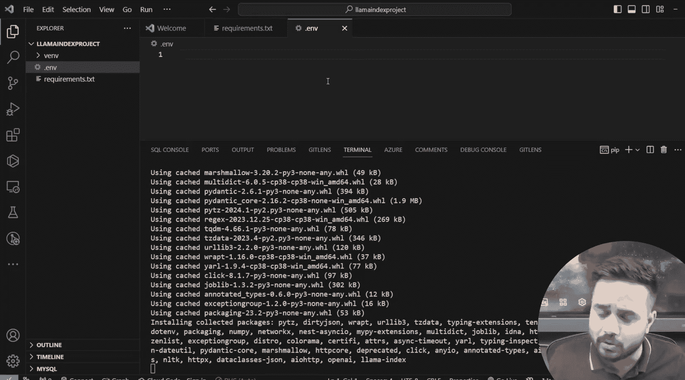

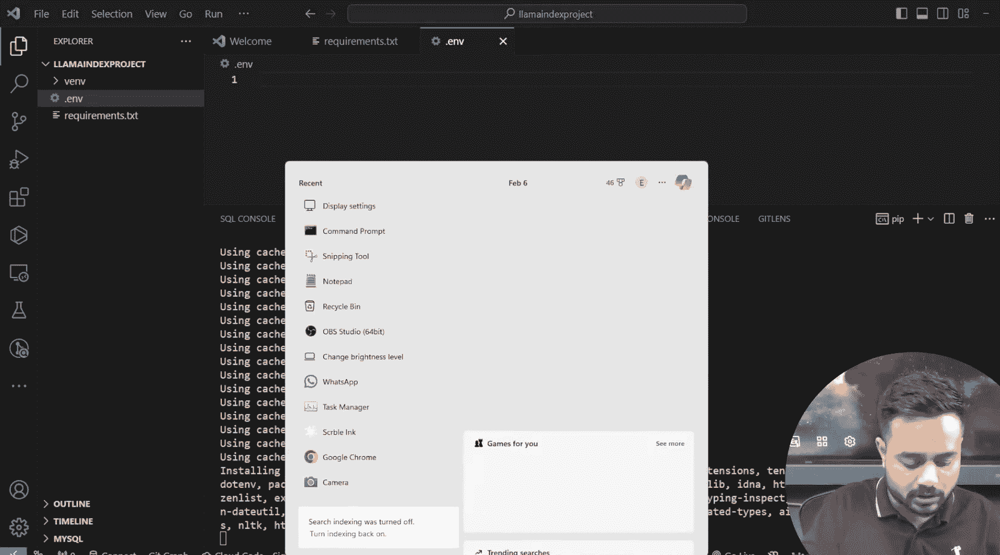

Now here guys see what I can do。 I can let's say here Im writing inside this dot5 I'm writing open AI open a API key okay open A API key now here actually what I will do I will pass my API key at this particular place what I will do I will pass my API key Now let me show you where is my API key。

 So here is what here is my API key I just copy and paste it I already kept in my not。

 So from there I just copy and paste it over here So see guys my requirement is installed now now let me clear this terminal So for clear this for clearing this terminal there is a simple Cs Now see this terminal is getting clear and here you can see I have this I have this open AI key Now guys。

 this open AI key also it's a confidential information means I should not expose to everyone。

 Otherwise everyone can use this particular API key and then at the end at the end of the month basically will。

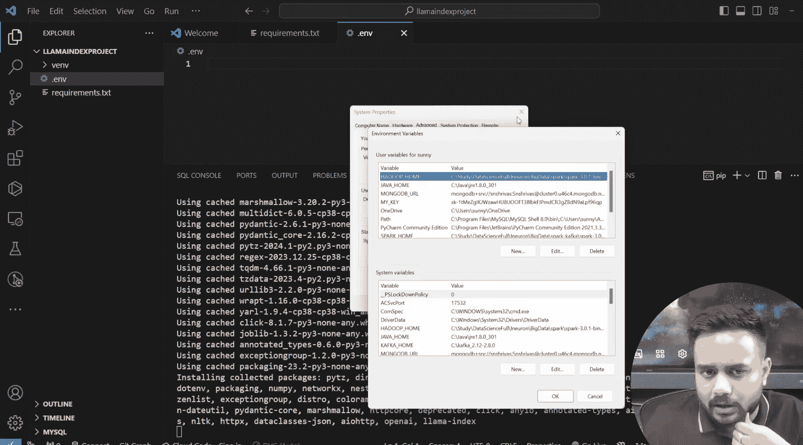

the bill okay from the open eye side。 So here what I can do， I can keep this variable。

 I can keep this variable and the value of this variable over here inside the。

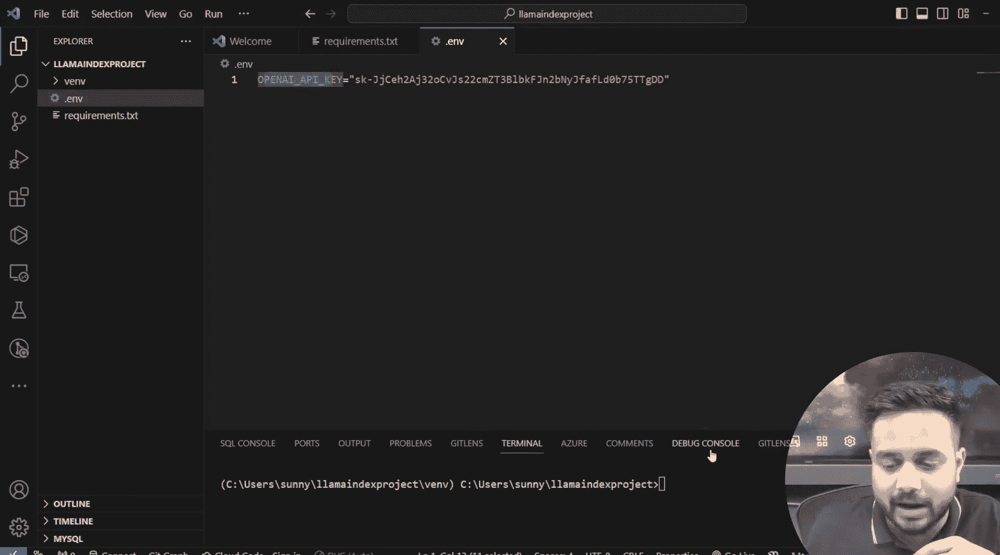

Environment variable into my environment variable so that no one will be able to see it。

 no one will be able to get it and directly by using the OS module I can fetch the value of this opener API key I think you are getting my point what I'm trying to say I'm saying that this open air API key is a confidential for me So what I can do I can keep this opener API key here itself inside my environment variable and then I can like write the value as well here is a variable and here is a value and then by using the OS module which is already there inside the python by using that OS module I can fetch this key right that is possible for me but here let's suppose Im running the same application the same。

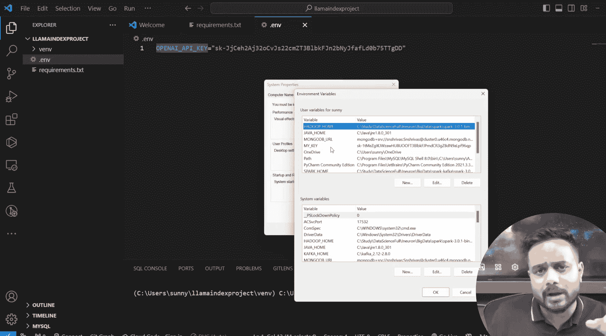

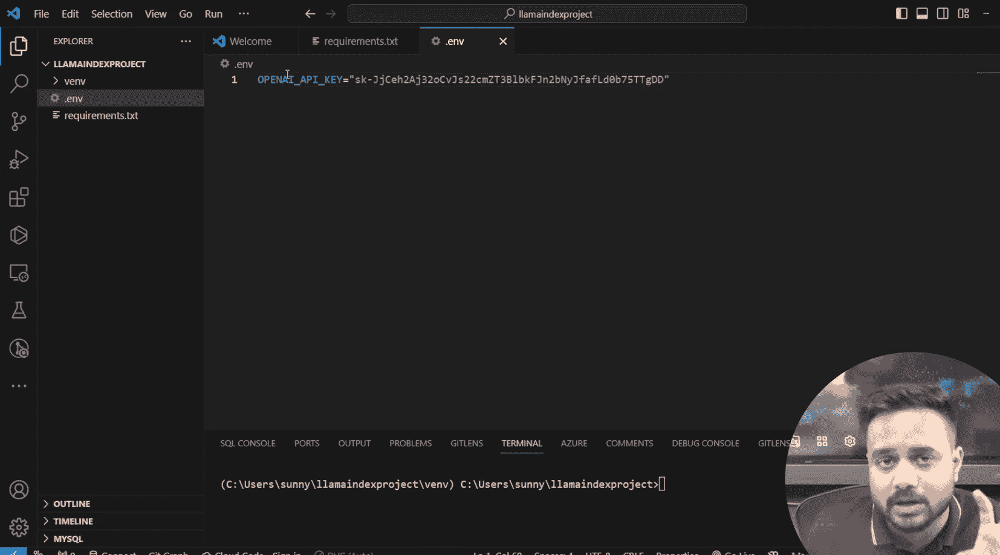

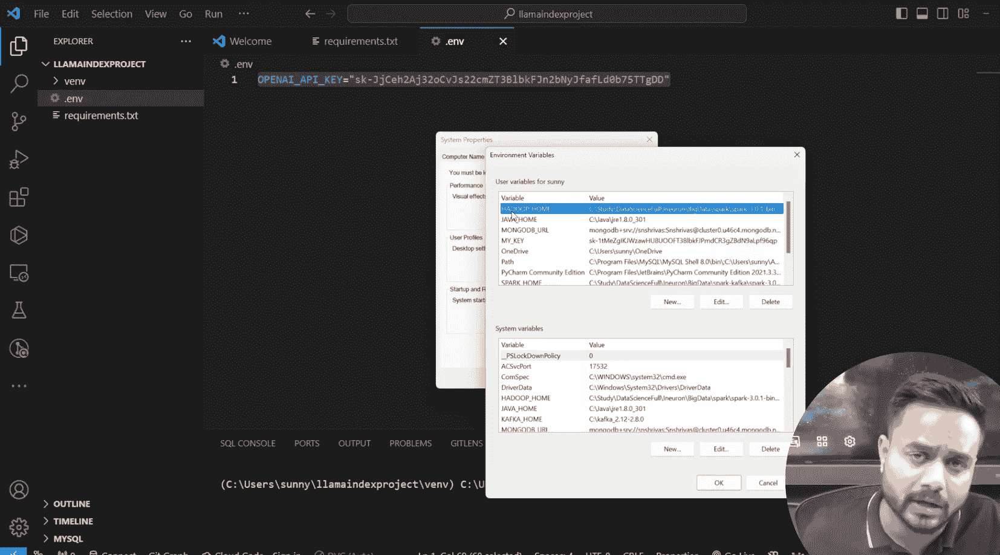

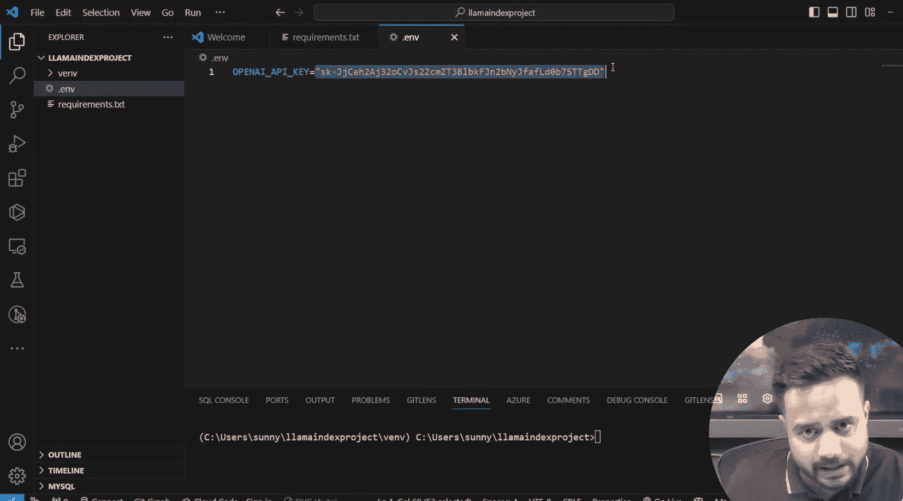