# Sunny Savita【中英⚡生成式AI：从初学者到专家｜Generative AI In-Depth Roadmap from Beginner to E】 p07 P7 Google Gemini Introduction Part 1 ｜ Google Gemini Python API #gemini #generat [BV1Uht8zDENA_p7]

Hello everyone。 welcomele back to my YouTube channel。

 My name is Sunni Savita and in this video we'll talk about the Google Gney。

 So guys recently I have uploaded video related to Lama index。

 I started the entire series of the geneative AI where Ive discuss about the complete and detailed history of the Geneative A。

 Then I came to this Lama index。 Now let's explore this Google G。

 So in this video we discuss the complete and detailed history of the Google Gney and we'll see that how we can use the Google G API by using Python。

 So let's start。 So first of all guys let me show you the complete playlist which I'm trying to record on my YouTube channel So once you will search about the Sunni Savita。

 So here guys you will find out my channel inside that inside the videos actually I recorded so far。

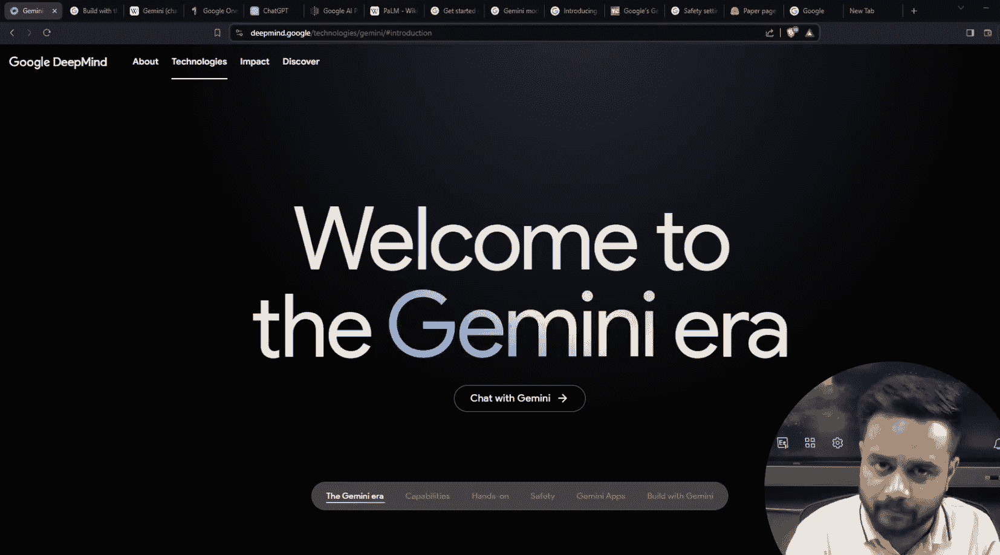

Recorded seven videos now inside the playlist。 actually。

 you will find out the you will find out the playlist as well related to those video。

 So here I'm trying to like update the Gene V playlist。

 So so far I recorded seven video now many more video coming into the future if you haven't seen guys。

 please go and check， please try to understand about the roadmap Gene history and the Lama index and all So guys yeah let's start with the video now let's start with the explanation。

 So first of all guys let me show you my blackboard where I have written each and everything related to this Google gymney。

 So step by step1 by one will try to discuss each and every point。 So here I have written four point。

 So the first one I will discuss that what is a Google gym then we'll discuss the complete timeline of the Google gym So what is a history of the Google gym before the Google G what was there so each and everything we are going to discuss over here then。

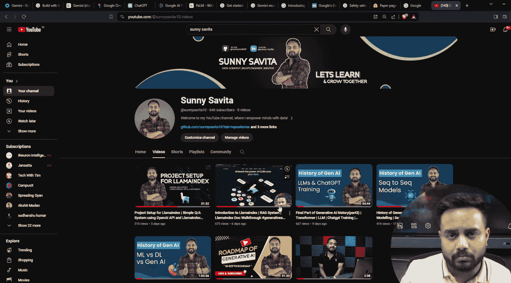

Discuss about the variants of the Google gymney that what all variants we have of the Google gymmney and which one we should use and then we'll discuss about the Google gymmni API。

 will try to access this Google Gni API by using Python。

 So let's begin with the Google gym that what is a Google gymney guy。

 So here I have already written a couple of things。

 So I know need to write it down inside the class itself inside the tutorial itself。

 and it will save my time as well。 So please try to understand and I have written in a refined way。

 each and everything。 I just written the precise information over here。

 now if we are talking about the Google。 So let's try to understand what is it。

 So Google G actually it's a chat board and earlier known as a bad。

 So I think you know about the bar right So badd was the chatbo。

 So Google as a chatboard only earlier known as a bad。 So former former name of the gym is nothing。

 It's a Google。 So。It is based on this two model。 first is gni Pro and the second is gni Pro Vi。

 So first of all， guys， let me show you， let me show you this Google bar。

 So whenever you are searching about this Google bard。 Okay。

 so let me search about the Google bar over here。 So here you can see。

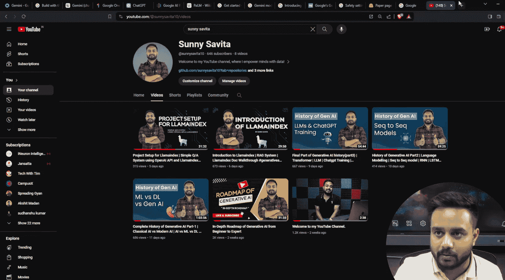

I am getting the link。 so for accessing this Google bar Now once I will click on it。

 So here you can see it will directly redirecting to me to this gymney only because now this jney become this Google bar become j。

 So here I will try to discuss the complete history then how this bar become how they have transformed this into the g behind the what was the model and when this g came into the picture。

 and what is the advantage and disadvantage of using this chiney So。

 as I told you it's nothing it's a chat board。 So definitely you can check it over here if I'm writing over here。

 So here definitely is going to be reply me I can ask anything it is similar to the chat Gp only So here let me show you the chat G。

 So yeah it is similar to the chat GP only now if I will write here on the GP So you can see it is giving me a reply。

 Now I can talk anything over here I can ask any sort of a thing。 So definitely。

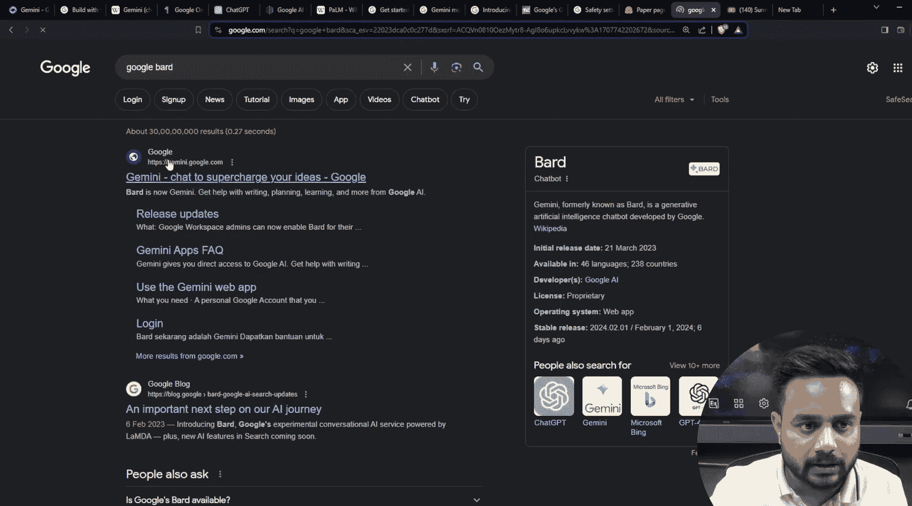

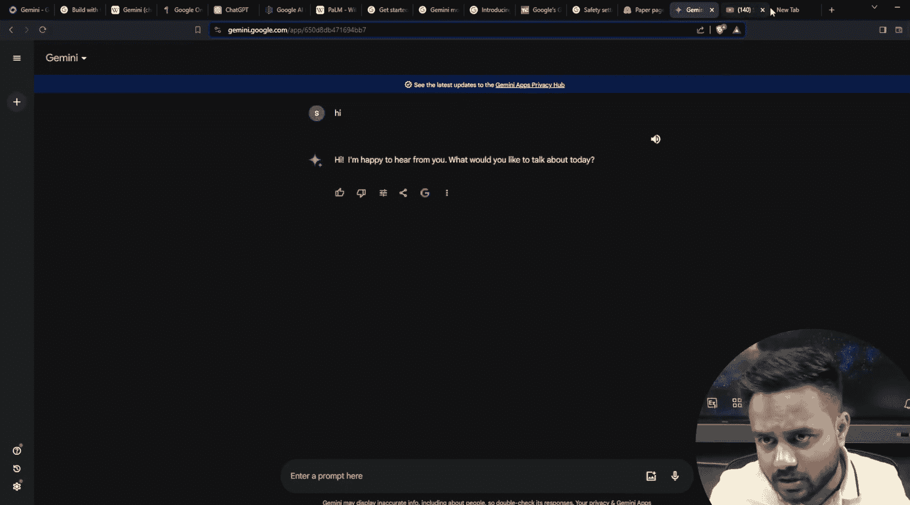

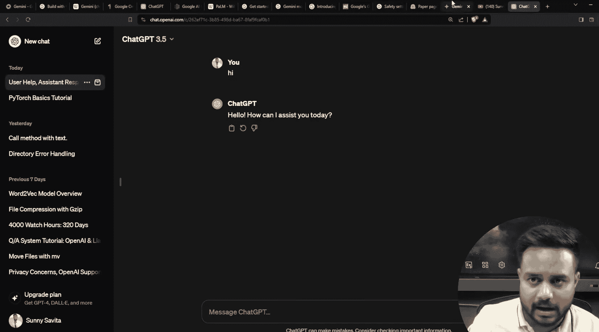

In between the session， I will again come to over here。

 Okay so now let's try to talk about the different point。 So Gni actually。

 it is based on the gni Pro and the gni pro vision as as I told you Now here guys。

 I written a couple of more points。 So Bd or j it's a chat board similar to the chat GP I think you already got to know about it。

 Now chat GP actually， it is based on this GP 3。5 and its variant So we are talking about the chat GP guy。

 So Cha GP is application similar to that gni is an application chat Gp based on GP 3。

5 and its variance on top of the variance right and Bd actually or gymni now descend its a gni So it's based on the gni pro and the gni Pro vision If you want to check out the model okay related to the chat GP So simply you can search over here over the Google itself。

 now here I can search about this open AI models。 So you will find out all the model related to the G and all。

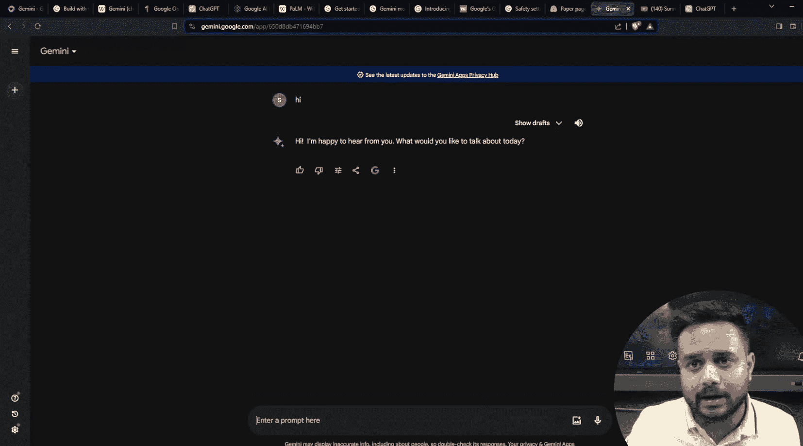

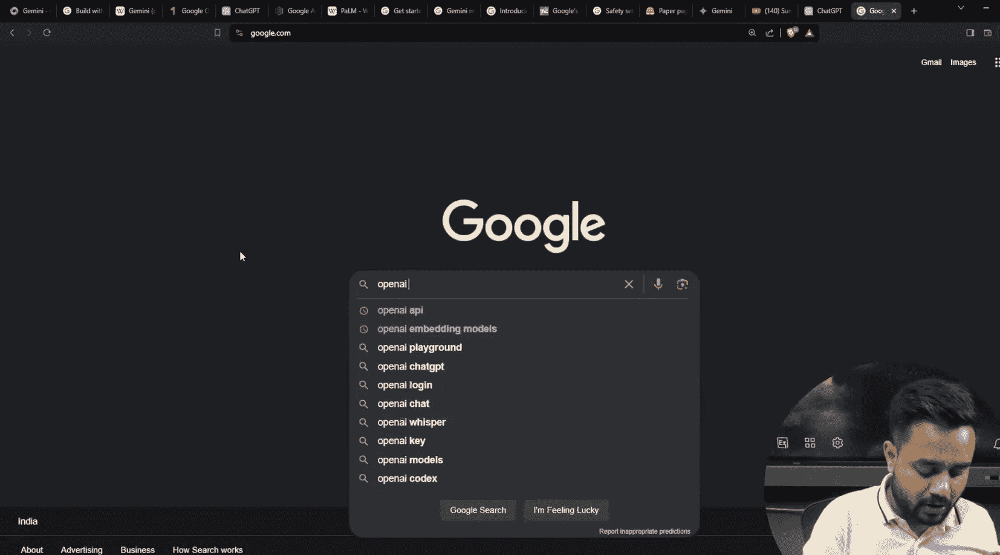

Right so here is a G4 GP 3。5 and the complete family of the G G3 and G4 right so G3。5 turbo。

 this was the main model basically they were using behind the chat G Now you can see they have updated also so updated G3。

5 turbo Here is a context window training data each and everything they have mention over here similar to that here is a G4 actually it's advanced model and it is having some vision based capability also so we can provide the vision based data means we can provide the images and the video based data as well to this particular model。

 so I hope you got the clear cut idea you got the clear cut understanding。

 Now let's try to understand something more Now whenever we are talking about the jly So Jimmyney is nothing。

 It's a multi model right it's a multimod large language model developed by the Google deep mind I think you are able to understand what I'm trying to say over here Now here the question is here the question is what is。

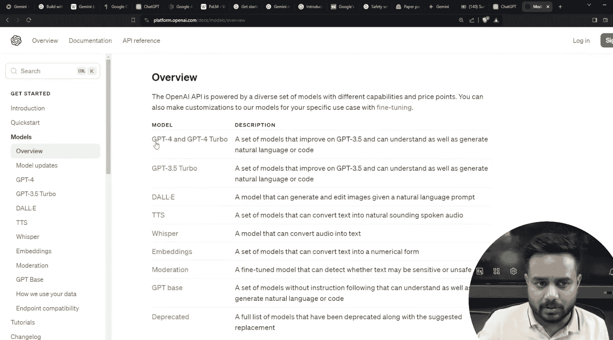

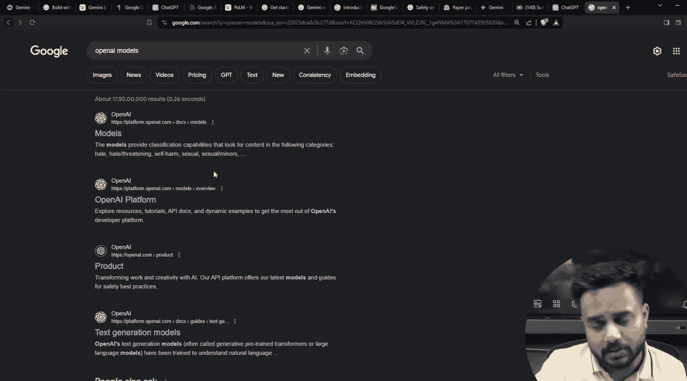

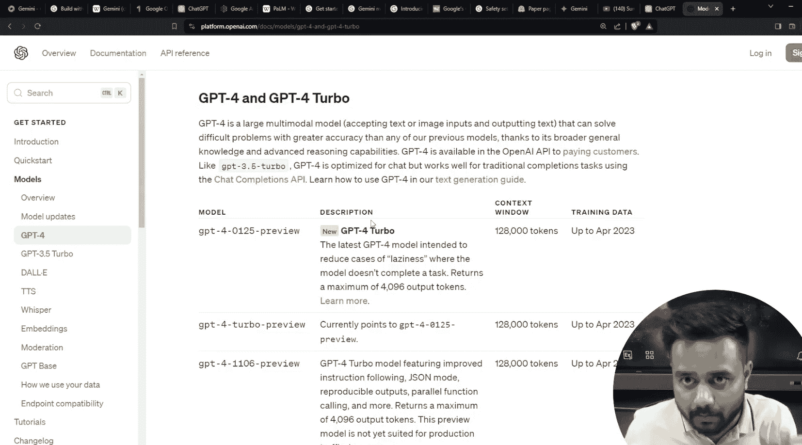

Multimodel， what is a multimod。 So let me write it down over here about the multimod。

 So multimod means the model， basically， which is capable to。Text to text translation。 Okay。

 text to text generation or text to text translation。 And the second is image to image to Okay。

 image to text image to text generation So this type of model actually is called multimod which is able to do the like which is able to do the homogeneous task as well as the heterogeneous task now here guys。

 if Im writing text to image generation text to image generation or image to image generation image to image generation So G sorry this gi actually is not capable for this text to image generation and image to text generation right So it is only able to generate this image to text and text to text only means whether you are passing text or you are passing this image it is going to generate only this text and that is why it is called multimod and it is having this multimod capability but as the output I can only get。

Tex， I hope you are getting my point。 What I'm trying to say here。 Now。

 let's try to discuss the history of the gney that what is the history。

 What is the history behind this gymney。 So guys， jney is nothing。 This gym model actually。

 it's a successor， It's a successor of Lambda model and Pa。 Okay， Lambda。

 So what is a Lada here M Lambda is a large language。

 Lambda is a language model for dialogue application。 right Lambda， actually。

 it was a model of it was a model of the Google， which they have a release for the conversation。

 right， So we'll try to discuss the complete and detailed history of the lambda。

 I already written couple of point。 I will come to that。 Just wait。

 Now here the second model was the Pam。 So it's a successor of Lambda and Pam。

 this two specific name I have mentioned what is a full form of the Pa guys。

 tell me Pa is pathway language model。 I hope you already know about Pa。

 and maybe you have you have used it right so because it was a open source model。

Maybe you have used a pretrain version of the palm or maybe you have fine unit according to your task。

 and the latest version of the palmm is palmm2。 but nowadays it's a legacy。

 no one is using this palmm。 everyone is using this Google chimney pro because it's it's a updated version of this palm on top of this now here let's try to discuss about this lambda palm and this chimney。

 So here I have written couple of points basically and based on these particular points。

 we are going to make a comparison。 So here the very first point is launch it。

 the second is size of the model。 the third one is a variance of the model and the third one on the fourth one reason behind creating this model。

 So the first model， the very first model is a lambda right so let's try to discuss about this lambda when they have created a lambda and what what is the size of this lambda what variance we have of this lambda。

 Each and everything willll try to discuss here If you want to the logo if。

To get a logo of the lambda。 So here is the logo。 So this is the logo of the Lada。

 You can even search over the Google Now， here you can see。

So this model actually it developed and introduced in 2020 they have introduced in 2020 Now first generation Lambda was released in 2021 okay so they have introduced in 2020 but the first generation they have released in 21 then the second generation they have released in June 22 right so first they have introduced。

