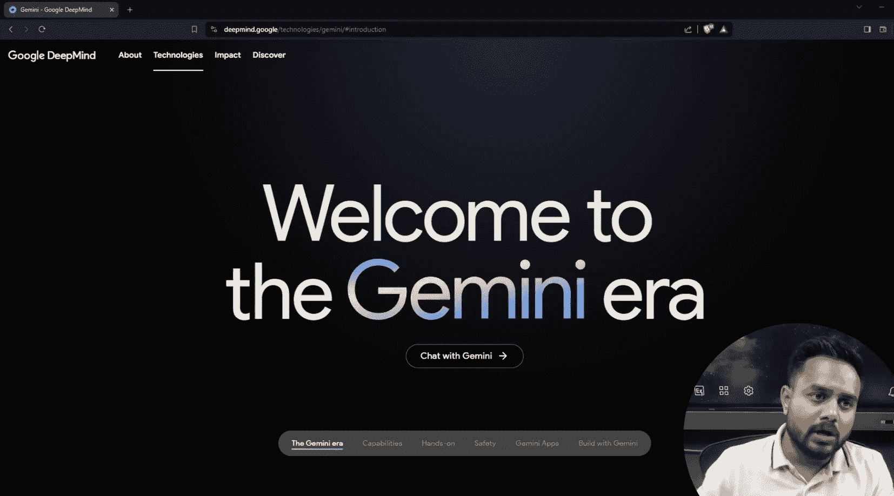
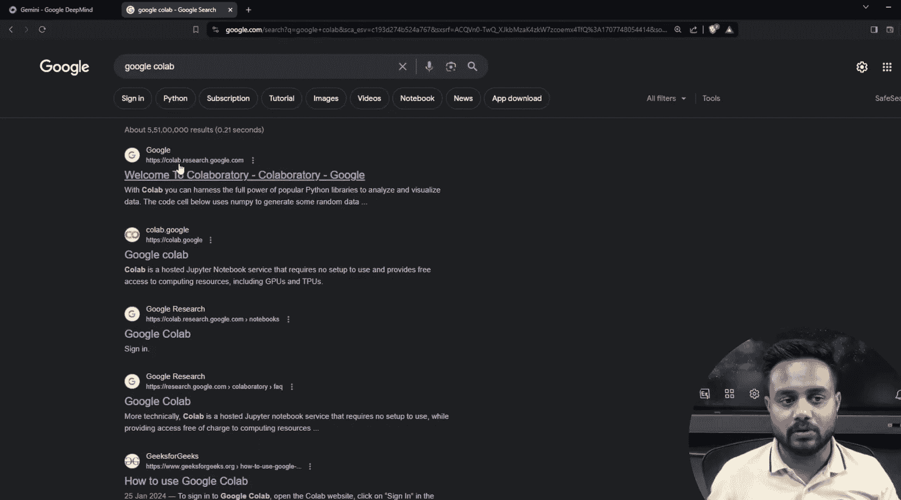
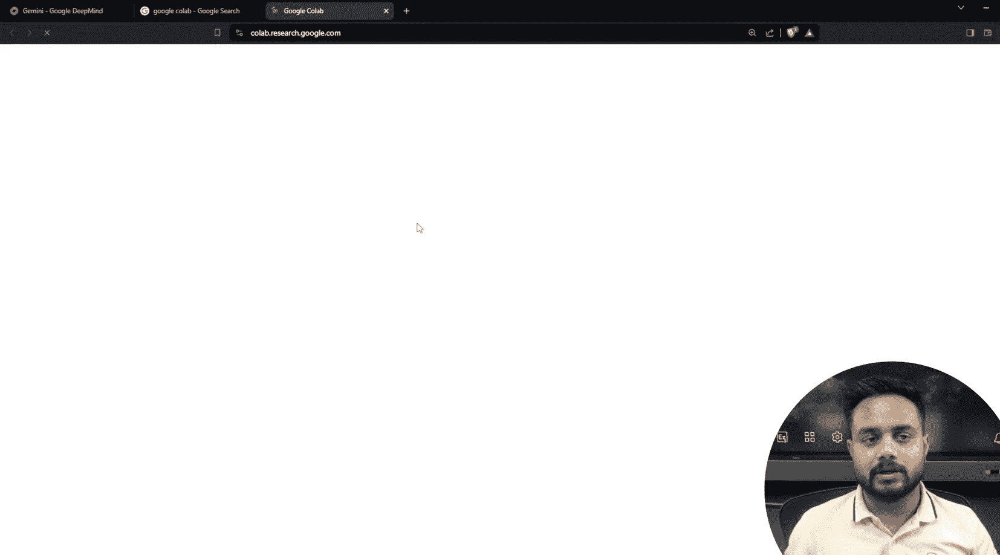
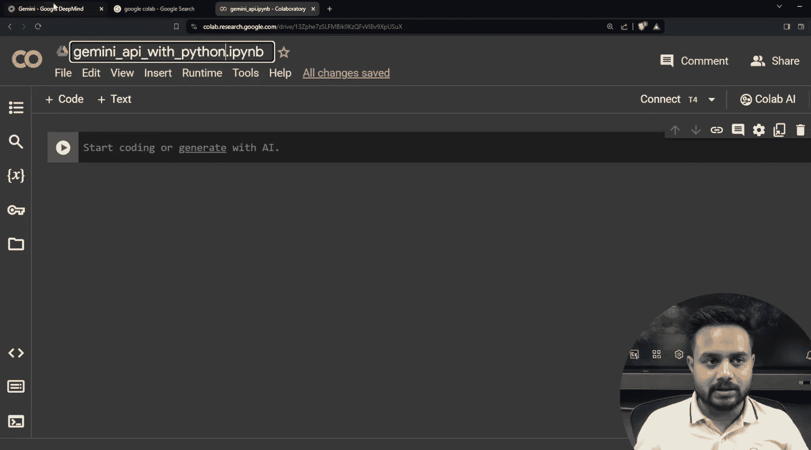
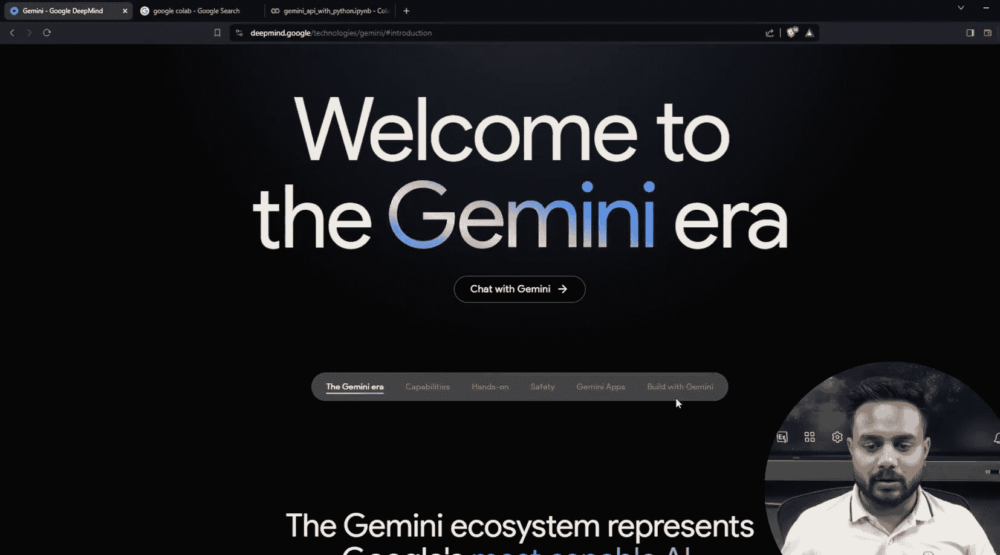
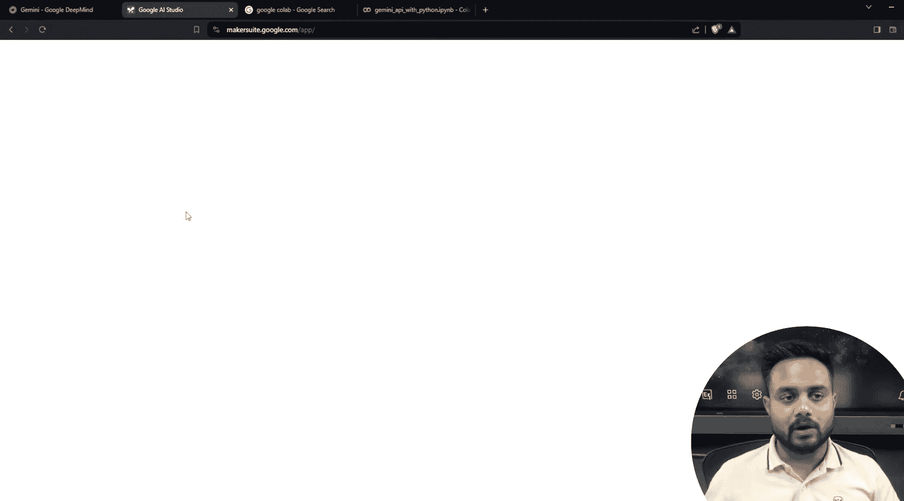
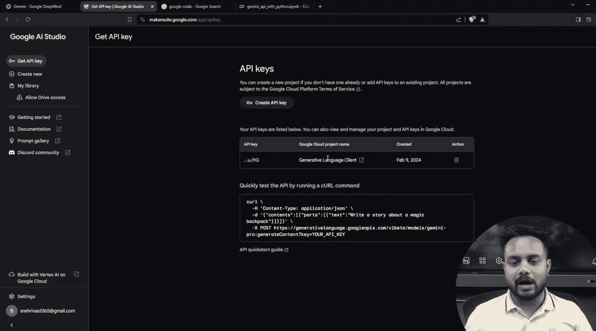
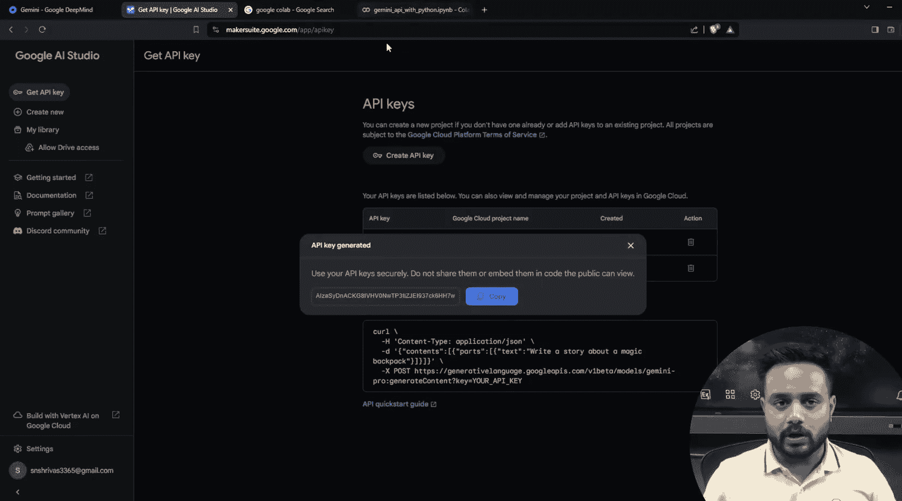
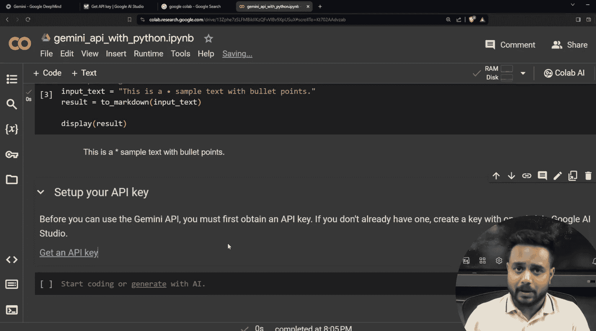

# Sunny Savita【中英⚡生成式AI：从初学者到专家｜Generative AI In-Depth Roadmap from Beginner to E】 p08 P8 Google gemini API with Python Part 2｜ text to text generation ｜ image to text [BV1Uht8zDENA_p8]

Hello everyone， welcomee back to my YouTube channel In this video we'll explore the Google Gei API In the previous video。

 I discuss the detailed introduction of the Google G that what is a Google G what is a history of the Google G and what all types of model we have in the Google Gni family if you haven't watched that video guys so please go and check I already upload it I already uploaded it on my YouTube channel Now in this video we'll try to discuss or will try to see the complete and the detailed introduction of Google Jimmyi API with Python So let's start so guys here we are going to do everything in the Google Collab so why I'm doing in a Google Collab because in the Google Collab actually recently they have introduced couple of new future so let's try to explore those of feature and already I have shown you the local setup in my Lama index introduction。

Whenever I will come to the intern project， whenever I will come to the next implementation by using the Lama index because my new video or the next video basically soon it will come soon I will upload it it will be based on the lama indexdex and Google j so by using this one I will create one rack system and it's going to be a quite interesting so there I will show you the local setup again but here this implementation we are doing in our we are doing in the Google collab only so let's start so here first what I will do guys I will search about this Google collab Now once I will search about the Google collab so I just need to click on this very first link on this collab search go do co once I will open it guys so here you can see like here it will give me this page now where I can create my new notebook now once I will click on this new notebook so here you can see it has given to me a new notebook so it will take some time until let me increase the。

Theize of the Web page。So I hope now it is clearly visible to all of you。

 so this collab actually they have provided you like couple of new feature like here itself you can save your API key and it has integrated the gni model also means it has integrated this Gene feature means where you can generate anything based on the pro basically so yeah we try to explore this particular feature so first I will show you that how you can save your API key here in the Google collab itself and how。

Like you can like run the different different method。

 different different function how you can access the Python SDK of the Google Gni API Now let's start let's begin so first of all guys you need to connect over here and for connecting actually you need to change the runtime so here I'm using a GPU so for connecting with the GPU I just need to click on this runtime so once I will click on this runtime here you can see there is an option change runtime so just click on this change runtime and here you will find out the different different option so this option is not available for me because I don't have access of the Google collab if you have access of the Google Collab Pro not Google Col Google Collab Pro then definitely you can access this GPU but here I have access of this GPp because it is completely free now I'm selecting this one and then save it。

Now I think this is done and let me write the name as well。

 So here I'm writing jni API with Python So jni API and jni API with what guys tell me jni API with Pyth I hope this is clear to you Now what I'm doing here So first of all guys I will go out with a jni website and here I will click on this build with jni so once I will click on this build with j here you will find out the option here you will find out the option for getting a jni API key so just click on this AI dot go dot dev So once you will click on it so it will give you the option for generating the API key so by using this option get API key in Google AI studio you can generate the API key just click on it and here you will find out the API key so see here you will find out the option for generating a API key now just click on this click on this get API key and generate the new API key see I already generated one API key。

I'm going to generate one more API key over here so create API key once I will click on it so here I can write any sort of a name so it is asking that such Google cloud project so you can take this one genetic language client and if it is not there definitely you can it will give you option for generating a new one only then here what I'm doing now I am generating or I'm creating a API key in the existing existing project itself because I already created one basically so here it will provide me a key so this is what this is my key guys now I can copy it and I can keep it somewhere so where you can keep it guys so here in the collab itself they have given the option for saving this API key So in the local what we were doing tell me in the local actually we are creating the dot env folder or we were saving inside the environment variable but here。

We can directly save inside our key Okay here in the secrets。

 actually we can save now see already I have saved it now what I'm going to do。

 So what I'm going to do here。 so I'm going to remove this particular value。

 let me check with the value So let me remove this value was was this was from my previous key and here Im going to save it if it is not there means in that in your case actually I it will be empty then you can click on this add new secret and there you can pass your value so here is a name of the variable。

 This is what this is the name of the variable。 what is the name of the variable tell me Google API key this is the name of the variable and here is a value。

 So what I did guys tell me I created a new API key and I have saved over here So this is my variable name and this is what this is the value now I can allow it I can like I can click on this one I can give the access notebook access basically and definitely I will be able to use it over here So now I hope we are done with this thing now let's try to understand that how。

We can like do the coding and all。 So it is giving me an option that okay connect cannot connect with the GPU and connect the users limit fine not an issue I can connect with my CPU only and it is connecting with the CPU Now guys step by step one by one basically will try to do each and every practical So the first thing okay so I set up each and everything now here what I did I written a couple of things。

 So along with the。Like code。 actually， I will be pass。

 I will be pasting those particular thing over here。 So， first of all， let me do one thing。

 Let me delete this thing。 Let me delete this cell。 And here I am passing this。As D related types。

 So if you want to deal with Google gni API。 So for that。

 actually you will have to install something。 Now what you have to install。 So let me show you。

 So here guys if you want to deal with a Python SD Pon SD forni API is content this Google geneative package Google gene package is required connecting with a gni API。

 So let's try to download it， let's try to install it。

 So I already couple of things in my notebook itself。

 So from there itself I'm going to copy and paste don't worry I will provide you this notebook so that you can also run inside your system without any sort of issue。

 So here see Im going to install this Google A this particular package So I just this command inside myself and I'm running it now So see it is downloading Now what I need to do here guys So here I need to import the necessary package。

 So my next thing is going to be import a necessary package。 So here I'm mentioning inside the。

Now here let me copy the package name。 So here is my package guys。 these are the packages。

 Now the first package is what the first package is the Geneva itself。 this one。

 the second package is the part loop， the third package of text rep the third fourth one is display and the markdown right so this is for the Gene this is for the gni API and this is just for the just for refining the text and all whatever text are we are getting now so we can define it or we can display in a precise format I will show you how just wait Now here I have imported this particular text And now here guys you can see this is a method and this is a function we are going to define because I want my text。

I want my text in a proper markdown format because basically the response。

 which I will get from the jni API in that I will be having this like a couple of dots。

 couple of a star in all。 So I'm going to replace each and everything。

 I'm going to wrapping it by using this tax text rep library and then I'm going to return it as a markdown。

 That's it this is the simplest functionality you will get to know more about it if you' are not getting it。

 don't worry I will show you that what is the use of it。

 what is the use of this particular method to markdown method。 Now let me run it And yes。

 it is working fine。 So here you can see Ive given one like dumy example also。

 So this is a simple text with a bullet point now it has changed a bullet point It is a star。

 And what is the real use of it you will get to know in some time just So I hope it is fine is kill to all of you now guys。

 what I have to do what is the next thing。 So let let me give you the detail of it So first of all。

 let me create a markdown cell and here I'm going to paste my detail。

So first thing what you need to do。 So here you need to set up your API key So before you can use the gi API right before you can use you must first obtain the API key from where you will obtain the API key from the secrets only so here actually you have saved your API key and from there itself you are going to like obtain it if you don't already have one then create a new one and basically then you can get then basically you can load the API key So let's see how we can do it how we will be able to do it So for that guys。

