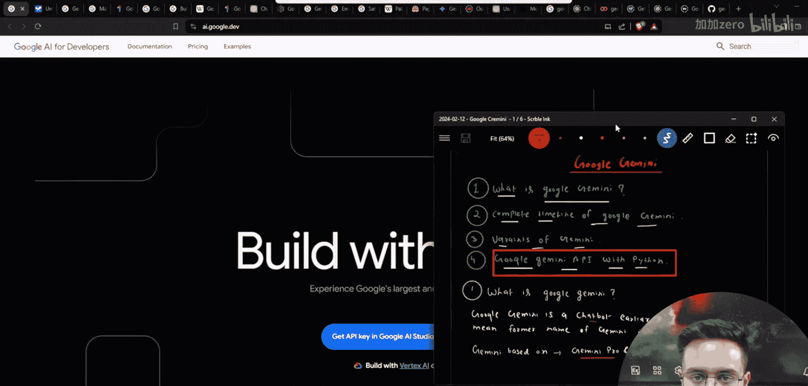
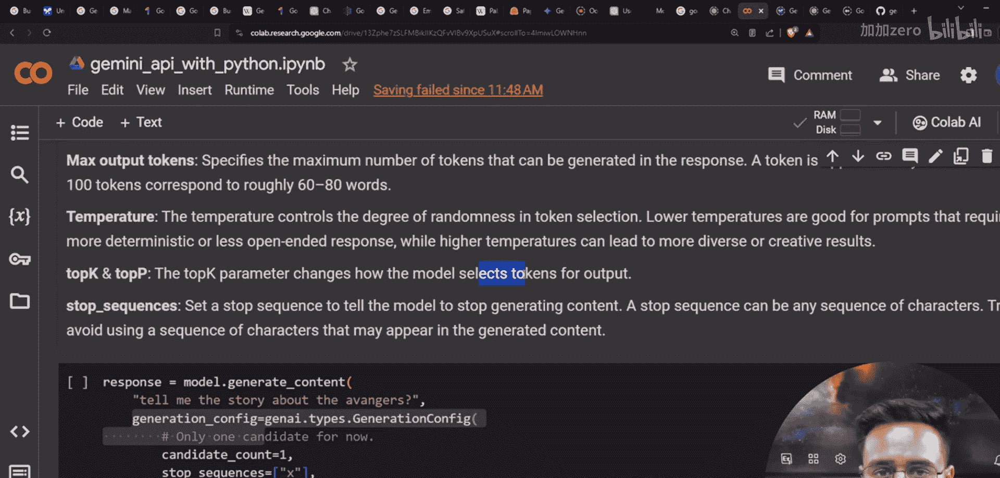

# Sunny Savita【中英⚡生成式AI：从初学者到专家｜Generative AI In-Depth Roadmap from Beginner to E】 p09 P9 Google gemini API with Python Part 3｜ Embedding ｜ Saftey Setting #gemini [BV1Uht8zDENA_p9]

Hello， everyone。 welcomelcome back to my YouTube channel。

 My name is Sunny and in this video we'll explore some advanced functionality of Googlemni API in the previous video。

 I discuss different different feature or some basic feature of this Google Gmni API if you will check with my previous video there I discuss that how to read the API key and I discuss that how you can generate the text response from the text itself。

 and then I discuss that how you can generate the text from the images in this video。

 we'll see some advanced functionality of this Google Gni API and definitely this functionality will help you a lot whenever whenever you are going to design any end to end application and don't worry in the class itself after completing this series after completing this API and all right So definitely I will come up with the end to end project。

 So I will create one end to end project by using the Lama index and this Google Gni API。

 So let's start。 Let's begin。😊，First of all， let's see that what topic I'm going to discuss throughout this video so here I can write it down each and every topic each and every basically and then you will get clearcut idea so guys I discuss the complete and detailed history of the Google and API if you don't know about it so please go and check with my previous videos there I already discuss the complete and detailed history of this Google jni API now in this video in today's video now the first thing which I will discuss so I will discuss that how you can how you can configure how you can configure the generation so the topic name is going to be a generation generation configuration configuration so what is a meaning of it I will let you know the second thing which we are going to discuss we are going discuss that how you can maintain the history。

History of the conversation。 So actually in the gney itself。

 we have a in build function in Billpenon by using that we are going to maintain the history of the history of the chats history of the conversation basically the third thing which we are going to discuss will see that how we can count tokens so in the input prompt like how many tokens we are providing right so definitely will see that how we can count it we have an in build function so we'll try to explore that the fourth topic which we are going to discuss we see that how we can generate the amdding。

And then the fifth one will see that how we can how we can configure the different different safety settings so different different safety settings So this five topic I'm going to discuss in this particular video so let's begin with this generation configuration So first of all let me give you a quick recap from the previous session so I was doing everything in my collab itself I told you that again I will do the setup in my local like when will when I will be doing the end project and in my Lama index project setup I already told you that how to do the local setup so as of now I'm executing everything in my Google collab itself because it it it is providing to me some like advance or some extra functionality so here you will see that here itself I can save my key and yes no one will be able to see my key and definitely I can read it directly from here itself So if you don't know about it you can go and check with my previous session then I already discuss that how you can save the key and how。

And read it from here。 Now lets begin with today's agenda。 So in my previous class。

 I told you that how to like import this package and all what is a use of the different different packages。

I discuss about that how to read the API keys and all。 So if you didn't check guys。

 please go and check with my previous session。 Now let's come to today's agenda。

 So here in this in today's session basically the very first thing which Im going to discuss over here that is going to be a generation configuration So what is a meaning of the generation configuration So you know thism is nothing。

 So this is is like it's a generation model。 this gym is a generation model so we are providing an input in terms of in terms of like a text and we are getting the output in terms of text。

 So here the text basically we are getting as an output right so we can configure it we can do a several configuration related to that。

 So if we if we want to do some changes inside the text that text basically which we are going to generate right so definitely we can do that and for that we have in build function inside the gym itself。

 So let's see how we will be able to do that particular thing So first what we are doing here。

We are so here I'm loading one。 I'm loading a model。 which model I'm loading over here。

 Tell me I'm loading this gymni pro model。 So let me load the model over here and see I definitely I' am able to load it now what I'm doing here Im like passing the prompt right where I'm passing the prompt tell me I'm passing the prompt to this method generate content method and from here from the response basically what I'm extracting I'm extracting this text So if you don't know about the response text pass candidates prompt feedback everything I've discuss in my previous session you can go and check with that now here what I'm going to do I'm going to generate a text so let's see whether I will be able to generate it or not。

 so initially it will take some time。 but yeah in some time basically I will be getting this particular text So yes。

 still it is running and let's wait for some time Yes so now here guys you can see we are able to generate a text。

 So according to the prompt basically it is able to give me a output it is able to give me a response so I think you already know。

About it in my previous class in my previous tutorial I already explain you this particular thing now coming to the next part So guys whenever we are going to generate a text by using this particular method。

 what is my method name。My method name is generate content。

 so here actually we can pass the different different parameter along with this prompt along with this input prompt I can pass the various parameter I can pass the different different parameter so here what I can do I can open my epic pen so that I can write it down whatever thing is required over here just a second。

So here guys you can see whenever we are like passing the prompt so definitely its going to generate something but here the output which we are getting right so the output which we are getting we can make the changes in that output right by using a different different parameter So here we are using a different different parameter So here actually basically we are using this generation con like parameter right so gen dot types and if this type actually is having this generation config parameter now where we are passing it we are passing to this generation config right we are passing to this generation config what I'm passing guys what Im which thing I'm passing I'm passing this generation cong itself right so here is my parameter my parameter name is what generation config now inside that I can define a several thing right so here the first thing is what candidate count the second thing is what is stop sequences the third one is a max output tokens the fourth one is a temperature and we have more right we have many more parameter。

Over here。 So if you want to get a parameter guy。 So you just need to hover your mouse on top of this method。

 if you are working with a Google。 sorry if you are working with a Google collab。

 then you will get your all the you will get your all the parameter。

 So here you can see your all the parameter。 So candidate count and stop sequences max output tokens temperature top top these are the different different parameter which we can pass basically to this generation configuration method。

 Now where I have to pass it， I have to pass to this particular parameter。

 got it Now let's try to understand the meaning of this different different parameter。

 So here you can see So the first one is a max output token。

 So here we are specifying that how many words we want as a output。

 So whether I want like 68 So here you can read the complete description which I have written So tokens is approximately four character tokens corresponding to roughly 680 words。

 So if we are talking about one single token in one single token actually So if we have。

4 character in one word。 So that will be called single token with respect to this Google gym right so according to that。

 you can estimate according to that basically you can make an estimation。

 Now the temperature is what temperature is for the creativity right so if we want to get some creativity in the sentence。

 if you want to make some randomness in the sentence So here basically this is the parameter the parameter name is what the parameter name is nothing。

 the parameter name is temperature itself。 So over here if we are talking about the temperature guys。

 So let me highlight the temperature。 So here is a temperature guys this one So if you want to like if you are working with a temperature。

 So we can have a different different value of the temperature。

 So what will be the range of the temperature guys。 So just a second。

 let me tell you the range of the temperature So the range of the temperature is going between0 to2 So we can mention any sort of a value between this0 to2 So if we are writing this0 over here if we are mentioning this0 over here in that case my model is not going to be my output is not going to be a random it will be a straightforward。

 but here。We are mentioning everything else right let's say 11。

5 and the value near to2 basically so I will find out like that much randomness in my output itself so here you can read the complete definition of it So here I written the complete definition basically So yes like you are able to understand the meaning of this temperature now coming to the next part top K top p so the top k and top p parameter change how the model select token from the output means here basically we are passing up value and the value is going to be between 0 to1 So here we are nothing we are just passing the probability value as the value basically between 0 to1 its nothing is a probability value and the probability of word the probability of that token selection right so which token it is picking up from the data which token is it is picking picking from the data and here this parameter this top K top p it is also responsible for the randomness。

