# Sunny Savita【中英⚡生成式AI：从初学者到专家｜Generative AI In-Depth Roadmap from Beginner to E】 p10 P10 🟥 Let’s build QA System with @LlamaIndex and Google Gemini!(LlamaIndex, Gem [BV1Uht8zDENA_p10]

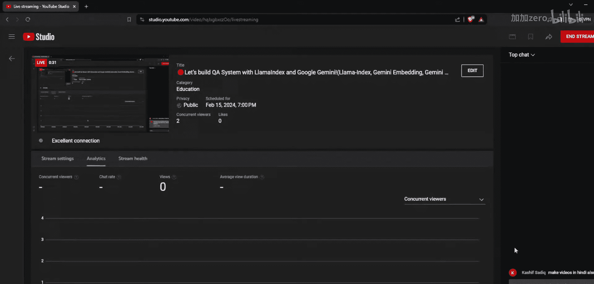

く。Yeah， hello， everyone。 So I think。You are watching to me， and I am audable to everyone。 Yes or no。

Can you confirm in the chat if you can hear me， if you can see me then。I'm audible， guys。

Can you hear me？My voice is clear to all of you。Okay， great。你好helo， hello， guys，hello， everyone。Yeah。

 I think I'm audible to everyone。 So this is my first live on my own YouTube channel。

And in today's session in today's like video， we'll discuss the QA system。

 well try to build one system okay。So I hope I am audible and visible to all of you。

Let me check one more time。Great。Perfect okay。Okay。Laauurren clearier， fine， grape。

I hope there is no such delays or something。 Yes or no。Great， perfect。

Okay fine so I think we can start with the session so first of all let me introduce myself so I hope you have seen my channel if you don't seen then first of all let me show you my channel then here guys so I recently started my YouTube channel and this is my first live so I'm uploading the content related to the data science Geneative AI machine learning and operations and this deep learning and all so recently I started my channel and I just uploaded 11 videos if you will go and check with my videos so here you will find out the like video related to the Gene AI only but don't worry I will be coming up with many more things。

 many more videos and all if you want to know about me so here is an introduction video so my name is Sunny Savita and I'm working like IEon and I'm having around three to four year of experience in terms of the data science I work with data science machine learning deep learning amops and all right so。

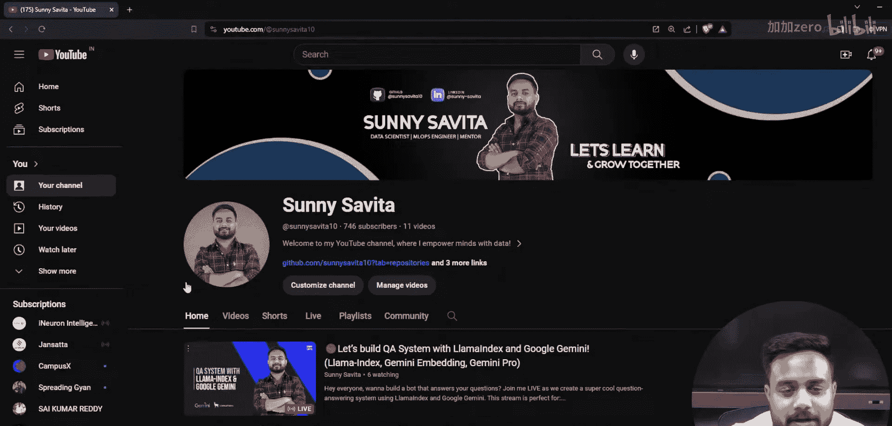

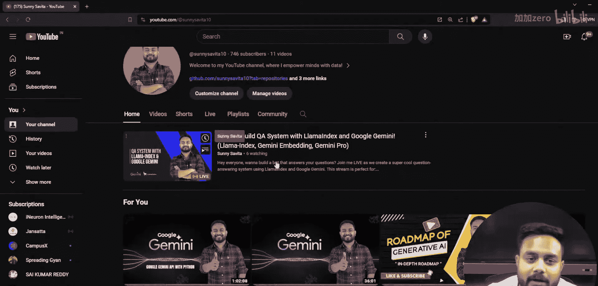

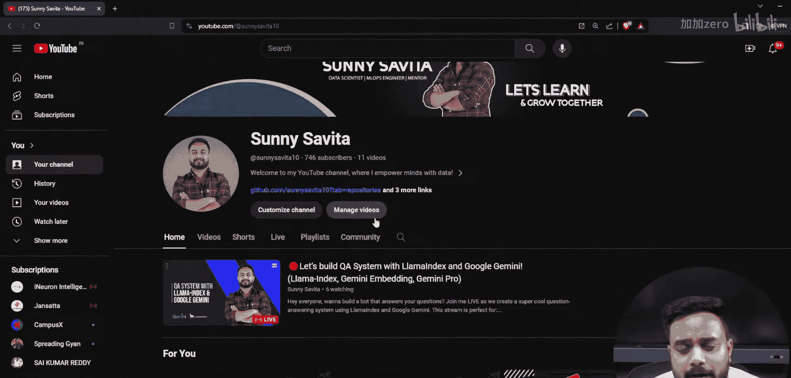

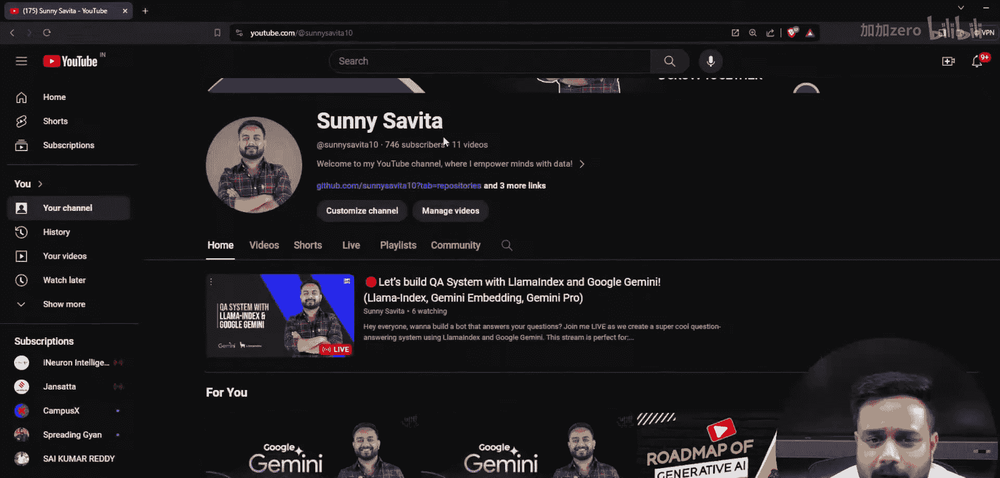

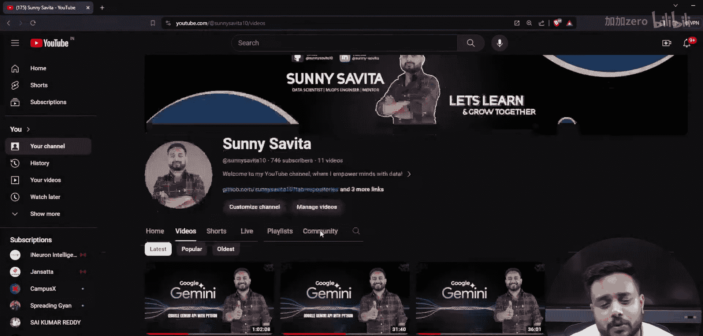

If if you want to know more about me then definitely you can visit this particular video if you are watching my content so here basically I recorded the video related to the Geneative AI so just go and check with my video and I'm coming up with many more videos and here you can see I created one playlist related to this Geneative AI so in this particular playlist I discussed like each and everything so I started from the roadmap and then I discussed the history complete history of the Geneative AI then here I discussed the isma In Google Gbeni and all so instead of recording a video what I was thinking then okay so why not I should go live and teach you the end end project。

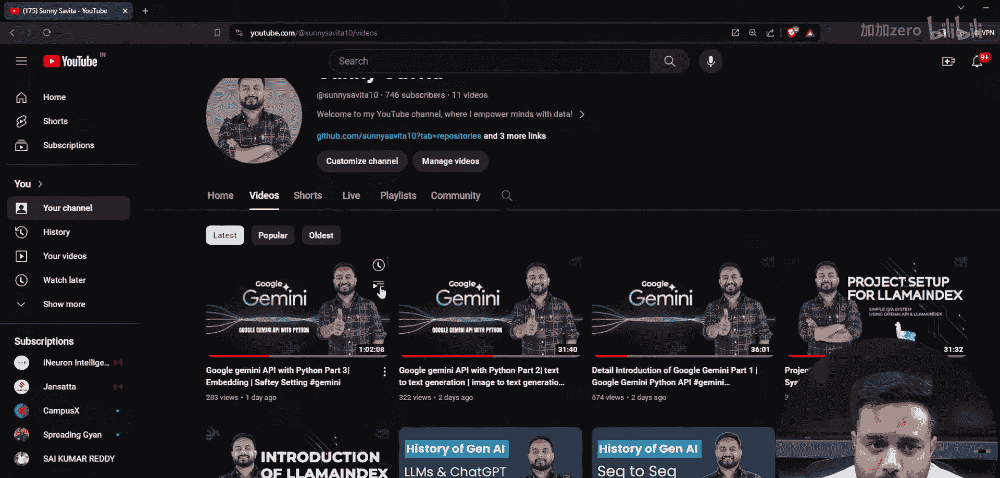

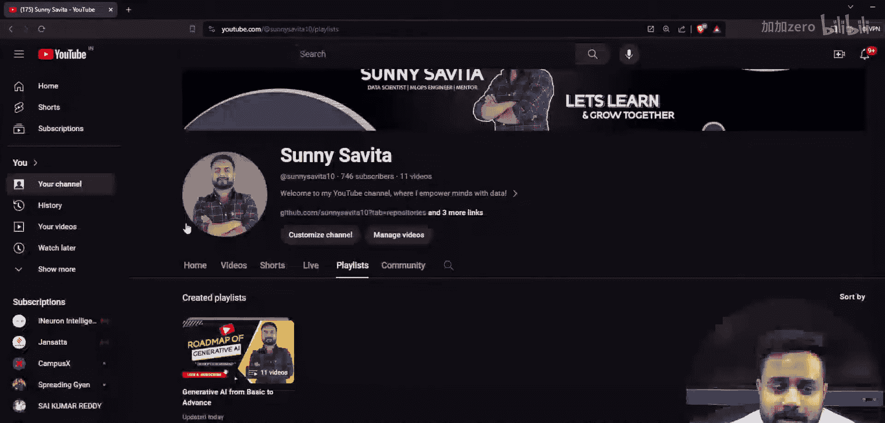

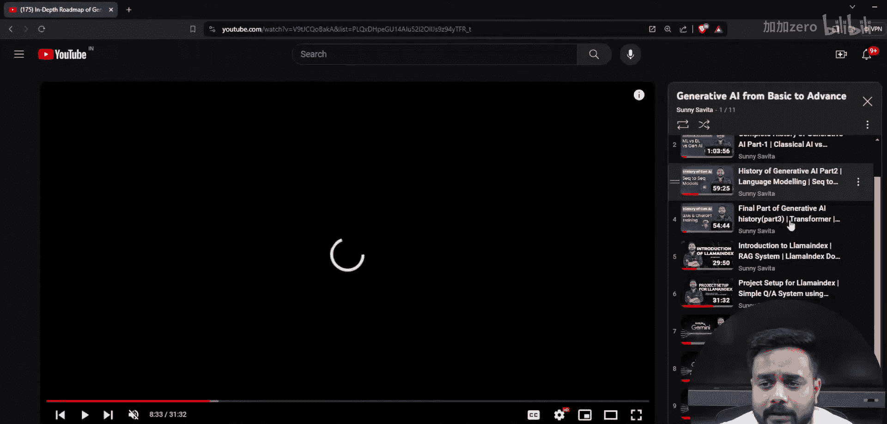

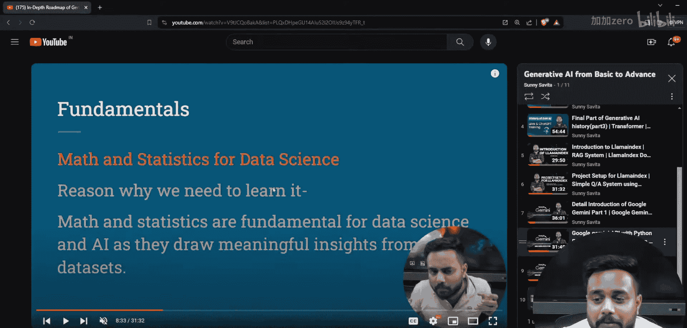

Based on my previous video So here you can see I have uploaded a couple of video related to this gini and this Lama index。

 So anyone has seen my videos so from my playlist from my YouTube channel Anyone guys tell me。

And if you are liking this session， then please hit the like button tell me guys first if anyone seen my playlist。

 if anyone seen my video， you can write it down in the chat in the live chat。

 you can interact with me。And don't worry in the live session itself will try to implement one end project based on these concepts only so anyone have watched my video anyone try to like like understand this ama index or this Google gymney and all。

Okay， day。 so definitely I will be coming of coming up with many more thing。 I will。

 I'm thinking about like Azure or A W S， so I will。

I will create a playlist on top of the Azure machine learning AWS machine learning。

 so I will keep it like I will keep it as simple as that and I will match the industry standard also so that is my moto and I love to teach and to explain the concept that's why I have created this particular channel so that whatever experience I have in terms of this technical thing okay whatever thing I have build up in my career throughout my career。

 whatever thing I have learned right so I can provide each and everything to the community So I hope guys you are able to learn from my videos if anything is there which you want to learn So here if you will look into the videos right in the description of the video I have attached I have attached like Google form so here once you will go through with this Google form so you will find out that So here Im asking the suggestion topic name and if you want anything that definitely you can fill。

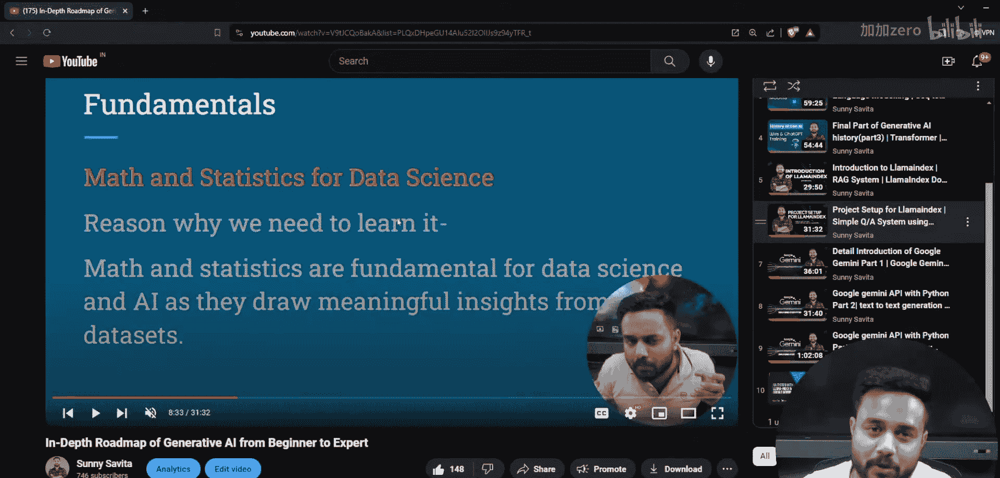

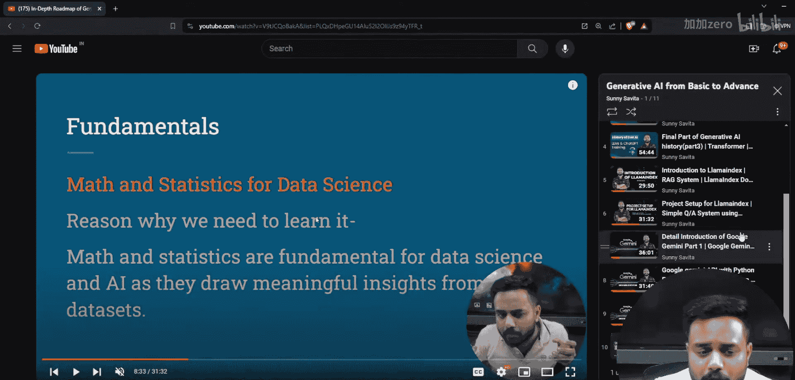

this form and based on your preference also I will try to make a content but here in starting actually I will try to more focus on this I will try to more focus on this generative AI I will try to complete it along with all the tools and framework and then I'm thinking to start one playlist on the machine learning and operations also and then I will come up with like a different different clouds like AWs Azure because this is very much required if you are going in an industry than definitely you are going to use this tools for building the application okay so that is my mo that is my moto basically to teach you everything from starting to and and in a simplest way so if you haven't subscribe subscribe guys so please try to subscribe my channel and yes I will be coming up with many more videos in future now let's start with the session so here in today's session in this session basically we are going to build a QA system。

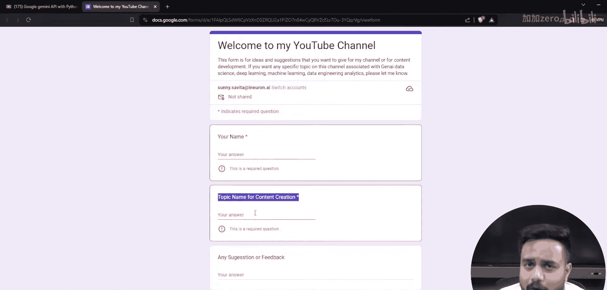

By with Lama index and this Google gym so already I discuss a couple of things in my playlist here。

 if you will go and check with my playlist so I discuss this Lama index and this Google Gmney and all so instead of record instead of the recording I prefer this live session so that I can interact with my people whoever is learning from my videos and all and yes that's going to be very very amazing so guys are you excited please do let me know in the chat if you are watching to me then you can hit the like button or you can let me know in the chat that are you excited or not and can we start。

If we can start， then please give me a thumbs up。And don't worry。

 I will start from very scratch and whatever concept I have taught you so。

