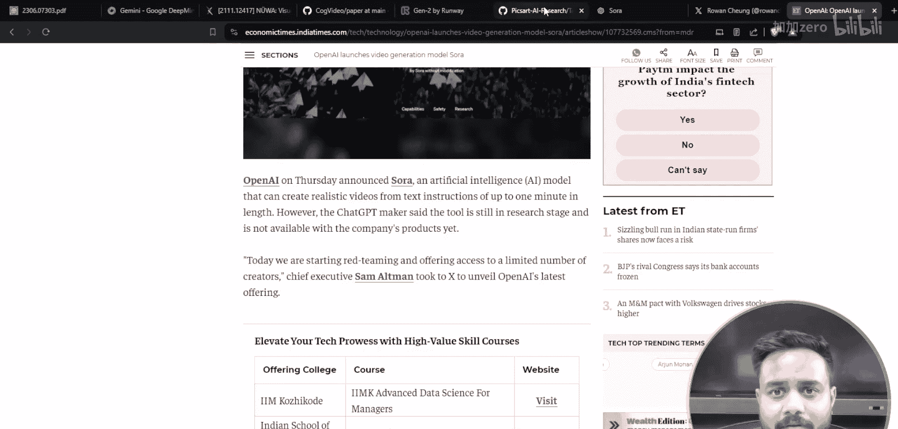
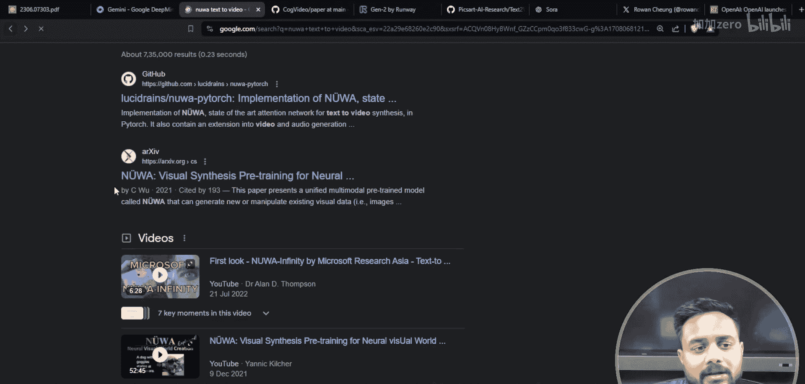

# Sunny Savita【中英⚡生成式AI：从初学者到专家｜Generative AI In-Depth Roadmap from Beginner to E】 p11 P11 @OpenAI ＂SORA＂ Just SHOCKED EVERYONE ｜ Text-to-Video Generation ｜ AGI ｜ Alte [BV1Uht8zDENA_p11]

Hello everyone welcomelcome back to my YouTube channel My name is Sunny and in this video we discuss about the newly launched model by Open AI that is Sora so guys yesterday itself means on Thursday OpenI Open AI has launched this new model which is capable for generating the videos from the given promptm so here you can check with the economics Times website so they have written an article on top of it Open AI on Thursday announced the Sora an artificial intelligence model that can create realistic video from the given text。

So in this particular video， we'll try to understand what is this so and how you can use it what it can do。

 what is a meaning of the video generation and where it lies in the generative AI So step by step one by one well try to discuss each and everything in this particular video So first of all guys let me tell you the type of the generation So if we are talking about the geneative AI right so we have a different different type of the data and based on this particular data we can divide or we can categorize the task as well So here what I'm going to do So here I'm going to open my blackboard and there basically I will explain you the type of the generation even though I explain you in my previous video but yes again let me give you a quick overview of it and then I will discuss the different different model which was already there related to the video generation based on the transformer and all and I will show you the。

Sa application of the attention all you need paper so here I have a research paper I will show you that particular paper with that easily you can understand so let's start guys let's begin。

 So here what I'm going to do I'm going to tell you the the type of the generation so if we are talking about the LLM guys。

 so here let me write the full form of the LLm I think you know the full form of the LLM LLM is called large language model as you know that LLM is nothing Its a large language model。

Now， this model， actually， it is having a capability so that it can generate something right。

 So let's say here I have a model。 So this is going to be my generated model。

 I I can draw it over here。 this one。 So this is what this is my model。

 Now I can write the model over here。 This is going to be my model。Now。

 if I'm passing any pro to this particular model， right， so based on this particular prompt。

 it can generate something。 So this this prompt， this prompt， basically which I'm passing here。

 This is called input prompt。 What is this， tell me this is called input prompt。 Now， here。

 the output which we are getting， that is called output。 Okay， output prompt or output。 Now。

 this input or output。 It can vary right based on a data basically。 So here this input。

 it can be text or it can be image。right and this output also this output also it can be text or image。

 so here we can categorize here we can categorize our generation model into4 category so the first category which is called homogeneous model。

Whi is called homogeneous model。And the second category， which is called heterogeneous model。

 So that is called heterogeneous model。 Now let's try to understand first about this homogeneous model。

 Now why we use this homogeneous model and what is a capability of this homogeneous model and then well see the different different example of it。

 So we are talking about the homogeneous model。 So it is capable to generate something like something text something text from text itself So text to text generation and the second basically image to image generation image to image generation means both side actually you will find out the same data here input site as well as to this output side right both side you will get a same data Now if we are talking about the heterogeneous model So here left hand side you will find out the either you will find out the text or image。

Or here， or basically。Right inside on the output side also you will find out the text or image。

 So text to image generation and here image to text generation。

 So this is called heterogeneous model。 So here how many categories we have we have a four category So let me write it down over here so that you will get clear cut idea。

 So we are talking about this text to text generation I think we know we already know about the model the model name is a G right so P G and we have a different different variant of the Gp like GP3 G3。

5 G4 now this was capable to generate text from the text。

 Now we are talking about the image to image generation。

 So image to image generation is also possible right so for that actually we have the stable diffusion model I think we know about the diffusion model So diffusion model actually these are the model which is responsible for generating images so stable diffion model is one of them Now if we are talking about this text to image generation So here I can write。

Model name。 so the model name is going to the model name is going to be a midgery。

 I think we all know about the mid Germanymany。 The model name is Dhi， right。

 which is responsible for generating text to image and the last one， basically image to text。 So yes。

 we are aware about this image to text also and we are couple we have a couple of model So recently we have seen this jni Pro Zimni pro Okay。

 and we are aware about this G4 also G4 or G4 v okay we have two variant of the G So these are the different categories。

 these are the different categories of the generation。 Now where this video lies。

 So here let's say this is my model。 So lets let me draw my model over here。

 let's say this is my model Okay so here I can write my model。

 It's going to be my model my model or generatedative model basically I can write it down here。

In the middle， just a second。 So this is nothing。 This is my model。

 Now I'm passing the input to my model and I'm getting a output for my model and here。

 here as an input basically what I'm doing as an input I'm passing the text。

 So here I'm passing the text and as a output what I'm getting。

 tell me as the output I'm getting the videos。 So where this type of model lies。

 So recently they have lease the solar model。 but we have different different we we have different other like。

Alternative also。 So I will talk about those particular alternative。 So apart from the sora。

 what alternative we have and why this soura is very， very important。

 So here we are talking about this text guys。 So this text actually， it's nothing。

 it's like collection of the tokens right now we we are passing to our geneative model。

 So here it's going to be my geneative model geneative V model And here we are getting a video。

 now this video， first of all， we have to understand about this video， or let me write it down here。

 the text。 So this text is nothing。 this text is nothing。 it's a collection of tokens。

 it's a collection of tokens。 Now here we are talking about the video。

 So video is nothing actually it's a sequence of images。 it's a sequence of images。

 or it's a sequence of images， or I can say it's a sequence of frame Now whenever I have to check the quality of the video。

 So Ill always check with the Fps right So whenever we have to check the quality of the video we always check with Fps。

 Now what is a meaning of the F。Now， we are talking about the FPS， So FPS is called frame。Frame。

 pour。Frame per second， right， So frame per second means in one second how many frame we are able to process means how many images we are able to process。

 and that is nothing。 that is a video。 So yes， now we have those type of model。

 which is capable to like do something which is capable to generate some sort of a video from the given text。

 we can pass the prompt， we can pass the prompt as a input。 Okay。

 we can pass the text prompt as an input。 and we can generate the video as a output。

 Now if we are talking about this video So this video is nothing this is a collection。

 This is the collection of this is the collection of images。

 this is a collection or sequence collection of the images。

 I think youve got to know that what is the meaning of this like text to video generation So here we have a prompt and we are trying to generate a video Now before the so。

 So let me write on the model that bottom model we have for generating this text to video right So here what I'm going to do。

 I'm going to write it down the models and。For so so we have seen this open eye so。 And before Sora。

 actually， we were having a couple of model， let me introduce with those a model。

 So here the second model is going to be a noba。 Okay and W a the third model which is capable to do like this video generation that was the cog video cog video I will come to that I will show you the Github repository also Now the fourth one。

 basically it was the runway generation2 runway generation2 So here Im writing some famous model and the fifth model which was there for which which was capable for generating the video from the given text that was the。

Text 2， okay， text to video0， text to video 0。 So these are these are the different different model。

 which I return over here。 So this sora， actually， it's the latest model。 This is what guys tell me。

 This is the latest model， which they have introduced like yesterday itself。 and this newba actually。

 it's a model from the Microsoft。It's a model of the Microsoft which was responsible for generating a video。

 Now let's try to see the Github。 or let's try let's try to see the research paper of each and every models over here。

 So here what I'm doing。 I am showing you the nova model。

 So here I have already like search about it And here basically what I'm getting I'm getting。

