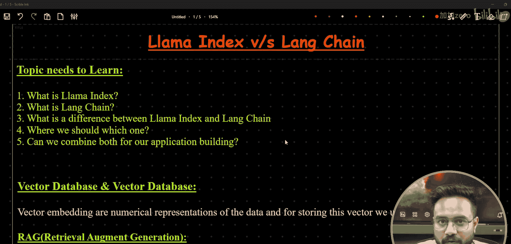
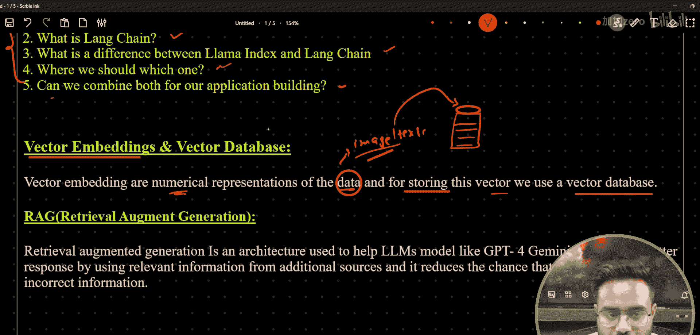
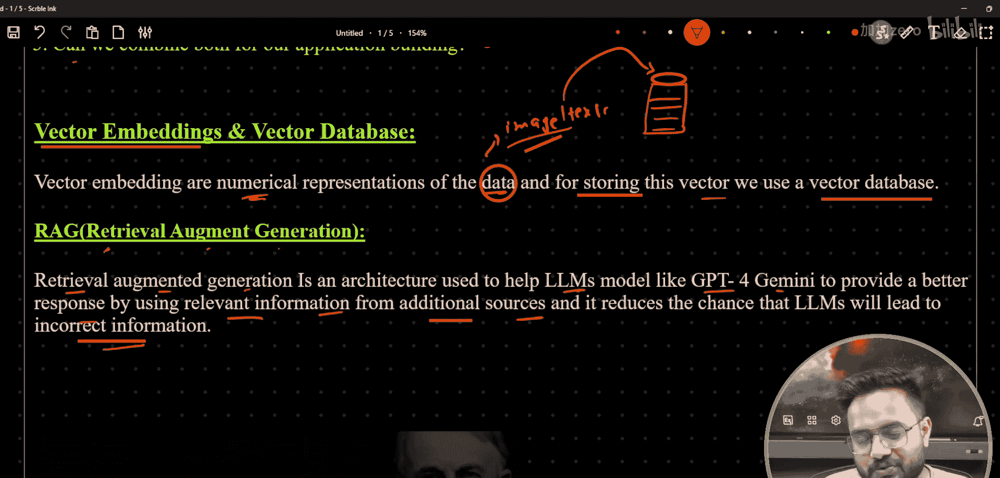
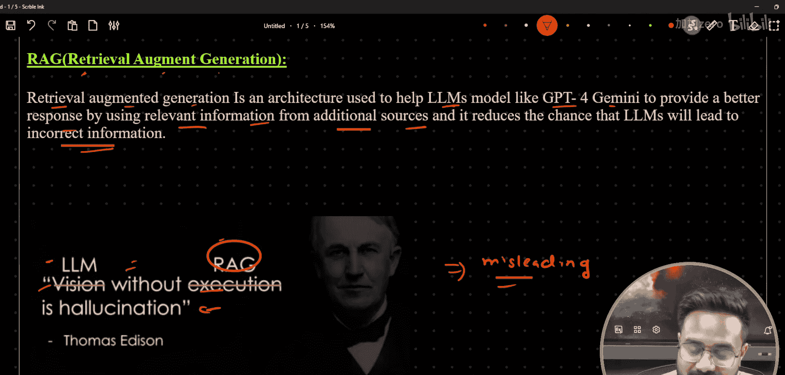
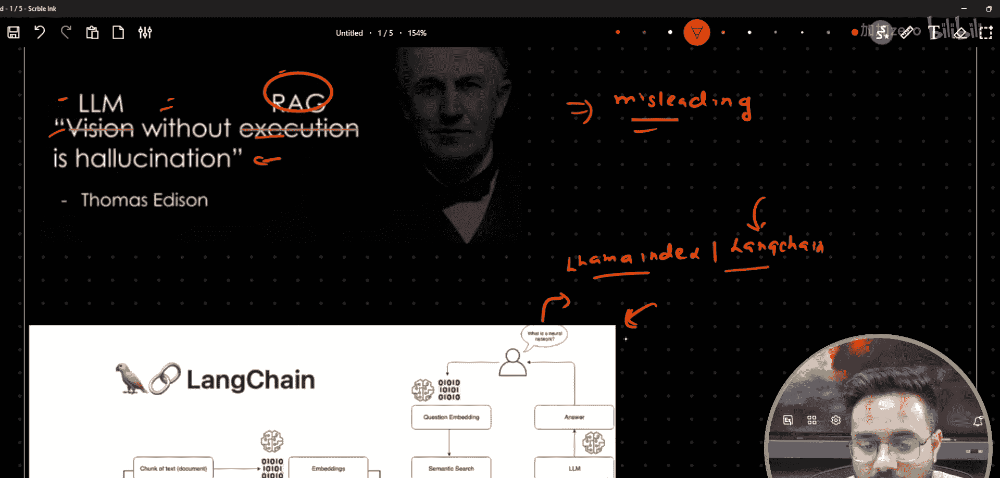
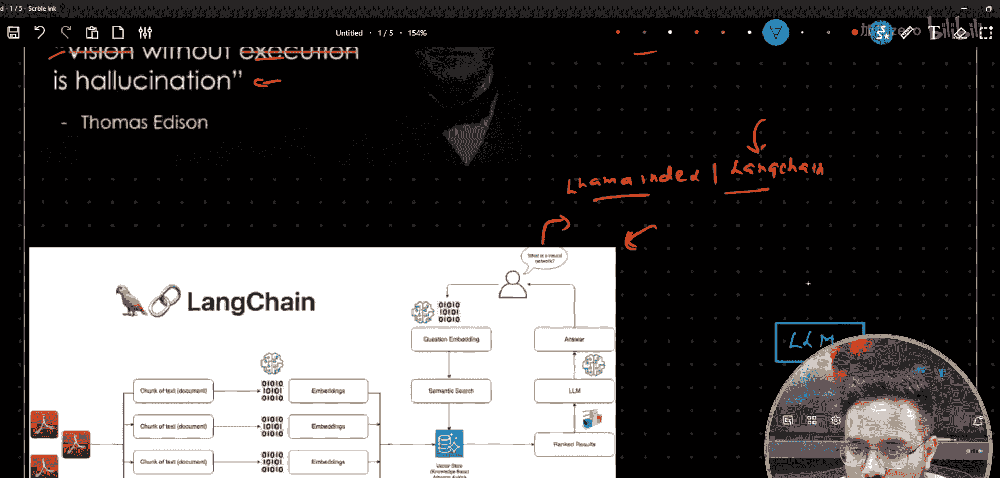
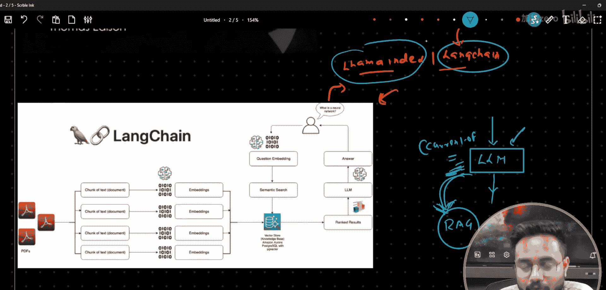
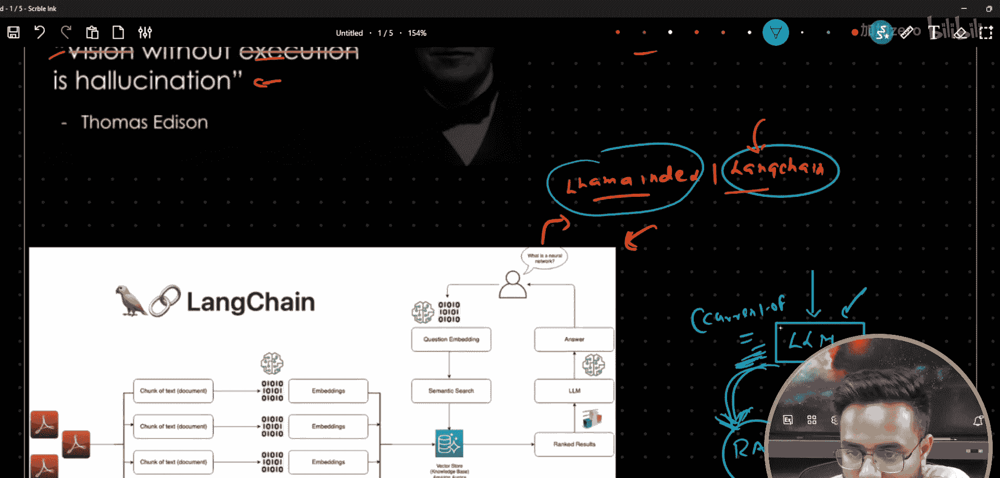

# Sunny Savita【中英⚡生成式AI：从初学者到专家｜Generative AI In-Depth Roadmap from Beginner to E】 p12 P12 LangChain v⧸s Llama-Index ｜ Detailed Differences ｜ Which one you should use？ [BV1Uht8zDENA_p12]

Hello everyone， welcome back to my YouTube channel。 I am back with another exciting video。

 So in this particular video we'll see the detailed differences between the Lama index and L chain。

 So guys recently I started my YouTube channel and I'm uploading the content related to the geneative AI So if you haven't check with my YouTube channel guys so please try to go and check if you want to learn the and to and geneative AI。

 so you can search about the Sararia Vita and then you will get my channel here on my channel you will get the different different videos related to the geneative AI I'm uploading the video in a sequence I'm not uploading any random video on my YouTube channel So here basically will find out the complete and detailed list on top of the geneative AI So whatever content I will create I will create in very detailed way So in this particular video we are going to discuss the detailed differences of the Lama index and the link So so far。

I discuss about the history I discuss about the Lama index I discuss about the L now here in the live session I completed one project also I've created the co answer system okay so whatever content I will be uploading on my YouTube channel related to the geneative AI MLlOps machine learning deep learning I'll be creating a sequence itself so guys please try to follow and if you want to learn more about data science machine learning operation deep learning about anything related to the artificial intelligence you will get everything on my YouTube channel so let's begin with the topic so here I hope you got to know about the topic the topic name is Lama index overseas L so why why I selected this topic because I was uploading the video related to the Lama index。

And here is two main framework for creating the application and here one more thing guys I would like to tell you。

 So Im covering each and everything in a very detailed way。

 okay in very detailed manner so the video can be quite long if you will look into my video guys so you will find out the length around 35 minute。

40 minute 45 minute So yes， so the video can be a quite long right the further video as well and I will be covering up each and everything from now onwards in little slower manner So guys if you are finding that it is little slow then you can speed up that particular video you can watch it on 1。

25 x or maybe 1。5 x then you will get the better X right so this is just this is just one suggestion from my that's it Now coming back to the topic here So let's try to discuss about the Lama index and length So guys here I created the beautiful notes for all of you and you can see each and everything basically I kept over here So step by step1 by1 I will try to explain you。

and everything and believe me after watching this video your every doubt will be clarified related to this Lama index and L Okay so I was uploading the video related to this Lama index and I was getting many questions sir what is the differences between this la and Lama index because there is two major framework for developing the application by using the。

lararge language model。 So let's try to understand like one by one。

 And in upcoming video basically I will explain you about the rank retivable arguments generation and I will discuss about the vector database and then I will come to the project because guys here in this geneative each and everything about the ranks only in sometimes the thing basically the retivval argument generation it will be clear to all of you and in the upcoming session。

 I will be coming with many rank techniques， not even one the advanced rack technique。

 different different techniques。 So at least I will show you 7 to8 rack techniques along with the python code。

 but here this session is very much important to understand about the Lama index and the So here the first thing is what So first we try to understand that what is a Lama index then we'll discuss about what is a then we'll try to understand the differences between Lama index and and again see you。

Well give the answer after learning all the stuff from here related to this particular question related to this particular topics then we'll understand where should be where we should use which one right where we should use which one is whether I should use the Lama index on the link then can we combine both for our application building so these are some common question and until we are not going to ask the right question to ourselves guys definitely we won't get the right answer as well so the question should be right and definitely we'll get the right answer related to that question so here guys before starting with the Al Lama index and L let me talk about this vector database and this retrieval augment generation again I'm saying I'm not going to discuss this thing in a very detailed way in this particular session so in the upcoming session basically I will discuss about this right retrieval generation and then I will come to the vector database and then basically we try to create couple of more application and finally I will be coming。

with many finally I will be coming up with complete and detailed p list on top of the la at least 20 to 35 video 25 to 30 video basically I have recorded on top of the la and soon you will get it。

So first of all， let us try to understand about this vector database vector database and this vector emdding right so here actually the thing is what vector database and vector em let me clarify it over here。

So vector embedding embedding and vector database Now guys see whenever we are talking about the vector embedding vector database So let's try don as a definition of it So vector embedding vector embedding are numerical representation vector embedding a numerical representation of the data and for restoring this vector we use vector database right so here let's say we have a vector database So here in this particular database what we do guys tell me we store the embedding and embedding is nothing embeddings is a numerical representation of the data itself So the data can be anything data can be image data data can be text data right so related to any sort of a data what we can do we can generate embedding and we can store inside the data right so don't worry I will be coming up with a dedicated video we will get to know about it now the second thing is what the second thing is right retrieval o Now let's try to see the definition of this retrieval o generally。

So here retrieval argument generation is an architecture used to help LM model like G for G for G to provide a better response by using relevant information from additional source okay and it reduce a chance that LLM will lead to the incorrect information so here I have included one image also so here you can see the image so in in the image like the real sentences vision without execution is hallucation right so here they have rectified the sentence it's like in a sarcastic manner so I took this particular image from the linkededin only now here you can see they are saying hallLm without rag it's a hallucination so if you don't know about the hallucination means if you are not using the rank okay if you are not using the rag in that case it it might lead to the misleading information it it might lead to the misleading information the information might be incorrect if you are not using the rank system now guys see。

Whenever we are talking about LLM I will come to this particular architecture because every LLM application。

 whatever LLM application you are seeing is just all about this architecture and whether we are talking about this Lama index or if we are talking about the la right so every every framework basically they are trying to implement this particular architecture yes definitely la is having like a too much functionality right like many functionality compared to this Lama index and I will be coming up those functionality as well but yes at the end basically we are trying to create this particular system only now here what is a main aim guys what is a main aim behind this ama behind this LLm so here let's say there is my LLm here is my Lm LM is what large language model okay large language model so if we are passing anything to this LLM we want to generate answer okay we want to generate answer we want to generate something from this LLM so here guys this LLM actually it might。

Mislead to the information。 It might mislead to the information because this LM is not having every information。

 So here let's say if I'm going to ask this。 So can you can you tell me the current GDP or the to the current GDP of the US or the current GDP of the India So definitely it it like mislead to the information because this has not been trained on a recent data it has been trained on like like like specific date till the specific date only if you will look into the G so it has been trained till 2022 if you will look into the gm So it is more better compared to the but this is not having each and every information and not having the information related to the particular or related to the specific task right so for that only we use the rag for that only we use the rag in the rag actually what we do you know so we can we connect this with with our。

Like a database right we connect we connect this LLM LLM is what large language model with our rag So how efficiently we can create this rag okay how efficiently we can create this rag or how useful this rag is right how useful this rag is So this depend on this ama index and this lengthng framework are you getting my point So at the end we are doing nothing So at the end basically we want this LLM。

