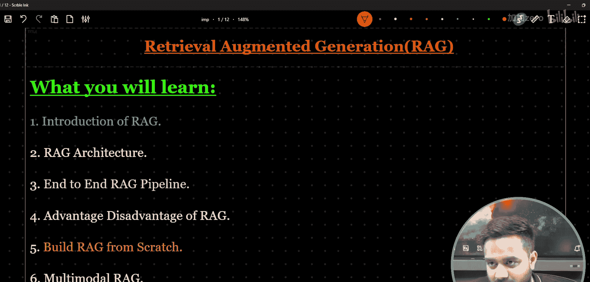
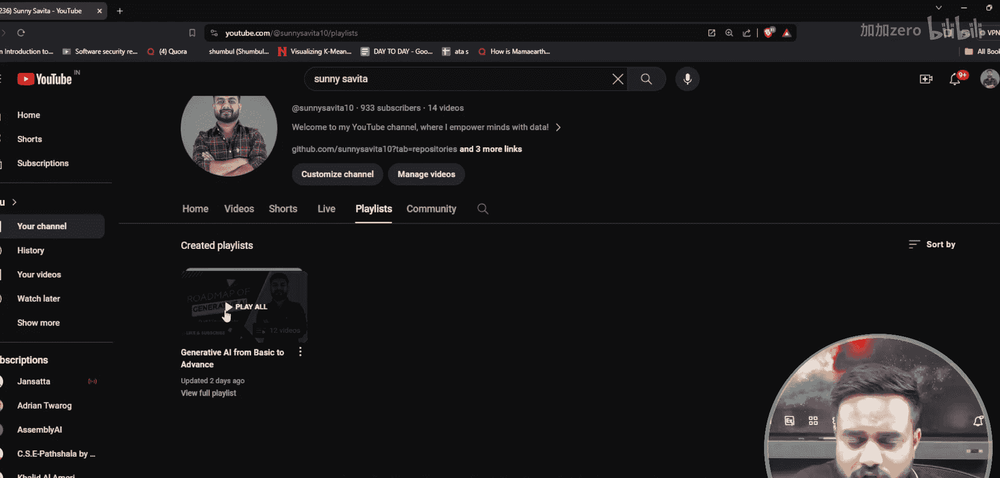
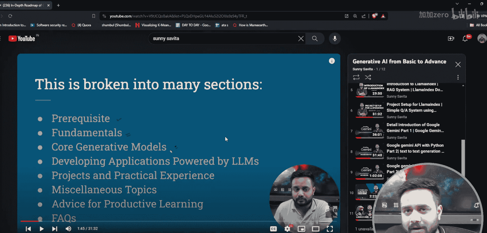
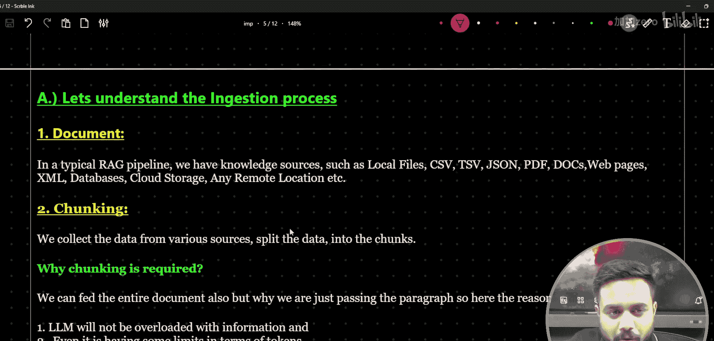
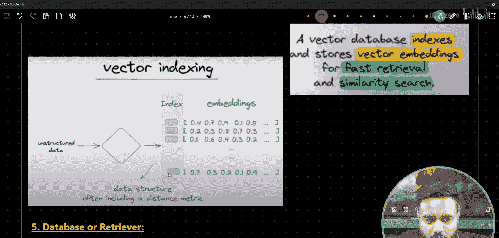
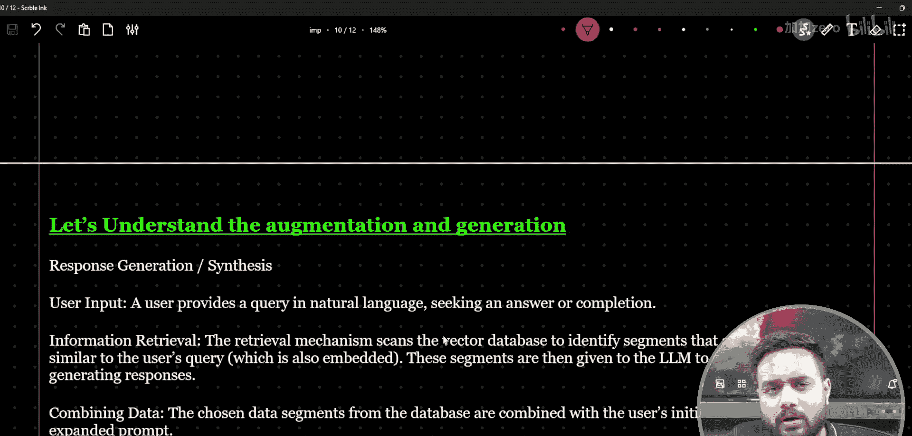
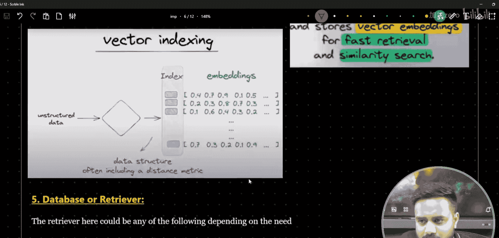
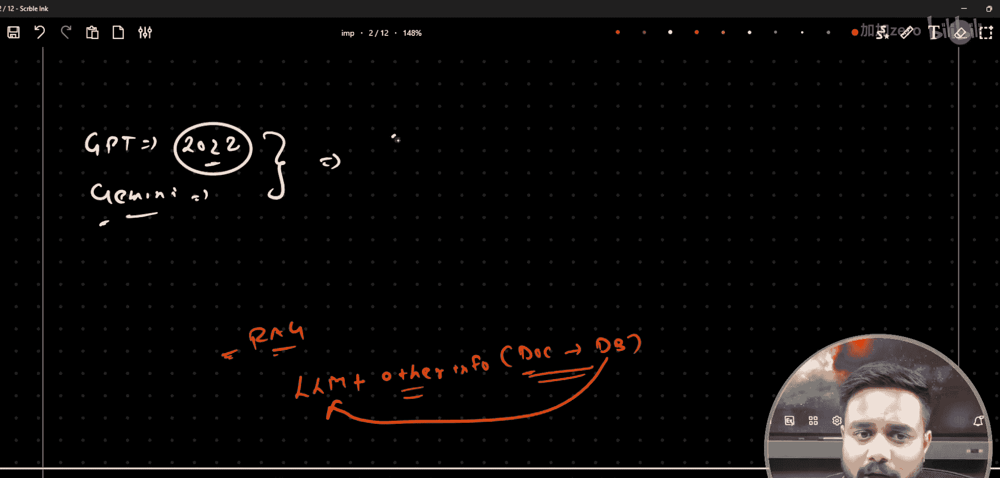

# Sunny Savita【中英⚡生成式AI：从初学者到专家｜Generative AI In-Depth Roadmap from Beginner to E】 p13 P13 End to End RAG Pipeline Part-1 ｜ RAG Architecture ｜ Ingestion ｜ generation ｜ [BV1Uht8zDENA_p13]

Hello， everyone。 welcomelcome back to my YouTube channel。 My name is Sunny。

 and in this particular video， we are going to discuss about the retrieval augment generation。

 That is rag。 guys recently I started my YouTube channel and on my YouTube channel I'm uploading the content related to the geneative AI So if you haven't check guys。

 please go and check and here guys you will find out multiple video related to the geneative AI and I'm trying to covering each and in a sequence itself and I'm trying to maintain playlist as well。

 So here in the playlist section actually you will find out the playlist related to geneative AI and the name is the name of the playlist gene A from basic to advance So yes I'm recording so many videos and in this video in today's video basically I will teach you about the and not with a few not with a simple one So I will teach you the end to end thing related to the rag。

 So in this manner only Im recording each and。

torial so if you will check guys， definitely you will get it。

 And if you find out that really this channel is helping you for building your Gene concept then please subscribe the channel and like the video and leave your thoughts as well So here in the description guys if you will check with the description So I did Google form as well So let me show you that let me show you with other video so apart from the introduction apart from the roadmap。

 if you will check with other videos right you will find out the Google form in the description so you can write your thoughts as well over there as well so that I will get to know that what my audience want and based on that basically I will try to record I will try to record the content。

 So guys I'm having a rich experience in artificial intelligence machine learning mainly machine learning deep learning and I work with the Gene also and with the MLlop also so along with the Gene I'm thinking to record one extensive playlist onlops guys don't worry Ill be coming up with MLops and。

Be coming up with Azure Azure machine learning AWS machine learning there are so many things basically which I'm thinking to record Okay so yes I think let's start with the session now so please guys subscribe the channel if you find that this is valuable for you so I hope you got to know the topic so in this particular video we are going to discuss about the retrieval argument generation Now this video actually this topic actually I divided it into various part so this is the first part because here I to discuss lots of things because what I have seen that。

This bigner right So whoever is having zero knowledge with respect to generative AI or maybe AI machine learning deep learning So they are not able to cop up with this type of topic like rag okay or fine tuning transfer learning is still lagging over there So what I thought that okay I won't cover the overview I will cover in depth related to this type of topic So here this particular topic basically I divide it into various section So in this particular in this particular part I'm going to discuss still four point and then I will discuss in the next part basically I will create one rag system from scratch then I will discuss that how you can use the rag system with respect to the multimod multimod means text to image or image2 text then we'll discuss about the rag versus fine tuning which is better option So whether you should go with the rag or fine tuning then we'll understand the evaluation matrixes of rag So if you are going to build your rag system that how you can evaluate that because that is very very much necessary。

And after that we'll discuss about the important research paper。 and at the end。

 basically we are going to implement different different type of rag in the python itself。

 Okay so let's begin， let's start so here I think in total there will be4 to5 parts so this is the first part of the rag and in this particular video I will teach you the and to and rag pipeline So what component is there and what thing basically which comes inside the end pipeline pipeline now you will get to know each and everything Okay so please make sure that you are watching this video till last and one more thing I would like to tell you here I have to cover so many things so I will go in little slower pace so that I can explain you in a better way if if you are finding out it is slower than you can speed up the video you can watch it at 1。

5 x so that you will get a better experience this is my personal suggestion to all of you so let's start let's begin with the video now So here you can see so first guys will start with。

Introduction introduction in the introduction basically we'll discuss about what is a rag Okay now here if you will find out So each and everything。

 basically I kept on my blackboard itself and here itself I try to create one document kind of thing so no need to go anywhere here itself I kept all the link all the images each and everything over here itself so guys see how beautifully I have created it and it takes a lot of effort guys so please if you find this available then definitely you can like it you can leave your comments and all now here you can see so this pipeline actually I divide it into various section So here in this particular pipeline will discuss about the intion process will discuss about the you can see rettririeval process and then will discuss about the generation process and here I have included so many things so many architecture and many advanced Im going to discuss over here right so this video can be quite long around 30 to 40 minutes so please make sure that guys you are watching till last。

If you want to get each and everything related to the rag system okay so let's discuss the rag system guys here you can see so first let's try to start with the definition itself So what is the definition of the rag So here I kept multiple definition of the rag So let's see so here I'm saying that rag is called retrieval argument generation it's the architecture used to help L means what large language model like G for gmei gma I think is a open source model Gma is open source model which has been released by the Google itself recently Google has it I think day before yesterday only you can go and check with this particular model it is pretty amazing like Lama is their is there right So if like we want to get a better experience related to this Lm model right so here actually we use the rag system ragg means what retrieval argument generation so here if I want to get a better response。

Back to this particular model because this model is not having each and every information so definitely we have to augment the information So how we can do that we have two ways first is rack system and the second is fine tuning I will come to the fine tuning also。

I'll try to discuss about the fine tuning and all。 But as of now。

 let's try dont understand about the rack。 Okay， so here you can see response by using the relevant information from additional sources and reduce the chance that LLM will lead to the incorrect information。

 So here along with the LLM here I can write。 So along with the LL M what I am going to do I am going to connect。

Open I'm going to connect some other information right So I'm going to connect some other information and how we are going to do that how we are going to do that。

 Tell me so this document actually document means what my data which Im keeping somewhere in the databases right and this database is basically which I'm going to be connect with the LLM during my point So this is the overall idea behind this rank system So if I want to make my model like if I want to make my model like much more efficient in that case I will have to use the rank or if I want to make my model task specific or domain is specific basically or problem is specific in that case definitely I will have to use the or fine tuning So here we are going to talk about the rag system now another definition it is similar to that only so Ra is technique that enhance language model generation by incorporating external knowledge external knowledge means another the outside knowledge right So external knowledge this is typically done by retrieving relevant。

Information from large corpus of document and using that information to inform the generation process Okay same thing。

 same thing I'm trying to convey over here now here you can see the second third definition with the L is LLM is leverage knowledge and information that is not necessarily in the in it weights mean okay weight meaning is it is not inside the training so what is a meaning of it guys so here I'm trying to say that whenever I was training the whenever I was training the LLM at that time at that time I haven't included those information right so I haven't included those information so for that what I'm trying to do here。

Tell me for that what I'm trying to do here so here Im going to connect my LLM with with one database with one knowledge base so that it can provide me accurate information here my point okay so all this three definition is trying to convey the same thing Now why we should use re what is the idea behind using this rag right so here guys you can see limited knowledge access as I told you that LLM is not having each and every information if we are talking about GP guys so GP here I can write so G also if we are talking about GP so G also has been trained till 2022 data right till this particular year only。

If you are talking about Germanyi so it is like little better compared to this compared to this G right so there are so many model basically which you can compare based on the trading and all now here guys is still this model are not able to answer a specific question so here to this particular model if you are going to ask then what will be the GP what will be the like GDP of the India okay current GDP of the India so here you can write here you can ask what will be the current GDP of the。

