# Sunny Savita【中英⚡生成式AI：从初学者到专家｜Generative AI In-Depth Roadmap from Beginner to E】 p14 P14 End to End RAG Pipeline Part-2 ｜ Advance Reterival Process ｜ RAG Architectur [BV1Uht8zDENA_p14]

Hello everyone。 welcomelcome back to my YouTube channel。

 My name is Sunny and in this particular video well see the further topic with respect to this rag。

 So Regg means what re meanss retrieval argument generation I already started with this rag if you will go and check with my YouTube channel。

 So here you will find out the first part of this rag pipeline。

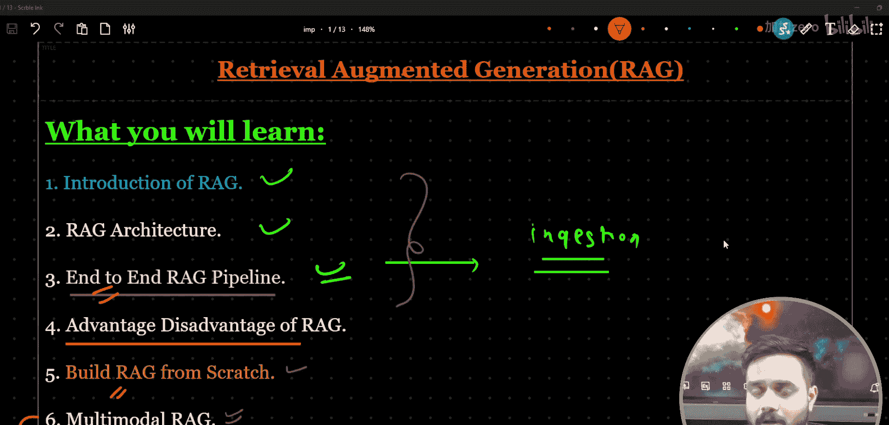

I uploaded a couple of more video with respect to the different different topic。

 So definitely you can go and check with these topic as well。 and yes。

 if you haven't subscribed the channel so far， guys。

 please do it And yeah now let's begin with the topic So here guys in the previous video I discuss about the introduction of the rag I discuss about the rag architecture I explain the concept of the embedding and I discuss about the like similar T search as well。

 So on which basis basically you are going to find out the similar vector like dot product or cosine similar tea and I discuss the data in component of this rag pipeline now I will discuss the further component of this pipeline and then I will discuss about the advantage and disadvantage of and a couple of more and then in the next video we'll see how we can build the rag from scratch rag fine tuning multimodal rag evaluation metrics and couple of research paper So guys yes。

 I believe you are liking the video and definitely。

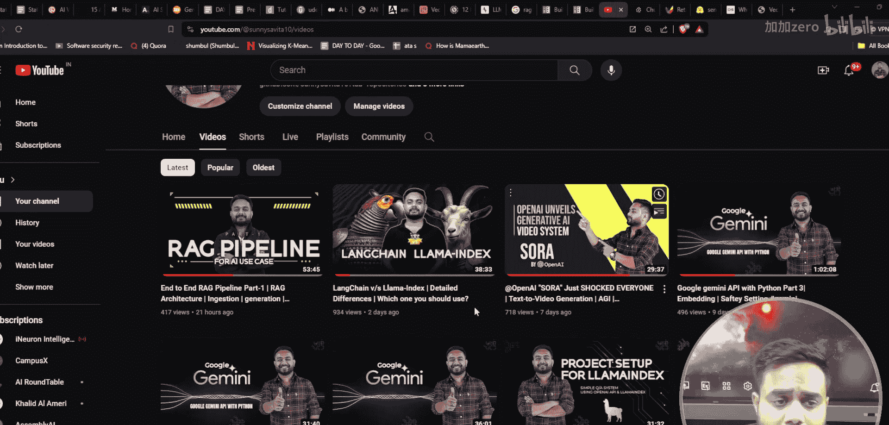

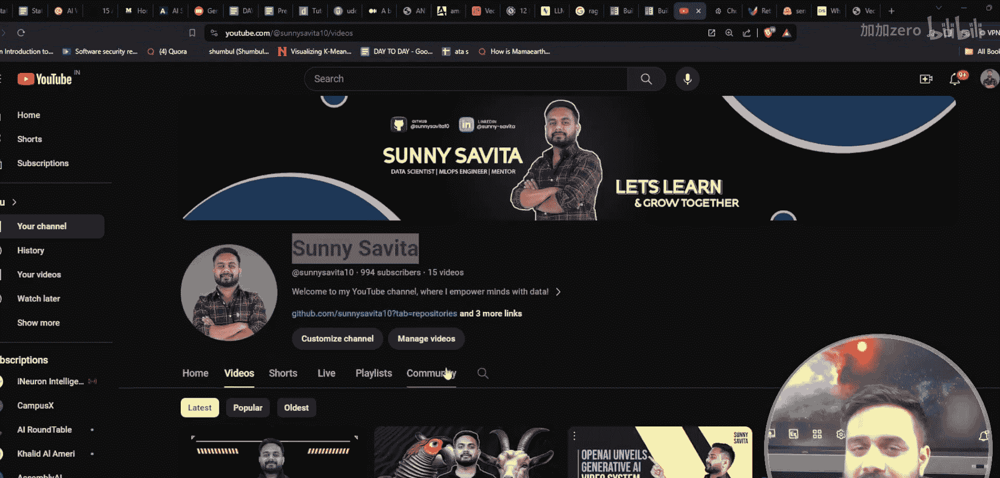

I'm going to like record each and everything in a very detailed manner。 So yeah。

 please go through with the content。 and if you find out that yes。

 it is adding the value in your life in your like learning the definition then please subscribe the channel and hit the like button and leave your thoughts。

 leave your comment So guys this session actually it's extension of the previous session itself So if you will check the previous session and then you will come to this particular session then you will get the better understanding and then you can connect each and everything in a simplest way。

 So let's start So first of all let me give you a quick overview from the previous session and then I will start with this particular session。

 So here I discuss the introduction like in the introduction I told you that what is a rag So is nothing it's a kind of architecture the kind of system which is helping to the Lmsms like G namema to provide a better responses If you want to know in more detail way you can go and check with my previous video So here is a architecture guys So this architecture I divided into。

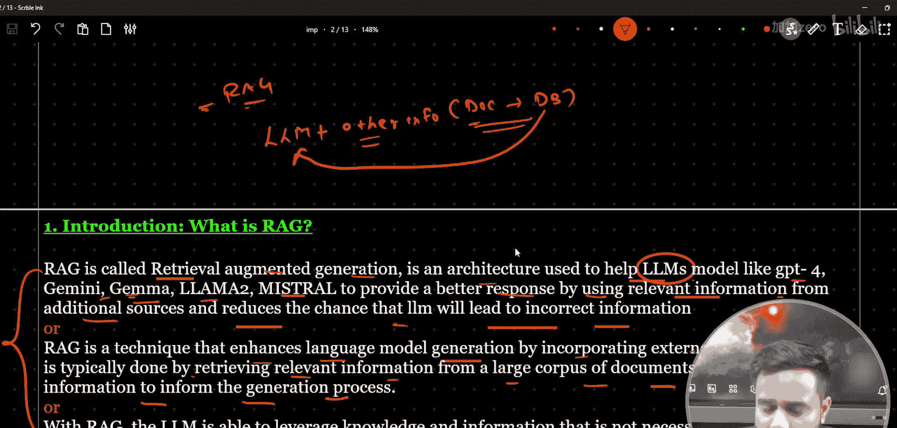

3 section so in the first in the first one I in the first section actually I discuss about the inion then retrieval and then generation。

 So actually I just discuss about the inition only in my previous video I'm about to discuss this retrieval in the generation and in this particular video I merely I will focus on this retrieval because this is very important part of the right。

Now， you can go and check with the previous video。 you will get this architecture， right so。

What are components we have in this architecture and how we can divide into these three parts each and everything basically we get it from there itself Now what is the meaning of retrieval。

 what is the meaning of augment， what is the meaning of generation so here you can see like obtaining means getting a data and then enhancing information through the LLM that is a meaning of augment the generation means we are going to generate a data so this process actually it called generation synthesis right we are we are going to combine the user query and the retrieval output from the database itself and then we are going to generate a refined response Now here guys you can see I discuss all about the embedding and the similar to channel definitely you can check with the previous video。

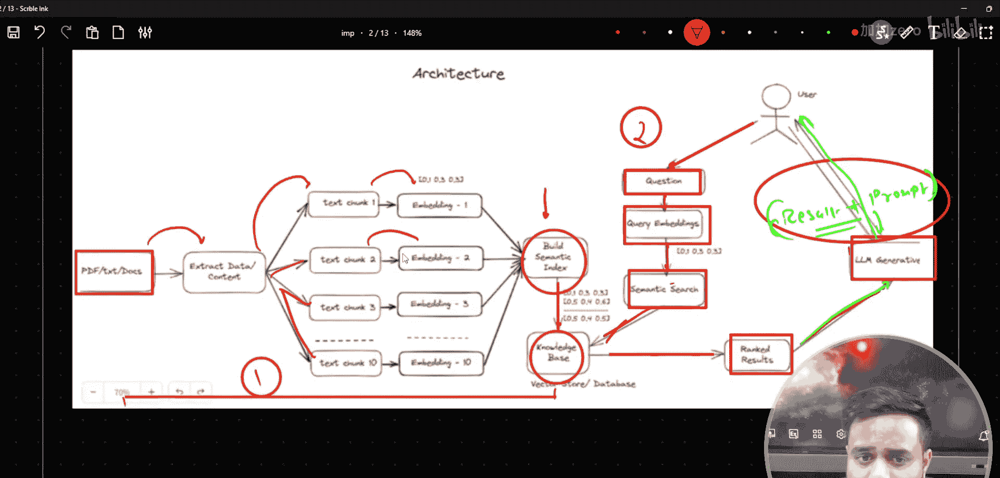

Then I came to this end pipeline of the rank。 So there actually I discussed the complete process。

 So here actually I discuss the ingesion process。 So in the instion basically I discuss five main points to this ingesion process I divided into five main parts first is a document collection means the data collection。

 second is chunky right so third one is what the third one is am now the fourth one is what indexing and the fifth one is what retriever。

 Okay like databases or retriever。 So along with each and every along with each and every topic I associated the links as well So here you can see the different different links So here you can go and check with chunking process right So indexing process that which indexing you should prefer different different type of indexing whenever you are going to store a data inside the database here you can see the comparison of the vector databases So if you are going to store the data in the vector database then which data you need to select right which database will be a best。

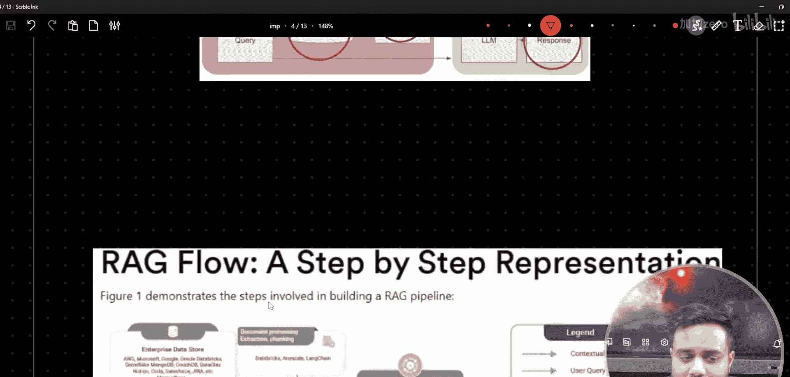

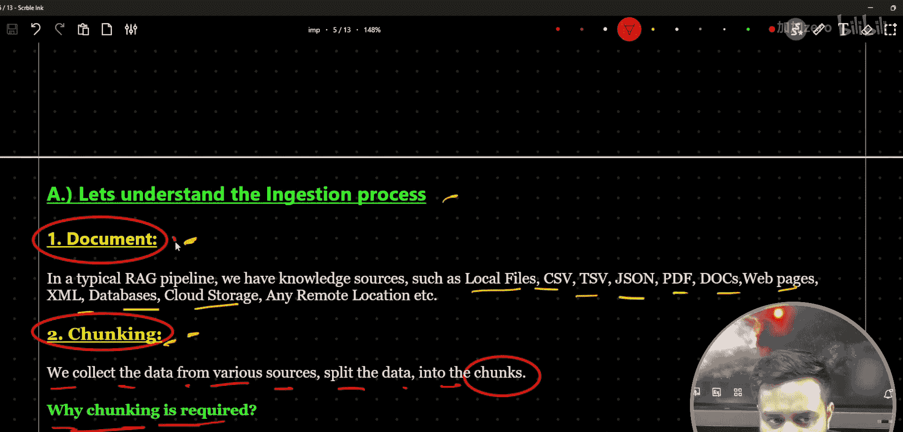

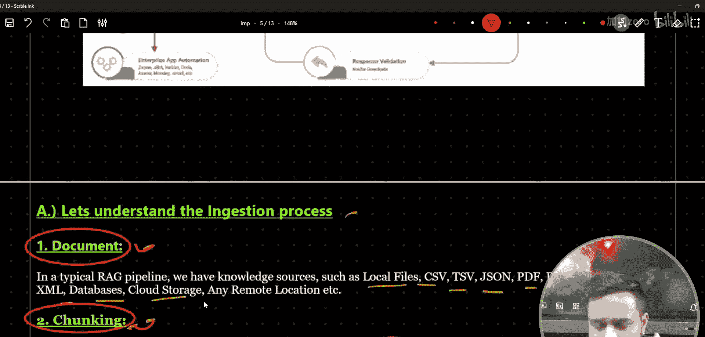

databaseabase for you。 So definitely you can decide by seeing this particular website and here you will find out each and every database。

 Now， apart from that you can see the sentence transformer。

 So the sentence transformer for for generating the sentence emdding we are not going to the token vice embedding we are going to generate the embedding based on the sentences So for that actually we have this sentence transformer。

 So whatever model you can see like j embedding open embedding or any other embedding。

 they are using this sentence transformer behind that behind the model itself Now here you can see this is a particular website vector。

 So it's database basically vector is vector database you can go and check that also you will find out this architecture it will give a more clear I discuss about the chunking size chunking strategy regarding each and everything I share the link So guys if you want to take a of this particular content。

 so definitely。

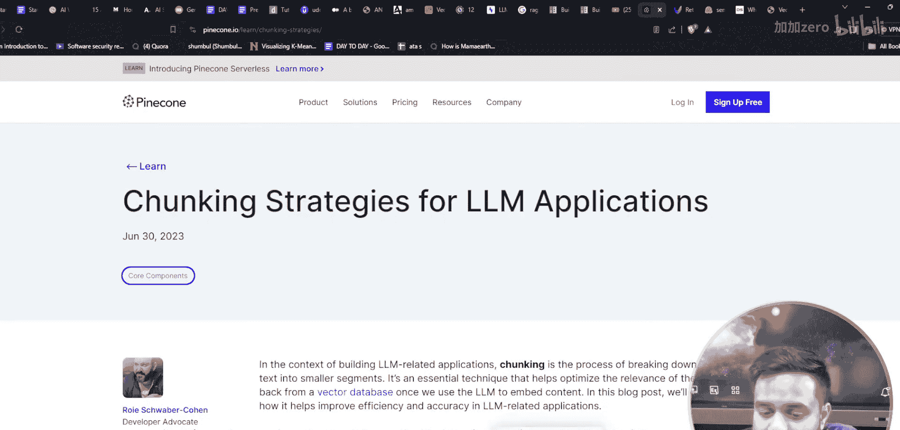

Andあ。Like go and check with my previous video and the description from the description you can download this notes Now I know for which a topic you have like you are you came to this particular video So here I need to discuss the retrieval process So here in this particular video I will more focus on this retrieval part again so what is the meaning of retrieval guys so retrieval is a very very easy easily I can explain you So here let's say this is what is my data。

This data， actually， I am going to be converted to the chunks。

Okay now after converting into the chunks， right So this is my data and this is my chunks。

 we are going to store inside the database。 So here what we are going to do。

 We are going to store inside the database。 after that， what is happening， you know。

 So this is what this my database this one。 So now what is happening you know。

 So here is a user let's say here is what here is a user。

 Now this user is asking something right this user actually is asking something。

 It is doing some query So this query will go to this database。 This is what this is my database。

 and from this database basically I'm going to collect some I'm going to collect。

 I'm going to collect top top top K responses it can be top 5 top 3 whatever this particular responses based on what based on a similar Tel。

 So here what I'm doing。 So here I'm having a query。

And here I am performing a similarity search with respect to this database， similar to search。

With respect to what with respect to the database。 again， then what we are doing。

 we are going to find out the top care responses。 Then I'm passing this So okay。

 so this responses is basically further I' am passing to the LLM along with the query。 And finally。

 we are getting the output right， Finally what we are doing。 We are generating the output。

 So this is a complete process actually， this is a complete process right。

 So here is what here is my LLm。 I'm passing to my LLM。 what I'm passing。

 I'm passing this top care responses along with this query and we are generating the output thats it So guys。

 this process from where to where。 So this process user is querying based on the similarity search。

 we are going to find out a top care response。 So this process actually is called the retriever。

 Now this retriever。 actually， we have a different different process of this retriever。

 we have a different different like a ways of retrieving the data。

 So here this is a basic rack pipeline。 This is a basic wave。 So we have a data。

This data I am going to be divide into the chunks， right And after that， you know what I'm doing。

 I am going to convert into embedding and I'm going to store inside the vector database。

 Then my user is querying something。 And based on that， based on that。

 I'm going to collect the top of 5 or top responses， top 5 top 3， top2 whatever。

 And then Im passing to my LM along with a query。 and finally， I am generating a response。

 So this process actually is called or synthesis。 Okay。

Now over here guys we have some advantage and disadvantage of this simple process。

 so let's try to read the advantage and disadvantage So here I am saying this simple process right。

It is fine for the smaller data， It is fine for the smaller data， but not for the bigger data。 Now。

 bigger data means what bigger chunks。 The chunks basically。

 which we are going to collect from the data here basically we are going to collect the chunks So Im talking about with respect to that chunk。

 Now let's see the advantage and the disadvantage and based on that will try to look into the next technique So we have a multiple technique So I kept three techniques。

3 main techniques over here。 the first one was simple and then I will come to the next technique So here the advantage is simple city and efficiency it is very very simple It is very very like efficient also with respect to the smart tie。

 uniformly in the data handling uniformly means what So here we have a data。

 So same data basically we are going to we are going to convert into a chunks。

 and then we are going to convert into the em right So here this is what is my emdding Now the same embe basically I am going to pass my after similar to such and all。

 So here you can read here you can。

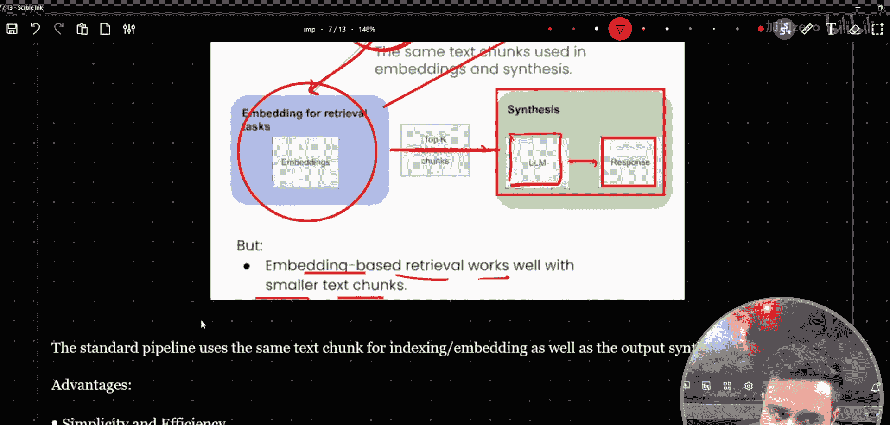

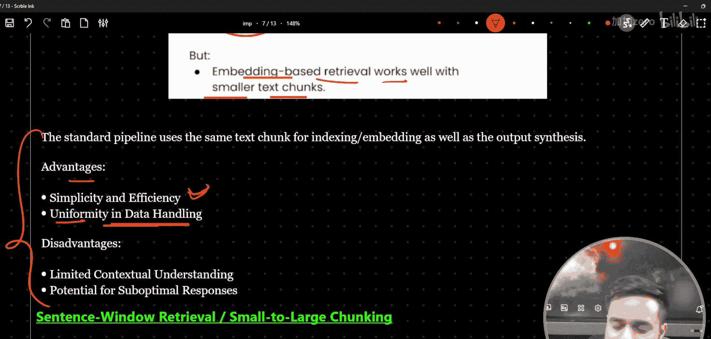

Like in the image itself like you will find out this particular text and just try to read the same text okay the same chunk actually。

 the same chunks used in embedding and synthesis right embedding we are going to create embedding from the same chunks and we are going to pass to the LLM the same thing same chunks Okay there is no such changes its a unified one right uniformly distributed now here you can see disadvantage with disadvantage is what so limited contextual understanding is is not having that much contextual understanding because I told you right it is better for the small。

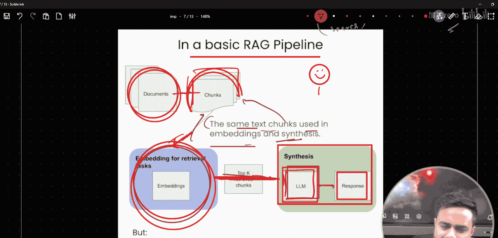

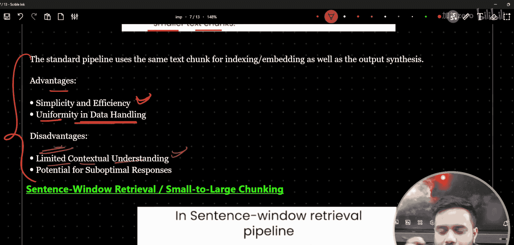