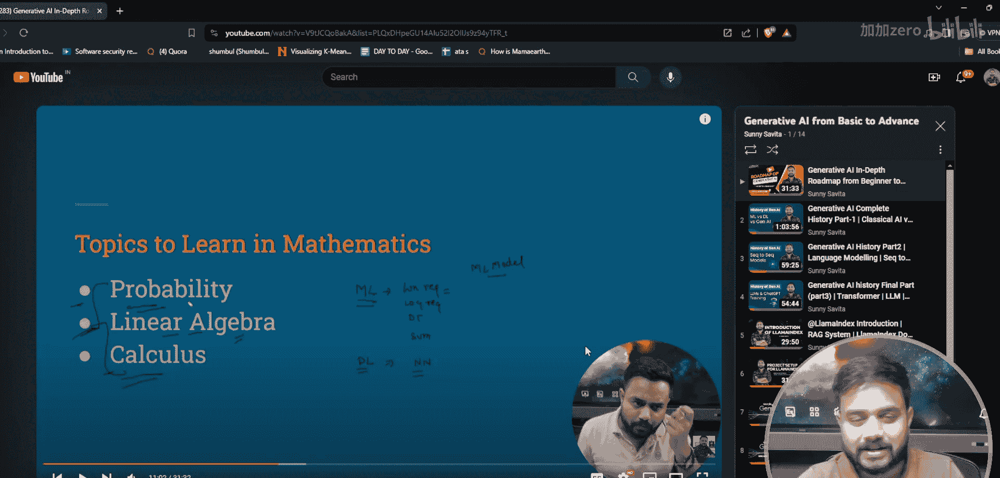
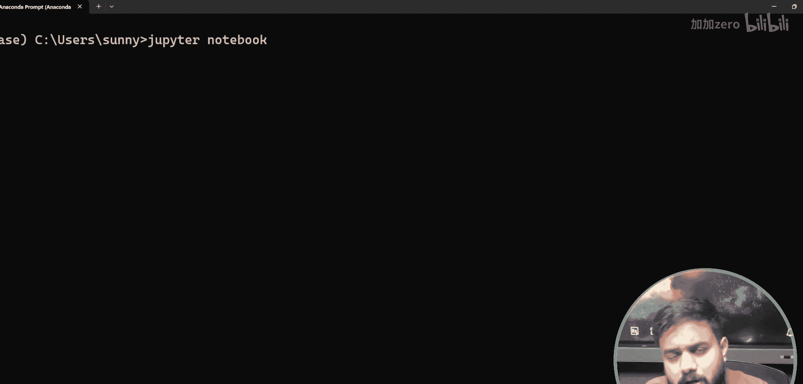
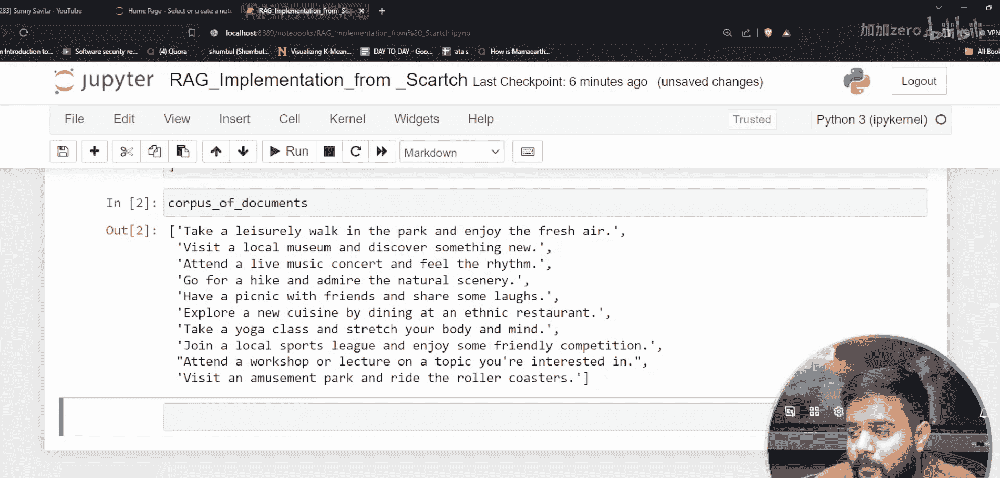
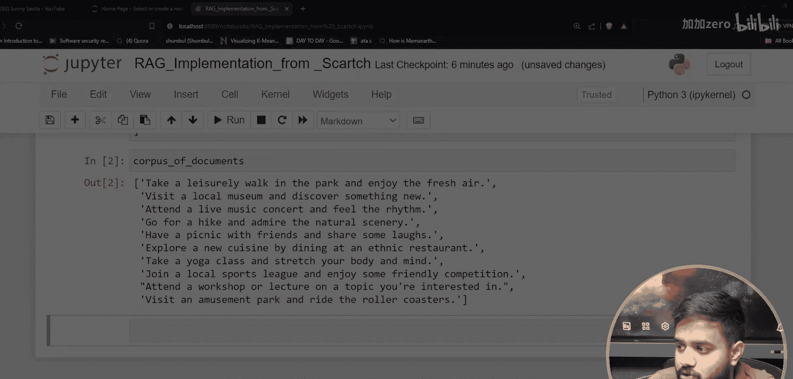
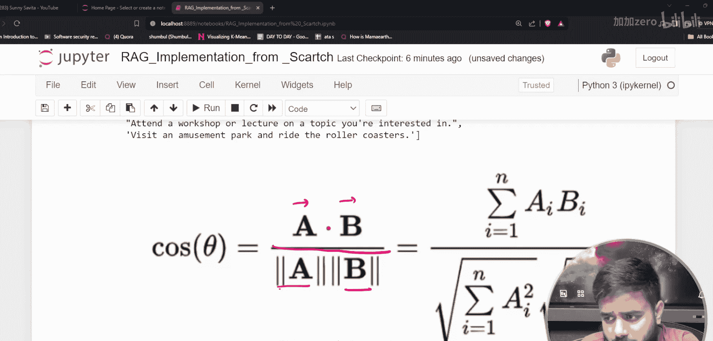

# Sunny Savita【中英⚡生成式AI：从初学者到专家｜Generative AI In-Depth Roadmap from Beginner to E】 p15 P15 RAG Pipeline from Scratch Using OLlama Python & Llama2 ｜  ｜ Llama2 Setup in [BV1Uht8zDENA_p15]

Hello everyone。 welcomelcome back to my YouTube channel。 My name is Sunni Savita。

 and I'm back with another exciting video。 So in this video。

 we'll see that how we can implement a rag architecture from scratch。

 Yes guys So here we are not going to use any framework like Lama and Ds L or any other framework for implementing rag architecture So here in front of you only I will create the rag architecture from scratch。

 So guys， if you will look into my YouTube channel So there you will find out the different different video on top of the Geneative AI and here basically Im creating one prelist on top of the Gene A where Im trying to cover up different different thing。

 different concept related to the Gene A and not not like a basic one I'm trying to cover each and everything in depth。

 So here if you will look into the video So you will find out the complete detail related to the topic。

 now not even Geneative A I'm thinking。

to cover nLP CV deep learning， machine learning， data science like every concept of data science from statistic to machine learning python。

 everything on my YouTubetu channel so that you can get each and everything at a single place itself。

So yes guys， if you haven't subscribed the channel then please do subscribe if this video is adding some value in your learning that definitely like the video share the video and please support the channel and I will be coming up with many more exciting video in the future。

So yes， let's start。 Let's start with the session。

Now guys here， first of all， let me explain you that what all thing we are going to be in today's session。

 So each and everything basically I will do inside the Jupyter notebook itself。

 And for that I'm using the Ananaconda。 So if you haven't installed the Ananaconda guys。

 please install the annaconda and try to do that like set up with respect to Ananaconda and if you don't know about it if you don't know about the Ananaconda and all definitely I will create one dedicated video for the end to end environment setup so end to end environment setup up for AI and yes。

 I was thinking for that also but I'm not getting time basically so I couldn't create but don't worry in future whenever I will get time then definitely I will create one end to end video for。

For the end setup ear development basically right now here I'm using this Ananaconda for what for my Jupyter notebook。

 So from here easily I can use my Jupyter notebook I just need to install the aconda nothing else。

 So this is mynaconda guys now annaconda prompt and from here what I'm going to do Im going to launch my Jupyter notebook So how I can do that So here I just need to write this Jupyter notebook after installing the Ananaconda。

 So easily you can find out this Ananaconda pro inside your search bar So once you will search about Ananaconda pro。

 you will get your annaconda pro and just write the Jupyter notebook there and your Jupyter notebook will be launch right every time try to launch the Jupyter notebook from the Ananaconda itself don't try to launch it separately because here basically。

You can track like so many thing right by using the Anacon itself Now here。

 if we want to like create a new file， new IP Y V file， then how we can do that。

 So just click on this new and then。Click on this Python3， then you will get your new notebook。

 Okay again Im repeating。 just click on this new and then you will get then click on this Python3 kernel and then basically you will get your new IP and B file。

 So here let me rename the file so the file name is going to be rag implementation rag implementation from scratch from scratch so here I can write from scratch I think this is fine so I hope it is fine to all of you now let's start with the implementation So one by one guys I will try to implement each and everything in front of you only now first of all guys let me show you the architecture。

 So here basically I kept the architecture let me copy this architecture and Im pasting over here So let me convert into the markdown and here is what here is my architecture guys So just wait I think does not。

Okay， not an issue。 what I can do。 I can take a snapshot of the architect。 So just allow me a second。

Let me take a snapshot of it。 So here is what guys， here is my complete architecture。 Just second。

 and yes， now is perfect。 So guys， this is what this is my architecture。

 And now let's try to implement this architecture from a scratch。

So here if you will look from here to here， so just just focus here。

 let me open my app pen also and then I can annot it the each and everything over here on top of the architecture itself。

好嘅， so this this game。Okay， perfect。 Now what I can do here， I can write that this part， right。

 this this particular part from here from here to here， right So this is called data insion。

 This is what tell me this is called data inion in my previous video。

 I clearly explain you this thing Then the this part， this， this particular part。

 this is called a retrieval right till here to here。 This one， This is called retrieval。

This is called a retrieval now from here to here， guys， from here to here， this one， the third one。

This one， like we are getting the query and we are generating answer from the LM。

 So this is called generation generation。 So this architecture actually I divided into three section。

 First is data second is retrieval and the third is generation。

 So let's try to implement this particular architecture from scratch without using any framework and then in the next video I will show you that how you can do it how you can do this particular thing by using by using by using what by using the Lama index。

 Okay so let's start let's begin first of all So first of all， guys， what I required。

 So here basically I required that data。 So see I'm not going to collect the data from any file folder So this this thing basically I am trying to keep it as simple as that right so here what I did I created a corpus I created like a corpus of document here you can see So we have like a corpus of the document inside the list。

 I'm not going to load anything from my from my。TXT file from my Pf right so here itself I kept it just for sake of simplicity right in my next video So even I did it。

 if you will go and check with my live section So here basically I was trying to read the data from the Pf or from the Tx file or here if you will look into my introduction video or this Q system and all yes I'm doing that right but here everything basically I want to show you from scratch so this data data part also I want to keep it simple only right I hope you are getting my point now this is what this is my corpus of document right document means what tell me corpus means the entire data right document means what document this particular sentences which is called the document I hope you are getting my point Now what I'm doing here so let me print this corpus of document now here。

You'll find out this is nothing。 This is my document right Now after that， guys， what I will do。

 So here， here， guys see this document， right， what I will do。

 I will convert into the embeddings embedding means what embedding is nothing。 It's a representation。

 It's a numerical representation it's a numerical representation of this text right we have this text now So embedding is called the numerical representation of this text。

 So what I will do I will keep the data。 inside what inside my vector is store So here guys again。

 Im saying I'm not going to use any P file。 I'm not going to use any vector is store or anything right I will keep it as simple as that。

 So everything I will keep it here itself in my file in my variables only but you will get the clear cut idea that how this is working in a backend right how this thing basically we can implement like from is scratch if someone has created the different different framework like L lama index So how the person has written the code and all everything you will get it over here。

RightSo what I required guys。 So here actually I required the embedding。

 So with respect to this particular sentence， I required the embedding means I required the numbers。

 I required the numbers。 Okay so let's try to do that and let's try to create a number by using these particular sentences right and after that basically will try to find out a similarity similarity between what similarity this query right similarity between this query。

 the query， which user is asking and this document。

 which is is stored inside the knowledge base right so my knowledge base。

 my vector database is whatever you can think everything is here itself where in my system as of now this is what this is nothing this is just my data right now for the similarity what I'm going to use you know for the similarity I'm going to use the cosine similarity right so first of all what I can do here I can give you the formula of the cosine similarity also So let me give you the formula of the cosine similarity I kept it over here let me take a short screenshot of it and let me paste it over。

HereSo already I kept in my document and I'm just going to copy and paste that particular formula in my notebook。

 So this is a formula of the cosine similarity if you want to calculate the cosine similarity So there you need to like there actually you need to multiply two vectors like two vectors A and V。

 So here you need to multiply not multiply basically it's a dot product I think you know about the dot product and then basically we have to divide it by using the magnitude right this is what this is a magnitude of the vector。

Getting my point， I think。

