# Sunny Savita【中英⚡生成式AI：从初学者到专家｜Generative AI In-Depth Roadmap from Beginner to E】 p16 P16 RAG Application using  @LangChain @OpenAI  and FAISS #llm #rag #python #lang [BV1Uht8zDENA_p16]

Hello everyone。 welcomelcome back to my YouTube channel。 My name is Sunny Savita。

 And in this particular video， we'll see that how we can create a ra system by using L。 So guys yes。

 I was on break。 So it's been a long time that I haven't uploaded any video on my YouTube channel。

 So first of all， let me show you my YouTube channel。 and then I will give me the further update。

 So guys once you will go and check with my YouTube channel。

 you just need to search about Sunny Savita。 and here you will get my YouTube channel there you will find out different different video on top of the geneative AI So regarding the L and all。

 So I started with a history of the geneative Ai then I came to the Lama In Jimmy So pipeline Lama index and all。

 So many more videos so guys if you haven't subscribed if you haven't checked then please go and check。

 So I uploaded my last video one。😊。

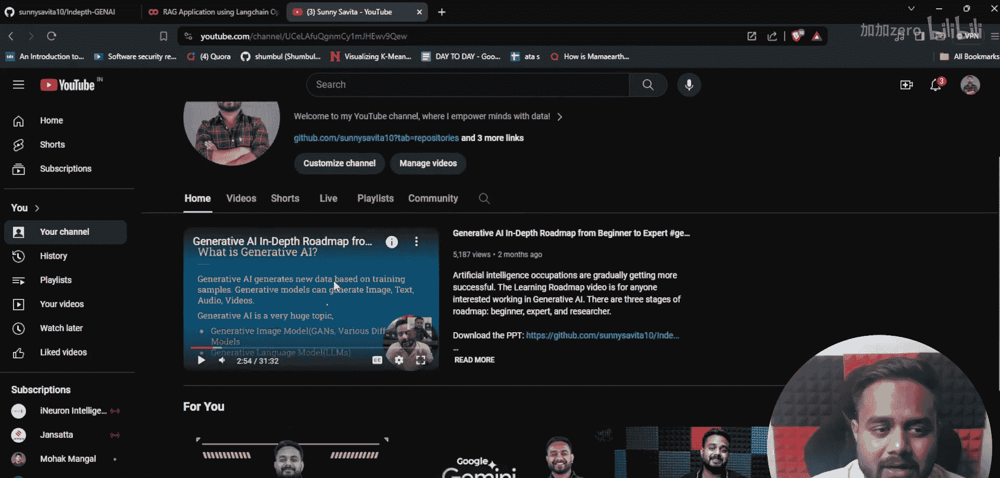

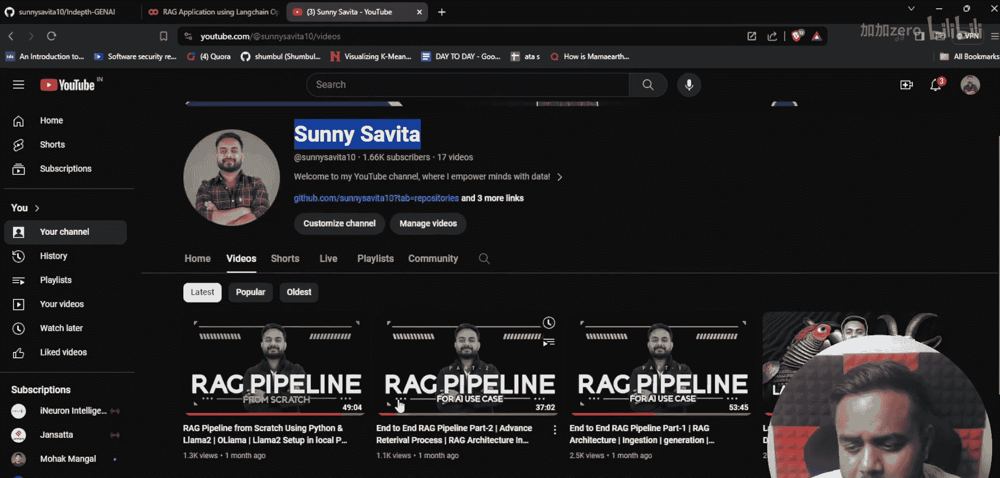

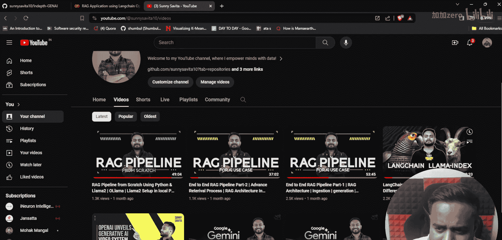

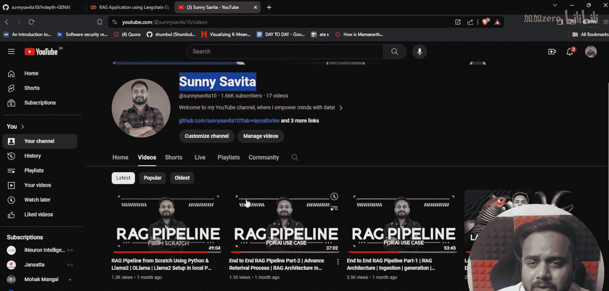

The back and it's been a long time。 It's been a bun month Basically。

 I haven't uploaded any sort of a video because I was busy with my personal thing and the walking out。

 So I took that break。 Now I'm back and definitely will start without learning again。

I will be appearing the video so I'm starting from that particular topic itself where I left one month back So here if you will go and check with my video so you will find out that in my previous video。

 I was creating the Ra pipeline from is scratch so I show you the complete code with respect to the Ra architecture that how you can create the pipeline rack pipeline from scratchch and I given you the complete and detailed introduction of the ragg So just go and check with this video if you want to know more about Jimmy Lan andma then definitely you can go and check even in the live class also I have covered one project end project it was a live session so definitely I will give you the further update that what thing I'm going to cover in the upcoming videos and all now first of all guys here。

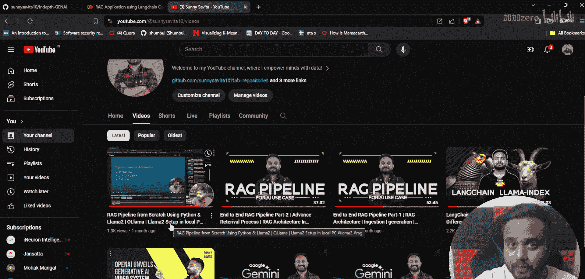

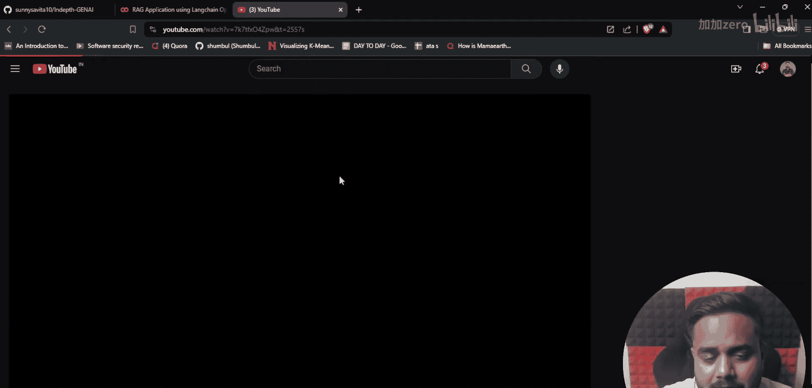

If you haven't subscribed， please go and subscribed if you are liking the content and please hit the like button as well。

 So let's start with the video now。 So in this video guys what we are going to do we are going to create a rag application using L open AI and vector database the database name is5 so here first of all let me show you the complete and detailed notes So whatever I have discussed in my YouTube video So each and every notes actually you will find out on my Github repository So let me show you my Github repository and in which repository you will find out the notes let me show you that as well。

 So here guys you just need to check with this repository in depth geneative AI just click on it and open it and here you will find out all the node。

 all the projects and all everything So let me show you this rag from scratch this particular p So here in this PDF actually you will find。

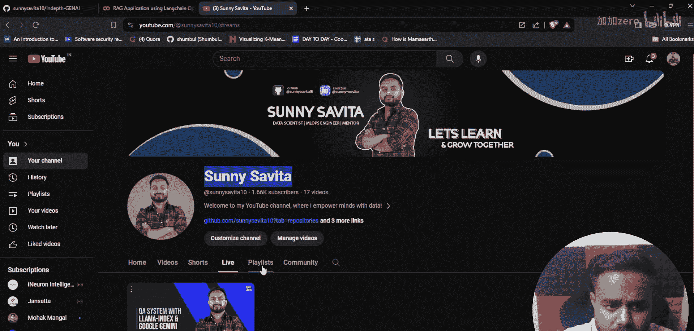

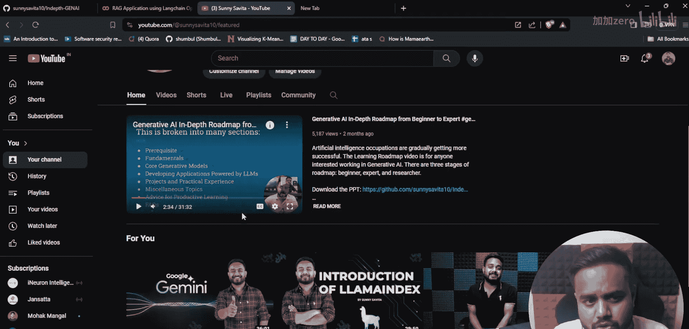

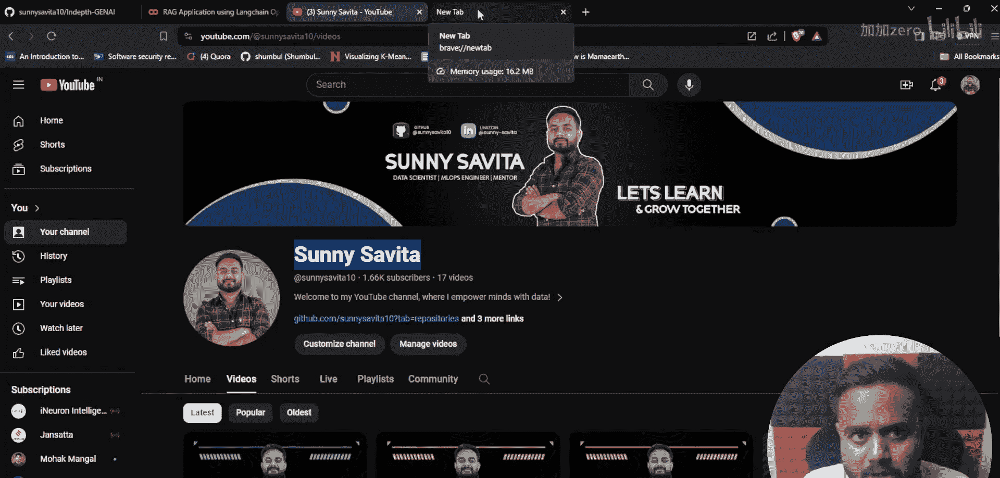

The complete and detailed theory of the rag， which even I discuss in the video as well。

 So here you can see this is a topic name， what you will learn inside this rag architecture inside this rag pipeline。

 So I mention each and every topic introduction of I already clarify rag architecture I already clarify entry pipeline I already clarify an advantage everything even building rag from sketch this five point I already discuss in your in the session basically now basically now what I'm going to do so I shown you that how you can create the rag from scratch and even you will find out the code as well this one is a code now I will show you that how you can create the rag by using the different different framework so that will get the different if you want to create the rag from scratch you can do that if you want to do if you want to create a rag from。

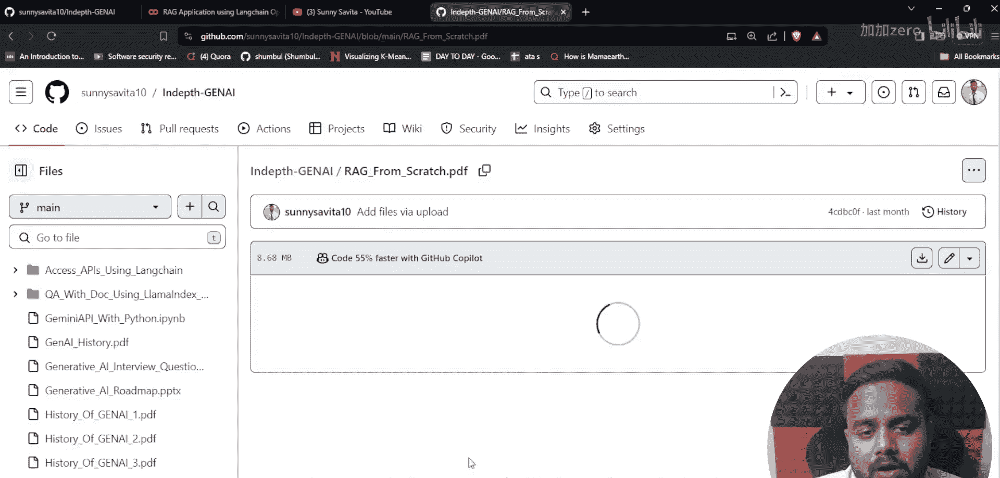

By using any sort of framework that definitely you can do that as well。

 So here I I will be covering different different framework like L online decks or maybe other framework as well。

 So in the upcoming video in 4 to5 video basically I will cover this entire thing along with the multimodal rag and the evaluation of the evaluation of the rag and then I will show you some research paper as well because I told you that wherever I left my tutorial I'm starting from that point itself so that you can maintain the sequence so then after I'm thinking to start one fine tu series as well where I will be discussing all the fine union technique and then I will be showing you rag overseas fine tuning that what is a difference between rag and the fine tuning system so let's start let's begin So first of all guys here you can go and check with the code as well the rag architecture or rag implementation from sketch if you haven't go through with this one please go and check please try to download this。

😊。

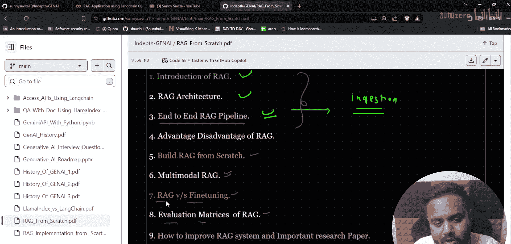

S run it inside your system and then you will get the enough amount of idea and even the video is also available now here you can see so in this particular video we are going to create Ra application using L open API open API and files and in the next video I will show you this rag architecture or rag application using L。

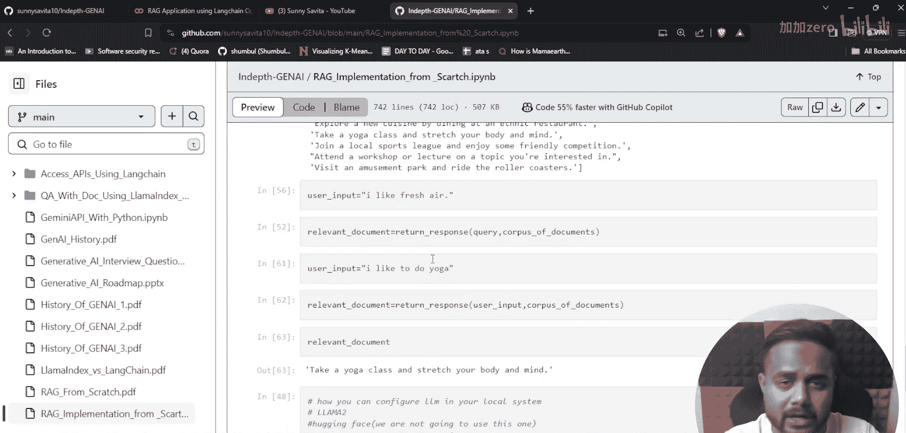

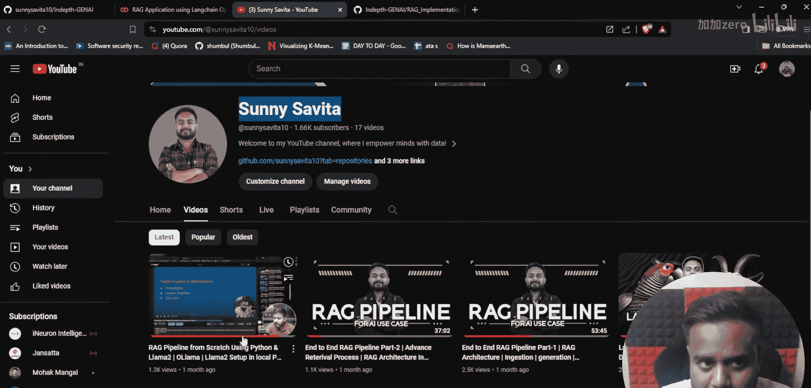

Mistel and this okay vector database because here I'm using this open air API service。

 which is a paid one。 and in the next one basically I will show you with the open So so I can use any sort of a model。

 but I selected the myill。 I will let you know why and even I can show you with other API also that I will let you know in my next video you will get that soon so here it's auffice So I think you know it's a Facebook database in memory database a vector database vector store。

 So definitely we are going to use it inside our project。

 So now let's begin let's start and some I will I will be writing the code and some I will be copying and pasteing。

 So just just for saving the time。 Nothing else。So what the rag guys here I clearly mention the definition of the rag if you don't know about it。

 you can go and check with my previous video as well。

 So what is the re So here is the definition of the re this is called retrieval augment generation as you would retrieve the relevant data relevant data and use it use it for for for the generation where we are going to generate we are going to generate from the LLm we are going to augment our response from the Lm right So and use it as augmented context from the Lm as I was saying that so instead of relying solely on the knowledge drive from the training data means instead of directly get the response from the LLm we are trying to create we are trying to maintain one knowledge base and from that knowledge base actually we are going to fetch the information not directly via Lm so we get will get the desired output now here guys whatever material and all I'm showing you it's a well research material and even like。

you will follow my material， my notebook， you no need to go anywhere because whatever thing you are doing。

 So I so here I'm doing behalf on you。 So if you are eager to learn this Gene V and all definitely you should follow my material because here I will show you each and everything whatever you required to become Gene engineer or whatever is required to develop something by using the Gene or LLn now definition is clear now let's try to understand the architecture so here guys I can explain the architecture in this architecture you can see we have multiple stages I already explain you in my previous video if you want to understand in a detail manner you can go and check with that particular video now here in this architecture you can see what we are doing so first of all let me open my pain so that I can highlight I can highlight something over here and I think it is visible also to all of you but don't worry I will give you this particular image so that you can。

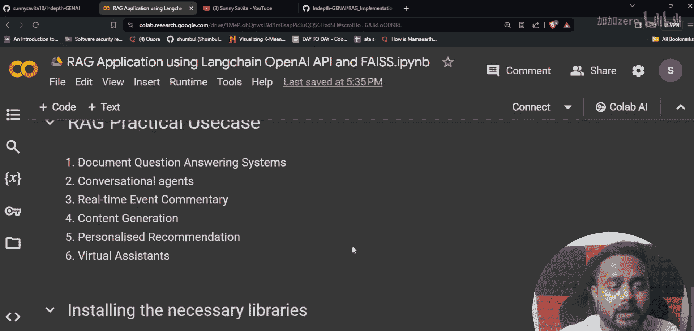

Go and check now here guys you will find out So we have pdf text document whatever and from there we are going to extract the data then we are going to create a chunk from that data and we are going to create a embidding and we are keeping somewhere inside the knowledge base so in our case we are going to use this app files okay price vector database。

Now after that here you can see user is asking query So if you will look into the user so here is my user if user is asking the query。

 So directly we are not generating a response from the LLM no， we are not doing that。

 So here is my LLM we are not we are we are not doing this thing instead of that what we are doing we are augmenting the response Okay why because we want the better answer thats why we are augmenting the response over here So here you can see this is my user and user is asking the question and here we are creating the emdding from that particular question If you don't know about emdding vector database and all don't worry guys。

I will create one dedicated video dedicated series dedicated tutorial for all of you so that you can understand about this vector database and different different like type of database as well。

 which we can use inside our geneative V application now we are creating a amdding of this particular query and then we are performing semantic search and here is my top answer Okay rank answer So this rank answer it can be one or it can be multi as well So it depends on us right now here we are passing this rank answer to this LLM and through this LLM right this rank answer。

 whatever like best answer we have which we are getting through from this knowledge base we are passing to this LLm and along with that we are passing the prompt as well to this LM and then we are generating the output directly we are not generating it because。

My LLM can mislead to me That's why my LLM like it's not able to give all sort of answer。

 right all the real time answer。So that's why we are using this particular technique getting my point。

 I think。

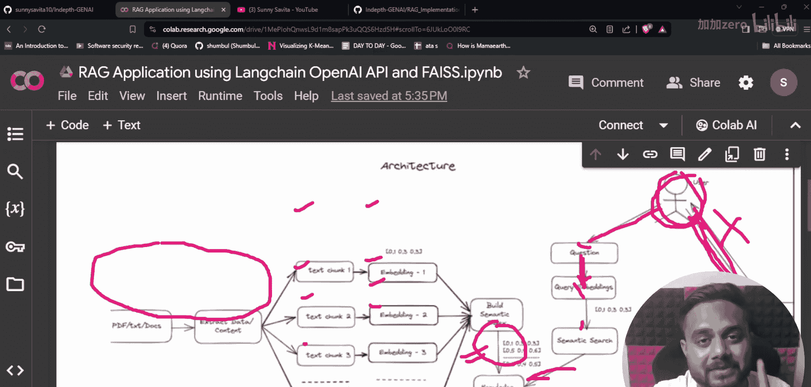