# Sunny Savita【中英⚡生成式AI：从初学者到专家｜Generative AI In-Depth Roadmap from Beginner to E】 p17 P17 RAG Application using Langchain Mistral AI and Weviate db #llm #rag #langcha [BV1Uht8zDENA_p17]

Hello， everyone。 welcomelcome back to my YouTube channel。 My name is Sunni Savita。

 and in this video well explore one more application re application by using L Mial and Webate vector database。

 So in the previous tutorial also I have shown you one application by using a L and open Ai and one inmeory database in memoryory vector database that is F。

 So first of all， let me show you that video and then we'll start with today's practical。

 So here guys here is my YouTube channel where I already uploaded that video So yesterday I uploaded that video and here you will find out into an implementation of this particular application So now in today's video guys well explore we implement one more architecture because yesterday actually I was using the open API Now in today's video actually we are going to use one open source mode。

😊，That is a mystery。 So I will talk about Mr。 A and all。 So what model is available。

 what model is paid and all。 So each and everything we talk about here。

 And along with that I will show you the baby vector database as well。

 So let's begin let's start with the practical So here guys if you want to get all the material So I'm keeping all the material in my Github So from there itself you can download now let me show you my Github and in which Github。

 you will find out all the material。 So here you just need to click on this sorry you need to check with this particular repository this inep repository in depth So once you will log in with your I you need to like search about myself Sunny Sunnyta1 this is my user name and here in my repository you can go and check with this indep Now here you will find out all the notebook all the like p and all everything according to the session whatever I'm covering or whatever I'm teaching you in my YouTube。

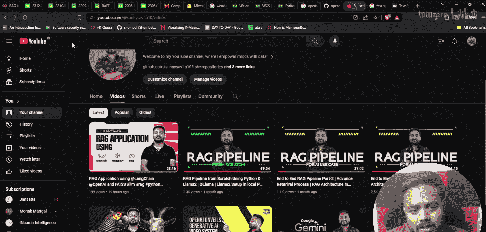

nelSo this is the notebook which I implemented in my previous session。

 So let me show you this notebook。 So here it is available in my coab as well。 So the same notebook。

 you will find out or you will get it from this Github as well got it So this is the architecture of the right guys。

 Now this is the simple and na architecture of the which we are trying to implement in a different different way now apart from that I will show you some advanced architecture as well because in this particular architecture。

 we can do lots of manipulations， lots of like think we can change over here with respect to the in retrieval or generation as well。

 So yes， going forward， basically I will show you some advanced architecture as well as of now we are more folks saying to explore the different different platform different different like。

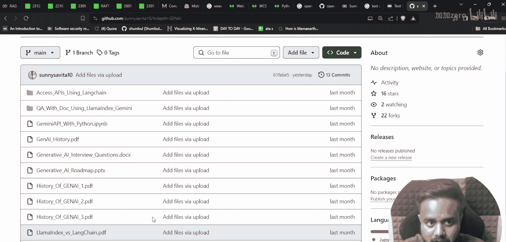

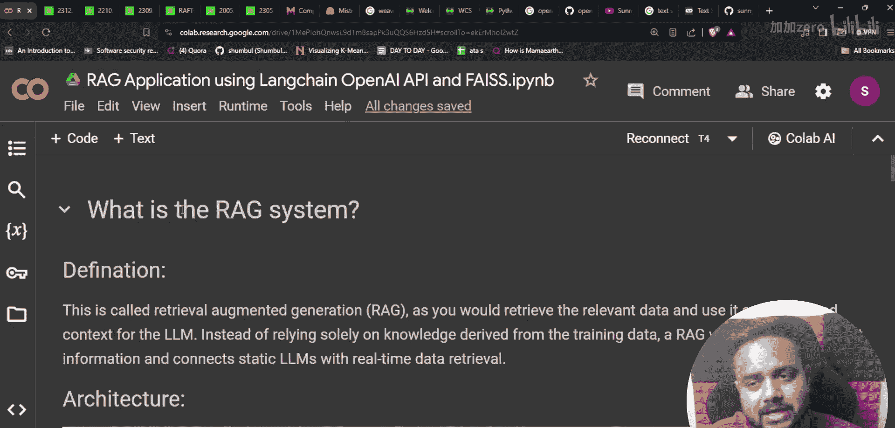

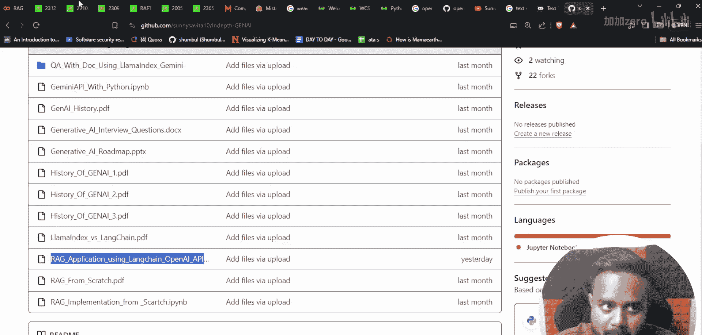

tools and all。 So in the previous video， I discuss about the open AI GP and all not today Mial and the V。

 So let's start with the。

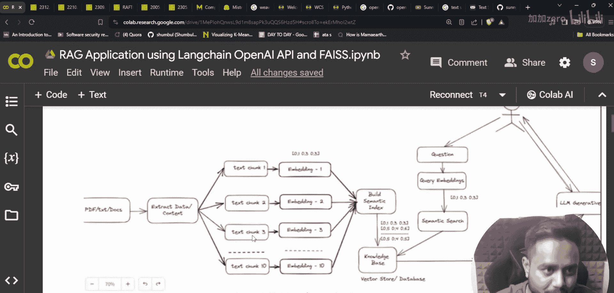

Implementation so first of all， guys， let me open my new notebook and here in front of you only I am going to write each and everything。

 So sometimes I will be copying paste and sometimes I will be writing it by myself。

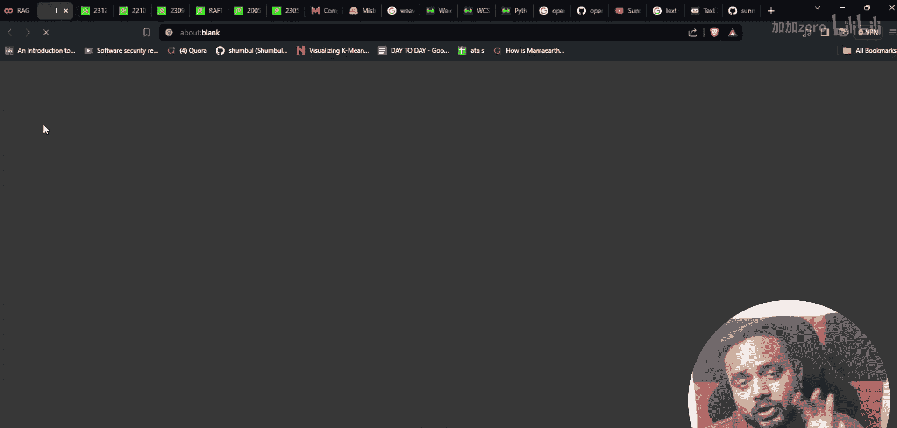

So I open my new notebook。 and here you can see this is what is my new notebook。 guys。 Now。

 first of all， what I will do， I will change my run time。 So for changing my run time here。

 I just need to click on this runtime and then。😊。

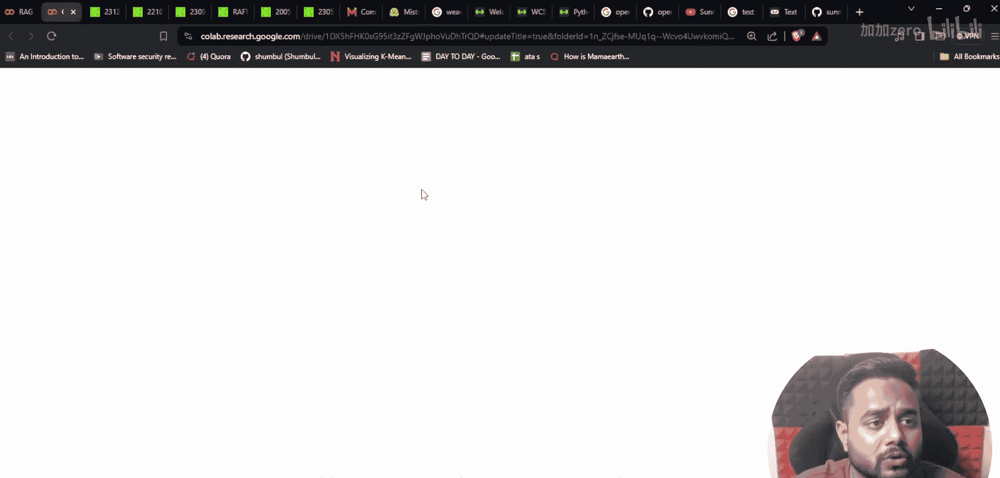

I just need to click on this change run time so you will find out this GPU。

 This is the free GPU free available GPU from the Google site so you can utilize this one apart from that you will find out some other GPus as well which is a paid one so you will have to purchase the Google collapse pro and then only you can access this particular GPU apart from that here you will find out the Tpus as well So if you want to use the tpU which is a specific processing unit of the Google itself tensor processing unit so yes definitely you can use this as well but here we are using the GPU so I'm just saving it and then connect it so first of all guys I will be required few library so let me copy and paste some library which we are going to install for this particular project so here is the library so here Im going to use the V8 I will show you that how to set up the Web8 and all I will show you that in how many ways actually you can set up this V8。

And the second one is the la I think like by using the la only we are going to implement it in the next class I will show you with the Lama index。

 So in the next tutorial one more video Ive recorded on top of the Lama index So after this one I will upload that one only then Tik token it's a package from the open eye for tokenization so if you want to do tokenize your data so definitely you gonna use this particular package in the backend p Pd for reading the P and this one is rapid talker on extra run time So it is a backend package so whenever we are going to use this pPf along with that you will have to download this one as well now on these other module basically which is required now here you can see I connect with my runtime now let me put my heading as well So here basically we are going to implement the application by using this vi and this mis so let's start let's begin now so first of all let me install all the libraries over here so。

Let's wait for two minutes because it will take2 night of time。

In installing all the required libraries。Weette client Langch。

 Tik token pipe P Df and this one as well。ok嗯。Great， so it is installing until what I can do。

 I can write my other line of code as well。 So guys， after this library， I require a few more things。

 So first of all， guys， I will show you about the Web so how you can configure the Web and Web is the vector database Web is what Web is a vector database So we use for st the vector if we want to store the vector we use it this one now we can use Webate in two ways so like files。

 actually we can we can like store each and everything on my instance as well in in my like in my runtime memory in my cache memory or the second ways I can configure over the cloud as well。

 So here in this particular tutorial I'm using the cloud variant I'm using this Web database as a cloud service So on my cloud itself I will store each and every em now how we can do that how to configure it。

 let me show you now So first of all guys， I require a couple of thing for using。😊，This Web。

 So here I required this Web API key and Web cluster URL。 So first of all。

 let me remove it because here I will show you that how to create this Web API key and this Web cluster URL After that guys。

 we required some code as well for configuring this Web。

 So let me write that as well And by using this one， we will be able to configure the Web Okay。

 again， I'm saying in two ways， actually you can access this Web you can use it as a inmemory database and you can use it as a cloud service as well。

 So here in this particular tutorial， I'm using it as a cloud service。

 So I'm storing all the embeddings and all over the cloud itself Now how to do that。 So first of all。

 guys， you require this Web API key and this Web cluster URL。 So from where you will get this thing。

 So first of all， you will have to log into the Web。

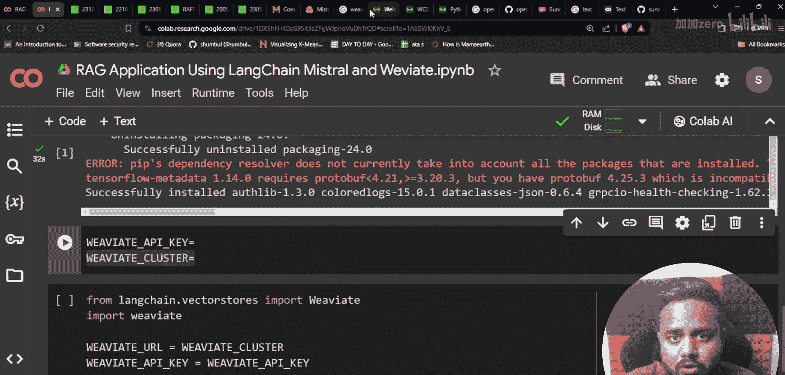

Wbe website。 So just search about the Webbe it in your in your Google right So after that you will get this web be and just click on this try now right after getting this particular website。

 just click on this try now So already guys here you can see I logged in but in in your case you will get So in your case actually you will get the option for logging in before the logging in register as well。

 So below logging in actually we will find out the register option。

 So simply you can register yourself by giving the email I password。

 that's it nothing will be required it's like a very simple process and after that after register to yourself。

 you just need to log in So here I already register and here you can see I just log in with that particular mail I Now I'm just clicking on this create cluster So just click on this create cluster after clicking on this create cluster here here actually it will ask you right So what it will ask you So first of all you can see it is showing you this two thing。

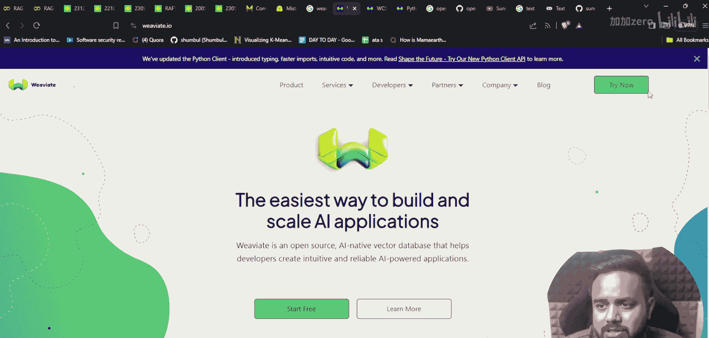

box and this manage cluster manage cluster actually it's the paid one。

 So it will ask you like $25 per month。 but here we are not going we are not going with paid service here we are going to create the pre send box Now here you just need to click on this create So once you will do that So here it will ask you right so you will have to pass the name as well。

 So whatever name So here Im writing my project So any name you can provide and after writing the name simply you can create the cluster。

 So here you can see it is creating the cluster and it will take some time and after creating the cluster definitely we can access the URL and the API key as well it's a very simple process nothing you have to do。

 you just need to register to yourself you need to log in and create the cluster。 Okay。

 that's it nothing else。 Now guys So let it create because it will take some time maybe one or two minutes。

 So in between what I get。

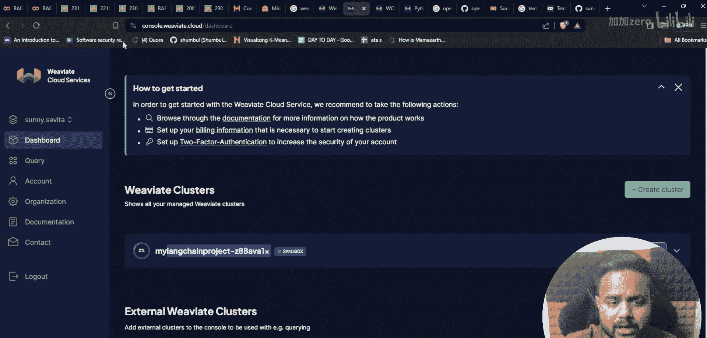

Do here in between， I can write some other code as well， because here。

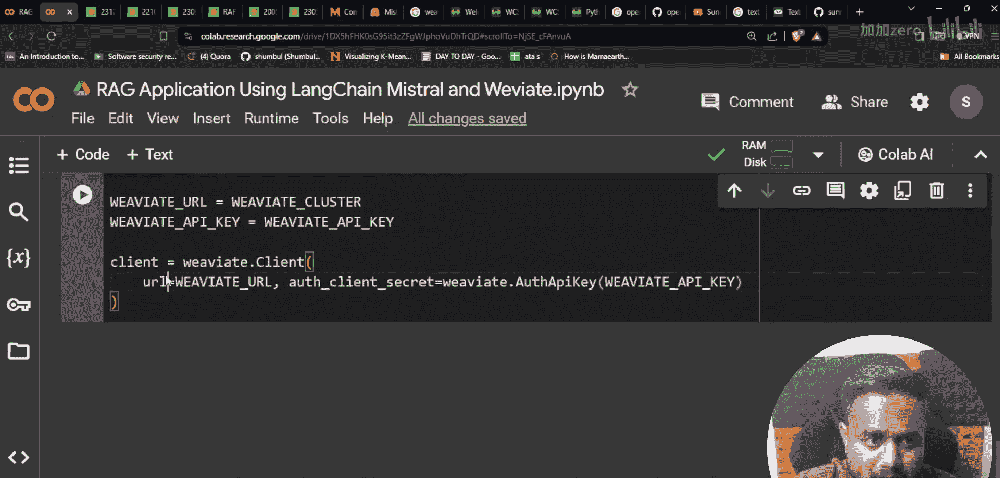

We are going to implement this particular architecture。

 this rag architecture and for that basically will be required the data chunking amending knowledge base which we are using like baby wetner。

 right？

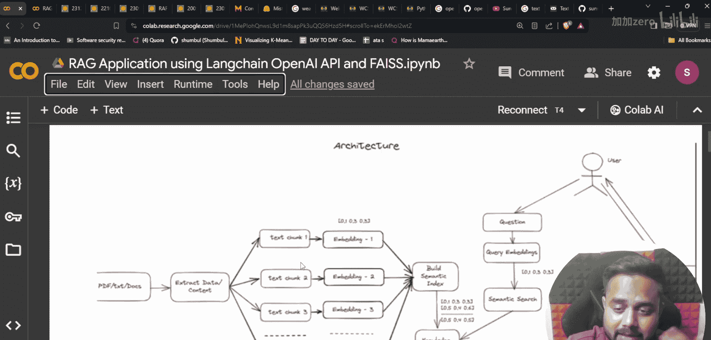