# Sunny Savita【中英⚡生成式AI：从初学者到专家｜Generative AI In-Depth Roadmap from Beginner to E】 p18 P18 RAG Application Using OpenSource Framework @LlamaIndex and @Mistral-AI #rag [BV1Uht8zDENA_p18]

Hello everyone。 welcomele back to my YouTube channel。

 My name is Sunni Savita and in this video we'll see that how we can implement a ragg application by using Lama index and misre So guys so far I shown you the ragg application by using the la and before that I shown you that how you can create ragg application from a scratch using Python So there also I involve a Lama2 model and old Lama concept if you haven't check guys。

 please go and check so let me show you my YouTube channel there I will show you all the video1 by one So here guys you will find out each and every video on my YouTube channel with respect to this ragg application So inside the playlist you can also check I created one I created one separate playlist for this ragg application where you will find out all the tutorial so far whatever I have created on top of the rag。

😊。

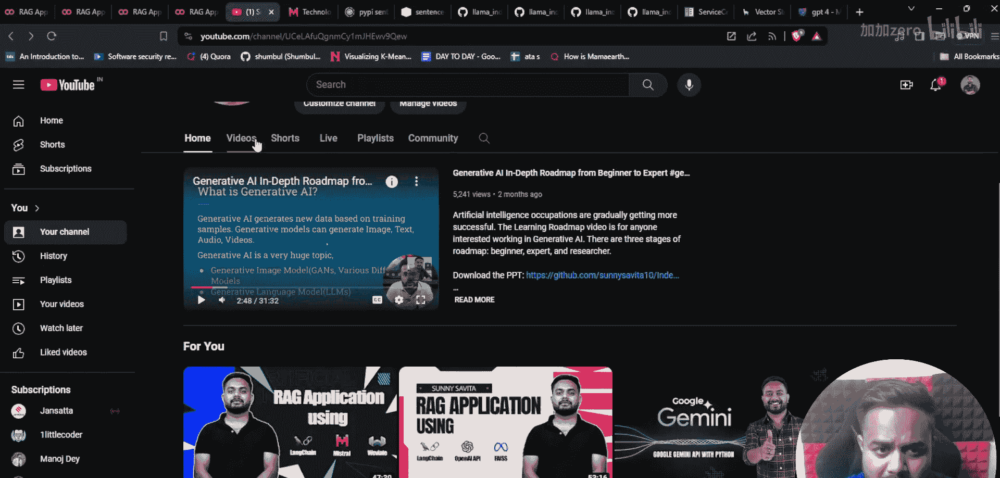

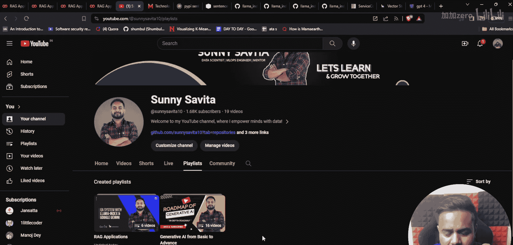

Rgged from a scratch rag by using L rag by using L and open source model everything you will find out over here。

 So let's begin， let's begin with one more new framework that is Lama index So before this tutorial even I also created the video on top of the Lama index if you will go and check with my video section。

 So here you will get the video with respect to the Lama index。

 So interaction about the Lama index and project set up for the Lama index already I taught you this thing apart from this one you will find out one project as well。

 which I took in the live session。 So Q system using Lama index and Google G API and apart from that you will find out this Lama index versus L。

 So enough amount of theoretical content I provided you with respect to the Lama index now it's time to build something by using Lama index and open source model that is。

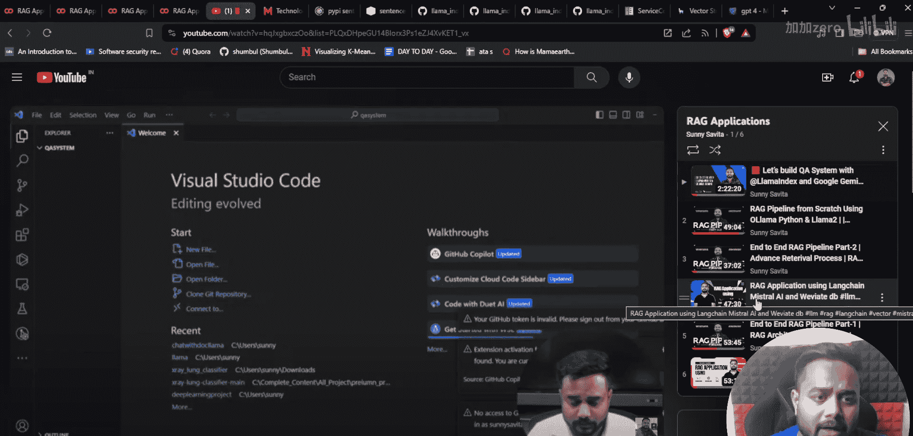

Still so let's begin， let's start。 So first of all， guys what you need to do here。

 you need to open your coab。 So here I already open my co and here you will find out so I return the heading write application using Lama index and mis guys here first of all you need to connect with your GPU So if you haven't connected with your GPU please do it just need to go inside this runtime and change your runtime and then save it and then finally connect now guys I'm doing it from starting。

 so step by step one by1 I will write each and every line of code。

 So sometimes I will be writing or sometimes I will be just copying and pay So guys and don't worry this notebook you will get inside my Github repository So let me show you my Github repository where I'm updating all the material related to this particular tutorial So here is my Github repository guys the name is index index gene So once you will go through with this Github repository here。

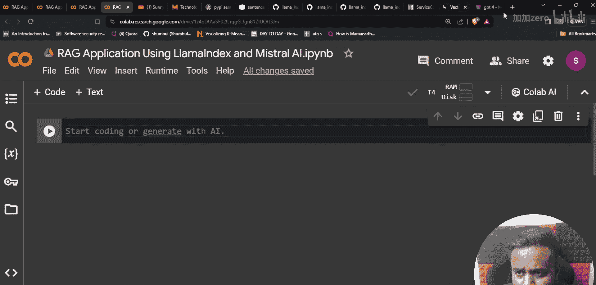

You will find out all the files and folder whatever I have used so far。

 whatever I have created so far。 so please go and check。

 please try to download in your system and then do the experiment Now I hope my system is connected my collab is connected So let's try to implement one by one so first of all guys we have to install something and here we are going to install this particular package So what is a package name guys。

 the package name Lama index Llm iPhone hugging phase So this package is required this package is required for creating this project and here apart from this one we required some other package also so I will show you that as well Now the package installing until that I can write some other line of code so here one more package which is required that is a lama index itself so here the second package is Lama iPhone index So let me install this one also and yes you can install by using this。

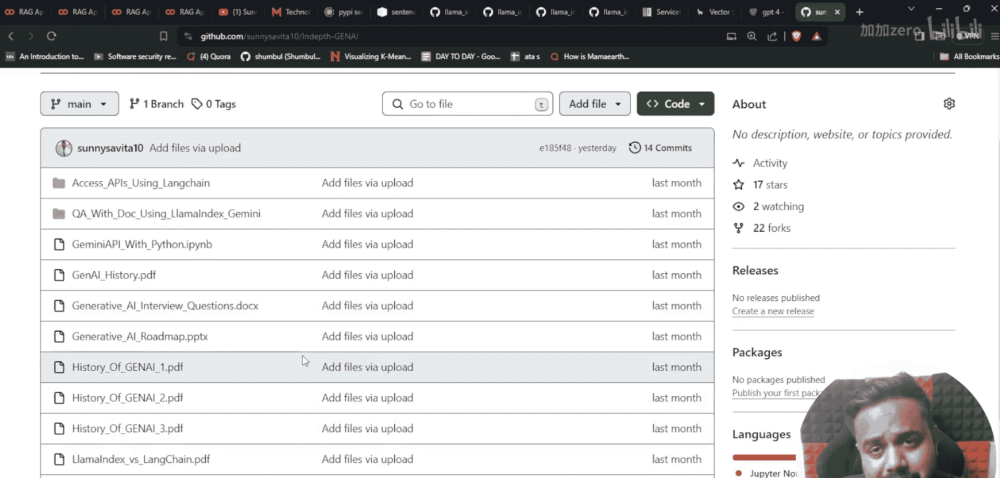

Exlamation mark or else you can use this percentage both are fine anything you can use for installing the package inside the coab now what I am doing here so after installing the package。

 right。Here I'm going to import something if you want to like write the code for the exception handling logging so definitely you can do that because in one video I see the comment recently so people are saying sir can I write the exception handling or logging for this particular project for this particular implementation notebook implementation here for sure you can do that okay you can write the exception handling everything you can mention inside the tri cache you can maintain the log inside the log file so that I will show you the next class one more notebook I have prepared with all of you So with a different model and different text side so that I will show you so now here Lama index is getting installed Now here guys one more thing So the heading heading you can see Lama index with Miral AI So the previous tutorial here also in this particular video I show you this Mial AI。

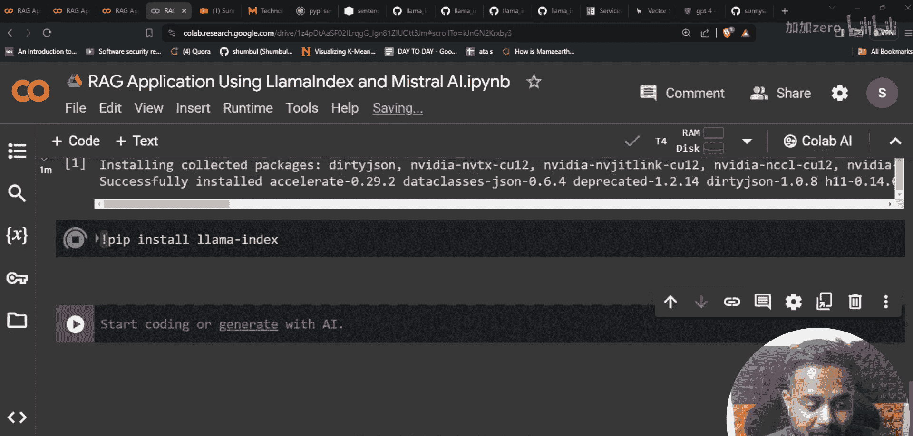

So this my layer actually， I was using the hugging face hub for loading this myill model。

 Miill 7 billion model Now in this particular tutorial here。

 we are not going to read this model using hugging face hub。

 instead of that we are going to load it inside the memory So here I' am doing each and every type of experiment so that you can explore each and everything over here So according to your requirement。

 you can test it。 Okay， you can use it getting my point Now what I'm doing here。

 So here I already installed。 So here I install this Lama index。 Now it's time to write some code。

 So first of all， guys， here what I'm going to do I am going to import few module。

 So this is my module guys two module。 First is vector store index。

 the second is simple directory reader。 the third one is the third one is hug facem。

 So this three classes I have import it。 And guys， please watch this tutorial till end I will give you like detailed knowledge regarding。

😊。

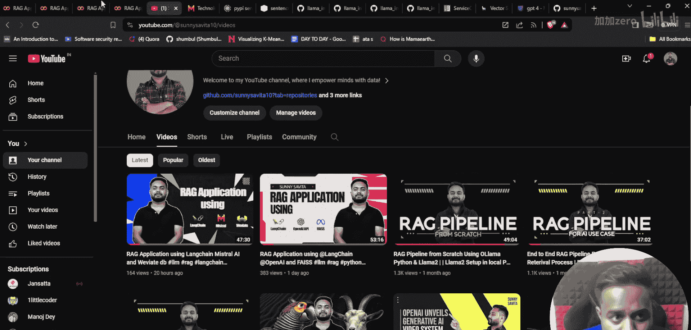

Particular class because this class I will show you from the Github directly from the Lama index Github directly Okay now what I'm doing here。

 I'm just loading this to this three class from this particular module Lama index dot co Lama index do Lm do hugging phase now here what I'm doing So guys for creating the rag pipeline I think you know about the rag retrieval augment generation in my previous video I have shown you this particular architecture and even I have implemented this as well So guys here this architecture it's a rag architecture where we have three process first is called data in second is called retrieval and the third is called generation So if you don't know about it is go and check with my previous video now what I'm doing here So here I will be required the data and for that simply I'm creating a directory So my directory is my data directory now here I am keeping some data inside this particular directory so。

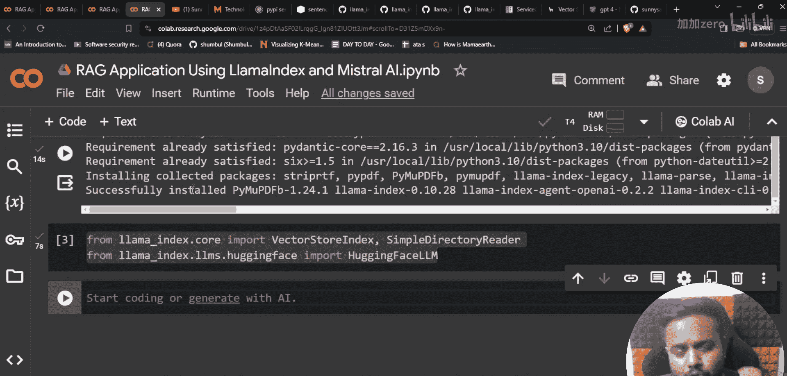

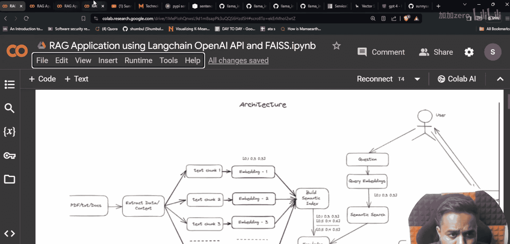

I already downloaded one Pdf and that pdf I am going to upload over here inside this data directory。

 So my Pdf name is what machine translation with attention。 It's a research paper easily you can。

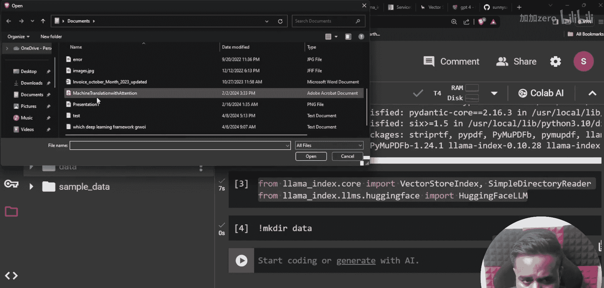

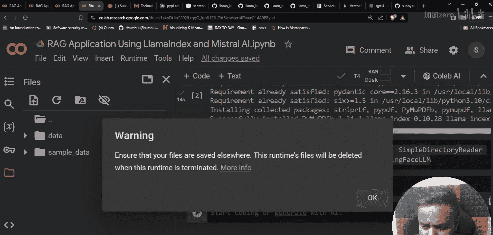

Checkt with Google and definitely will get it。So here you can see my data is uploading。

 Now my data is available。 simply I can read my data now。 So for that also I have code。

 So this is a code guide for loading the document for loading the data。

 So simply I'm reading the directory over here So simply I'm writing simple directory reader dot dot means what current directory and here is my data folder from there I' am reading that a particular PDFf。

 So once I will execute it So here in this particular variable I will find out by data。

 So let me show you how my data looks like。 So here is my data guys。

 So simply you can read it simply you can check it and you can write this thing inside of print statement also so you won't get that unnecessary parameter like slash and all now here if I'm writing a print and So simply you will find out this data Okay。

 this is a data and it is inside the list Okay you can extract from this particular list This is。

あデータ。I hope you got till here how to load the data it' is not big deal。

 it is not a very big thing and now what I am going to do now I am going to implement further。Cd。

 right， So here guys， after implementing the data， Sorry after getting the data。

 I'll be required the prompt。 So here I am keeping the prompt。 Now why this prompt and is required。

 I will come to that。 first of all， let me execute it。

 So here you will find out the prompt template inside inside the Lama index also similar to the lag chain。

 getting my point。 So here inside the Lama index also you will find out this prompt template。

 So from Lama index or code， I am going to import prompt template。

 Now here is what here is my system prompt means what So here I am giving the here Im giving the instruction to my system So whenever you will go and check with any application with respect to the LLM there you will find out three thing right the first thing is called user。

 the second the second thing is called assistance。 And the third one is a system right So here I kept one。

So here is what here is what this one so here guys you can see one is stack overflowing there Im explaining you with the example so just just look into this particular example just a format right so here you will find out so here is a role okay role we are selecting as a user directly you can check with a playground and all and simply you can set a different different role this playground is available over the open。

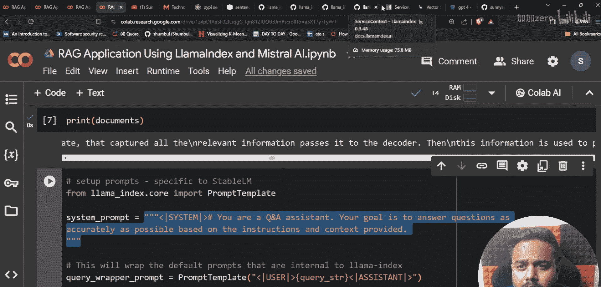

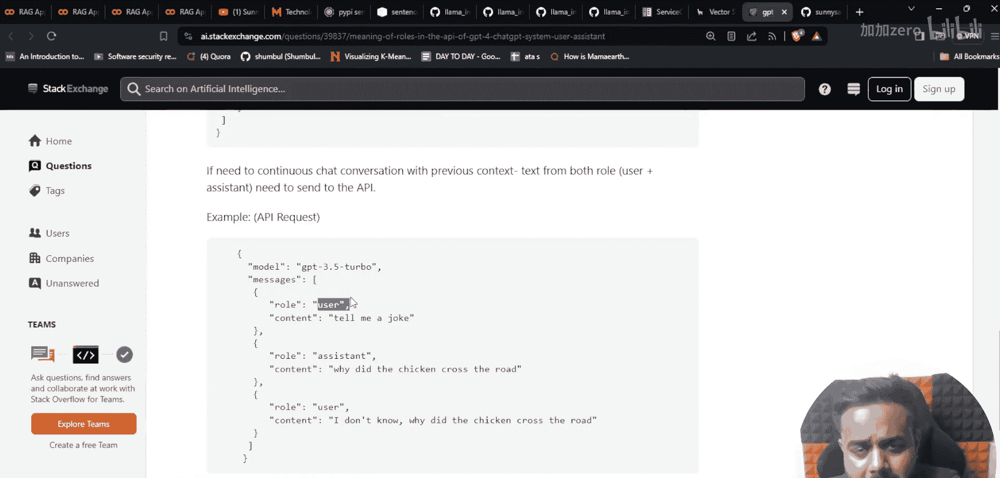