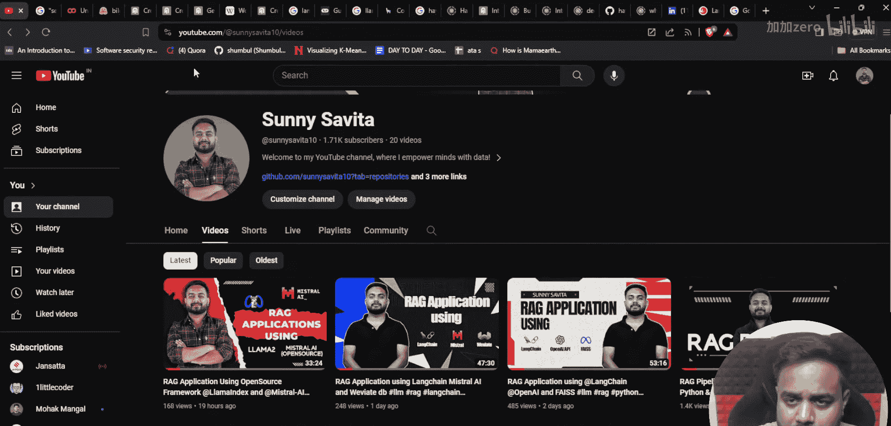
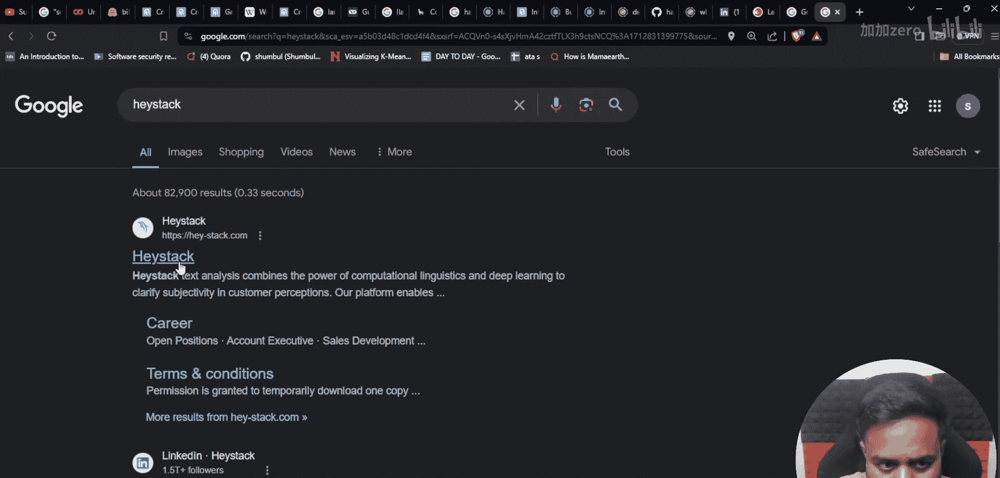
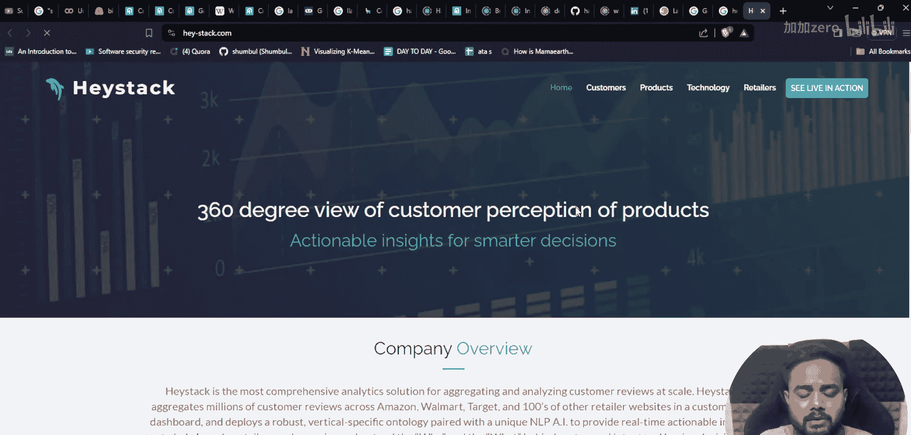
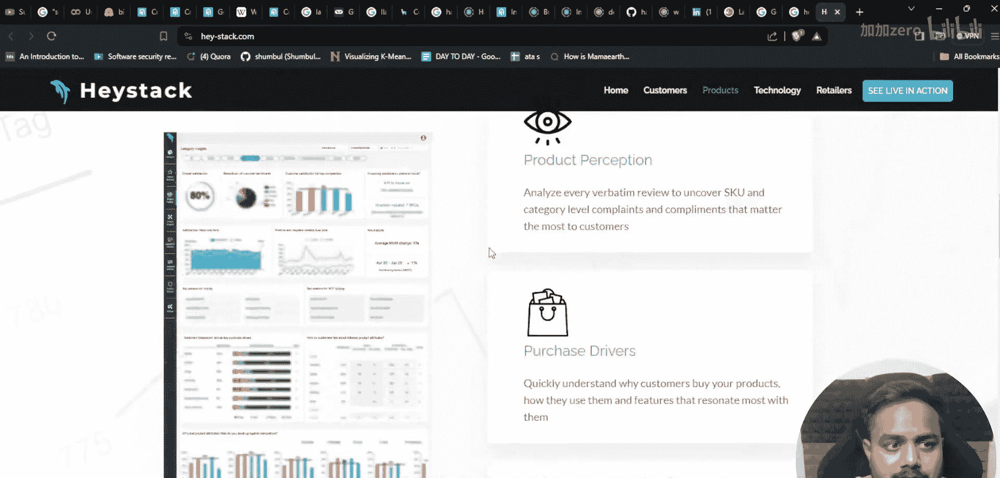
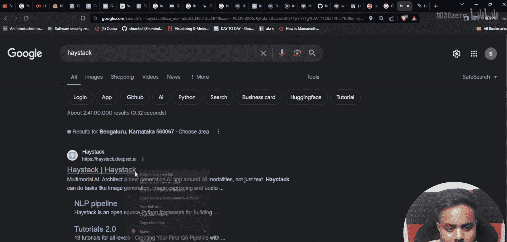
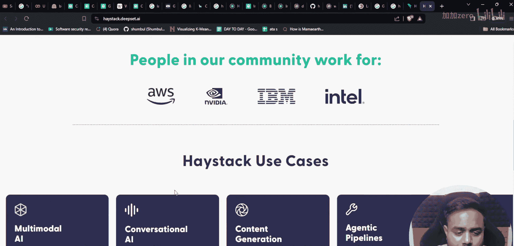
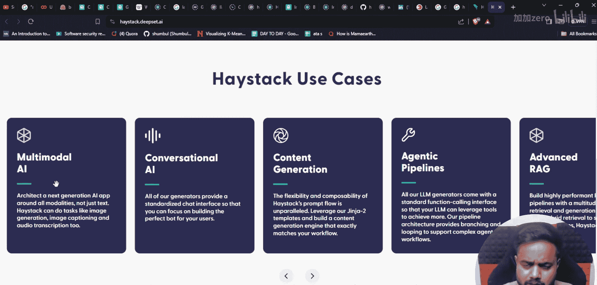
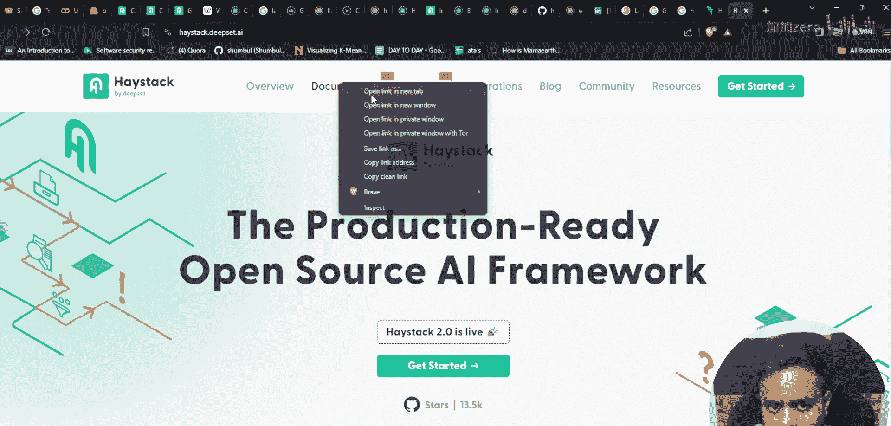
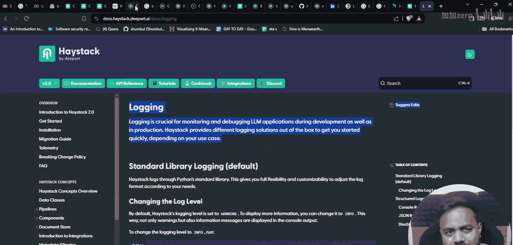
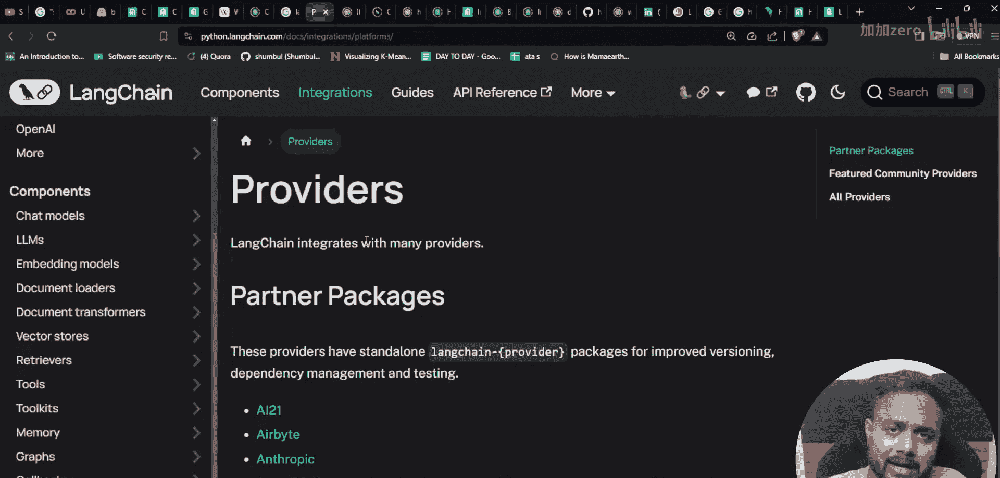

# Sunny Savita【中英⚡生成式AI：从初学者到专家｜Generative AI In-Depth Roadmap from Beginner to E】 p19 P19 Haystack by Deepset - Framework to Build LLM Apps ｜ RAG Pipeline Using Hayst [BV1Uht8zDENA_p19]

Hello everyone， welcomelcome back to my YouTube channel。 My name is Sunni Savita。

 and I'm back with another exciting video。 guys， in this particular video。

 we are going to discuss one more new framework for creating LLM based application。 Yes guys。

 so apart from L and my index。 we have one more framework。

 which is gaining so much popularity for creating this LLM application and all the name is Hatag。

 So let's begin， let's start with the video。 So first of all， guys。

 let me show you my YouTube channel and then。😊，I will show you the like the further thing so here guys you can see my YouTube channel now I'm creating a video on top of the geneative AI and here within this three days I created three video with respect to this rag application so in the first video I show you the L that how you can create the ragg application by using this L chain open I phase。

And then I created one more video on top of the la itself there I explained you the open source thing。

 So there I took this Miral AI instead of this open AI model and then I show you the complete open source thing where I use this Lama index along with a Miral AI So now you have all three flavor and yes if you are like willing to create the rag application if you are willing to learn definitely you can refer this particular video now it's time to learn something new and yes。

 in order to that， we are going to explore one more new framework that is haystag。

 So first of all guys I will show you the website of the hasystag now for that you just need to search over the Google here in the niite hasystag it's a framework it's a Python framework for creating specifically for creating the Ra application in version 1。

 X they have defined that this framework。

Tyically for the right application but now it is supporting too many things so I will show you I will give you a quick walkthrough of the website and definitely you will get to know and then I will try to understand the differences between this hairt and the la as well that what is the exact difference and then well try to do one implementation as well here itself in this particular video so please make sure that you are watching till the end now here guys you can see this is the okay not this one I think we open the wrong one。

The spelling is H A Y。 So his tag is is the spelling。 And here guys。

 you can see this is the website of the。

This framework Now this framework by the deepest。 and here you can see the complete detail of it。

 So simply like they are writing over here the production ready open source AI framework And here you can see they have mentioned his tech 2。

0 is live and from here itself it gained too much popularity and they have added lots of thing over here 1 by1。

 I will give it a quick walkthrough So here once you will explore then you will see that it's highly customizable。

 Yes， this is definitely true I even explore it。 and I tried so many things from here and really it's amazing。

 And it is giving like。😊，The tough competition to the la and the Lama index after this one I will show you that now building with leading LLm provider and AI tools production is where it get real so it is providing you three things first it's a highly customizable means you can customized according to your requirement and then it is providing you so many AI tool so many like Lm apis and also that you can use a different different agent tool or different different model basically and then finally you can productionize it also after that you will find out that what type of use cases we can solve by using this so we can create multimodal AI we can create the conversation AI we can create this content generation agent application agent application and advanced right so in one point X they specifically mention the framework with respect to the right but now they have added so many things and once I will show you the documentation documentation of it that definitely you will be surprised。

Now multimodal AI means what so here you can create the system where like not even the text data you can handle the audio video or other type of data as well。

 So multimodal AI means the AI the model which is able to handle the different different type of data conversational AI means what kind of chatbot right so we know about the chatgpN part its a conversational AI where you can make your conversation content generation So yes it is also a product very。

 very like popular product of the NLP where you can generate a content and again chatgp is example of it agent application means any thirdpart API general we can connect with that so that we can fulfill the fulfill the requirement of the user if my LLn is not able to do that advanced also it's we are trying to launch this one only so we just manage one knowledge base and we augment the response of the LLn so this is kind of the use case of the hast which is able to solve it now here they have given you like some other thing。

If you want to join the community and all now the very amazing thing。

 the documentation itself So here you just need to click on this Hayt 2。

0 is like right so once you will do that， you will get entire detail of this Hat 2。

0 right what all changes basically they have made all Now first of all。

 let me show you the documentation of it So here once I will show you the documentation So just look over here guys and here you will find out lots of things related to lots of detail So just just look over here just look into the documentation they have given you like how to start from this hasyst how to install it migration guide also migration guide means what So if you are if you are using this Hayst 1。

0 then how you can migrate to hisyt 2。0 right so definitely they have given the complete guide of it now telemetry guys it's amazing feature I haven't seen this feature in blank channel my index So here actually they are tracking your they are tracking your data and all So if you are going to define。

This telemetry inside your code so they will get to know that which type of data you are using。

 which type of model you are using what is your output and all and here based on that only is going to be improved so you can read about this telemetry and all and it's like pretty amazing thing then here you will find out some other thing like pipeline is a very important part of it component is a very important part we create the pipeline we create one basic application so by using this particular thing then definitely will get to know then here you can see the document is stored so how we can store the document that thing also you can see over here now apart from this one guys here you will find out that it support lots of document is stored right not even in memory it it support as chromma Db elastic Mel Melb Mongo Db neo4j and here you can see Pg vector go quadrant。

Just like write the name just take the name and it support all the vector database and not even the vector database is support all like a different different NosQL based database also And here they have given you the API references also for the audio for the builder caching classifier connectors converters right each and everything you can export from here and you can build the powerful application by using this right now apart from this。

 you will find out the evaluation techniques over here。

 you will find out the advanced technique where you can like you can do the different different augmentation and all while you are retrieving the data so you can use the different different knowledge base you can use a different like Lm and all everything you can manipulate over here by using this particular framework just wait I will show you that as well Now development part So yes development now here you can see it provide you the GP acceleration tracing logging each and everything whatever we were able to see insert each。

We thing it is providing to you but here the question is when we should use the L and when we should use this hasyst I will come to that also but here I think you are liking this particular framework and now maybe you are willing to use this one So first of all guys I would like to show you a few more thing let me show you the documentation as well because it's a very popular and we are using this particular like since a long time now here if you will look into the So here also you find out like a different different component re component composition component like tools agents chains which is a very popular part of the right now here you will find out the integration part so we can integrate this with the Aws Google hugging face Microsoft Open eye with many more right and it's like very very powerful now component also the component which you are seeing over here now the hasystag now here you can see the extensive list of the component just to make the。

ful application。 Okay， now here you will find out the guide APIs and all many more thing like this length is providing to you。

 So here the question is which one should I use， should I use the length and this hasyst which one is having the upper hand So according to my experience according to my knowledge I would say this la is having upper hand why like you will ask me sunny do you have any proof like whatever you are saying yes。

 I have proof and let's try to understand that also because I just like kept the differences between this length and this hereyst and even with the Lama index right So La。

