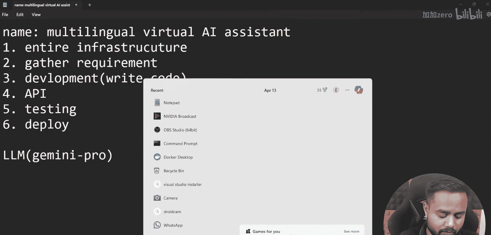
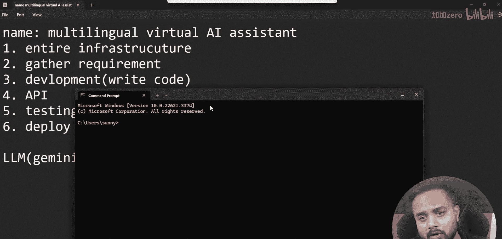
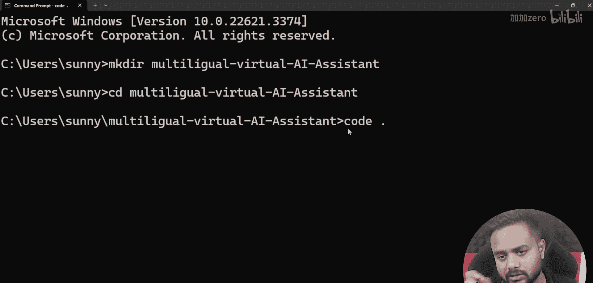
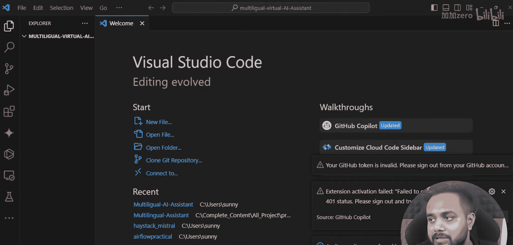
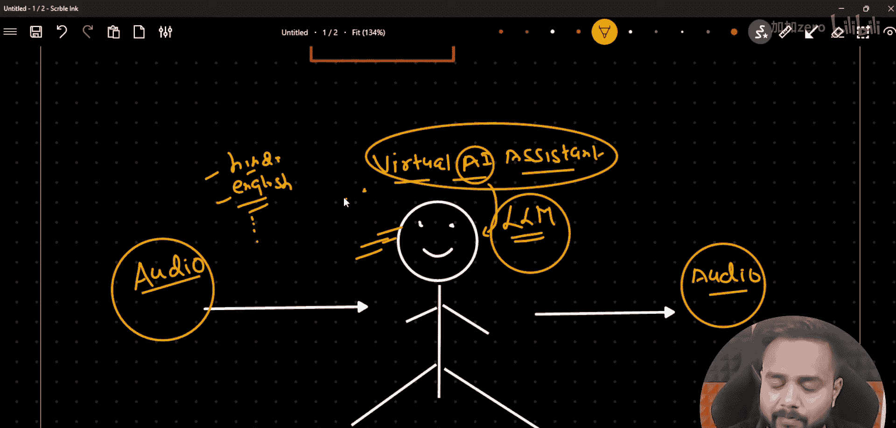
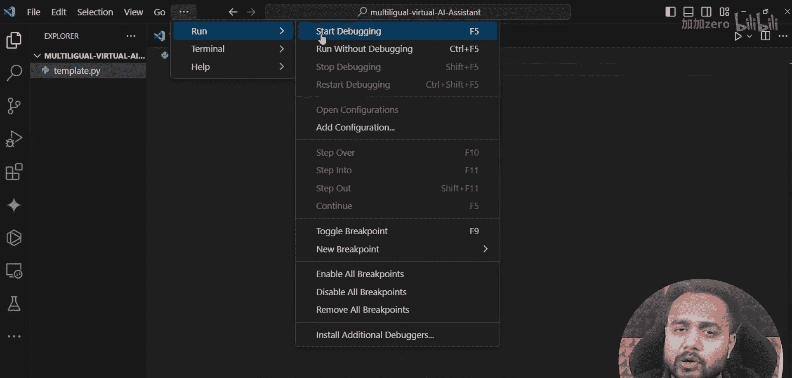

# Sunny Savita【中英⚡生成式AI：从初学者到专家｜Generative AI In-Depth Roadmap from Beginner to E】 p20 P20 Discover The Power Of Multilingual Ai Voice Assistant With Google Gemini-pro [BV1Uht8zDENA_p20]

Hello， everyone。 welcomelcome back to my YouTube channel。 My name is Sunni Savita。 and in this video。

 we are going to implement one project that is multilinguistic virtual AI assistant。 Yes guys。

 here itself in this video we are going to implement it from very scratch and step by step I will show you each and every process。

 So guys I am creating a video on top of the geneative AI L natural language processing data science machine learning on each and everything so if you haven't check with my YouTube channel。

 please go and check so my moto is very， very simple。

 whatever I have learned and earn so I just want to share with you with the committee so that everyone can take the benefit。

 So without wasting time now let's begin with the project。

 So first of all guys I will give you the complete and detailed introduction of the project。

 So here what I'm doing Im I'm going to open my not and here step by step。😊。

One by one I will write each and everything。 So here the very first thing what we'll do guys will create the entire infrastructure for the project。

 Okay， so what is the name of the project guys， So here let me write the name of the project the name of the project is going to be multilingual。

Virual。Yeah。Assistant okay so what is a meaning of it and what I want to do over here so don't worry I will let you know over here itself so here first of all what we want we want the entire infrastructure entire infrastructure SR C TR right so entire infrastructure of the project after that I will gather the requirement whatever requirement is there will gather all the requirement with respect to this particular project and then after getting the requirement basically。

Well try to create the API Okay， so first well do the development So whatever like whatever like folder and the files which is required。

 so definitely will try to write those thing we try to write the entire code over here So here we write the entire code And after that after writing the code guys what we do So after writing the code will create the API so that we can consume this particular project And then finally after creating the API guys what we do will perform data test。

 Okay， so we'll try to test our project And then we are going to deploy it Now here this is the entire step which we need to follow And here we are going to use write large language model So we have different different API like anthropic or。

🎼Open AI j。 So for this particular project and we have open source model as well。

 So here for this particular project， I'm going to use gni API。

 So here we are going to use this chini pro model for this a particular project because like you can consume it freely。

 and you' need to pay anything for this a particular API。 Now let's begin。

 let's start for this particular project。 So first of all， what we need to do。

 So here we need to open command from So here guys， what I it。

 I open my command from now after opening this one。 just need to open my V code。

 So here in at this particular location itself。 Im going to create one folder。

 So here let me create a folder。 My folder name is what multilingual。

我准。エアい。Assistant okay， so this is the project name Now guys。

 you must be thinking that what is the meaning of it multilingual virtual AI assistant So don't worry I will let you know that first of all。

 let me create this folder。 So here I did it basically now let me change the directly So here simply I'm writing multilingual virtual AI assistant So this is my folder now Im inside this particular folder here you can see and here from here itself Im going to launch my vs code So for launching a vs code here I just need to write this code dot code space dot and I will be able to open my Vs code So here guys you can see I open my v code and now here I am going to perform each and every step here Im going to do my entire development Okay so first of all guys what you need to do here。

 So step by step one by1 I will show you each and everything but let's try to understand the problem statement so。

For explaining the problem statement， let me open my blackboard and here itself basically I can show you each and everything step by step now lets try to understand about the problem statement so what we are going to do here so first of all guys。

Here see。 let's say this is what this is my LM。 Okay， Now this is what this is my LM。

 Now to this particular LM。 what you are passing， you are passing input right so you are passing input in a different different way。

 So here you can pass the input in the form of images in the form of text in the form of audio Okay。

 so what I'm doing here。 So here let's say if I'm writing image So definitely I can pass the image。

 I can pass the text test file。 and here along with that。

 I can pass the audio Now simply it's going to process each and everything。 So this is what is my LM。

 and according to that is's going to generate the output。 Now this LLm， this large language order。

 whether it's GT G or cloud or misill。 they don't know about text images audio They just know about the number So each and everything is going to convert into the embedding and form there actually it's going to generate the respective。

So maybe it might be like text it might be image okay it might be audio right so yes I think you know about this input and output process with respect to this LLM Now here guys we know the behavior of this LLM now in todays are actually we have those type of those type of LM which can process text image audio and which can generate text image and audio with respect to the input Now here what we are going to do So here we are going to create word one virtual assistant right so first of all let me draw something over here so here just forget about this LM it is just for the overview now coming to the point So here what is this So this is what is my virtual assistant Now this virtual assistant let's say this is a human and here。

You can imagine this is a human as of now。 So this is what this is a human。 Okay。

 now this virtual assistant， actually， what it is time to do。 So let me。Draw the eyes also。

 And here is a。My okay， so this human or okay， so you can think this is nothing this is my virtual assistant this like this is the AI virtual assistant。

 which is taking， which is taking input right， so which is taking input as a audio I which is going to generate the output as a audio okay。

 so this is my problem statement now over here I can simply write So what I'm passing over here guys tell me here actually I'm passing audio。

And here I will be generating the audio。Now this is what this human is nothing。 It's my virtual。

 okay， virtual virtual AI。い。Aア assistant。Okay， assistant now how we are going to perform this particular thing。

 So here as a human which model we are going to use right and for creating this virtual assistant。

 what thing is required water method water package Okay what dependency So each and everything we are going to discuss over here getting my point guys yes or no So here we are passing the audio and we are generating the audio and this human。

 this human， this project right this assistant is nothing it's my virtual AI assistant。

 So if I'm saying AI guys So definitely I'm going to use any AI model over here I'm going to use any Lm model over here in the starting of the session I told you that we are going to use the chi over here now how we do that how we create the entire system you will get to know and this AI assistant guys it's a pretty clever So it understand about the Hindi it understand about the English it understand about the other languages as well Okay so multiple language。

That's why I'm saying it's a multilingual virtual AI assistant so if you don't know that definitely according to that you can change the LLM and that thing I will like tell you later on so here guys I think this problem statement is clear to all of you now let's begin let's start let's start to create this particular application so first of all what you need to do here so first of all guys you need to create one folder so here guys the folder name is going to be asrc so here what you can do I'm not going to create any sort of a folder manually simply I can write over here。

Template right template dot P because I can create my template and with that particular template actually I can create okay。

 I can create the multiple files each and every line of code I can simply write it down over here itself。

 So this is going to my file Its not going to my folder So simply I can write over here template dot P Now after that is what I will do So here this environment will be required。

 Okay virtual environment basically because this is a specific project。

